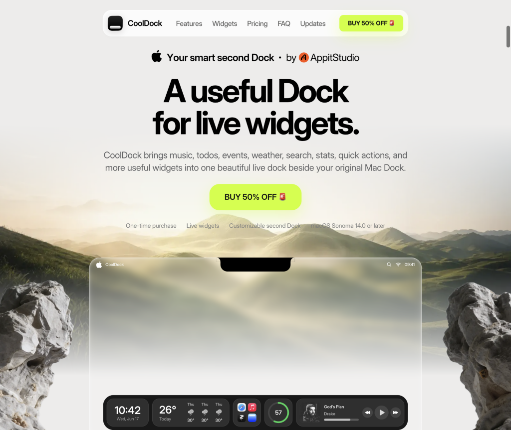

# Reference 01 — CoolDock (`https://cooldock.app/`)

> **Inspected:** November 19, 2026 (`1440×900` desktop viewport)  
> **Why You Chose It:** Clean, airy desktop space usage; modern tactile clarity; effortless floating navigation and live interactive dock.  
> *(Note: On Nov 19, 2026, CoolDock displayed a temporary seasonal Black Friday `#CCFF00` sale banner/CTA override — our analysis separates its timeless core design system from the temporary sale neon!)*

---

## 1. What Makes It Feel Clean, Spacious & Simple

1. **Tonal Separation Instead of Borders or Muddy Shadows:**
   - CoolDock almost never draws `1px solid #ddd` wireframe boxes around cards. Instead, it steps luminance gently across **3 warm-neutral planes**: Canvas `#EDECEB` → Soft Card `#F7F7F7` → Highlighted Card `#FFFFFF`. Because the luminance step is ~4%, cards separate cleanly with zero visual noise.
2. **Macro-Whitespace Around Focused Narrow Copy Columns:**
   - Even inside a generous `1200px` desktop shell (`1280px` on pricing), text blocks stay capped at **`600px–760px`** wide and float inside `100px–200px` of vertical breathing room. Headlines land in 2 crisp lines, never sprawling edge-to-edge.
3. **Atmospheric Photography Without Hard Rectangular Boxes:**
   - Hero and footer photography dissolves seamlessly into the exact canvas tone (`#EDECEB`) via multi-hundred-pixel linear-gradient masks (`454px` top fade, `350px` bottom fade). Images feel like natural light on the page rather than pasted stickers.
4. **Compact Floating Frosted Nav Pill:**
   - Instead of a heavy edge-to-edge top bar, navigation sits in a centered **`610px`-wide** frosted-glass pill (`18px` radius, `rgba(255,255,255,0.8)`, `backdrop-filter: blur(10px)`, `inset 1px 1px 1px #FFFFFF` top-left light catch) floating `20px` from the top edge.
5. **High-Contrast Interactive Dock + Single Dark Interruption:**
   - A dark translucent floating dock (`#000000E6`, `30px` radius) creates unmistakable figure-ground focus at the bottom of the hero, and a single full-bleed dark break two-thirds down acts as a palate cleanser before returning to light stone.

---

## 2. Exact Measured Design Tokens

| Category | Measured Value |
| :--- | :--- |
| **Canvas / Surfaces** | `--cd-canvas: #EDECEB` (warm light stone) · `--cd-surface: #F7F7F7` · `--cd-white: #FFFFFF` · Dock `#000000E6` · Inner widget tiles `#FFFFFF1A` |
| **Ink & Hairlines** | Primary `#000000` · Muted `#65666A` / `#5F6062` · Eyebrow `#52545A` · Nav links `rgba(0,0,0,0.6)` · Subtle line `rgba(0,0,0,0.08)` |
| **Fonts** | `Inter Display` + `Inter` + `-apple-system, SF Pro Display` |
| **Type Scale** | `H1`: `80px` (`clamp(3.2rem, 7vw, 5rem)`), `700`, LH `1.0`, tracking `-4px` · `H2`: `60px`, `700`, tracking `-3px` · `H3`: `30px`, `700`, tracking `-1.5px` · Lead: `20px`, LH `28px` · Body: `16px`, LH `22.4px` · Nav: `14px` weight `500` |
| **Containers** | Main shell `1200px` (`40px` inner padding) · Pricing shell `1280px` · Copy caps `600px–760px` |
| **Radii & Glass** | Nav pill `18px` (`blur(10px)`, `inset 1px 1px 1px #FFF`) · Feature/testimonial cards `30px` (`border: 0`, `box-shadow: none`) · FAQ cards `20px` (`#F7F7F7`) · Primary CTA `20px` (morphs to `40px` pill on `:active`) |
| **Shadows** | Feature cards: **none** · Standard pricing card: `0 12px 36px rgba(26,30,35,0.04)` · Featured card: `0 20px 50px rgba(26,30,35,0.10)` |

---

## 3. Section Rhythm (Top to Bottom)

1. Floating frosted-glass top nav pill (`top: 20px`, `610px` wide)
2. Full-viewport centered Hero (`680px` text column + atmospheric faded landscape + floating live interactive dock below)
3. Centered overview + flex-wrap `#F7F7F7` capability pills + `30px`-radius widescreen media frame
4. Centered single featured testimonial (`500px` wide, ultra-quiet)
5. `2-column` equal-height `#F7F7F7` feature grid (`30px` radius, `40px` padding, `20px` gap, `200px` bottom breath)
6. Single full-bleed dark contrast break (visual palate cleanser)
7. `3-column` pricing/tier showcase (center card elevated to `#FFFFFF`)
8. `2-column` standalone `#F7F7F7` pill-card FAQ accordions (`20px` radius, `+` rotates `45deg`)
9. Clean `6-column` footer over atmospheric faded backdrop

---

## 4. What to Borrow vs. What to Reject for Our Restaurant

| Borrow (Principles of Layers, Light & Layout) | Reject (Do NOT Copy Literally!) |
| :--- | :--- |
| **3-step warm-stone tonal surface ladder** (`warm canvas → soft card → crisp white focal card`) with zero ugly wireframe borders. | **Literal MacBook notch bezel (`948×533`) & floating 3D rocks** *(the old agents literally pasted a MacBook notch onto a burger site — never again!)*. |
| **Floating centered frosted-glass top nav pill** (`blur`, subtle inset top light catch) — leaves desktop space open and calm. | **Neon `#CCFF00` Black Friday buttons & stark `#000000` cold ink** — clashes horribly with warm appetizing food. |
| **Floating dark translucent interactive Dock at bottom** — reimagined naturally as our **Live Table & Shared Cart Dock** (Table #, tablemates, live total, checkout trigger)! | **Extreme `-4px` negative headline tracking** — feels mechanical/hardware-like; hospitality needs slightly warmer, looser display typography. |
| **Wide `1200px` desktop shell with `600–760px` centered copy blocks** and generous vertical padding. | **12-item SaaS FAQ matrix & 3-tier software pricing grid.** |
