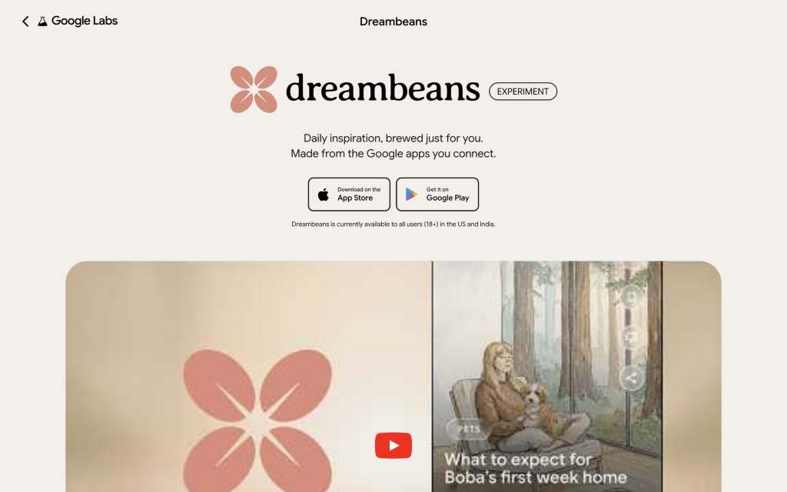

# Reference 02 — Google Labs Dreambeans (`https://labs.google/dreambeans`)

> **Inspected:** November 19, 2026 (`1440×900` desktop viewport, full unclipped capture)  
> **Why You Chose It:** Warm, sunlit, organic minimalism; effortless editorial calm; feels handcrafted and welcoming instead of sterile SaaS.

---

## 1. What Makes It Feel Clean, Spacious & Tactile

1. **Warm Linen Canvas (`#F3EFEA`) Instead of Harsh Hospital White:**
   - Dreambeans opens on warm oat/parchment (`#F3EFEA`) with soft espresso-charcoal ink (`#1A1A1A` / `#323232`) and a warm terracotta-clay organic petal mark. Instantly feels like a printed craft menu or morning coffee ritual — **zero cold glare**.
2. **Zero Drop Shadows — Depth Comes Strictly From Contrast & Generous Corner Radius:**
   - There are literally **0 box-shadows** on the entire page. Hierarchy works effortlessly through oversized **`40px` (`4rem`) rounded media cards**, a single **`36px`-radius `#1A1A1A` dark anchor card** near the bottom, and whisper-thin `1px` hairlines (`#ABA9A9` / `#E8DFD5`).
3. **Outlined-to-Solid Tactile Buttons:**
   - Hero CTAs use crisp `2px solid #1A1A1A` outlines over `#F3EFEA` (`10px` radius) that invert cleanly to solid `#000000` with `#FFFFFF` text on hover — keeping the hero light and letting the warm terracotta brand mark & artwork stay the star.
4. **Editorial Print-Menu Rhythm in Its Accordion:**
   - Its Help Center uses a full `1320px` layout with a bold **`125px` gutter** between the `01–05` index column and `30px` titles, with circular `32px` `+` knobs that rotate `180deg` into `−`. It reads like a fine-dining tasting menu or printed guide, not a boring web widget.

---

## 2. Exact Measured Design Tokens

*(Note: Dreambeans sets `html { font-size: 62.5%; }`, so `1rem = 10px`.)*

| Category | Measured Value |
| :--- | :--- |
| **Canvas & Surfaces** | Primary `--gl-color-surface: #F3EFEA` (warm oat linen) · Warm sand border `--gl-color-border: #E8DFD5` / `#DDD3C7` · Dark CTA anchor card `--gl-color-surface-dark: #1A1A1A` |
| **Ink & Rules** | Primary ink `#1A1A1A` & `#323232` · Subtle body `rgba(50,50,50,0.8)` · Hairline dividers `#ABA9A9` · Terracotta clay flower emblem (`~#D88573`) |
| **Fonts** | `Google Sans` (headings/UI), `Google Sans Text` (footer), `Google Sans Mono` (uppercase `12px` tracked socket metadata) + expressive warm serif wordmark |
| **Type Scale** | Hero subtitle `20px` (`LH 140%`, `text-wrap: balance`) · Section heading `36px` (`500`) · Accordion row title `30px` (`500`) · Accordion index `26px` (`400`) · Expanded body `20px` (`400`) · Dark anchor heading `22px` (`500`) · Mono socket `12px` (`0.05em` tracking, uppercase) |
| **Containers & Rhythm** | `60px` side padding at `>=1024px` (`1320px` active content width at `1440px`) · Hero media `1200×675px` (`16:9`) peeking cleanly above the fold (`y = 478px`) · Bottom dark banner `1320×213px` (`padding: 60px 48px`, `margin-top: 100px`) |
| **Radii & Shadows** | Hero media `40px` (`20px` tablet, `8px` mobile) · Dark bottom CTA `36px` · System card token `24px` · Pill token `999px` · **Box Shadows: `none`** |

---

## 3. Section Rhythm (Top to Bottom)

1. Minimal `80px` top utility bar (`#F3EFEA`, subtle `1px solid #FFFFFF` bottom seam)
2. Centered editorial Hero (organic emblem + serif wordmark + outlined pill tag + 2-line `text-wrap: balance` subtitle + outlined tactile buttons)
3. Giant `1200×675px` (`40px`-radius) rounded media stage peeking cleanly above the fold
4. Architectural numbered `01–05` hairline accordion (`1320px` wide, generous `125px` index gutter)
5. Single inverted `#1A1A1A` `36px`-radius CTA island right before the footer
6. Print-colophon footer with oversized edge-to-edge wordmark + uppercase mono utility bar

---

## 4. What to Borrow vs. What to Adapt for Our Restaurant

| Borrow (Almost 1:1 Fit for Light Hospitality!) | Adapt for Interactive Restaurant Ordering |
| :--- | :--- |
| **Warm oat/linen canvas (`#F3EFEA`-family) + soft charcoal/espresso ink (`#1A1A1A`)** — makes grilled meats, wood-fired crusts, and bright garnishes look mouth-watering. | **Boost appetite energy slightly** with a richer hearth red-orange primary accent (Dreambeans' muted pastel clay is calm for morning notes; food ordering thrives on warmer ember terracotta/flame on key CTAs!). |
| **Shadowless giant rounded frames (`24–36px`)** + hairline rules for clean editorial poise. | **Add persistent dining navigation & ordering cues** (Dreambeans is a single-app download page with no browsing/cart controls; we pair its warm surface with CoolDock's floating nav pill and bottom cart dock). |
| **Single `#1A1A1A` `36px`-radius dark anchor island** at the bottom of a light page (great for *"Reserve / Scan Table / Live Kitchen"* spotlight). | **Keep Dish Card copy tight (`16–18px` body, `20–24px` dish titles)** rather than Dreambeans' `30px` FAQ rows. |
| **Numbered editorial index sections (`01`, `02`, `03`)** with crisp horizontal hairlines — feels like a modern bistro menu! | **Make photography rich and real** (replacing watercolor illustration with consistent studio-lit food plates). |
