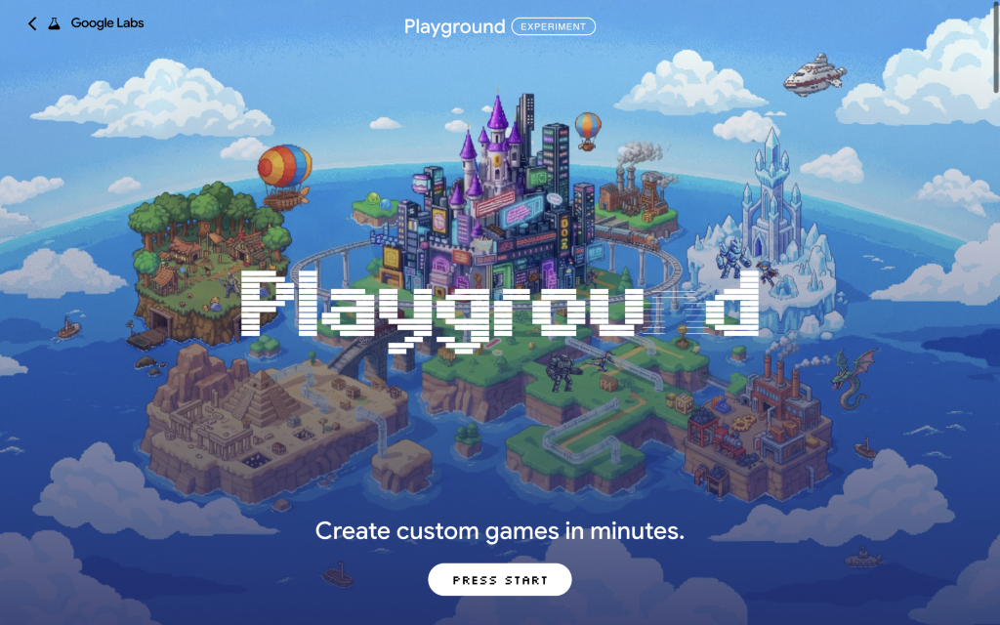

# Reference 03 — Google Labs Playground (`https://labs.google/playground`)

> **Inspected:** November 19, 2026 (`1440×900` desktop viewport, full capture)  
> **Why You Chose It:** Bold full-bleed viewport framing, playful energy without clutter, effortless progressive-blur chrome, and peeking visual carousels.

---

## 1. What Makes It Feel Spacious, Playful & Simple

1. **Full-Bleed `100vh` Stage Hero With Zero Nav Clutter:**
   - Opens with one captivating full-bleed visual stage (`1440×900`), a floating top brand mark, one 5-word subtitle, and a single crisp pill CTA (`PRESS START`). Zero competing sidebars, search bars, or promotional banners above the fold.
2. **Viewport-Aware Media Sizing Formula:**
   - Its primary showcase frames compute width dynamically as `min(76vw, (100vh - 300px) * 1.7778, 147.3rem)` (`1067×600px` at `1440×900`). That guarantees every visual centerpiece fits cleanly inside *any* laptop screen without awkward vertical clipping while keeping generous `187px` side margins.
3. **Progressive Multi-Layer Backdrop-Blur Sticky Bar:**
   - Instead of a solid white bar with a harsh bottom line, the sticky header (`72px`) uses a **6-layer masked progressive backdrop blur** (`12px → 6px → 4px → 2px → 1px → 0`) so scrolling photography dissolves effortlessly behind the nav links.
4. **Peeking Blurred Side-Slides Carousel:**
   - Interactive showcase tabs (`CREATE / PLAY / SHARE`) drive a centered `16:9` showcase where adjacent slides peek from both edges at `scale(0.92) blur(6px) brightness(0.55)` — signaling horizontal exploration intuitively without ugly heavy carousel arrow buttons.
5. **Single-Accent Discipline:**
   - Even with colorful artwork, the UI chrome restricts its accent (`#AEEA00`) strictly to **active tab states, active dots, hover links, and focus rings** — keeping the interface disciplined and uncluttered.

---

## 2. Exact Measured Design Tokens

*(Note: Uses `html { font-size: 62.5%; }` where `1rem = 10px`. Interestingly, its `:root` still ships Google Labs' warm light system tokens `#F3EFEA` / `#E8DFD5` / `#323232` underneath its dark arcade landing override!)*

| Category | Measured Value |
| :--- | :--- |
| **Landing Surfaces** | Dark landing `#000000` with subtle `1px` scanlines (`rgba(117,117,117,0.3)` every `31.75px`) · Card fallback `#1A1A1A` · Media `1px` border `#303030` · Overlay badge `rgba(0,0,0,0.8)` |
| **Root Light Tokens (Underlying)** | `--gl-color-surface: #F3EFEA` · `--gl-color-border: #E8DFD5` · `--gl-color-on-surface: #323232` |
| **Buttons & Glass** | Primary pill `#FFFFFF` bg / `#000000` ink (`hover: #E0E0E0`) · Glass secondary pill `backdrop-filter: blur(20px)`, `box-shadow: inset 0 0 1px 1px #dadce040` |
| **Accent** | `#AEEA00` (strictly active tab border/text, pagination dot, link hover, `:focus-visible`) |
| **Fonts** | Expressive display (`Silkscreen`) + clean humanist sans (`Google Sans` / `Google Sans Flex`) + monospace socket (`Google Sans Mono`) |
| **Type Scale** | Hero subtitle `34.5px` (`500`, `text-wrap: balance`) · Section H1 `74px` (`line-height: 0.9`, `max-width: 1074px`) · Subtitle `25.5px` (`max-width: 756px`) · Body `14.4–19.5px` (`LH 145%`) · Card title `20px` · Nav `16px` |
| **Spacing & Radii** | Sticky header `72px` (`nav gap: 48px`) · Desktop section breath `195px` · Video frames `24px` radius · Portrait showcase cards `475×615px` (`78:101`), `30px` radius, hover `scale(1.025)` + `0 12px 32px rgba(0,0,0,0.5)` |

---

## 3. Section Rhythm (Top to Bottom)

1. Full-bleed `100vh` atmospheric Hero (`< Google Labs` + centered title + 5-word subtitle + single pill CTA)
2. Progressive-blur `72px` sticky section navigation appearing below hero
3. Centered `74px` headline + `756px` subtitle + viewport-fitted `16:9` (`24px`-radius) visual stage
4. 3-tab horizontal switcher driving a peeking blurred-side-slides showcase
5. Full-bleed portrait visual cards (`30px` radius, ~75% open artwork with floating translucent info pill)
6. Minimal conversion anchor + oversized wordmark footer

---

## 4. What to Borrow vs. What to Reject for Our Restaurant

| Borrow (Spatial & Interactive Polish) | Reject / Adapt for Warm Light Hospitality |
| :--- | :--- |
| **Full-bleed opening Hero confidence** — one breathtaking focal dish/hearth visual + crisp 3–5 word tagline + clear primary pill CTA (`Explore Menu` / `Join Table`). | **Pure `#000000` background, CRT scanlines, `Silkscreen` pixel font, and neon `#AEEA00` lime** — great for arcade games, wrong for warm food! |
| **3-tab interactive feature switcher with peeking side slides** — awesome way on `/` to showcase *"1. Scan & Share Table → 2. Customize & Split → 3. Live Kitchen Pass"*! | **`195px` empty vertical voids** — tame to **`80px–120px`** on a restaurant site so hungry diners reach the menu quickly. |
| **Progressive multi-layer backdrop blur header** — makes scrolling dish photos glide softly behind the top bar. | **Dark boxes covering half of tall cards** — on menu cards, keep food photography bright and un-obscured (place title/price cleanly below or in subtle warm light cards!). |
| **Viewport-safe `16:9` stage sizing formula** so desktop showcase frames never clip awkwardly on `1280×800` or `1440×900` laptops. | **Auto-scrolling infinite marquees for clickable menu items** — fine for ambient gallery/reviews, bad UX for picking dishes to order! |
