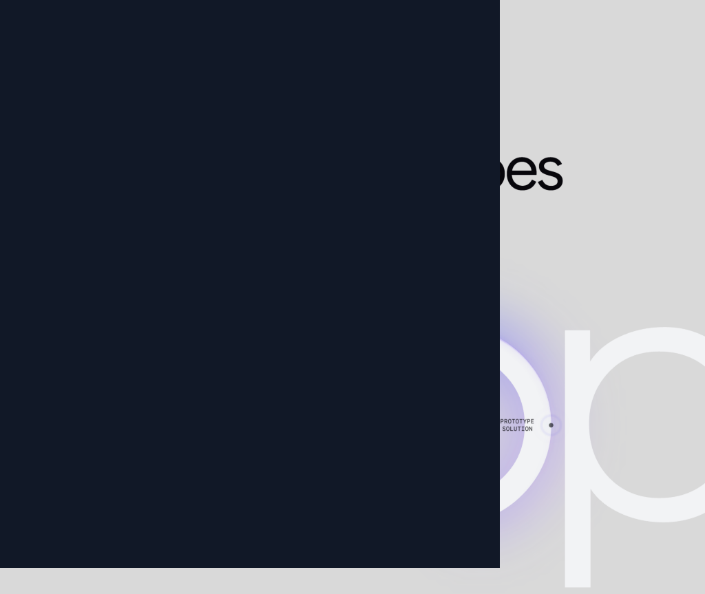

# Reference 04 — Google Stitch Loop (`https://stitch.google.com/loop/`)

> **Inspected:** November 19, 2026 (`1440×900` desktop viewport)  
> **Transparent Capture Note:** `stitch.google.com/loop/` renders its live app inside a cross-origin iframe (`jules-web.uc.r.appspot.com`). In the Electron browser webview, a compositor dark-rectangle occlusion artifact partially overlapped the iframe's left side (shown transparently below), so our inspector directly extracted the **exact live production CSS stylesheet (`index-BsyUH0ZQ.css`, Tailwind v4.3.5, 342 KB)** and compiled UI component chunks (`button`, `badge`) alongside full-scroll visual inspection of the unoccluded sections.

---

## 1. What Makes It Feel Calm, Spacious & Minimal

1. **Surface-Over-Shadow Architecture (`shadow-none` Everywhere):**
   - Just like CoolDock and Dreambeans, Stitch Loop relies on **matte tinted canvas (`~#d7d7d7` / `oklch(98.5%)`) vs. lifted pure-white `#ffffff` rounded cards (`22px–26px`)** instead of noisy drop shadows or dark outlines. Cards feel like calm hardware slabs resting on a clean desk.
2. **One Focused Artifact Per Band:**
   - Every vertical section isolates **one** visual idea inside a `1152px` (`max-w-6xl`) centered column with generous vertical gaps (`~120–180px`): a single hero ring, one metric card, one 3-column bento row, one clean 2-column split, one integration pill hub.
3. **Humanist Geometric Sans + Tracked Monospace Micro-Labels:**
   - Pairing **`Google Sans Flex`** (calm, readable display & body) with tiny tracked **`Google Sans Code`** eyebrows (`12px`, `letter-spacing: 0.05–0.1em`, uppercase) carries status/metadata cleanly without shouting or competing with the headline.
4. **Tactile Pill Chips (`rounded-full`) & Earned Ambient Glow:**
   - 90%+ of the interface is neutral charcoal + white. Color (`#6256f9`) and soft diffused radial halos appear strictly behind focal moments (the hero CTA pill, active progress rings, and final CTA wash), plus one pure-dark `#000000` card (`CLI`) anchoring the light page.

---

## 2. Exact Measured Design Tokens (Extracted Live From Production Tailwind v4.3.5 CSS)

| Category | Measured Value |
| :--- | :--- |
| **Surfaces (`oklch()`)** | `--background: oklch(98.5% .002 247.839)` (marketing matte canvas `~#d7d7d7`) · `--card: oklch(100% 0 0)` (`#FFFFFF`) · `--muted: oklch(0% 0 0 / .06)` · `--secondary: oklch(93% 0 0)` · Dark anchor card `#000000` |
| **Ink & Borders** | `--foreground: oklch(14.5% 0 0)` (`#0a0a0a`) · `--muted-foreground: oklch(55.6% 0 0)` · Subtle hairline border `1px solid oklch(90.365% .0001 271.152)` |
| **Accent & Auras** | `--primary: #6256f9` (Blurple) · hover `#583dee` · Soft diffused radial aura washes (`blur: 40px`) + smooth edge fade masks (`linear-gradient(to bottom, transparent 0%, black 15%, black 85%, transparent 100%)`) |
| **Fonts** | `--font-grotesk: "Google Sans Flex"` (variable `opsz, slnt, wght`) · `--font-mono: "Google Sans Code"` |
| **Type Scale** | `xs: 12px` (mono eyebrows/badges) · `sm: 14px` (buttons, `font-medium`) · `base: 16px` (`LH 1.5`) · `lg–xl: 18–20px` (card leads) · `3xl–6xl: 30–60px` (`LH 1.2–1.0`, tracking `-0.025em`) |
| **Containers & Radii** | Max container `--container-6xl: 72rem` (`1152px`) · Cards `rounded-3xl / 4xl` (`22px–26px`) · Buttons `rounded-full` (`h-8` `32px` / `h-9` `36px`, `active:translate-y-px`) · Badges `rounded-4xl` (`px-2 py-0.5 text-xs font-medium`) · **Card Shadows: `shadow-none`** |

---

## 3. Section Rhythm (Top to Bottom)

1. Centered Hero (`Experiment` hairline badge → mono eyebrow → clean sans headline → glowing pill CTA → focal orbital ring visual)
2. Single wide rounded feature card (inline tinted pill + crisp visual indicator)
3. `3-column` equal shadowless bento grid (`20px–24px` gap, small circular icon + title + tracked mono tag + 2-line calm body)
4. Centered 3-stage sequence (`INSPECTION → SOLUTION → PROGRESS`) + asymmetric `2-column` preview split
5. `3-column` channel cards featuring **one high-contrast dark card** anchoring the light layout
6. Crisp white `rounded-full` pill chip hub (`px-3 py-1.5`)
7. Quiet final CTA over soft pastel ambient bottom wash + minimal footer

---

## 4. What to Borrow vs. What to Adapt for Our Restaurant

| Borrow (Exact Tailwind v4 + `shadcn base-luma` Synergy!) | Adapt for Warm Appetizing Hospitality |
| :--- | :--- |
| **`oklch()` matte light canvas + shadowless `#FFFFFF` `22–26px` rounded cards** — literally native to our Tailwind v4 + `shadcn base-luma` stack! | **Replace cool gray `#d7d7d7` + `#6256f9` Blurple + cyan/violet halos** with warm linen/stone + red-orange hearth flame + whisper-soft warm ember glow. |
| **Crisp white `rounded-full` pill filter chips** (`h-9`, `font-medium`, tactile `active:translate-y-px`) — ideal for Menu Categories & Dietary Filters (`Signature`, `Burgers`, `Wood-Fired`, `Spicy`, `Light`). | **Give Dish Cards rich `4:3` food photography** inside those `24px` rounded cards (Stitch Loop's text-only bento cards work for dev automation, not hungry diners). |
| **Clean 3-stage progress grammar** (`INSPECTION → SOLUTION → PROGRESS`) — translates brilliantly to our **Live Order Tracker (`Received → On the Grill 250° → Ready at Pass`)**! | **Keep navigation & cart visibly anchored** (Stitch Loop hides site nav because it's a single experiment page). |
| **One dark high-contrast card inside a light layout** — perfect way to preview our **Live Kitchen Display (KDS)** card right inside the light homepage! | **Keep UI native (zero cross-origin iframes)** for crisp mobile/desktop performance. |
