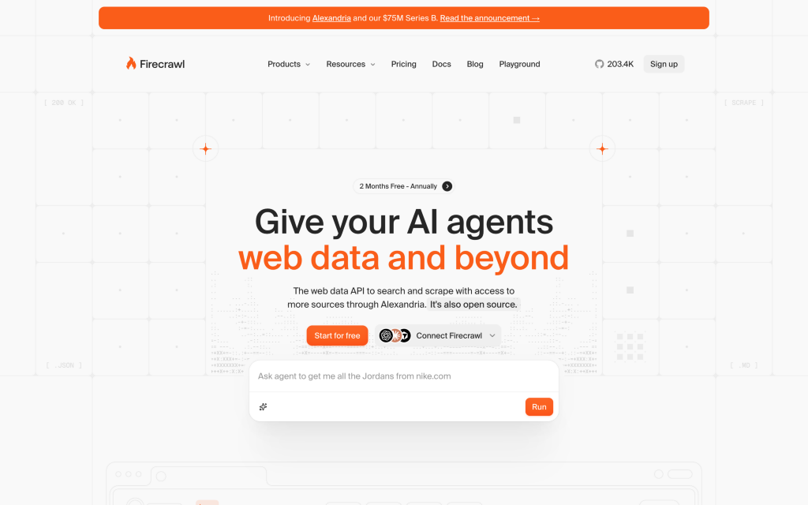

# Reference 05 — Firecrawl (`https://www.firecrawl.dev/`)

> **Inspected:** November 19, 2026 (`1440×900` desktop viewport, full capture & `18,163px` scroll audit)  
> **Why You Chose It (With Caveat):** You liked its overall light-theme design, clean structure, and warm orange energy — **but** felt its text is too small and text-heavy. Our measurements prove your eye caught the *exact* typographic culprit!

---

## 1. Why Its Overall Architecture Works

1. **Warm Paper Canvas + Disciplined Flame Orange Accent:**
   - Canvas uses warm paper `#F9F9F9` with pure `#FFFFFF` elevated interactive surfaces and soft charcoal ink (`#262626`, never harsh `#000000`). Roughly 90% of the page stays calm neutral paper so the single flame-orange accent (`#FA5D19` / `#FF4C00`) hits with instant warmth and energy.
2. **Single Vertical Structural Spine (`1112px`):**
   - A continuous centered `1112px` column flanked by `164px` gutters with subtle `1px` `#EDEDED` hairlines keeps wildly different sections visually aligned from top to bottom.
3. **Flat Hairlines Make ONE Elevated Focal Element Pop:**
   - 95% of page cells are completely flat (`0` shadows), which makes the elevated floating hero prompt card (`0 16px 24px -12px rgba(0,0,0,0.08)`) and tactile primary orange button stand out effortlessly.
4. **One Full-Bleed Orange Feature Band (`[05/07]`):**
   - Breaks the light-neutral scroll once with a confident full-bleed `#FA5D19` section + white typography — a killer technique for a single signature restaurant story or "Live Kitchen" spotlight!

---

## 2. Exact Measured Tokens (Scientifically Exposing Why Text Feels Small & Dense)

| Category | Measured Value | Diagnostic Note |
| :--- | :--- | :--- |
| **Canvas & Surfaces** | `--background-base: #F9F9F9` · `--background-lighter: #FBFBFB` · `--surface: #FFFFFF` | Warm, clean light base — great! |
| **Ink & Hairlines** | `--accent-black: #262626` · Muted alphas `72% / 64% / 56% / 48%` · Borders `1px solid #EDEDED` / `#E8E8E8` | Soft charcoal is great; overusing `56%` alpha on tiny text hurts scan speed. |
| **Flame Orange Accent** | `--heat-100: #FA5D19` · `.button-primary: #FF4C00` (with warm tactile inner bottom glow `inset 0 -6px 12px rgba(255,0,0,0.2)`) | **Gorgeous warm tactile CTA glow** — very close to our red-orange hearth zone! |
| **Display Headings** | `H1`: `60px/64px` (`500`, `-0.3px`) · `H2`: `52px/56px` (`500`) · `H3`: `40px/44px` (`500`) | Crisp, authoritative display hierarchy. |
| **Body & Micro Copy (THE CULPRIT!)** | Hero lead `
`: **only `16px/24px`** · Secondary/buttons: **`14px/20px`** · Card descriptions: **`13px/20px`** · Badges: **`12px/20px`** · Code/mono tags: **`11px–13px`** | **MASSIVE `3.75×–4.6×` CLIFF** straight from `60px` H1 to `13px` card text across an **`18,163px`-tall** page (31 FAQ items + benchmark tables)! This is *exactly* why it feels small & text-heavy. |
| **Layout & Radii** | Central rail `1112px` (`164px` side gutters) · Sticky header `72px` · Buttons `10px` radius · Grid cells `0px` (sharp hairline intersections) | Sharp `0px` boxes feel very technical/developer; our restaurant benefits from CoolDock/Dreambeans' softer `20–32px` rounded cards. |

---

## 3. What to Borrow vs. What to Reject/Fix for Our Restaurant

| Borrow (With Restraint!) | Reject / Fix Explicitly! |
| :--- | :--- |
| **90% warm light paper + 10% disciplined red-orange flame accent** (`#FA5D19` / `#FF4C00` territory, calibrated for WCAG AA contrast!). | **ALL developer-blueprint ornaments** (`22×21` crosshairs, `11×11` corner brackets, `// Label //` comments, `[ 200 OK ]`, ASCII dot-matrix art — the old `DESIGN-SYSTEM.md` copied these literally onto a restaurant and made it feel sterile!). |
| **Tactile primary orange CTA button depth** (subtle warm inner sheen + soft shadow, never flat garish red). | **The `11px–13px` micro-copy floor!** We enforce a **generous hospitality typography floor**: `18–20px` hero leads, `16–17px` body/dish descriptions (`LH 1.55`), `20–24px` dish titles, and minimum `13–14px` badges (never `11px`!). |
| **Single elevated floating interactive centerpiece** rising cleanly above a calm light grid (imagine our **Quick Table / Live Menu Bar** floating cleanly in the hero!). | **`18,163px` wall-of-text length & 31 FAQs!** Cut copy by 65%+: let warm food photography carry the emotional story, max 1–2 crisp lines per dish. |
| **Interactive left-list / right-live-preview split** (great for demonstrating how Table QR → Shared Cart → Live KDS works without prose!). | **Sharp `0px` rigid table cells** — soften into CoolDock + Dreambeans' breathable `24–32px` rounded cards. |
