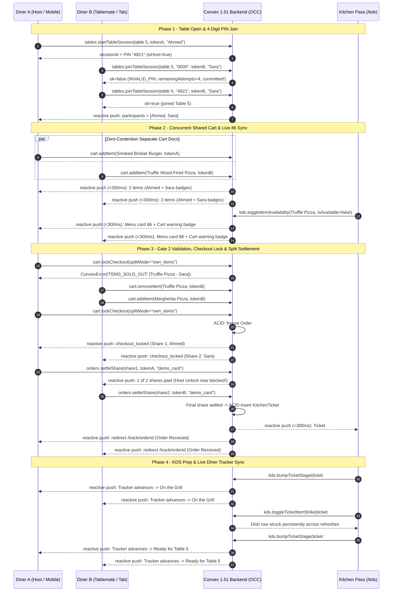

# Convex 1.51.0 Schema & Real-Time Backend Architecture Blueprint

> **Document Status:** Build-Ready Engineering Prep Pack (`04-prep-packs/engineering/01-convex-schema-and-realtime-architecture.md`)  
> **Verified Date:** November 19, 2026 (`convex@1.51.0`, `convex-test@0.0.73`, optional Tier 2 `@convex-dev/auth@2.0.0`)  
> **Scope Alignment:** Tier 1 Core Showcase (`/` → `/menu` → `/table/:n` → `/track/:orderId` ↔ `/kds`) with zero-friction optional fields pre-wired for Tier 2 (Bilingual `ar-EG`, Staff RBAC, Stripe Sandbox) and **zero Tier 3 ERP bloat**.

---

## 1. Architectural Posture & Verified Convex 1.51.0 Conventions

### Why Convex 1.51.0 Fits This Capstone
Because this project is graded 100% on **Frontend Architecture, UI/UX Polish, and Code Quality**, the backend's job is to deliver rock-solid real-time interactivity (`<300ms` sync across diners and the kitchen pass) with minimal boilerplate and full end-to-end TypeScript inference.

Convex eliminates manual WebSocket rooms, Redis lock tables, and stale cache invalidation through two guarantees:
1. **Reactive Subscriptions (`useQuery`):** Convex tracks every index range and document read inside a query. When any mutation patches a tracked row (for example, the chef toggling **`86` / Sold Out** — restaurant shorthand for marking an item out of stock), Convex automatically re-executes affected queries and pushes fresh snapshots to every subscribed diner and KDS screen.
2. **Deterministic OCC (Optimistic Concurrency Control):** Every Convex `mutation` runs as an ACID transaction. Convex records the exact version of every document read; if two diners write to a conflicting record at the same millisecond, Convex safely retries the second deterministic transaction automatically—no manual `SELECT ... FOR UPDATE` locks and no half-written partial states.

### Mandatory Convex 1.51.0 Engineering Rules (Enforced in All Code Below)
| Rule | Convention Enforced | Why (Verified Nov 19, 2026) |
| :--- | :--- | :--- |
| **Explicit Table IDs (`1.31+`)** | Always pass the table name as the first argument to `ctx.db.get("menuItems", id)`, `ctx.db.patch("tableSessions", id, ...)`, `ctx.db.replace(...)`, and `ctx.db.delete(...)`. | Enforced by Convex's `explicit-table-ids` lint rule in `convex@1.51.0`; guards against cross-table ID confusion and future-proofs custom IDs. |
| **Strict `args` + `returns`** | Every public `query` and `mutation` declares both `args` and `returns` validators using `convex/values` (`v.*`). Use `v.null()` for void mutations. | Prevents accidental internal field leaks (like leaking table PINs or staff hashes) and guarantees zero `any` end-to-end. |
| **Typed `ConvexError` Payloads** | Business-rule rejections throw `new ConvexError({ code, message, ... })` with a strict union `code`. | Preserves structured error payloads across the network boundary in production builds (unlike generic `Error`, which Convex redacts in prod). |
| **Commit-on-Rate-Limit Rule** | Failed Table PIN guesses **must return** `{ ok: false, errorCode: "INVALID_PIN" \| "PIN_RATE_LIMITED", ... }` instead of throwing `ConvexError`. | Throwing inside a Convex mutation **rolls back the entire transaction**, which would wipe out the incremented failed-attempt counter! |
| **Integer Piasters Only** | All currency values are stored and calculated as exact integer **piasters** (`1 EGP = 100 piasters`, e.g., `18500` = EGP 185.00). | Eliminates IEEE-754 floating-point drift (`0.1 + 0.2 !== 0.3`) across split-bill remainders, VAT, and service charge. |
| **Single-Restaurant `storeId`** | Operational tables include `storeId: v.string()` (default `"main"` via `DEFAULT_STORE_ID`), leading compound indexes where appropriate. | Keeps the app cleanly scoped to one restaurant today while staying multi-branch ready without ERP overhead. |
| **Staged Validators (`.staged()`)** | Use `defineTable({...}).staged({...})` (`convex@1.47+`) when promoting Tier 2 schema tightenings (e.g., making `nameAr` required). | Validates existing documents asynchronously in the background without blocking `npx convex deploy`. |
| **Zero-Contention Timer Design** | Store only `firedAt: v.number()` on `kitchenTickets`. Never run a server cron to update elapsed seconds. | Elapsed KDS timers (`mm:ss`) compute locally in React from `Date.now() - ticket.firedAt`, avoiding useless database writes. |

### Explicitly Excluded (Tier 3 ERP Bloat — Never Add to Schema)
- No 04:00 AM Cairo DST rollover schedulers or business-day ledger partitions.
- No 120-second lazy Stripe PaymentIntent cancellation timers (note: in `convex@1.50+`, a scheduled mutation cancelling itself throws `ScheduledFunctionCancelingItself`).
- No 80mm thermal print queues, inventory/warehouse ingredient tables, calorie-delta algebra, or 42-item catalog bloat (target is **14–16 curated signature dishes** across **4–5 categories**).

---

## 2. Complete `convex/schema.ts` Data Model Design

### Entity Relationship Overview
- **Catalog Layer:** `categories` (1) → `menuItems` (N). `menuItems.isAvailable` is the single real-time truth for **`86 / Sold Out`**.
- **Dining & Shared Cart Layer:** `tables` (1) → active `tableSessions` (0..1) → `cartItems` (N).
  - **OCC Hotspot Avoidance:** `cartItems` is a separate table (not an array inside `tableSessions`) so Diner A and Diner B can add, increment, and remove their own items concurrently with **zero write conflicts**.
- **Checkout & Split-Bill Layer:** `tableSessions` (1) → `orders` (1 active per lock) → `dinerShares` (1..N).
  - Freezing `orders.items` at Checkout Lock guarantees that subsequent menu edits or cart resets never mutate historical receipts.
  - Separating `dinerShares` lets multiple diners tap **Pay** simultaneously under `own_items` or `equal_split` without stepping on each other's share rows.
- **Kitchen Pass Layer:** `orders` (1) → `kitchenTickets` (0..1, strict 1:1 via `by_order`). Created atomically the instant the final `dinerShare` settles.
- **Tier 2 Extension Layer:** Optional bilingual fields (`nameAr`, `descriptionAr`, `optionNameAr`), optional `stripePaymentIntentId` on `dinerShares`, and a clean `staffProfiles` table ready for `@convex-dev/auth@2.0.0`.

### Table-by-Table Schema Specification

| Table | Tier | Purpose | Key Indexes | Tier 2 Optional Hooks |
| :--- | :---: | :--- | :--- | :--- |
| `categories` | Tier 1 | 4–5 menu sections ordered for horizontal pill tabs | `by_store_sort`, `by_store_slug` | `nameAr?` |
| `menuItems` | Tier 1 | 14–16 signature dishes, typed modifier groups, live `86` switch (`isAvailable`) | `by_store_category_sort`, `by_store_available`, `by_store_slug`, `search_name` (searchIndex) | `nameAr?`, `descriptionAr?`, `modifierGroups[].nameAr?`, `options[].nameAr?` |
| `tables` | Tier 1 | Physical tables (`1`–`12`), seat count, QR slug, pointer to `activeSessionId` | `by_store_number`, `by_store_status` | QR card batch metadata via `qrCodeSlug` |
| `tableSessions` | Tier 1 | Live dine-in session: 4-digit `pinCode`, participants, `hostParticipantToken`, PIN rate-limit map, checkout lock state, `paidSharesCount` | `by_store_status`, `by_table_status`, `by_store_tableNumber_status` | — |
| `cartItems` | Tier 1 | Live shared cart lines with strict single-owner `participantToken` and server-computed piaster totals | `by_session`, `by_session_participant`, `by_menuItem` | `itemNameArSnapshot?`, `selectedModifiers[].optionNameAr?` |
| `orders` | Tier 1 | Immutable order snapshot created at Checkout Lock (or Takeaway Checkout); sequential `#101+` numbering | `by_store_sequence`, `by_session`, `by_store_status` | `items[].nameAr?` |
| `dinerShares` | Tier 1 | Individual payment obligations across `full_table`, `own_items`, and `equal_split` (`sum(amountPiasters) === order.totalPiasters`) | `by_order`, `by_order_status`, `by_session`, `by_stripe_intent` | `stripePaymentIntentId?`, `"stripe_card"` method |
| `kitchenTickets` | Tier 1 | Live `/kds` ticket with stage machine (`new`→`preparing`→`ready`→`completed` + `recall`) and persistent row strike-through (`isStruck`) | `by_store_stage_fired`, `by_store_stage_completed`, `by_order` | `items[].nameAr?` |
| `staffProfiles` | Tier 2 | Compact staff roster (`kitchen` / `manager`) decoupled from guest `participantToken` flow | `by_store_username`, `by_authUserId` | Links cleanly to `@convex-dev/auth@2.0.0` user ID |

### Safe Tier 1 → Tier 2 Evolution with Convex 1.47+ `.staged()`
When Tier 2 introduces full Egyptian Arabic (`ar-EG`) copy and you want to tighten `nameAr` from `v.optional(v.string())` to required `v.string()` without risking a blocked deploy:
```ts
// Step 1: Backfill nameAr on all 14-16 menuItems, then chain .staged()
menuItems: defineTable({
  // ...current enforced Tier 1 fields (nameAr: v.optional(v.string()))
}).staged({
  nameAr: v.string(),
  descriptionAr: v.string(),
})
// Step 2: Run `npx convex deploy` -> CLI reports staged status `validating` -> `validated`.
// Step 3: Promote `nameAr: v.string()` into `defineTable` and remove `.staged()`.
```

---

## 3. Complete Real-Time Query & Mutation Contract Table

### Flow 1: Table Session Access, 4-Digit PIN & 5-Attempt Rate Limit (`/table/:n`)

| Function | Type | Arguments | Return Shape | Reactive UI Consumers | Concurrency & Security Invariants |
| :--- | :--- | :--- | :--- | :--- | :--- |
| `tables.listTables` | `query` | `{ storeId?: string }` | `Array<{ _id, tableNumber, label, seats, status, hasActiveSession, activeParticipantCount }>` | Home (`/`) Quick Table Picker; Admin QR table list | **Zero PIN Leakage:** Never selects or returns `pinCode` or `pinAttempts`. Uses `by_store_number` index. |
| `tables.getTableAccessState` | `query` | `{ tableNumber: number, participantToken: string, storeId?: string }` | Discriminated union: `{ state: "available", table }` \| `{ state: "pin_required", table, sessionId, activeParticipantCount, remainingAttempts, lockedUntil? }` \| `{ state: "joined", table, sessionId, pinCode, status, isHost, participants, activeOrderId? }` | `/table/:n` Gatekeeper Sheet & Table Header Pill | Reveals `pinCode` **only** when `participantToken` is already present in `session.participants`. Computes live lockout countdown from `pinAttempts[participantToken]`. |
| `tables.startTableSession` | `mutation` | `{ tableNumber: number, participantToken: string, displayName: string, storeId?: string }` | `{ sessionId: Id<"tableSessions">, tableNumber: number, pinCode: string, isHost: true }` | `/table/:n` "Start Table" CTA | **OCC Single-Session Guard:** Reads `tables` (`by_store_number`); rejects with `SESSION_ALREADY_ACTIVE` if `table.activeSessionId` is already set. Generates random 4-digit PIN (`1000`–`9999`), sets `hostParticipantToken = participantToken`, links `tables.activeSessionId` atomically. |
| `tables.joinTableSession` | `mutation` | `{ tableNumber: number, pinCode: string, participantToken: string, displayName: string, storeId?: string }` | `{ ok: true, sessionId, tableNumber, isHost: boolean }` \| `{ ok: false, errorCode: "INVALID_PIN" \| "PIN_RATE_LIMITED", remainingAttempts: number, lockedUntil?: number }` | `/table/:n` 4-Digit PIN Entry Modal | **5-Attempt / 15-Min Window Rate Limit (Per `participantToken`):** If already a participant, returns `{ ok: true }` idempotently. If locked (`lockedUntil > now`), returns `{ ok: false, errorCode: "PIN_RATE_LIMITED" }`. On wrong PIN, **commits** incremented `pinAttempts[participantToken]` and returns `{ ok: false }` (never throws `ConvexError` on wrong PIN so Convex does not roll back the attempt counter!). Clears attempts on match. |
| `tables.closeAndResetTable` | `mutation` | `{ tableNumber: number, participantToken?: string, storeId?: string }` | `null` | `/kds` Table Reset button; Post-meal Demo Reset | Closes `"settled"` (or empty `"active"`) session, sets `tables.status = "available"` and unsets `activeSessionId`. Rejects with `UNPAID_LOCKED_ORDER` if `status === "checkout_locked"` and `paidSharesCount > 0`. |

### Flow 2: Menu Catalog & Shared Table Cart (`participantToken` Single-Owner Tagging)

| Function | Type | Arguments | Return Shape | Reactive UI Consumers | Concurrency & Security Invariants |
| :--- | :--- | :--- | :--- | :--- | :--- |
| `menu.listCatalog` | `query` | `{ storeId?: string, includeInactive?: boolean }` | `{ categories: Category[], items: MenuItem[] }` | `/menu` Gallery, Dish Customizer Drawer, Home Featured Dishes | Subscribed to `menuItems` via `by_store_category_sort`. Any KDS `86` toggle patches `menuItems.isAvailable`, instantly flipping dish cards to Sold Out (`<300ms`). |
| `cart.getSessionCart` | `query` | `{ sessionId: Id<"tableSessions">, participantToken: string }` | `{ session, isHost, items: EnrichedCartItem[], hasSoldOutItems, totals, participantSubtotals, activeOrder?, dinerShares[] }` | Floating Cart Dock, Shared Table Cart Drawer, Smart Split Checkout Drawer | **Security:** Rejects/returns `null` if `participantToken` is not in `session.participants`. Joins each `cartItem` with live `menuItem.isAvailable` (`isSoldOut: !menuItem?.isAvailable`) so KDS `86` updates surface immediately on in-cart items. |
| `cart.addItem` | `mutation` | `{ sessionId, participantToken, menuItemId, selectedModifiers: Array<{ groupId, optionId }>, quantity, specialInstructions? }` | `{ cartItemId: Id<"cartItems">, merged: boolean }` | Dish Customizer Drawer "Add to Table Cart" CTA | **Gate 1 `86` Guard:** Throws `ITEM_SOLD_OUT` if `!menuItem.isAvailable`. Throws `SESSION_LOCKED` if `session.status !== "active"`. Validates modifier group min/max rules and **recomputes `unitTotalPiasters` strictly server-side**. Merges into an existing row **only** if owned by the exact same `participantToken` with identical modifiers + note. |
| `cart.updateItemQuantity` | `mutation` | `{ cartItemId: Id<"cartItems">, participantToken: string, quantity: number }` | `null` | Shared Cart Drawer `−` / `+` Stepper | **Strict Single-Owner Invariant:** Throws `NOT_ITEM_OWNER` if `cartItem.participantToken !== participantToken`. Throws `SESSION_LOCKED` if `session.status !== "active"`. Deletes row if `quantity === 0`; validates `1..20` and checks `menuItem.isAvailable` when incrementing. |
| `cart.removeItem` | `mutation` | `{ cartItemId: Id<"cartItems">, participantToken: string }` | `null` | Shared Cart Drawer Remove button (including removing `86`'d items) | **Strict Single-Owner Invariant:** Throws `NOT_ITEM_OWNER` if `cartItem.participantToken !== participantToken`. Throws `SESSION_LOCKED` if `session.status !== "active"`. Deletes only the caller's own `cartItems` document (zero OCC contention with other diners). |

### Flow 3: Atomic Checkout Lock (Gate 2 `86` Validation) & Host Unlock

| Function | Type | Arguments | Return Shape | Reactive UI Consumers | Concurrency & Security Invariants |
| :--- | :--- | :--- | :--- | :--- | :--- |
| `cart.lockCheckout` | `mutation` | `{ sessionId, participantToken, splitMode: "full_table" \| "own_items" \| "equal_split", equalSplitCount?: number }` | `{ orderId: Id<"orders">, orderNumber: string, shareIds: Id<"dinerShares">[], totalPiasters: number }` | Smart Split Checkout Drawer "Lock & Proceed to Pay" CTA | **Single ACID Transaction:** Verifies caller is a verified participant, `session.status === "active"`, and cart is non-empty. **Gate 2 `86` Sweep:** Reads every unique `menuItemId` in cart; if **any** item is `!isAvailable`, throws `ConvexError({ code: "ITEMS_SOLD_OUT", soldOutItems })` and aborts cleanly so session stays `"active"`. Computes exact integer-piaster totals + `dinerShares` (`sum === order.totalPiasters`), assigns sequential `orderNumber` (`#101+`), inserts `orders` + `dinerShares`, and patches `session.status = "checkout_locked"` + `paidSharesCount = 0`. |
| `cart.unlockCheckout` | `mutation` | `{ sessionId: Id<"tableSessions">, participantToken: string }` | `null` | Smart Split Checkout Drawer "Unlock Cart to Edit" (Host-only) | **Host + Zero-Paid Guard:** Throws `ONLY_HOST_CAN_UNLOCK` if `participantToken !== session.hostParticipantToken`. Throws `SESSION_NOT_LOCKED` if `session.status !== "checkout_locked"`. Throws `SHARES_ALREADY_PAID` if `session.paidSharesCount > 0` OR any `dinerShare` for `activeOrderId` has `status === "paid"`. Voids all unpaid shares, marks `activeOrder` `"cancelled"`, and returns `session` to `"active"` with all `cartItems` preserved intact. |

### Flow 4: Settling `dinerShares` (All 3 Split Modes) & Atomic KDS Ticket Firing

| Function | Type | Arguments | Return Shape | Reactive UI Consumers | Concurrency & Security Invariants |
| :--- | :--- | :--- | :--- | :--- | :--- |
| `orders.settleShare` | `mutation` | `{ shareId: Id<"dinerShares">, participantToken: string, paymentMethod: "demo_card" \| "pay_at_counter" \| "stripe_card", stripePaymentIntentId?: string }` | `{ shareStatus: "paid", orderFullyPaid: boolean, orderId: Id<"orders">, ticketId?: Id<"kitchenTickets">, counterReceiptCode?: string }` | Smart Split Checkout Drawer "Pay My Share" / "Pay Full Table" / "Pay at Counter" CTAs | **Exact Settlement + 1:1 KDS Firing:** Verifies `share.status === "unpaid"` (OCC blocks double-pay clicks). In `own_items`, enforces caller is share owner or table host. Patches share `"paid"`, increments `order.paidPiasters` and `session.paidSharesCount`. When `paidSharesCount === totalSharesCount` (and `paidPiasters === order.totalPiasters`): idempotently checks `kitchenTickets` (`by_order`), inserts `kitchenTicket` (`stage: "new"`, `firedAt: now`), sets `order.status = "in_kitchen"`, `session.status = "settled"`, and clears the session's `cartItems`—all in one ACID commit. |
| `orders.createTakeawayOrder` | `mutation` | `{ storeId?: string, guestName: string, items: Array<{ menuItemId, selectedModifiers, quantity, specialInstructions? }>, paymentMethod: "demo_card" \| "pay_at_counter" \| "stripe_card" }` | `{ orderId: Id<"orders">, orderNumber: string, ticketId: Id<"kitchenTickets">, totalPiasters: number }` | `/menu` Takeaway Solo Checkout Drawer | Runs Gate 2 `86` validation, recomputes prices server-side (`serviceChargePiasters = 0`, 14% VAT), creates 1 paid `full_table` share, and fires `kitchenTicket` straight to `/kds` atomically. |
| `orders.getOrderTracker` | `query` | `{ orderId: Id<"orders"> }` | `{ order, shares: DinerShare[], ticket: KitchenTicket \| null }` \| `null` | `/track/:orderId` Live Progress Stepper & Digital Receipt | Reads `orders`, `dinerShares` (`by_order`), and `kitchenTickets` (`by_order`). Re-renders instantaneously whenever another tablemate pays a share or the kitchen bumps the ticket stage. |

### Flow 5 & Flow 6: Live `86 / Sold Out` Sync, KDS Stage Bumps, Recall & Dish Strike-Through (`/kds`)

| Function | Type | Arguments | Return Shape | Reactive UI Consumers | Concurrency & Security Invariants |
| :--- | :--- | :--- | :--- | :--- | :--- |
| `kds.getBoard` | `query` | `{ storeId?: string }` | `{ columns: { new: Ticket[], preparing: Ticket[], ready: Ticket[] }, recentlyCompleted: Ticket[], metrics: { activeTicketCount, estimatedWaitMinutes } }` | `/kds` Dark Charcoal Board & Recall Drawer | Uses `by_store_stage_fired` (`order("asc")` = strict FIFO) for active lanes and `by_store_stage_completed` (`order("desc").take(10)`) for Recall. |
| `kds.getLivePrepEstimate` | `query` | `{ storeId?: string }` | `{ activeTicketCount: number, estimatedWaitMinutes: number }` | Storefront Hero (`/`) live kitchen prep badge (`~12 min`) | Lightweight read across `new` + `preparing` tickets only; never exposes ticket contents or table details to public storefront visitors. |
| `kds.listStockControlItems` | `query` | `{ storeId?: string }` | `Array<{ _id, categoryId, name, nameAr?, isAvailable, soldOutAt? }>` | `/kds` `86 / Sold Out` Quick-Toggle Sheet | Lightweight projection over `menuItems` (`by_store_category_sort`). |
| `kds.toggleItemAvailability` | `mutation` | `{ menuItemId: Id<"menuItems">, isAvailable: boolean }` | `{ menuItemId: Id<"menuItems">, isAvailable: boolean, soldOutAt?: number }` | `/kds` `86` Toggle Switch | Patches `menuItems` directly; **never deletes** existing `cartItems` (prevents destructive accidents if chef un-86s). Reactive sync disables `/menu` cards and flags affected `/table/:n` cart lines in `<300ms`; Gate 2 blocks checkout until resolved. |
| `kds.bumpTicketStage` | `mutation` | `{ ticketId: Id<"kitchenTickets">, nextStage: "preparing" \| "ready" \| "completed" }` | `{ ticketId, stage, updatedAt }` | `/kds` explicit 1-tap `Start Prep` / `Mark Ready` / `Complete` buttons (zero `@dnd-kit`) | Enforces strict forward state machine (`new→preparing→ready→completed`). Throws `INVALID_STAGE_TRANSITION` on stale double-tap. Synchronizes `orders.status` in the same ACID transaction so `/track/:orderId` updates in lockstep. |
| `kds.recallTicket` | `mutation` | `{ ticketId: Id<"kitchenTickets"> }` | `{ ticketId, stage: "preparing" \| "ready", recalledCount: number }` | `/kds` Recall Drawer & Ready-column Undo button | Deterministic step-back: `completed → ready`, `ready → preparing`. Rejects `new` with `CANNOT_RECALL_NEW_TICKET`. Increments `recalledCount` and syncs `orders.status` back (`"ready"` or `"in_kitchen"`). |
| `kds.toggleTicketItemStrike` | `mutation` | `{ ticketId: Id<"kitchenTickets">, lineId: string }` | `{ ticketId, lineId, isStruck: boolean }` | `/kds` `48px+` tap-to-strike dish rows | Rejects if `ticket.stage === "completed"` (`TICKET_ALREADY_COMPLETED`). Flips `isStruck` and stamps `struckAt` on the exact `lineId`, persisting across refreshes and multiple kitchen screens. |

---

## 4. Concrete Build-Ready TypeScript Code Skeletons

> **Strictness Contract:** Compiles cleanly under `"strict": true`, `"noUnusedLocals": true`, `"noUncheckedIndexedAccess": true`, zero `any`, and `oxlint` + `oxlint-tsgolint`.

### 4.1 `convex/schema.ts`

```ts
import { defineSchema, defineTable } from "convex/server";
import { v } from "convex/values";

// Reusable domain validators (imported by cart.ts, orders.ts, and kds.ts via convex/lib/validators.ts in implementation)
export const menuTagValidator = v.union(
  v.literal("signature"),
  v.literal("spicy"),
  v.literal("vegetarian"),
  v.literal("new"),
);

export const modifierOptionValidator = v.object({
  optionId: v.string(),
  name: v.string(),
  nameAr: v.optional(v.string()), // Tier 2 bilingual hook
  priceDeltaPiasters: v.number(), // Integer piasters (>= 0)
  isDefault: v.optional(v.boolean()),
});

export const modifierGroupValidator = v.object({
  groupId: v.string(),
  name: v.string(),
  nameAr: v.optional(v.string()), // Tier 2 bilingual hook
  required: v.boolean(),
  minSelections: v.number(),
  maxSelections: v.number(),
  options: v.array(modifierOptionValidator),
});

export const selectedModifierSnapshotValidator = v.object({
  groupId: v.string(),
  groupName: v.string(),
  optionId: v.string(),
  optionName: v.string(),
  optionNameAr: v.optional(v.string()),
  priceDeltaPiasters: v.number(),
});

export const splitModeValidator = v.union(
  v.literal("full_table"),
  v.literal("own_items"),
  v.literal("equal_split"),
);

export const paymentMethodValidator = v.union(
  v.literal("demo_card"),
  v.literal("pay_at_counter"),
  v.literal("stripe_card"), // Tier 2 Stripe Sandbox hook
);

export const orderItemSnapshotValidator = v.object({
  lineId: v.string(),
  menuItemId: v.id("menuItems"),
  participantToken: v.string(),
  participantName: v.string(),
  name: v.string(),
  nameAr: v.optional(v.string()),
  selectedModifiers: v.array(selectedModifierSnapshotValidator),
  unitTotalPiasters: v.number(),
  quantity: v.number(),
  lineTotalPiasters: v.number(),
  specialInstructions: v.optional(v.string()),
});

export const kdsStageValidator = v.union(
  v.literal("new"),
  v.literal("preparing"),
  v.literal("ready"),
  v.literal("completed"),
);

export const ticketItemValidator = v.object({
  lineId: v.string(),
  menuItemId: v.id("menuItems"),
  name: v.string(),
  nameAr: v.optional(v.string()),
  quantity: v.number(),
  modifierSummary: v.array(v.string()),
  specialInstructions: v.optional(v.string()),
  participantName: v.optional(v.string()),
  isStruck: v.boolean(),
  struckAt: v.optional(v.number()),
});

export const pinAttemptStateValidator = v.object({
  count: v.number(),
  windowStartAt: v.number(),
  lastAttemptAt: v.number(),
  lockedUntil: v.optional(v.number()),
});

export default defineSchema({
  // 1. Curated Menu Categories (4-5 categories)
  categories: defineTable({
    storeId: v.string(),
    slug: v.string(),
    name: v.string(),
    nameAr: v.optional(v.string()), // Tier 2 bilingual
    sortOrder: v.number(),
    isActive: v.boolean(),
  })
    .index("by_store_sort", ["storeId", "sortOrder"])
    .index("by_store_slug", ["storeId", "slug"]),

  // 2. Curated Signature Menu Items (14-16 dishes) + Live 86 Switch
  menuItems: defineTable({
    storeId: v.string(),
    categoryId: v.id("categories"),
    slug: v.string(),
    name: v.string(),
    nameAr: v.optional(v.string()), // Tier 2 bilingual
    description: v.string(),
    descriptionAr: v.optional(v.string()), // Tier 2 bilingual
    basePricePiasters: v.number(), // Exact integer piasters (1 EGP = 100)
    imagePath: v.string(), // Bundled sunlit .webp asset key or URL
    prepTimeMinutes: v.number(),
    tags: v.array(menuTagValidator),
    modifierGroups: v.array(modifierGroupValidator),
    isAvailable: v.boolean(), // Live 86 / Sold Out switch
    soldOutAt: v.optional(v.number()),
    sortOrder: v.number(),
  })
    .index("by_store_category_sort", ["storeId", "categoryId", "sortOrder"])
    .index("by_store_available", ["storeId", "isAvailable"])
    .index("by_store_slug", ["storeId", "slug"])
    .searchIndex("search_name", {
      searchField: "name",
      filterFields: ["storeId", "isAvailable"],
    }),

  // 3. Physical Dining Tables (Tables 1-12)
  tables: defineTable({
    storeId: v.string(),
    tableNumber: v.number(),
    label: v.string(), // e.g., "Table 5"
    seats: v.number(),
    qrCodeSlug: v.string(), // e.g., "t5"
    status: v.union(v.literal("available"), v.literal("occupied")),
    activeSessionId: v.optional(v.id("tableSessions")),
  })
    .index("by_store_number", ["storeId", "tableNumber"])
    .index("by_store_status", ["storeId", "status"]),

  // 4. Live Table Sessions (4-digit PIN, 5-attempt rate limit, Checkout Lock)
  tableSessions: defineTable({
    storeId: v.string(),
    tableId: v.id("tables"),
    tableNumber: v.number(),
    pinCode: v.string(), // 4-digit string ("1000"-"9999")
    status: v.union(
      v.literal("active"),
      v.literal("checkout_locked"),
      v.literal("settled"),
      v.literal("closed"),
    ),
    hostParticipantToken: v.string(),
    participants: v.array(
      v.object({
        participantToken: v.string(),
        displayName: v.string(),
        joinedAt: v.number(),
      }),
    ),
    // Keyed by ASCII participantToken (UUID/nanoid); committed on wrong PIN without rollback
    pinAttempts: v.record(v.string(), pinAttemptStateValidator),
    splitMode: v.optional(splitModeValidator),
    equalSplitCount: v.optional(v.number()),
    lockedByToken: v.optional(v.string()),
    lockedAt: v.optional(v.number()),
    activeOrderId: v.optional(v.id("orders")),
    paidSharesCount: v.number(),
    totalSharesCount: v.number(),
    openedAt: v.number(),
    closedAt: v.optional(v.number()),
  })
    .index("by_store_status", ["storeId", "status"])
    .index("by_table_status", ["tableId", "status"])
    .index("by_store_tableNumber_status", ["storeId", "tableNumber", "status"]),

  // 5. Shared Table Cart Items (Separate docs = zero OCC contention between diners)
  cartItems: defineTable({
    storeId: v.string(),
    sessionId: v.id("tableSessions"),
    menuItemId: v.id("menuItems"),
    participantToken: v.string(), // Strict single-owner tag
    participantName: v.string(),
    itemNameSnapshot: v.string(),
    itemNameArSnapshot: v.optional(v.string()),
    unitBasePricePiasters: v.number(),
    selectedModifiers: v.array(selectedModifierSnapshotValidator),
    unitTotalPiasters: v.number(),
    quantity: v.number(),
    lineTotalPiasters: v.number(),
    specialInstructions: v.optional(v.string()),
    updatedAt: v.number(),
  })
    .index("by_session", ["sessionId"])
    .index("by_session_participant", ["sessionId", "participantToken"])
    .index("by_menuItem", ["menuItemId"]),

  // 6. Immutable Orders (Created atomically on Checkout Lock or Takeaway Checkout)
  orders: defineTable({
    storeId: v.string(),
    sequenceNumber: v.number(), // Monotonic 101, 102, ... via OCC
    orderNumber: v.string(), // Display code e.g. "#104"
    orderType: v.union(v.literal("dine_in"), v.literal("takeaway")),
    sessionId: v.optional(v.id("tableSessions")),
    tableNumber: v.optional(v.number()),
    guestName: v.optional(v.string()),
    splitMode: splitModeValidator,
    status: v.union(
      v.literal("awaiting_payment"),
      v.literal("paid"),
      v.literal("in_kitchen"),
      v.literal("ready"),
      v.literal("completed"),
      v.literal("cancelled"),
    ),
    items: v.array(orderItemSnapshotValidator),
    subtotalPiasters: v.number(),
    vatPiasters: v.number(),
    serviceChargePiasters: v.number(),
    totalPiasters: v.number(),
    paidPiasters: v.number(),
    createdAt: v.number(),
    paidAt: v.optional(v.number()),
    cancelledAt: v.optional(v.number()),
  })
    .index("by_store_sequence", ["storeId", "sequenceNumber"])
    .index("by_session", ["sessionId"])
    .index("by_store_status", ["storeId", "status"]),

  // 7. Per-Diner Split Payment Shares (full_table | own_items | equal_split)
  dinerShares: defineTable({
    storeId: v.string(),
    orderId: v.id("orders"),
    sessionId: v.optional(v.id("tableSessions")),
    shareIndex: v.number(), // Deterministic 0..N-1 order
    label: v.string(),
    participantToken: v.optional(v.string()),
    participantName: v.optional(v.string()),
    coveredLineIds: v.array(v.string()),
    subtotalPiasters: v.number(),
    vatPiasters: v.number(),
    serviceChargePiasters: v.number(),
    amountPiasters: v.number(), // Exact integer piaster sum === order.totalPiasters
    status: v.union(v.literal("unpaid"), v.literal("paid"), v.literal("voided")),
    paymentMethod: v.optional(paymentMethodValidator),
    counterReceiptCode: v.optional(v.string()), // e.g., "C-104-1"
    stripePaymentIntentId: v.optional(v.string()), // Tier 2 Stripe Sandbox hook
    paidAt: v.optional(v.number()),
  })
    .index("by_order", ["orderId"])
    .index("by_order_status", ["orderId", "status"])
    .index("by_session", ["sessionId"])
    .index("by_stripe_intent", ["stripePaymentIntentId"]),

  // 8. Real-Time Kitchen Display Tickets (/kds)
  kitchenTickets: defineTable({
    storeId: v.string(),
    orderId: v.id("orders"),
    orderNumber: v.string(),
    orderType: v.union(v.literal("dine_in"), v.literal("takeaway")),
    tableNumber: v.optional(v.number()),
    stage: kdsStageValidator,
    previousStage: v.optional(
      v.union(v.literal("new"), v.literal("preparing"), v.literal("ready")),
    ),
    items: v.array(ticketItemValidator),
    firedAt: v.number(), // Client renders elapsed mm:ss locally from firedAt
    startedAt: v.optional(v.number()),
    readyAt: v.optional(v.number()),
    completedAt: v.optional(v.number()),
    recalledCount: v.number(),
    updatedAt: v.number(),
  })
    .index("by_store_stage_fired", ["storeId", "stage", "firedAt"])
    .index("by_store_stage_completed", ["storeId", "stage", "completedAt"])
    .index("by_order", ["orderId"]),

  // 9. Tier 2 Optional: Staff Profiles (Pre-wired for @convex-dev/auth@2.0.0)
  staffProfiles: defineTable({
    storeId: v.string(),
    authUserId: v.optional(v.string()),
    username: v.string(),
    displayName: v.string(),
    role: v.union(v.literal("kitchen"), v.literal("manager")),
    isActive: v.boolean(),
    createdAt: v.number(),
  })
    .index("by_store_username", ["storeId", "username"])
    .index("by_authUserId", ["authUserId"]),
});
```

---

### 4.2 Shared Pure Domain Helper (`convex/lib/billEngine.ts`)

> **Why keep this pure & zero-Convex-import?** The exact same integer-piaster split engine powers both `convex/cart.ts` on the server **and** instant live previews inside the React Smart Split Checkout Drawer, and achieves 100% unit coverage in `vitest`.

```ts
export const DEFAULT_STORE_ID = "main" as const;
export const EGYPT_VAT_BPS = 1400 as const; // 14.00%
export const DINE_IN_SERVICE_BPS = 1200 as const; // 12.00%

export interface OrderTotals {
  subtotalPiasters: number;
  vatPiasters: number;
  serviceChargePiasters: number;
  totalPiasters: number;
}

export interface ShareLineInput {
  lineId: string;
  participantToken: string;
  participantName: string;
  lineTotalPiasters: number;
}

export interface ComputedShare {
  shareIndex: number;
  label: string;
  participantToken?: string;
  participantName?: string;
  coveredLineIds: string[];
  subtotalPiasters: number;
  vatPiasters: number;
  serviceChargePiasters: number;
  amountPiasters: number;
}

export function applyBps(amountPiasters: number, bps: number): number {
  return Math.round((amountPiasters * bps) / 10_000);
}

export function computeOrderTotals(
  subtotalPiasters: number,
  orderType: "dine_in" | "takeaway",
): OrderTotals {
  const vatPiasters = applyBps(subtotalPiasters, EGYPT_VAT_BPS);
  const serviceChargePiasters =
    orderType === "dine_in" ? applyBps(subtotalPiasters, DINE_IN_SERVICE_BPS) : 0;
  return {
    subtotalPiasters,
    vatPiasters,
    serviceChargePiasters,
    totalPiasters: subtotalPiasters + vatPiasters + serviceChargePiasters,
  };
}

/**
 * Largest-remainder proportional integer allocation.
 * Guarantees sum(result) === totalToDistribute with zero floating-point drift.
 */
function distributeProportionally(
  weights: readonly number[],
  totalToDistribute: number,
): number[] {
  const totalWeight = weights.reduce((acc, w) => acc + w, 0);
  if (weights.length === 0 || totalWeight <= 0 || totalToDistribute <= 0) {
    return weights.map(() => 0);
  }

  const parts = weights.map((weight, index) => {
    const numerator = weight * totalToDistribute;
    return {
      index,
      floorVal: Math.floor(numerator / totalWeight),
      remainder: numerator % totalWeight,
    };
  });

  const allocated = parts.reduce((acc, p) => acc + p.floorVal, 0);
  let remaining = totalToDistribute - allocated;

  const sortedByRemainder = [...parts].sort((a, b) =>
    b.remainder !== a.remainder ? b.remainder - a.remainder : a.index - b.index,
  );

  for (const part of sortedByRemainder) {
    if (remaining <= 0) break;
    part.floorVal += 1;
    remaining -= 1;
  }

  const result = new Array<number>(weights.length).fill(0);
  for (const part of parts) {
    result[part.index] = part.floorVal;
  }
  return result;
}

/**
 * Pure split engine for all 3 split modes.
 * Mathematical invariant: sum(shares.amountPiasters) === totals.totalPiasters ALWAYS.
 */
export function computeDinerShares(params: {
  splitMode: "full_table" | "own_items" | "equal_split";
  totals: OrderTotals;
  lines: readonly ShareLineInput[];
  participantOrder: readonly { participantToken: string; displayName: string }[];
  equalSplitCount?: number;
}): ComputedShare[] {
  const { splitMode, totals, lines, participantOrder, equalSplitCount } = params;

  if (splitMode === "full_table") {
    return [
      {
        shareIndex: 0,
        label: "Full Table",
        coveredLineIds: lines.map((line) => line.lineId),
        subtotalPiasters: totals.subtotalPiasters,
        vatPiasters: totals.vatPiasters,
        serviceChargePiasters: totals.serviceChargePiasters,
        amountPiasters: totals.totalPiasters,
      },
    ];
  }

  if (splitMode === "equal_split") {
    const count = equalSplitCount ?? Math.max(2, participantOrder.length);
    const subParts = new Array<number>(count).fill(0);
    const vatParts = new Array<number>(count).fill(0);
    const svcParts = new Array<number>(count).fill(0);

    // Rotating remainder cursor guarantees:
    // 1. Every sub-component sums strictly to order total, AND
    // 2. Final per-seat amountPiasters differ by AT MOST 1 piaster (0.01 EGP).
    let cursor = 0;
    const distributeComponent = (target: number[], value: number): void => {
      const base = Math.floor(value / count);
      const rem = value % count;
      for (let i = 0; i < count; i += 1) {
        target[i] = base;
      }
      for (let k = 0; k < rem; k += 1) {
        const idx = (cursor + k) % count;
        target[idx] = (target[idx] ?? 0) + 1;
      }
      cursor = (cursor + rem) % count;
    };

    distributeComponent(subParts, totals.subtotalPiasters);
    distributeComponent(vatParts, totals.vatPiasters);
    distributeComponent(svcParts, totals.serviceChargePiasters);

    return Array.from({ length: count }, (_, index) => {
      const sub = subParts[index] ?? 0;
      const vat = vatParts[index] ?? 0;
      const svc = svcParts[index] ?? 0;
      return {
        shareIndex: index,
        label: `Split Share ${index + 1} of ${count}`,
        coveredLineIds: [],
        subtotalPiasters: sub,
        vatPiasters: vat,
        serviceChargePiasters: svc,
        amountPiasters: sub + vat + svc,
      };
    });
  }

  // splitMode === "own_items"
  const byOwner = new Map<
    string,
    { displayName: string; lineIds: string[]; subtotal: number }
  >();

  for (const p of participantOrder) {
    byOwner.set(p.participantToken, {
      displayName: p.displayName,
      lineIds: [],
      subtotal: 0,
    });
  }

  for (const line of lines) {
    const bucket = byOwner.get(line.participantToken) ?? {
      displayName: line.participantName,
      lineIds: [],
      subtotal: 0,
    };
    bucket.lineIds.push(line.lineId);
    bucket.subtotal += line.lineTotalPiasters;
    byOwner.set(line.participantToken, bucket);
  }

  const activeOwners = Array.from(byOwner.entries()).filter(
    ([, bucket]) => bucket.subtotal > 0,
  );
  const weights = activeOwners.map(([, bucket]) => bucket.subtotal);
  const vatAllocations = distributeProportionally(weights, totals.vatPiasters);
  const svcAllocations = distributeProportionally(
    weights,
    totals.serviceChargePiasters,
  );

  return activeOwners.map(([token, bucket], shareIndex) => {
    const vat = vatAllocations[shareIndex] ?? 0;
    const svc = svcAllocations[shareIndex] ?? 0;
    return {
      shareIndex,
      label: `${bucket.displayName}'s Items`,
      participantToken: token,
      participantName: bucket.displayName,
      coveredLineIds: bucket.lineIds,
      subtotalPiasters: bucket.subtotal,
      vatPiasters: vat,
      serviceChargePiasters: svc,
      amountPiasters: bucket.subtotal + vat + svc,
    };
  });
}
```

---

### 4.3 `convex/cart.ts`

```ts
import { ConvexError, v } from "convex/values";
import type { Doc, Id } from "./_generated/dataModel";
import { mutation, query } from "./_generated/server";
import { computeDinerShares, computeOrderTotals } from "./lib/billEngine";
import {
  selectedModifierSnapshotValidator,
  splitModeValidator,
} from "./schema";

const MAX_ITEM_QUANTITY = 20;
const MAX_NOTE_LENGTH = 140;
const MIN_EQUAL_SPLITS = 2;
const MAX_EQUAL_SPLITS = 12;

interface ResolvedModifierSnapshot {
  groupId: string;
  groupName: string;
  optionId: string;
  optionName: string;
  optionNameAr?: string;
  priceDeltaPiasters: number;
}

/**
 * Validates selected modifiers against authoritative menuItem.modifierGroups
 * and computes the server-authoritative unit price in integer piasters.
 */
function resolveAndValidateModifiers(
  menuItem: Doc<"menuItems">,
  requested: readonly { groupId: string; optionId: string }[],
): { snapshots: ResolvedModifierSnapshot[]; unitTotalPiasters: number } {
  const byGroup = new Map<string, Set<string>>();
  for (const sel of requested) {
    const set = byGroup.get(sel.groupId) ?? new Set<string>();
    set.add(sel.optionId);
    byGroup.set(sel.groupId, set);
  }

  const validGroupIds = new Set(menuItem.modifierGroups.map((g) => g.groupId));
  for (const groupId of byGroup.keys()) {
    if (!validGroupIds.has(groupId)) {
      throw new ConvexError({
        code: "INVALID_MODIFIER_GROUP",
        message: "One or more selected customizations are no longer valid.",
        groupId,
      });
    }
  }

  const snapshots: ResolvedModifierSnapshot[] = [];
  let modifierDeltaSum = 0;

  for (const group of menuItem.modifierGroups) {
    const chosenIds = byGroup.get(group.groupId) ?? new Set<string>();
    const minReq = group.required ? Math.max(1, group.minSelections) : group.minSelections;

    if (chosenIds.size < minReq || chosenIds.size > group.maxSelections) {
      throw new ConvexError({
        code: "INVALID_MODIFIER_SELECTION",
        message: `Please select between ${minReq} and ${group.maxSelections} option(s) for ${group.name}.`,
        groupId: group.groupId,
      });
    }

    for (const optionId of chosenIds) {
      const option = group.options.find((o) => o.optionId === optionId);
      if (!option) {
        throw new ConvexError({
          code: "INVALID_MODIFIER_OPTION",
          message: `Selected option is invalid for ${group.name}.`,
          groupId: group.groupId,
          optionId,
        });
      }
      modifierDeltaSum += option.priceDeltaPiasters;
      snapshots.push({
        groupId: group.groupId,
        groupName: group.name,
        optionId: option.optionId,
        optionName: option.name,
        ...(option.nameAr !== undefined ? { optionNameAr: option.nameAr } : {}),
        priceDeltaPiasters: option.priceDeltaPiasters,
      });
    }
  }

  snapshots.sort((a, b) =>
    a.groupId !== b.groupId
      ? a.groupId.localeCompare(b.groupId)
      : a.optionId.localeCompare(b.optionId),
  );

  return {
    snapshots,
    unitTotalPiasters: menuItem.basePricePiasters + modifierDeltaSum,
  };
}

function modifierSignature(
  modifiers: readonly { groupId: string; optionId: string }[],
): string {
  return [...modifiers]
    .sort((a, b) =>
      a.groupId !== b.groupId
        ? a.groupId.localeCompare(b.groupId)
        : a.optionId.localeCompare(b.optionId),
    )
    .map((m) => `${m.groupId}:${m.optionId}`)
    .join("|");
}

export const getSessionCart = query({
  args: {
    sessionId: v.id("tableSessions"),
    participantToken: v.string(),
  },
  returns: v.union(
    v.null(),
    v.object({
      sessionId: v.id("tableSessions"),
      tableNumber: v.number(),
      status: v.union(
        v.literal("active"),
        v.literal("checkout_locked"),
        v.literal("settled"),
        v.literal("closed"),
      ),
      isHost: v.boolean(),
      splitMode: v.optional(splitModeValidator),
      equalSplitCount: v.optional(v.number()),
      paidSharesCount: v.number(),
      totalSharesCount: v.number(),
      activeOrderId: v.optional(v.id("orders")),
      participants: v.array(
        v.object({
          participantToken: v.string(),
          displayName: v.string(),
          joinedAt: v.number(),
        }),
      ),
      items: v.array(
        v.object({
          _id: v.id("cartItems"),
          menuItemId: v.id("menuItems"),
          participantToken: v.string(),
          participantName: v.string(),
          isOwnedByCaller: v.boolean(),
          itemNameSnapshot: v.string(),
          itemNameArSnapshot: v.optional(v.string()),
          selectedModifiers: v.array(selectedModifierSnapshotValidator),
          unitTotalPiasters: v.number(),
          quantity: v.number(),
          lineTotalPiasters: v.number(),
          specialInstructions: v.optional(v.string()),
          isSoldOut: v.boolean(),
        }),
      ),
      hasSoldOutItems: v.boolean(),
      totals: v.object({
        subtotalPiasters: v.number(),
        vatPiasters: v.number(),
        serviceChargePiasters: v.number(),
        totalPiasters: v.number(),
      }),
      dinerShares: v.array(
        v.object({
          _id: v.id("dinerShares"),
          shareIndex: v.number(),
          label: v.string(),
          participantToken: v.optional(v.string()),
          participantName: v.optional(v.string()),
          amountPiasters: v.number(),
          status: v.union(
            v.literal("unpaid"),
            v.literal("paid"),
            v.literal("voided"),
          ),
          counterReceiptCode: v.optional(v.string()),
        }),
      ),
    }),
  ),
  handler: async (ctx, args) => {
    const session = await ctx.db.get("tableSessions", args.sessionId);
    if (!session) return null;

    const isParticipant = session.participants.some(
      (p) => p.participantToken === args.participantToken,
    );
    if (!isParticipant) return null;

    const rawItems = await ctx.db
      .query("cartItems")
      .withIndex("by_session", (q) => q.eq("sessionId", session._id))
      .collect();

    const uniqueMenuItemIds = Array.from(
      new Set(rawItems.map((item) => item.menuItemId)),
    );
    const menuDocs = await Promise.all(
      uniqueMenuItemIds.map((id) => ctx.db.get("menuItems", id)),
    );
    const availabilityById = new Map<Id<"menuItems">, boolean>();
    for (const doc of menuDocs) {
      if (doc) availabilityById.set(doc._id, doc.isAvailable);
    }

    let subtotalPiasters = 0;
    let hasSoldOutItems = false;

    const items = rawItems.map((item) => {
      const isSoldOut = !(availabilityById.get(item.menuItemId) ?? false);
      if (isSoldOut) hasSoldOutItems = true;
      subtotalPiasters += item.lineTotalPiasters;
      return {
        _id: item._id,
        menuItemId: item.menuItemId,
        participantToken: item.participantToken,
        participantName: item.participantName,
        isOwnedByCaller: item.participantToken === args.participantToken,
        itemNameSnapshot: item.itemNameSnapshot,
        ...(item.itemNameArSnapshot !== undefined
          ? { itemNameArSnapshot: item.itemNameArSnapshot }
          : {}),
        selectedModifiers: item.selectedModifiers,
        unitTotalPiasters: item.unitTotalPiasters,
        quantity: item.quantity,
        lineTotalPiasters: item.lineTotalPiasters,
        ...(item.specialInstructions !== undefined
          ? { specialInstructions: item.specialInstructions }
          : {}),
        isSoldOut,
      };
    });

    const totals = computeOrderTotals(subtotalPiasters, "dine_in");

    const activeOrderId = session.activeOrderId;
    const rawShares = activeOrderId
      ? await ctx.db
          .query("dinerShares")
          .withIndex("by_order", (q) => q.eq("orderId", activeOrderId))
          .collect()
      : [];

    const dinerShares = rawShares
      .filter((s) => s.status !== "voided")
      .sort((a, b) => a.shareIndex - b.shareIndex)
      .map((s) => ({
        _id: s._id,
        shareIndex: s.shareIndex,
        label: s.label,
        ...(s.participantToken !== undefined
          ? { participantToken: s.participantToken }
          : {}),
        ...(s.participantName !== undefined
          ? { participantName: s.participantName }
          : {}),
        amountPiasters: s.amountPiasters,
        status: s.status,
        ...(s.counterReceiptCode !== undefined
          ? { counterReceiptCode: s.counterReceiptCode }
          : {}),
      }));

    return {
      sessionId: session._id,
      tableNumber: session.tableNumber,
      status: session.status,
      isHost: session.hostParticipantToken === args.participantToken,
      ...(session.splitMode !== undefined ? { splitMode: session.splitMode } : {}),
      ...(session.equalSplitCount !== undefined
        ? { equalSplitCount: session.equalSplitCount }
        : {}),
      paidSharesCount: session.paidSharesCount,
      totalSharesCount: session.totalSharesCount,
      ...(activeOrderId !== undefined ? { activeOrderId } : {}),
      participants: session.participants,
      items,
      hasSoldOutItems,
      totals,
      dinerShares,
    };
  },
});

export const addItem = mutation({
  args: {
    sessionId: v.id("tableSessions"),
    participantToken: v.string(),
    menuItemId: v.id("menuItems"),
    selectedModifiers: v.array(
      v.object({
        groupId: v.string(),
        optionId: v.string(),
      }),
    ),
    quantity: v.number(),
    specialInstructions: v.optional(v.string()),
  },
  returns: v.object({
    cartItemId: v.id("cartItems"),
    merged: v.boolean(),
  }),
  handler: async (ctx, args) => {
    if (
      !Number.isInteger(args.quantity) ||
      args.quantity < 1 ||
      args.quantity > MAX_ITEM_QUANTITY
    ) {
      throw new ConvexError({
        code: "INVALID_QUANTITY",
        message: `Quantity must be an integer between 1 and ${MAX_ITEM_QUANTITY}.`,
      });
    }

    const session = await ctx.db.get("tableSessions", args.sessionId);
    if (!session) {
      throw new ConvexError({
        code: "SESSION_NOT_FOUND",
        message: "Table session does not exist.",
      });
    }
    if (session.status !== "active") {
      throw new ConvexError({
        code: "SESSION_LOCKED",
        message: "Checkout is locked. Ask the table host to unlock the cart first.",
      });
    }

    const participant = session.participants.find(
      (p) => p.participantToken === args.participantToken,
    );
    if (!participant) {
      throw new ConvexError({
        code: "NOT_A_PARTICIPANT",
        message: "Join this table with the 4-digit PIN before adding dishes.",
      });
    }

    // Gate 1: Live 86 availability check
    const menuItem = await ctx.db.get("menuItems", args.menuItemId);
    if (!menuItem) {
      throw new ConvexError({
        code: "ITEM_NOT_FOUND",
        message: "Menu item no longer exists.",
      });
    }
    if (!menuItem.isAvailable) {
      throw new ConvexError({
        code: "ITEM_SOLD_OUT",
        message: `${menuItem.name} was just marked sold out by the kitchen.`,
        menuItemId: menuItem._id,
      });
    }

    const { snapshots, unitTotalPiasters } = resolveAndValidateModifiers(
      menuItem,
      args.selectedModifiers,
    );

    const trimmedNote = args.specialInstructions?.trim();
    if (trimmedNote && trimmedNote.length > MAX_NOTE_LENGTH) {
      throw new ConvexError({
        code: "NOTE_TOO_LONG",
        message: `Kitchen note must be ${MAX_NOTE_LENGTH} characters or fewer.`,
      });
    }
    const normalizedNote = trimmedNote && trimmedNote.length > 0 ? trimmedNote : undefined;

    // Merge ONLY with caller's own matching cart row (preserves strict single-owner tagging)
    const callerItems = await ctx.db
      .query("cartItems")
      .withIndex("by_session_participant", (q) =>
        q
          .eq("sessionId", session._id)
          .eq("participantToken", args.participantToken),
      )
      .collect();

    const targetSig = modifierSignature(snapshots);
    const existingMatch = callerItems.find(
      (row) =>
        row.menuItemId === menuItem._id &&
        modifierSignature(row.selectedModifiers) === targetSig &&
        row.specialInstructions === normalizedNote,
    );

    const now = Date.now();
    if (existingMatch) {
      const nextQuantity = Math.min(
        MAX_ITEM_QUANTITY,
        existingMatch.quantity + args.quantity,
      );
      await ctx.db.patch("cartItems", existingMatch._id, {
        unitBasePricePiasters: menuItem.basePricePiasters,
        unitTotalPiasters,
        quantity: nextQuantity,
        lineTotalPiasters: unitTotalPiasters * nextQuantity,
        updatedAt: now,
      });
      return { cartItemId: existingMatch._id, merged: true };
    }

    const cartItemId = await ctx.db.insert("cartItems", {
      storeId: session.storeId,
      sessionId: session._id,
      menuItemId: menuItem._id,
      participantToken: participant.participantToken,
      participantName: participant.displayName,
      itemNameSnapshot: menuItem.name,
      ...(menuItem.nameAr !== undefined
        ? { itemNameArSnapshot: menuItem.nameAr }
        : {}),
      unitBasePricePiasters: menuItem.basePricePiasters,
      selectedModifiers: snapshots,
      unitTotalPiasters,
      quantity: args.quantity,
      lineTotalPiasters: unitTotalPiasters * args.quantity,
      ...(normalizedNote !== undefined
        ? { specialInstructions: normalizedNote }
        : {}),
      updatedAt: now,
    });

    return { cartItemId, merged: false };
  },
});

export const updateItemQuantity = mutation({
  args: {
    cartItemId: v.id("cartItems"),
    participantToken: v.string(),
    quantity: v.number(),
  },
  returns: v.null(),
  handler: async (ctx, args) => {
    if (
      !Number.isInteger(args.quantity) ||
      args.quantity < 0 ||
      args.quantity > MAX_ITEM_QUANTITY
    ) {
      throw new ConvexError({
        code: "INVALID_QUANTITY",
        message: `Quantity must be between 0 and ${MAX_ITEM_QUANTITY}.`,
      });
    }

    const cartItem = await ctx.db.get("cartItems", args.cartItemId);
    if (!cartItem) {
      throw new ConvexError({
        code: "CART_ITEM_NOT_FOUND",
        message: "Cart item was already removed.",
      });
    }

    // Strict single-owner invariant
    if (cartItem.participantToken !== args.participantToken) {
      throw new ConvexError({
        code: "NOT_ITEM_OWNER",
        message: `Only ${cartItem.participantName} can edit this item.`,
      });
    }

    const session = await ctx.db.get("tableSessions", cartItem.sessionId);
    if (!session || session.status !== "active") {
      throw new ConvexError({
        code: "SESSION_LOCKED",
        message: "Cart cannot be modified while checkout is locked.",
      });
    }

    if (args.quantity === 0) {
      await ctx.db.delete("cartItems", cartItem._id);
      return null;
    }

    if (args.quantity > cartItem.quantity) {
      const menuItem = await ctx.db.get("menuItems", cartItem.menuItemId);
      if (!menuItem || !menuItem.isAvailable) {
        throw new ConvexError({
          code: "ITEM_SOLD_OUT",
          message: `${cartItem.itemNameSnapshot} is currently sold out.`,
          menuItemId: cartItem.menuItemId,
        });
      }
    }

    await ctx.db.patch("cartItems", cartItem._id, {
      quantity: args.quantity,
      lineTotalPiasters: cartItem.unitTotalPiasters * args.quantity,
      updatedAt: Date.now(),
    });
    return null;
  },
});

export const removeItem = mutation({
  args: {
    cartItemId: v.id("cartItems"),
    participantToken: v.string(),
  },
  returns: v.null(),
  handler: async (ctx, args) => {
    const cartItem = await ctx.db.get("cartItems", args.cartItemId);
    if (!cartItem) return null;

    if (cartItem.participantToken !== args.participantToken) {
      throw new ConvexError({
        code: "NOT_ITEM_OWNER",
        message: `Only ${cartItem.participantName} can remove this item.`,
      });
    }

    const session = await ctx.db.get("tableSessions", cartItem.sessionId);
    if (!session || session.status !== "active") {
      throw new ConvexError({
        code: "SESSION_LOCKED",
        message: "Cart cannot be modified while checkout is locked.",
      });
    }

    await ctx.db.delete("cartItems", cartItem._id);
    return null;
  },
});

/**
 * Atomic Checkout Lock (active -> checkout_locked) with Gate 2 86 validation.
 */
export const lockCheckout = mutation({
  args: {
    sessionId: v.id("tableSessions"),
    participantToken: v.string(),
    splitMode: splitModeValidator,
    equalSplitCount: v.optional(v.number()),
  },
  returns: v.object({
    orderId: v.id("orders"),
    orderNumber: v.string(),
    shareIds: v.array(v.id("dinerShares")),
    totalPiasters: v.number(),
  }),
  handler: async (ctx, args) => {
    const session = await ctx.db.get("tableSessions", args.sessionId);
    if (!session) {
      throw new ConvexError({
        code: "SESSION_NOT_FOUND",
        message: "Table session not found.",
      });
    }
    if (session.status !== "active") {
      throw new ConvexError({
        code: "SESSION_ALREADY_LOCKED",
        message: "This table is already locked for checkout.",
      });
    }

    const isParticipant = session.participants.some(
      (p) => p.participantToken === args.participantToken,
    );
    if (!isParticipant) {
      throw new ConvexError({
        code: "NOT_A_PARTICIPANT",
        message: "Only table participants can start checkout.",
      });
    }

    if (args.splitMode === "equal_split") {
      const count = args.equalSplitCount;
      if (
        count === undefined ||
        !Number.isInteger(count) ||
        count < MIN_EQUAL_SPLITS ||
        count > MAX_EQUAL_SPLITS
      ) {
        throw new ConvexError({
          code: "INVALID_SPLIT_COUNT",
          message: `Equal split count must be between ${MIN_EQUAL_SPLITS} and ${MAX_EQUAL_SPLITS}.`,
        });
      }
    }

    const cartRows = await ctx.db
      .query("cartItems")
      .withIndex("by_session", (q) => q.eq("sessionId", session._id))
      .collect();

    if (cartRows.length === 0) {
      throw new ConvexError({
        code: "EMPTY_CART",
        message: "Add at least one dish before locking checkout.",
      });
    }

    // Gate 2: Exhaustive live 86 availability verification
    const uniqueMenuItemIds = Array.from(
      new Set(cartRows.map((row) => row.menuItemId)),
    );
    const menuDocs = await Promise.all(
      uniqueMenuItemIds.map((id) => ctx.db.get("menuItems", id)),
    );
    const menuById = new Map<Id<"menuItems">, Doc<"menuItems">>();
    for (const doc of menuDocs) {
      if (doc) menuById.set(doc._id, doc);
    }

    const soldOutItems: Array<{
      cartItemId: Id<"cartItems">;
      menuItemId: Id<"menuItems">;
      name: string;
      participantName: string;
    }> = [];

    for (const row of cartRows) {
      const menuItem = menuById.get(row.menuItemId);
      if (!menuItem || !menuItem.isAvailable) {
        soldOutItems.push({
          cartItemId: row._id,
          menuItemId: row.menuItemId,
          name: row.itemNameSnapshot,
          participantName: row.participantName,
        });
      }
    }

    if (soldOutItems.length > 0) {
      throw new ConvexError({
        code: "ITEMS_SOLD_OUT",
        message: "Remove sold-out dishes from the cart before locking checkout.",
        soldOutItems,
      });
    }

    // Build frozen order snapshot
    const frozenItems = cartRows.map((row, idx) => ({
      lineId: `line-${idx + 1}-${row._id}`,
      menuItemId: row.menuItemId,
      participantToken: row.participantToken,
      participantName: row.participantName,
      name: row.itemNameSnapshot,
      ...(row.itemNameArSnapshot !== undefined
        ? { nameAr: row.itemNameArSnapshot }
        : {}),
      selectedModifiers: row.selectedModifiers,
      unitTotalPiasters: row.unitTotalPiasters,
      quantity: row.quantity,
      lineTotalPiasters: row.lineTotalPiasters,
      ...(row.specialInstructions !== undefined
        ? { specialInstructions: row.specialInstructions }
        : {}),
    }));

    const subtotalPiasters = frozenItems.reduce(
      (acc, item) => acc + item.lineTotalPiasters,
      0,
    );
    const totals = computeOrderTotals(subtotalPiasters, "dine_in");

    const computedShares = computeDinerShares({
      splitMode: args.splitMode,
      totals,
      lines: frozenItems,
      participantOrder: session.participants,
      ...(args.equalSplitCount !== undefined
        ? { equalSplitCount: args.equalSplitCount }
        : {}),
    });

    // Sequential order number protected automatically by Convex OCC
    const latestOrder = await ctx.db
      .query("orders")
      .withIndex("by_store_sequence", (q) => q.eq("storeId", session.storeId))
      .order("desc")
      .first();
    const sequenceNumber = (latestOrder?.sequenceNumber ?? 100) + 1;
    const orderNumber = `#${sequenceNumber}`;
    const now = Date.now();

    const orderId = await ctx.db.insert("orders", {
      storeId: session.storeId,
      sequenceNumber,
      orderNumber,
      orderType: "dine_in",
      sessionId: session._id,
      tableNumber: session.tableNumber,
      splitMode: args.splitMode,
      status: "awaiting_payment",
      items: frozenItems,
      subtotalPiasters: totals.subtotalPiasters,
      vatPiasters: totals.vatPiasters,
      serviceChargePiasters: totals.serviceChargePiasters,
      totalPiasters: totals.totalPiasters,
      paidPiasters: 0,
      createdAt: now,
    });

    const shareIds: Id<"dinerShares">[] = [];
    for (const share of computedShares) {
      const shareId = await ctx.db.insert("dinerShares", {
        storeId: session.storeId,
        orderId,
        sessionId: session._id,
        shareIndex: share.shareIndex,
        label: share.label,
        ...(share.participantToken !== undefined
          ? { participantToken: share.participantToken }
          : {}),
        ...(share.participantName !== undefined
          ? { participantName: share.participantName }
          : {}),
        coveredLineIds: share.coveredLineIds,
        subtotalPiasters: share.subtotalPiasters,
        vatPiasters: share.vatPiasters,
        serviceChargePiasters: share.serviceChargePiasters,
        amountPiasters: share.amountPiasters,
        status: "unpaid",
      });
      shareIds.push(shareId);
    }

    await ctx.db.patch("tableSessions", session._id, {
      status: "checkout_locked",
      splitMode: args.splitMode,
      equalSplitCount:
        args.splitMode === "equal_split" ? args.equalSplitCount : undefined,
      lockedByToken: args.participantToken,
      lockedAt: now,
      activeOrderId: orderId,
      paidSharesCount: 0,
      totalSharesCount: shareIds.length,
    });

    return {
      orderId,
      orderNumber,
      shareIds,
      totalPiasters: totals.totalPiasters,
    };
  },
});

/**
 * Host Unlock (checkout_locked -> active) strictly while paidSharesCount === 0.
 */
export const unlockCheckout = mutation({
  args: {
    sessionId: v.id("tableSessions"),
    participantToken: v.string(),
  },
  returns: v.null(),
  handler: async (ctx, args) => {
    const session = await ctx.db.get("tableSessions", args.sessionId);
    if (!session) {
      throw new ConvexError({
        code: "SESSION_NOT_FOUND",
        message: "Table session not found.",
      });
    }
    if (session.hostParticipantToken !== args.participantToken) {
      throw new ConvexError({
        code: "ONLY_HOST_CAN_UNLOCK",
        message: "Only the table host can unlock checkout.",
      });
    }
    if (session.status !== "checkout_locked") {
      throw new ConvexError({
        code: "SESSION_NOT_LOCKED",
        message: "Table checkout is not currently locked.",
      });
    }

    // Strict zero-paid-shares invariant (verified on both session counter and dinerShares)
    if (session.paidSharesCount > 0) {
      throw new ConvexError({
        code: "SHARES_ALREADY_PAID",
        message: "Checkout cannot be unlocked after a diner has already paid.",
      });
    }

    const activeOrderId = session.activeOrderId;
    if (activeOrderId) {
      const paidShare = await ctx.db
        .query("dinerShares")
        .withIndex("by_order_status", (q) =>
          q.eq("orderId", activeOrderId).eq("status", "paid"),
        )
        .first();
      if (paidShare) {
        throw new ConvexError({
          code: "SHARES_ALREADY_PAID",
          message: "Checkout cannot be unlocked after a diner has already paid.",
        });
      }

      const unpaidShares = await ctx.db
        .query("dinerShares")
        .withIndex("by_order_status", (q) =>
          q.eq("orderId", activeOrderId).eq("status", "unpaid"),
        )
        .collect();
      for (const share of unpaidShares) {
        await ctx.db.patch("dinerShares", share._id, { status: "voided" });
      }

      await ctx.db.patch("orders", activeOrderId, {
        status: "cancelled",
        cancelledAt: Date.now(),
      });
    }

    await ctx.db.patch("tableSessions", session._id, {
      status: "active",
      splitMode: undefined,
      equalSplitCount: undefined,
      lockedByToken: undefined,
      lockedAt: undefined,
      activeOrderId: undefined,
      paidSharesCount: 0,
      totalSharesCount: 0,
    });

    return null;
  },
});
```

---

### 4.4 `convex/kds.ts`

```ts
import { ConvexError, v } from "convex/values";
import type { Doc } from "./_generated/dataModel";
import { mutation, query } from "./_generated/server";
import { DEFAULT_STORE_ID } from "./lib/billEngine";
import { kdsStageValidator, ticketItemValidator } from "./schema";

const BASE_PREP_MINUTES = 10;
const MINUTES_PER_ACTIVE_TICKET = 3;
const MAX_PREP_ESTIMATE_MINUTES = 45;
const RECENT_COMPLETED_LIMIT = 10;

const ALLOWED_FORWARD_TRANSITIONS: Record<
  "new" | "preparing" | "ready" | "completed",
  "preparing" | "ready" | "completed" | null
> = {
  new: "preparing",
  preparing: "ready",
  ready: "completed",
  completed: null,
};

const kdsTicketProjectionValidator = v.object({
  _id: v.id("kitchenTickets"),
  orderId: v.id("orders"),
  orderNumber: v.string(),
  orderType: v.union(v.literal("dine_in"), v.literal("takeaway")),
  tableNumber: v.optional(v.number()),
  stage: kdsStageValidator,
  items: v.array(ticketItemValidator),
  firedAt: v.number(),
  startedAt: v.optional(v.number()),
  readyAt: v.optional(v.number()),
  completedAt: v.optional(v.number()),
  recalledCount: v.number(),
});

function projectTicket(doc: Doc<"kitchenTickets">) {
  return {
    _id: doc._id,
    orderId: doc.orderId,
    orderNumber: doc.orderNumber,
    orderType: doc.orderType,
    ...(doc.tableNumber !== undefined ? { tableNumber: doc.tableNumber } : {}),
    stage: doc.stage,
    items: doc.items,
    firedAt: doc.firedAt,
    ...(doc.startedAt !== undefined ? { startedAt: doc.startedAt } : {}),
    ...(doc.readyAt !== undefined ? { readyAt: doc.readyAt } : {}),
    ...(doc.completedAt !== undefined ? { completedAt: doc.completedAt } : {}),
    recalledCount: doc.recalledCount,
  };
}

function estimatePrepMinutes(activeTicketCount: number): number {
  return Math.min(
    MAX_PREP_ESTIMATE_MINUTES,
    BASE_PREP_MINUTES + activeTicketCount * MINUTES_PER_ACTIVE_TICKET,
  );
}

export const getBoard = query({
  args: {
    storeId: v.optional(v.string()),
  },
  returns: v.object({
    columns: v.object({
      new: v.array(kdsTicketProjectionValidator),
      preparing: v.array(kdsTicketProjectionValidator),
      ready: v.array(kdsTicketProjectionValidator),
    }),
    recentlyCompleted: v.array(kdsTicketProjectionValidator),
    metrics: v.object({
      activeTicketCount: v.number(),
      estimatedWaitMinutes: v.number(),
    }),
  }),
  handler: async (ctx, args) => {
    const storeId = args.storeId ?? DEFAULT_STORE_ID;

    const [newDocs, preparingDocs, readyDocs, completedDocs] = await Promise.all([
      ctx.db
        .query("kitchenTickets")
        .withIndex("by_store_stage_fired", (q) =>
          q.eq("storeId", storeId).eq("stage", "new"),
        )
        .order("asc")
        .collect(),
      ctx.db
        .query("kitchenTickets")
        .withIndex("by_store_stage_fired", (q) =>
          q.eq("storeId", storeId).eq("stage", "preparing"),
        )
        .order("asc")
        .collect(),
      ctx.db
        .query("kitchenTickets")
        .withIndex("by_store_stage_fired", (q) =>
          q.eq("storeId", storeId).eq("stage", "ready"),
        )
        .order("asc")
        .collect(),
      ctx.db
        .query("kitchenTickets")
        .withIndex("by_store_stage_completed", (q) =>
          q.eq("storeId", storeId).eq("stage", "completed"),
        )
        .order("desc")
        .take(RECENT_COMPLETED_LIMIT),
    ]);

    const activeTicketCount = newDocs.length + preparingDocs.length;

    return {
      columns: {
        new: newDocs.map(projectTicket),
        preparing: preparingDocs.map(projectTicket),
        ready: readyDocs.map(projectTicket),
      },
      recentlyCompleted: completedDocs.map(projectTicket),
      metrics: {
        activeTicketCount,
        estimatedWaitMinutes: estimatePrepMinutes(activeTicketCount),
      },
    };
  },
});

export const getLivePrepEstimate = query({
  args: {
    storeId: v.optional(v.string()),
  },
  returns: v.object({
    activeTicketCount: v.number(),
    estimatedWaitMinutes: v.number(),
  }),
  handler: async (ctx, args) => {
    const storeId = args.storeId ?? DEFAULT_STORE_ID;
    const [newDocs, preparingDocs] = await Promise.all([
      ctx.db
        .query("kitchenTickets")
        .withIndex("by_store_stage_fired", (q) =>
          q.eq("storeId", storeId).eq("stage", "new"),
        )
        .collect(),
      ctx.db
        .query("kitchenTickets")
        .withIndex("by_store_stage_fired", (q) =>
          q.eq("storeId", storeId).eq("stage", "preparing"),
        )
        .collect(),
    ]);

    const activeTicketCount = newDocs.length + preparingDocs.length;
    return {
      activeTicketCount,
      estimatedWaitMinutes: estimatePrepMinutes(activeTicketCount),
    };
  },
});

export const listStockControlItems = query({
  args: {
    storeId: v.optional(v.string()),
  },
  returns: v.array(
    v.object({
      _id: v.id("menuItems"),
      categoryId: v.id("categories"),
      name: v.string(),
      nameAr: v.optional(v.string()),
      isAvailable: v.boolean(),
      soldOutAt: v.optional(v.number()),
    }),
  ),
  handler: async (ctx, args) => {
    const storeId = args.storeId ?? DEFAULT_STORE_ID;
    const items = await ctx.db
      .query("menuItems")
      .withIndex("by_store_category_sort", (q) => q.eq("storeId", storeId))
      .collect();

    return items.map((item) => ({
      _id: item._id,
      categoryId: item.categoryId,
      name: item.name,
      ...(item.nameAr !== undefined ? { nameAr: item.nameAr } : {}),
      isAvailable: item.isAvailable,
      ...(item.soldOutAt !== undefined ? { soldOutAt: item.soldOutAt } : {}),
    }));
  },
});

/**
 * Live 86 / Sold Out Toggle.
 * Immediately propagates (<300ms) to all /menu galleries and /table/:n shared carts.
 */
export const toggleItemAvailability = mutation({
  args: {
    menuItemId: v.id("menuItems"),
    isAvailable: v.boolean(),
  },
  returns: v.object({
    menuItemId: v.id("menuItems"),
    isAvailable: v.boolean(),
    soldOutAt: v.optional(v.number()),
  }),
  handler: async (ctx, args) => {
    const menuItem = await ctx.db.get("menuItems", args.menuItemId);
    if (!menuItem) {
      throw new ConvexError({
        code: "ITEM_NOT_FOUND",
        message: "Menu item not found.",
      });
    }

    const soldOutAt = args.isAvailable ? undefined : Date.now();
    await ctx.db.patch("menuItems", args.menuItemId, {
      isAvailable: args.isAvailable,
      soldOutAt,
    });

    return {
      menuItemId: args.menuItemId,
      isAvailable: args.isAvailable,
      ...(soldOutAt !== undefined ? { soldOutAt } : {}),
    };
  },
});

/**
 * Forward stage bump: new -> preparing -> ready -> completed.
 * Synchronizes parent order.status atomically so /track/:orderId updates live.
 */
export const bumpTicketStage = mutation({
  args: {
    ticketId: v.id("kitchenTickets"),
    nextStage: v.union(
      v.literal("preparing"),
      v.literal("ready"),
      v.literal("completed"),
    ),
  },
  returns: v.object({
    ticketId: v.id("kitchenTickets"),
    stage: kdsStageValidator,
    updatedAt: v.number(),
  }),
  handler: async (ctx, args) => {
    const ticket = await ctx.db.get("kitchenTickets", args.ticketId);
    if (!ticket) {
      throw new ConvexError({
        code: "TICKET_NOT_FOUND",
        message: "Kitchen ticket not found.",
      });
    }

    if (
      ticket.stage === "completed" ||
      ALLOWED_FORWARD_TRANSITIONS[ticket.stage] !== args.nextStage
    ) {
      throw new ConvexError({
        code: "INVALID_STAGE_TRANSITION",
        message: `Cannot move ticket ${ticket.orderNumber} from "${ticket.stage}" to "${args.nextStage}".`,
        currentStage: ticket.stage,
        requestedStage: args.nextStage,
      });
    }

    const now = Date.now();
    const stageTimestampPatch =
      args.nextStage === "preparing"
        ? { startedAt: now }
        : args.nextStage === "ready"
          ? { readyAt: now }
          : { completedAt: now };

    await ctx.db.patch("kitchenTickets", ticket._id, {
      stage: args.nextStage,
      previousStage: ticket.stage,
      ...stageTimestampPatch,
      updatedAt: now,
    });

    const syncedOrderStatus =
      args.nextStage === "preparing"
        ? "in_kitchen"
        : args.nextStage === "ready"
          ? "ready"
          : "completed";

    await ctx.db.patch("orders", ticket.orderId, {
      status: syncedOrderStatus,
    });

    return {
      ticketId: ticket._id,
      stage: args.nextStage,
      updatedAt: now,
    };
  },
});

/**
 * Deterministic recall: completed -> ready, ready -> preparing.
 */
export const recallTicket = mutation({
  args: {
    ticketId: v.id("kitchenTickets"),
  },
  returns: v.object({
    ticketId: v.id("kitchenTickets"),
    stage: v.union(v.literal("preparing"), v.literal("ready")),
    recalledCount: v.number(),
  }),
  handler: async (ctx, args) => {
    const ticket = await ctx.db.get("kitchenTickets", args.ticketId);
    if (!ticket) {
      throw new ConvexError({
        code: "TICKET_NOT_FOUND",
        message: "Kitchen ticket not found.",
      });
    }

    if (ticket.stage === "new" || ticket.stage === "preparing") {
      throw new ConvexError({
        code: "CANNOT_RECALL_TICKET",
        message: `Tickets in "${ticket.stage}" stage cannot be recalled.`,
        currentStage: ticket.stage,
      });
    }

    const targetStage: "preparing" | "ready" =
      ticket.stage === "completed" ? "ready" : "preparing";
    const now = Date.now();
    const nextRecalledCount = ticket.recalledCount + 1;

    await ctx.db.patch("kitchenTickets", ticket._id, {
      stage: targetStage,
      completedAt: targetStage === "ready" ? undefined : ticket.completedAt,
      readyAt: targetStage === "preparing" ? undefined : ticket.readyAt,
      recalledCount: nextRecalledCount,
      updatedAt: now,
    });

    await ctx.db.patch("orders", ticket.orderId, {
      status: targetStage === "ready" ? "ready" : "in_kitchen",
    });

    return {
      ticketId: ticket._id,
      stage: targetStage,
      recalledCount: nextRecalledCount,
    };
  },
});

/**
 * Persistent 48px+ dish row strike-through toggle on KDS tickets.
 */
export const toggleTicketItemStrike = mutation({
  args: {
    ticketId: v.id("kitchenTickets"),
    lineId: v.string(),
  },
  returns: v.object({
    ticketId: v.id("kitchenTickets"),
    lineId: v.string(),
    isStruck: v.boolean(),
  }),
  handler: async (ctx, args) => {
    const ticket = await ctx.db.get("kitchenTickets", args.ticketId);
    if (!ticket) {
      throw new ConvexError({
        code: "TICKET_NOT_FOUND",
        message: "Kitchen ticket not found.",
      });
    }
    if (ticket.stage === "completed") {
      throw new ConvexError({
        code: "TICKET_ALREADY_COMPLETED",
        message: "Recall this ticket before modifying dish checkmarks.",
      });
    }

    const lineExists = ticket.items.some((item) => item.lineId === args.lineId);
    if (!lineExists) {
      throw new ConvexError({
        code: "TICKET_LINE_NOT_FOUND",
        message: "Dish line was not found on this ticket.",
        lineId: args.lineId,
      });
    }

    const now = Date.now();
    let nextIsStruck = false;

    const updatedItems = ticket.items.map((item) => {
      if (item.lineId !== args.lineId) return item;
      nextIsStruck = !item.isStruck;
      const { struckAt: _previousStruckAt, ...baseItem } = item;
      return nextIsStruck
        ? { ...baseItem, isStruck: true, struckAt: now }
        : { ...baseItem, isStruck: false };
    });

    await ctx.db.patch("kitchenTickets", ticket._id, {
      items: updatedItems,
      updatedAt: now,
    });

    return {
      ticketId: ticket._id,
      lineId: args.lineId,
      isStruck: nextIsStruck,
    };
  },
});
```

---

## 5. Real-Time Multi-Client Data-Flow Sequence (Two Diners + KDS)



---

## 6. Verification & `convex-test@0.0.73` Test Matrix (Vite 8 Ready)

Per our Nov 19, 2026 audit (`01-audit/TECH-FACT-CHECK-2026-11-19.md`), configure `vitest.config.ts` with array-negation globs (`!./**/*.test.ts`) and `server.deps.inline: ["convex-test"]` so `convex-test@0.0.73` runs cleanly under Vite 8 (Rolldown).

### Mandatory Automated Backend Test Cases Before Marking Slice "Done"
1. **PIN Rate-Limit Persistence:** 5 wrong PIN guesses return `{ ok: false, errorCode: "INVALID_PIN" }` decrementing `remainingAttempts` from `4` → `0`, and attempt #6 returns `PIN_RATE_LIMITED` even with the correct PIN until `lockedUntil` passes (proving no rollback bug).
2. **Strict Single-Owner Cart Tagging:** Diner B attempting `updateItemQuantity` or `removeItem` on Diner A's `cartItemId` rejects with `NOT_ITEM_OWNER`.
3. **Gate 1 & Gate 2 `86` Enforcement:**
   - Adding a sold-out item rejects immediately with `ITEM_SOLD_OUT`.
   - Toggling `86` *after* an item is already in the cart causes `getSessionCart` to set `isSoldOut: true` and `lockCheckout` to abort with `ITEMS_SOLD_OUT` containing the exact offending line without locking the session.
4. **Host Unlock Guard:**
   - Host unlocks a `checkout_locked` session while `paidSharesCount === 0` → shares voided, order cancelled, cart items preserved.
   - Once Share 1 of 2 is settled, `unlockCheckout` rejects with `SHARES_ALREADY_PAID`.
5. **Exact Integer-Piaster Split Invariant:** Property-style unit tests across odd/prime prices (`101`, `1263`, `33333` piasters) and `N = 2..12` prove `sum(shares.amountPiasters) === order.totalPiasters` and max equal-split spread `<= 1 piaster` across all 3 modes (`full_table`, `own_items`, `equal_split`).
6. **1:1 KDS Ticket Firing & Stage Machine:** Settling the final share inserts exactly 1 `kitchenTicket`; re-calling `settleShare` rejects with `SHARE_ALREADY_PAID`; invalid stage jumps (`new → completed`) reject with `INVALID_STAGE_TRANSITION`; `recallTicket` steps `completed → ready` and syncs `orders.status` atomically.
