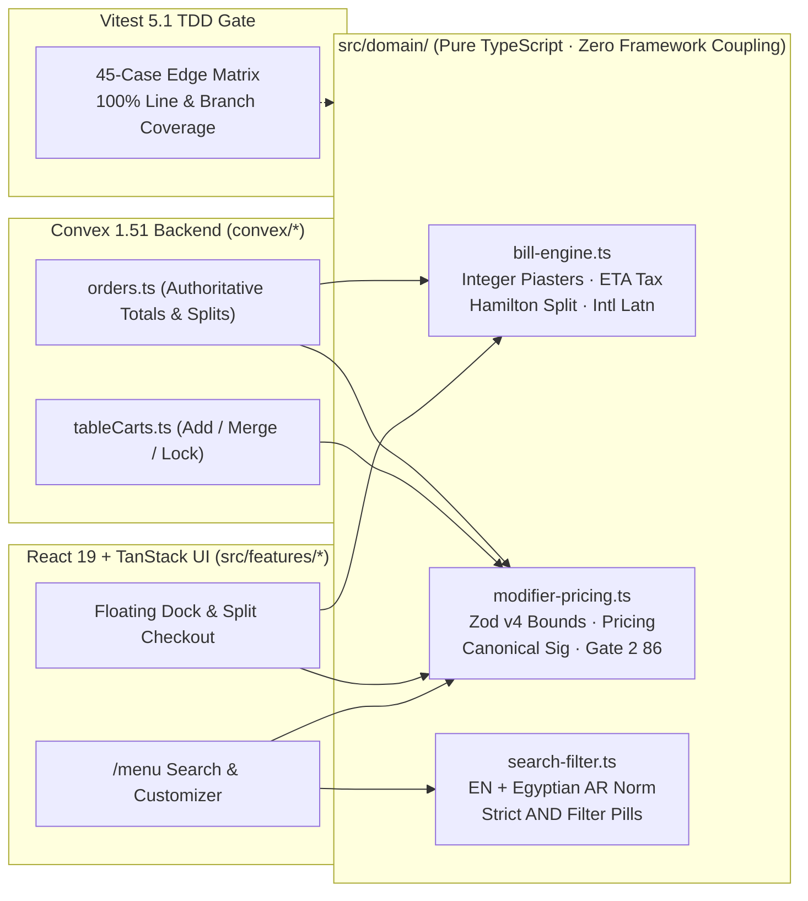

# Pure-TypeScript Domain Engines & TDD Verification Spec

> **Project:** `250° Kitchen` — Real-Time Hospitality Storefront, Shared Table Cart & Kitchen Pass (`/kds`)  
> **Date:** November 19, 2026 · **Target Submission:** December 12, 2026  
> **Stack Alignment:** TypeScript `6.x` / `7.0.2` (`strict: true`, `noUncheckedIndexedAccess: true`), `zod@^4.6.7`, `vitest@5.1.1`, `oxlint@1.94.0` + `oxlint-tsgolint@7.0.2007`  
> **Architectural Guarantee:** **Zero React imports · Zero Convex imports · Zero DOM globals · Zero floating-point currency math · 100% unit-test coverage on `src/domain/**`**

---

## 1. Architecture Overview & Boundary Contract

The `src/domain/` layer is the **single pure-TypeScript source of truth** shared identically by:
1. **React UI Features (`src/features/{menu,cart,table}`):** Instant optimistic subtotal previews, Zod v4 customizer validation, Arabic/English search & pill filtering, and checkout split previews with `< 1ms` local computation.
2. **Convex Server Mutations (`convex/{tableCarts,orders}.ts`):** Authoritative server-side price recalculation, Gate 2 `86 / Sold Out` cart lock verification, and piaster-exact split-bill ledger generation.
3. **Vitest Unit Test Runner (`src/domain/__tests__/`):** Fast, deterministic, zero-network verification executing all 45 edge cases in `< 150ms`.



### Module Layout & Dependency Rules

```text
src/domain/
├── index.ts                      # Public barrel export (functions, schemas, types)
├── bill-engine.ts                # Zero external dependencies (ES2024 + BigInt + Intl)
├── modifier-pricing.ts           # Only external dependency: zod@^4.6.7
├── search-filter.ts              # Zero external dependencies
└── __tests__/
    ├── bill-engine.test.ts       # TC-01 .. TC-18 (18 cases)
    ├── modifier-pricing.test.ts  # TC-19 .. TC-32 (14 cases)
    └── search-filter.test.ts     # TC-33 .. TC-45 (13 cases)
```

**Hard Engineering Rules Enforced Across `src/domain/`:**
- **Zero `any`, zero `!` non-null assertions, zero type casts (`as`):** Every array index and map lookup is explicitly narrowed to pass `noUncheckedIndexedAccess: true` and `oxlint` (`no-explicit-any`).
- **Integer Piasters Only (`1 EGP = 100 piasters`):** All monetary inputs, intermediates, and outputs are safe integers (`Number.isSafeInteger`). Percentage math and Hamilton rational remainders execute in **`BigInt`** so IEEE-754 floating-point drift is mathematically impossible.
- **Total Determinism:** Zero calls to `Date.now()`, `Math.random()`, or locale-sensitive `String.prototype.localeCompare()`. All tie-breaking and canonical sorting use explicit UTF-16 code-unit comparison (`a < b ? -1 : a > b ? 1 : 0`).
- **Immutability:** Every exported function treats all input arrays/objects as `readonly` and never mutates caller data.

---

## 2. Module 1 — `src/domain/bill-engine.ts`

### Domain Rules & Mathematical Invariants

1. **Egyptian Hospitality Tax Rule (ETA Law No. 67 of 2016):**
   - **Dine-In (`orderType: "dine_in"`):** `serviceChargeBps = 1_200` (`12%`) applied to `subtotalPiaster`; `vatBps = 1_400` (`14%`) applied sequentially to `subtotalPiaster + serviceChargePiaster` (effective multiplier `1.12 × 1.14 = 1.2768`, i.e., `+27.68%`).
   - **Takeaway (`orderType: "takeaway"`):** `serviceChargeBps = 0` (`0%`); `vatBps = 1_400` (`14%`) applied to `subtotalPiaster`.
   - **Rounding:** Exact `BigInt` half-up rounding (`(amount * bps + 5_000n) / 10_000n`).
2. **Conservation Invariants (Guaranteed Across All 3 Split Modes):**
   - $\sum_i \text{share}_i.\text{subtotalPiaster} = \text{masterBill.subtotalPiaster}$
   - $\sum_i \text{share}_i.\text{serviceChargePiaster} = \text{masterBill.serviceChargePiaster}$
   - $\sum_i \text{share}_i.\text{vatPiaster} = \text{masterBill.vatPiaster}$
   - $\forall i,\ \text{share}_i.\text{totalPiaster} = \text{share}_i.\text{subtotalPiaster} + \text{share}_i.\text{serviceChargePiaster} + \text{share}_i.\text{vatPiaster}$
   - $\sum_i \text{share}_i.\text{totalPiaster} = \text{masterBill.grandTotalPiaster}$
3. **`own_items` Largest Remainder (Hamilton Method) Tie-Breaking:**
   - Exact rational quotient & remainder computed in `BigInt`:
     - `quotient = (BigInt(total) * BigInt(weight)) / totalWeight`
     - `remainder = (BigInt(total) * BigInt(weight)) % totalWeight`
   - Remaining piasters (`leftover = total - sum(quotients)`) are distributed `+1` each in strict total order:
     1. **`remainder` descending** (exact rational comparison — no epsilon ambiguity)
     2. **`weight` descending** (when two diners have identical rational remainders on different subtotals, the larger spender absorbs the `+1` piaster to minimize relative rounding distortion)
     3. **`id` ascending** (UTF-16 code-unit order — 100% deterministic and invariant to input array permutation)
   - Zero-weight diners (e.g., complimentary `0 EGP` item) have `remainder = 0n` and **never** receive a phantom `+1` piaster.
4. **`equal_split` Cyclic-Cursor Reconciliation + `K of N` Multi-Share Payment:**
   - Total shares satisfy `share[i].totalPiaster = Math.floor(grandTotal / N) + (i < grandTotal % N ? 1 : 0)`, guaranteeing `max(share) - min(share) <= 1`.
   - A cyclic cursor distributes `subtotal % N`, `serviceCharge % N`, and `vat % N` across indices `0 .. N-1` continuously, guaranteeing every share's itemized `subtotal + service + vat` equals `base + (i < grandTotal % N ? 1 : 0)` with zero row or column drift.
   - `computeMultiSharePayment` slices the next `K` consecutive unpaid share slots `[paidShareCount .. paidShareCount + K - 1]`, guaranteeing sequential partial payments always sum to `masterBill.grandTotalPiaster`.
5. **Cross-Platform Currency Formatting (`formatPiaster`):**
   - Uses `Intl.NumberFormat("en-EG", { numberingSystem: "latn", useGrouping: true, maximumFractionDigits: 0 })` on the whole `BigInt` pounds + `.` + zero-padded 2-digit piasters, then appends `" EGP"` (`en`) or `" ج.م"` (`ar-EG`).
   - Avoids ICU `ar-EG` Arabic-decimal (`٫`) and hidden RTL mark (`\u200f`) variance across Node/Chromium/Safari while guaranteeing Latin digits (`0-9`) in both locales.

### Complete Production Implementation (`src/domain/bill-engine.ts`)

```ts
// src/domain/bill-engine.ts
// Pure TypeScript · Zero React / Zero Convex / Zero Floating-Point Currency Math

/** Integer monetary amount in Egyptian piasters (1 EGP = 100 piasters). */
export type Piaster = number;

/** Non-negative integer basis points (10_000 bps = 100.00%, 1_200 bps = 12.00%). */
export type BasisPoints = number;

export type OrderType = "dine_in" | "takeaway";

export type SplitMode = "full_table" | "own_items" | "equal_split";

export type CurrencyLocale = "en" | "ar-EG";

export interface BillTaxConfig {
  readonly orderType: OrderType;
  readonly serviceChargeBps: BasisPoints;
  readonly vatBps: BasisPoints;
  /**
   * Under Egypt ETA Law No. 67 of 2016, dine-in VAT (14%) applies sequentially
   * to (subtotal + serviceCharge). Defaults to true.
   */
  readonly vatAppliesToServiceCharge?: boolean;
}

export interface BillableLine {
  readonly lineId: string;
  readonly ownerId: string;
  readonly ownerName: string;
  readonly lineTotalPiaster: Piaster;
}

export interface MasterBill {
  readonly orderType: OrderType;
  readonly serviceChargeBps: BasisPoints;
  readonly vatBps: BasisPoints;
  readonly vatAppliesToServiceCharge: boolean;
  readonly subtotalPiaster: Piaster;
  readonly serviceChargePiaster: Piaster;
  readonly vatPiaster: Piaster;
  readonly grandTotalPiaster: Piaster;
}

export interface FullTableSplitRequest {
  readonly mode: "full_table";
  readonly payerId: string;
  readonly payerName: string;
}

export interface OwnItemsSplitRequest {
  readonly mode: "own_items";
}

export interface EqualSplitRequest {
  readonly mode: "equal_split";
  readonly splitCount: number;
}

export type SplitRequest =
  | FullTableSplitRequest
  | OwnItemsSplitRequest
  | EqualSplitRequest;

export interface DinerShare {
  readonly shareId: string;
  readonly shareIndex: number;
  readonly ownerId: string | null;
  readonly label: string;
  readonly itemLineIds: ReadonlyArray<string>;
  readonly subtotalPiaster: Piaster;
  readonly serviceChargePiaster: Piaster;
  readonly vatPiaster: Piaster;
  readonly totalPiaster: Piaster;
}

export interface SplitAllocationResult {
  readonly mode: SplitMode;
  readonly masterBill: MasterBill;
  readonly shares: ReadonlyArray<DinerShare>;
}

export interface WeightedEntry {
  readonly id: string;
  readonly weight: number;
}

export interface MultiSharePaymentResult {
  readonly totalShares: number;
  readonly paidBeforeCount: number;
  readonly sharesToPay: number;
  readonly coveredShareIndices: ReadonlyArray<number>;
  readonly subtotalPiaster: Piaster;
  readonly serviceChargePiaster: Piaster;
  readonly vatPiaster: Piaster;
  readonly amountDuePiaster: Piaster;
  readonly remainingShareCount: number;
  readonly remainingBalancePiaster: Piaster;
}

export interface FormatPiasterOptions {
  /** Prefix positive non-zero amounts with "+" (useful for modifier deltas). */
  readonly showSign?: boolean;
}

// ---------------------------------------------------------------------------
// Constants
// ---------------------------------------------------------------------------

const BPS_DENOMINATOR = 10_000n;
const BPS_HALF = 5_000n;
const MAX_SAFE_BIGINT = BigInt(Number.MAX_SAFE_INTEGER);

export const MAX_EQUAL_SPLIT_SHARES = 100;

export const EGYPT_DINE_IN_TAX_CONFIG: Readonly<BillTaxConfig> = Object.freeze({
  orderType: "dine_in",
  serviceChargeBps: 1_200, // 12.00%
  vatBps: 1_400,           // 14.00%
  vatAppliesToServiceCharge: true,
});

export const EGYPT_TAKEAWAY_TAX_CONFIG: Readonly<BillTaxConfig> = Object.freeze({
  orderType: "takeaway",
  serviceChargeBps: 0,     // 0.00%
  vatBps: 1_400,           // 14.00%
  vatAppliesToServiceCharge: true,
});

const EGP_WHOLE_FORMATTER = new Intl.NumberFormat("en-EG", {
  style: "decimal",
  numberingSystem: "latn",
  useGrouping: true,
  maximumFractionDigits: 0,
});

// ---------------------------------------------------------------------------
// Internal Guards & Deterministic Helpers
// ---------------------------------------------------------------------------

export function compareCodeUnits(a: string, b: string): -1 | 0 | 1 {
  if (a < b) return -1;
  if (a > b) return 1;
  return 0;
}

function assertSafeInt(value: number, fieldName: string): void {
  if (!Number.isSafeInteger(value)) {
    throw new RangeError(`${fieldName} must be a safe integer, received: ${String(value)}`);
  }
}

function assertNonNegativeInt(value: number, fieldName: string): void {
  assertSafeInt(value, fieldName);
  if (value < 0) {
    throw new RangeError(`${fieldName} must be >= 0, received: ${String(value)}`);
  }
}

function toSafeNumber(value: bigint, context: string): number {
  if (value < 0n || value > MAX_SAFE_BIGINT) {
    throw new RangeError(`${context} out of safe non-negative integer bounds`);
  }
  return Number(value);
}

// ---------------------------------------------------------------------------
// 1. Exact Basis-Points & Master Bill Engine
// ---------------------------------------------------------------------------

/**
 * Computes `round_half_up(amountPiaster * bps / 10_000)` using exact BigInt arithmetic.
 */
export function applyBpsHalfUp(amountPiaster: Piaster, bps: BasisPoints): Piaster {
  assertNonNegativeInt(amountPiaster, "amountPiaster");
  assertNonNegativeInt(bps, "bps");
  if (amountPiaster === 0 || bps === 0) return 0;

  const rounded = (BigInt(amountPiaster) * BigInt(bps) + BPS_HALF) / BPS_DENOMINATOR;
  return toSafeNumber(rounded, "applyBpsHalfUp");
}

/**
 * Returns default Egypt tax configuration for a given order type.
 */
export function getDefaultTaxConfig(orderType: OrderType): BillTaxConfig {
  return orderType === "dine_in"
    ? EGYPT_DINE_IN_TAX_CONFIG
    : EGYPT_TAKEAWAY_TAX_CONFIG;
}

/**
 * Computes the authoritative Master Bill in integer piasters.
 */
export function computeMasterBill(
  lines: ReadonlyArray<Pick<BillableLine, "lineTotalPiaster">>,
  config: BillTaxConfig,
): MasterBill {
  assertNonNegativeInt(config.serviceChargeBps, "config.serviceChargeBps");
  assertNonNegativeInt(config.vatBps, "config.vatBps");

  let subtotalBig = 0n;
  for (let i = 0; i < lines.length; i += 1) {
    const line = lines[i];
    if (line === undefined) continue;
    assertNonNegativeInt(line.lineTotalPiaster, `lines[${i}].lineTotalPiaster`);
    subtotalBig += BigInt(line.lineTotalPiaster);
  }

  const subtotalPiaster = toSafeNumber(subtotalBig, "subtotalPiaster");
  const effectiveServiceBps =
    config.orderType === "takeaway" ? 0 : config.serviceChargeBps;
  const vatAppliesToServiceCharge = config.vatAppliesToServiceCharge ?? true;

  const serviceChargePiaster = applyBpsHalfUp(subtotalPiaster, effectiveServiceBps);
  const vatTaxableBase = vatAppliesToServiceCharge
    ? toSafeNumber(BigInt(subtotalPiaster) + BigInt(serviceChargePiaster), "vatTaxableBase")
    : subtotalPiaster;
  const vatPiaster = applyBpsHalfUp(vatTaxableBase, config.vatBps);
  const grandTotalPiaster = toSafeNumber(
    BigInt(subtotalPiaster) + BigInt(serviceChargePiaster) + BigInt(vatPiaster),
    "grandTotalPiaster",
  );

  return {
    orderType: config.orderType,
    serviceChargeBps: effectiveServiceBps,
    vatBps: config.vatBps,
    vatAppliesToServiceCharge,
    subtotalPiaster,
    serviceChargePiaster,
    vatPiaster,
    grandTotalPiaster,
  };
}

// ---------------------------------------------------------------------------
// 2. Pure Largest Remainder (Hamilton Method) Allocator
// ---------------------------------------------------------------------------

/**
 * Allocates `totalPiaster` proportionally across weighted entries using the
 * Largest Remainder (Hamilton) Method in exact BigInt arithmetic.
 *
 * Tie-breaking strict total order:
 *   1. Exact rational remainder descending
 *   2. Entry weight descending (minimizes relative rounding error)
 *   3. Entry id ascending (UTF-16 code-unit order; input-order independent)
 *
 * Guarantee: sum(returned values) === totalPiaster ALWAYS.
 */
export function allocateByLargestRemainder(
  totalPiaster: Piaster,
  entries: ReadonlyArray<WeightedEntry>,
): ReadonlyMap<string, Piaster> {
  assertNonNegativeInt(totalPiaster, "totalPiaster");

  const result = new Map<string, Piaster>();
  if (entries.length === 0) {
    if (totalPiaster > 0) {
      throw new RangeError("Cannot allocate a positive amount across zero entries");
    }
    return result;
  }

  let totalWeight = 0n;
  const seenIds = new Set<string>();
  for (let i = 0; i < entries.length; i += 1) {
    const entry = entries[i];
    if (entry === undefined) continue;
    if (entry.id.length === 0) {
      throw new RangeError(`entries[${i}].id must be non-empty`);
    }
    if (seenIds.has(entry.id)) {
      throw new RangeError(`Duplicate weighted entry id: "${entry.id}"`);
    }
    seenIds.add(entry.id);
    assertNonNegativeInt(entry.weight, `entries[${i}].weight`);
    totalWeight += BigInt(entry.weight);
  }

  if (totalPiaster === 0) {
    for (const entry of entries) {
      result.set(entry.id, 0);
    }
    return result;
  }

  if (totalWeight === 0n) {
    throw new RangeError("Cannot allocate a positive amount when total weight is 0");
  }

  const totalBig = BigInt(totalPiaster);
  let allocatedFloorSum = 0n;

  const ranked: Array<{
    readonly id: string;
    readonly weight: bigint;
    quotient: bigint;
    readonly remainder: bigint;
  }> = [];

  for (const entry of entries) {
    const weightBig = BigInt(entry.weight);
    const numerator = totalBig * weightBig;
    const quotient = numerator / totalWeight;
    const remainder = numerator % totalWeight;
    allocatedFloorSum += quotient;
    ranked.push({
      id: entry.id,
      weight: weightBig,
      quotient,
      remainder,
    });
  }

  const leftover = Number(totalBig - allocatedFloorSum);

  ranked.sort((a, b) => {
    if (a.remainder !== b.remainder) {
      return b.remainder > a.remainder ? 1 : -1;
    }
    if (a.weight !== b.weight) {
      return b.weight > a.weight ? 1 : -1;
    }
    return compareCodeUnits(a.id, b.id);
  });

  let distributed = 0;
  for (const row of ranked) {
    if (distributed >= leftover) break;
    // Defensive guard: mathematically impossible for zero-weight entries to be needed,
    // because leftover < count(positive-weight entries).
    if (row.weight === 0n) continue;
    row.quotient += 1n;
    distributed += 1;
  }

  for (const row of ranked) {
    result.set(row.id, toSafeNumber(row.quotient, `hamilton(${row.id})`));
  }

  return result;
}

// ---------------------------------------------------------------------------
// 3. Equal Split & K-of-N Multi-Share Payment
// ---------------------------------------------------------------------------

/**
 * Low-level pure equal split of an integer amount into `N` shares.
 * First `total % N` shares receive `base + 1`; remaining shares receive `base`.
 */
export function computeEqualSplitAmounts(
  totalPiaster: Piaster,
  splitCount: number,
): ReadonlyArray<Piaster> {
  assertNonNegativeInt(totalPiaster, "totalPiaster");
  assertSafeInt(splitCount, "splitCount");
  if (splitCount < 1 || splitCount > MAX_EQUAL_SPLIT_SHARES) {
    throw new RangeError(
      `splitCount must be an integer between 1 and ${MAX_EQUAL_SPLIT_SHARES}, received: ${splitCount}`,
    );
  }

  const base = Math.floor(totalPiaster / splitCount);
  const remainder = totalPiaster % splitCount;

  const amounts: Piaster[] = [];
  for (let i = 0; i < splitCount; i += 1) {
    amounts.push(base + (i < remainder ? 1 : 0));
  }
  return amounts;
}

/**
 * Computes a `K of N` multi-share payment from an equal-split share ledger.
 * Claims the next `sharesToPay` consecutive unpaid share slots starting at `paidBeforeCount`.
 */
export function computeMultiSharePayment(
  equalShares: ReadonlyArray<DinerShare>,
  sharesToPay: number,
  paidBeforeCount = 0,
): MultiSharePaymentResult {
  const totalShares = equalShares.length;
  if (totalShares === 0) {
    throw new RangeError("equalShares must contain at least 1 share");
  }
  assertNonNegativeInt(paidBeforeCount, "paidBeforeCount");
  assertSafeInt(sharesToPay, "sharesToPay");

  const remainingBefore = totalShares - paidBeforeCount;
  if (paidBeforeCount >= totalShares) {
    throw new RangeError("All shares have already been paid");
  }
  if (sharesToPay < 1 || sharesToPay > remainingBefore) {
    throw new RangeError(
      `sharesToPay (${sharesToPay}) must be between 1 and remaining unpaid shares (${remainingBefore})`,
    );
  }

  let subtotalBig = 0n;
  let serviceBig = 0n;
  let vatBig = 0n;
  let amountDueBig = 0n;
  const coveredShareIndices: number[] = [];

  for (let i = paidBeforeCount; i < paidBeforeCount + sharesToPay; i += 1) {
    const share = equalShares[i];
    if (share === undefined) {
      throw new RangeError(`Missing share at index ${i}`);
    }
    coveredShareIndices.push(share.shareIndex);
    subtotalBig += BigInt(share.subtotalPiaster);
    serviceBig += BigInt(share.serviceChargePiaster);
    vatBig += BigInt(share.vatPiaster);
    amountDueBig += BigInt(share.totalPiaster);
  }

  let remainingBalanceBig = 0n;
  for (let i = paidBeforeCount + sharesToPay; i < totalShares; i += 1) {
    const share = equalShares[i];
    if (share === undefined) continue;
    remainingBalanceBig += BigInt(share.totalPiaster);
  }

  return {
    totalShares,
    paidBeforeCount,
    sharesToPay,
    coveredShareIndices,
    subtotalPiaster: toSafeNumber(subtotalBig, "multiShare.subtotal"),
    serviceChargePiaster: toSafeNumber(serviceBig, "multiShare.service"),
    vatPiaster: toSafeNumber(vatBig, "multiShare.vat"),
    amountDuePiaster: toSafeNumber(amountDueBig, "multiShare.amountDue"),
    remainingShareCount: totalShares - (paidBeforeCount + sharesToPay),
    remainingBalancePiaster: toSafeNumber(remainingBalanceBig, "multiShare.remainingBalance"),
  };
}

// ---------------------------------------------------------------------------
// 4. Unified Split Allocation Entry Point
// ---------------------------------------------------------------------------

/**
 * Computes the master bill and allocates diner shares across all 3 checkout modes:
 * - `full_table`: 1 share = 100% of grandTotalPiaster
 * - `own_items`: strict 1 owner per item; Hamilton allocation for service + VAT
 * - `equal_split`: N shares using cyclic-cursor decomposition so every share's
 *   (subtotal + service + vat) === floor(grandTotal / N) + (i < grandTotal % N ? 1 : 0)
 */
export function allocateDinerShares(params: {
  readonly lines: ReadonlyArray<BillableLine>;
  readonly config: BillTaxConfig;
  readonly split: SplitRequest;
}): SplitAllocationResult {
  const { lines, config, split } = params;

  for (let i = 0; i < lines.length; i += 1) {
    const line = lines[i];
    if (line === undefined) continue;
    if (line.lineId.trim().length === 0) {
      throw new RangeError(`lines[${i}].lineId must be non-empty`);
    }
    if (line.ownerId.trim().length === 0) {
      throw new RangeError(`lines[${i}].ownerId must be non-empty`);
    }
  }

  const masterBill = computeMasterBill(lines, config);

  if (split.mode === "full_table") {
    if (split.payerId.trim().length === 0) {
      throw new RangeError("full_table payerId must be non-empty");
    }
    const share: DinerShare = {
      shareId: "full_table",
      shareIndex: 0,
      ownerId: split.payerId,
      label: split.payerName.trim() || split.payerId,
      itemLineIds: lines.map((line) => line.lineId),
      subtotalPiaster: masterBill.subtotalPiaster,
      serviceChargePiaster: masterBill.serviceChargePiaster,
      vatPiaster: masterBill.vatPiaster,
      totalPiaster: masterBill.grandTotalPiaster,
    };
    return { mode: "full_table", masterBill, shares: [share] };
  }

  if (split.mode === "equal_split") {
    const n = split.splitCount;
    assertSafeInt(n, "split.splitCount");
    if (n < 1 || n > MAX_EQUAL_SPLIT_SHARES) {
      throw new RangeError(
        `split.splitCount must be between 1 and ${MAX_EQUAL_SPLIT_SHARES}, received: ${n}`,
      );
    }

    const subBase = Math.floor(masterBill.subtotalPiaster / n);
    const subRem = masterBill.subtotalPiaster % n;
    const svcBase = Math.floor(masterBill.serviceChargePiaster / n);
    const svcRem = masterBill.serviceChargePiaster % n;
    const vatBase = Math.floor(masterBill.vatPiaster / n);
    const vatRem = masterBill.vatPiaster % n;

    const subParts = new Array<number>(n).fill(subBase);
    const svcParts = new Array<number>(n).fill(svcBase);
    const vatParts = new Array<number>(n).fill(vatBase);

    // Cyclic cursor guarantees exact vertical AND horizontal reconciliation
    // while preserving total[i] === floor(grandTotal / N) + (i < grandTotal % N ? 1 : 0).
    let cursor = 0;
    for (let k = 0; k < subRem; k += 1) {
      subParts[cursor] = (subParts[cursor] ?? 0) + 1;
      cursor = (cursor + 1) % n;
    }
    for (let k = 0; k < svcRem; k += 1) {
      svcParts[cursor] = (svcParts[cursor] ?? 0) + 1;
      cursor = (cursor + 1) % n;
    }
    for (let k = 0; k < vatRem; k += 1) {
      vatParts[cursor] = (vatParts[cursor] ?? 0) + 1;
      cursor = (cursor + 1) % n;
    }

    const allLineIds = lines.map((line) => line.lineId);
    const shares: DinerShare[] = [];
    for (let i = 0; i < n; i += 1) {
      const subtotalPiaster = subParts[i] ?? 0;
      const serviceChargePiaster = svcParts[i] ?? 0;
      const vatPiaster = vatParts[i] ?? 0;
      shares.push({
        shareId: `equal:${i + 1}_of_${n}`,
        shareIndex: i,
        ownerId: null,
        label: `Share ${i + 1} of ${n}`,
        itemLineIds: allLineIds,
        subtotalPiaster,
        serviceChargePiaster,
        vatPiaster,
        totalPiaster: subtotalPiaster + serviceChargePiaster + vatPiaster,
      });
    }

    return { mode: "equal_split", masterBill, shares };
  }

  // Mode: "own_items" — aggregate strict 1-owner lines, then allocate service & VAT via Hamilton
  const grouped = new Map<
    string,
    { ownerName: string; subtotalBig: bigint; itemLineIds: string[] }
  >();

  for (const line of lines) {
    const existing = grouped.get(line.ownerId);
    if (existing === undefined) {
      grouped.set(line.ownerId, {
        ownerName: line.ownerName.trim() || line.ownerId,
        subtotalBig: BigInt(line.lineTotalPiaster),
        itemLineIds: [line.lineId],
      });
    } else {
      existing.subtotalBig += BigInt(line.lineTotalPiaster);
      existing.itemLineIds.push(line.lineId);
    }
  }

  const sortedOwnerIds = Array.from(grouped.keys()).sort(compareCodeUnits);
  const weights: WeightedEntry[] = sortedOwnerIds.map((ownerId) => {
    const bucket = grouped.get(ownerId);
    return {
      id: ownerId,
      weight: toSafeNumber(bucket?.subtotalBig ?? 0n, `ownerSubtotal(${ownerId})`),
    };
  });

  const serviceAlloc = allocateByLargestRemainder(masterBill.serviceChargePiaster, weights);
  const vatAlloc = allocateByLargestRemainder(masterBill.vatPiaster, weights);

  const shares: DinerShare[] = sortedOwnerIds.map((ownerId, index) => {
    const bucket = grouped.get(ownerId);
    const subtotalPiaster = toSafeNumber(bucket?.subtotalBig ?? 0n, `shareSub(${ownerId})`);
    const serviceChargePiaster = serviceAlloc.get(ownerId) ?? 0;
    const vatPiaster = vatAlloc.get(ownerId) ?? 0;

    return {
      shareId: `owner:${ownerId}`,
      shareIndex: index,
      ownerId,
      label: bucket?.ownerName ?? ownerId,
      itemLineIds: bucket?.itemLineIds ?? [],
      subtotalPiaster,
      serviceChargePiaster,
      vatPiaster,
      totalPiaster: subtotalPiaster + serviceChargePiaster + vatPiaster,
    };
  });

  return { mode: "own_items", masterBill, shares };
}

// ---------------------------------------------------------------------------
// 5. EGP Currency Formatter (Intl.NumberFormat + numberingSystem: "latn")
// ---------------------------------------------------------------------------

/**
 * Formats integer piasters using Western Latin digits (`numberingSystem: "latn"`):
 * - `"en"`    -> `"245.00 EGP"` (thousands: `"1,276.80 EGP"`)
 * - `"ar-EG"` -> `"245.00 ج.م"` (thousands: `"1,276.80 ج.م"`)
 *
 * Zero floating-point division; free of hidden RTL marks (`\u200f`) or NBSP (`\u00a0`).
 * UI Note: In RTL mode, render inside `<span dir="ltr" className="tabular-nums">`
 * so negative signs stay attached to the numeric value.
 */
export function formatPiaster(
  amountPiaster: Piaster,
  locale: CurrencyLocale = "en",
  options: FormatPiasterOptions = {},
): string {
  assertSafeInt(amountPiaster, "amountPiaster");

  const sign =
    amountPiaster < 0 ? "-" : options.showSign === true && amountPiaster > 0 ? "+" : "";
  const absBig = amountPiaster < 0 ? -BigInt(amountPiaster) : BigInt(amountPiaster);
  const wholePounds = absBig / 100n;
  const fractionPiasters = Number(absBig % 100n);

  const formattedWhole = EGP_WHOLE_FORMATTER.format(wholePounds);
  const formattedFraction = String(fractionPiasters).padStart(2, "0");
  const currencySuffix = locale === "ar-EG" ? "ج.م" : "EGP";

  return `${sign}${formattedWhole}.${formattedFraction} ${currencySuffix}`;
}
```

---

## 3. Module 2 — `src/domain/modifier-pricing.ts`

### Domain Rules & Zod v4 Design

1. **Flat `ModifierGroup` Validation (`zod@^4.6.7`):**
   - Uses native Zod v4 primitives: `z.strictObject()`, `z.int()`, unified `{ error: ... }`, and `.check((ctx) => ctx.issues.push({ code: "custom", ... }))`.
   - Enforces `0 <= minSelect <= maxSelect <= options.length`, `options.length >= 1`, and unique `option.id` within every group (plus unique `group.id` per menu item).
2. **Deterministic Pricing & Calorie Computation (`validateAndPriceLine`):**
   - Validates selections against the dish's live `ModifierGroup[]` schema without throwing on expected user form errors (returns structured `{ ok: false; errors }` ready for `@tanstack/react-form` and Convex).
   - Rejects unknown group IDs, unknown option IDs, duplicate option IDs, `86`'d (`isAvailable: false`) modifier options, out-of-bounds selection counts, invalid quantity (`1..99`), and negative `unitTotalPiaster < 0`.
   - Computes `unitTotalPiaster`, `lineTotalPiaster`, `unitTotalKcal` (clamped at `>= 0`), and `lineTotalKcal`.
3. **Bijective `canonicalSignature` & Shared Cart Merge Key:**
   - Format: `v1:${JSON.stringify([menuItemId, sortedGroupOptionTuples, normalizedNote])}`.
   - Order-independent across both groups and option IDs within a group; strips empty groups; normalizes kitchen notes (`NFC` -> trim -> collapse whitespace -> lowercase).
   - Bijective JSON tuple serialization guarantees **zero delimiter-injection collisions**.
   - `buildCartMergeKey(ownerId, canonicalSignature)` scopes cart-line merging strictly per diner owner so Diner A and Diner B's identical orders never overwrite each other's ownership tags.
4. **Gate 2 `86 / Sold Out` Pre-Lock Check (`assertLinesAvailableAtLock`):**
   - Inspects **every** cart line and every selected modifier option against the current catalog snapshot before locking a Shared Table Cart for checkout.
   - Aggregates **all** blocked lines in one pass (never short-circuits on the first error), reporting exact `lineId`, `ownerId`, `ownerName`, `reason`, and any unavailable modifier options so the UI can highlight every affected item at once.

### Complete Production Implementation (`src/domain/modifier-pricing.ts`)

```ts
// src/domain/modifier-pricing.ts
// Pure TypeScript + Zod v4 · Zero React / Zero Convex Imports

import { z } from "zod";
import { compareCodeUnits, type Piaster } from "./bill-engine";

export const MAX_LINE_QUANTITY = 99;
export const MAX_KITCHEN_NOTE_LENGTH = 200;

// ---------------------------------------------------------------------------
// 1. Zod v4 Flat Modifier Group & Menu Item Pricing Schemas
// ---------------------------------------------------------------------------

export const ModifierOptionSchema = z.strictObject({
  id: z.string().trim().min(1, { error: "Modifier option id is required" }),
  labelEn: z.string().trim().min(1, { error: "English option label is required" }),
  labelAr: z.string().trim().min(1, { error: "Arabic option label is required" }),
  priceDeltaPiaster: z.int({ error: "priceDeltaPiaster must be a safe integer" }),
  kcalDelta: z.int({ error: "kcalDelta must be a safe integer" }).default(0),
  isAvailable: z.boolean().default(true),
});

export type ModifierOption = z.infer<typeof ModifierOptionSchema>;

export const ModifierGroupSchema = z
  .strictObject({
    id: z.string().trim().min(1, { error: "Modifier group id is required" }),
    nameEn: z.string().trim().min(1, { error: "English group name is required" }),
    nameAr: z.string().trim().min(1, { error: "Arabic group name is required" }),
    minSelect: z.int({ error: "minSelect must be an integer" }).min(0, {
      error: "minSelect must be >= 0",
    }),
    maxSelect: z.int({ error: "maxSelect must be an integer" }).min(0, {
      error: "maxSelect must be >= 0",
    }),
    options: z.array(ModifierOptionSchema).min(1, {
      error: "Modifier group must contain at least 1 option",
    }),
  })
  .check((ctx) => {
    const { id, minSelect, maxSelect, options } = ctx.value;

    if (minSelect > maxSelect) {
      ctx.issues.push({
        code: "custom",
        input: minSelect,
        path: ["minSelect"],
        message: `minSelect (${minSelect}) cannot exceed maxSelect (${maxSelect}) in group "${id}"`,
      });
    }

    if (maxSelect > options.length) {
      ctx.issues.push({
        code: "custom",
        input: maxSelect,
        path: ["maxSelect"],
        message: `maxSelect (${maxSelect}) cannot exceed options.length (${options.length}) in group "${id}"`,
      });
    }

    const seenOptionIds = new Set<string>();
    for (let i = 0; i < options.length; i += 1) {
      const option = options[i];
      if (option === undefined) continue;
      if (seenOptionIds.has(option.id)) {
        ctx.issues.push({
          code: "custom",
          input: option.id,
          path: ["options", i, "id"],
          message: `Duplicate modifier option id "${option.id}" in group "${id}"`,
        });
      }
      seenOptionIds.add(option.id);
    }
  });

export type ModifierGroup = z.infer<typeof ModifierGroupSchema>;

export const MenuItemPricingSpecSchema = z
  .strictObject({
    id: z.string().trim().min(1, { error: "Menu item id is required" }),
    nameEn: z.string().trim().min(1, { error: "English dish name is required" }),
    nameAr: z.string().trim().min(1, { error: "Arabic dish name is required" }),
    basePricePiaster: z.int({ error: "basePricePiaster must be an integer" }).min(0, {
      error: "basePricePiaster must be >= 0",
    }),
    baseKcal: z.int({ error: "baseKcal must be an integer" }).min(0, {
      error: "baseKcal must be >= 0",
    }),
    isAvailable: z.boolean(),
    modifierGroups: z.array(ModifierGroupSchema),
  })
  .check((ctx) => {
    const seenGroupIds = new Set<string>();
    for (let i = 0; i < ctx.value.modifierGroups.length; i += 1) {
      const group = ctx.value.modifierGroups[i];
      if (group === undefined) continue;
      if (seenGroupIds.has(group.id)) {
        ctx.issues.push({
          code: "custom",
          input: group.id,
          path: ["modifierGroups", i, "id"],
          message: `Duplicate modifier group id "${group.id}" on dish "${ctx.value.id}"`,
        });
      }
      seenGroupIds.add(group.id);
    }
  });

export type MenuItemPricingSpec = z.infer<typeof MenuItemPricingSpecSchema>;

export const GroupSelectionInputSchema = z.strictObject({
  groupId: z.string().trim().min(1, { error: "groupId is required" }),
  optionIds: z.array(z.string().trim().min(1, { error: "optionId must be non-empty" })),
});

export type GroupSelectionInput = z.infer<typeof GroupSelectionInputSchema>;

export const CartLineDraftSchema = z.strictObject({
  quantity: z
    .int({ error: "Quantity must be an integer" })
    .min(1, { error: "Quantity must be at least 1" })
    .max(MAX_LINE_QUANTITY, { error: `Quantity cannot exceed ${MAX_LINE_QUANTITY}` }),
  selections: z.array(GroupSelectionInputSchema).default([]),
  specialNote: z
    .string()
    .trim()
    .max(MAX_KITCHEN_NOTE_LENGTH, {
      error: `Special kitchen note cannot exceed ${MAX_KITCHEN_NOTE_LENGTH} characters`,
    })
    .optional(),
});

export type CartLineDraft = z.input<typeof CartLineDraftSchema>;

// ---------------------------------------------------------------------------
// 2. Output & Validation Error Types
// ---------------------------------------------------------------------------

export type ModifierValidationErrorCode =
  | "INVALID_SCHEMA"
  | "DISH_UNAVAILABLE"
  | "DUPLICATE_GROUP_INPUT"
  | "UNKNOWN_GROUP"
  | "UNKNOWN_OPTION"
  | "DUPLICATE_OPTION"
  | "OPTION_UNAVAILABLE"
  | "MIN_SELECT_NOT_MET"
  | "MAX_SELECT_EXCEEDED"
  | "NEGATIVE_UNIT_PRICE";

export interface ModifierValidationError {
  readonly code: ModifierValidationErrorCode;
  readonly groupId?: string;
  readonly optionId?: string;
  readonly field?: string;
  readonly message: string;
}

export interface ResolvedModifierSelection {
  readonly groupId: string;
  readonly groupNameEn: string;
  readonly groupNameAr: string;
  readonly optionId: string;
  readonly labelEn: string;
  readonly labelAr: string;
  readonly priceDeltaPiaster: Piaster;
  readonly kcalDelta: number;
}

export interface PricedCartLine {
  readonly menuItemId: string;
  readonly quantity: number;
  readonly basePricePiaster: Piaster;
  readonly modifiersUnitDeltaPiaster: Piaster;
  readonly unitTotalPiaster: Piaster;
  readonly lineTotalPiaster: Piaster;
  readonly unitTotalKcal: number;
  readonly lineTotalKcal: number;
  readonly resolvedModifiers: ReadonlyArray<ResolvedModifierSelection>;
  readonly specialNote: string;
  readonly canonicalSignature: string;
}

export type ModifierPricingResult =
  | { readonly ok: true; readonly value: PricedCartLine }
  | { readonly ok: false; readonly errors: ReadonlyArray<ModifierValidationError> };

// ---------------------------------------------------------------------------
// 3. Canonical Signature & Cart Merge Key Helpers
// ---------------------------------------------------------------------------

/**
 * Normalizes a special kitchen note for signature deduplication:
 * NFC normalize -> trim -> collapse internal whitespace -> lowercase.
 */
export function normalizeKitchenNote(note: string | undefined | null): string {
  if (note === undefined || note === null) return "";
  return note.normalize("NFC").trim().replace(/\s+/g, " ").toLowerCase();
}

/**
 * Builds a collision-free, order-independent canonical signature for a dish configuration.
 * Identical selections in different group/option orders and equivalent whitespace notes
 * always produce the exact same `v1:[...]` JSON tuple string.
 */
export function buildCanonicalSignature(params: {
  readonly menuItemId: string;
  readonly selections: ReadonlyArray<GroupSelectionInput>;
  readonly specialNote?: string | null;
}): string {
  const byGroup = new Map<string, Set<string>>();

  for (const selection of params.selections) {
    if (selection.optionIds.length === 0) continue;
    let optSet = byGroup.get(selection.groupId);
    if (optSet === undefined) {
      optSet = new Set<string>();
      byGroup.set(selection.groupId, optSet);
    }
    for (const optionId of selection.optionIds) {
      const trimmed = optionId.trim();
      if (trimmed.length > 0) {
        optSet.add(trimmed);
      }
    }
  }

  const canonicalGroups: Array<readonly [string, ReadonlyArray<string>]> = Array.from(
    byGroup.entries(),
  )
    .filter(([, optSet]) => optSet.size > 0)
    .sort(([groupA], [groupB]) => compareCodeUnits(groupA, groupB))
    .map(([groupId, optSet]) => [
      groupId,
      Array.from(optSet).sort(compareCodeUnits),
    ]);

  const normalizedNote = normalizeKitchenNote(params.specialNote);

  return `v1:${JSON.stringify([params.menuItemId.trim(), canonicalGroups, normalizedNote])}`;
}

/**
 * Scopes a dish's canonical signature to a single cart line owner so two diners
 * ordering the exact same customized burger maintain independent ownership rows.
 */
export function buildCartMergeKey(ownerId: string, canonicalSignature: string): string {
  const trimmedOwner = ownerId.trim();
  if (trimmedOwner.length === 0) {
    throw new RangeError("ownerId must be non-empty when building a cart merge key");
  }
  return JSON.stringify([trimmedOwner, canonicalSignature]);
}

// ---------------------------------------------------------------------------
// 4. Authoritative Selection Validation & Deterministic Line Pricing
// ---------------------------------------------------------------------------

/**
 * Validates customer modifier selections against a dish's flat `ModifierGroup[]`
 * bounds and computes deterministic integer-piaster totals, calories, and signature.
 */
export function validateAndPriceLine(
  dish: MenuItemPricingSpec,
  draftInput: CartLineDraft,
): ModifierPricingResult {
  const errors: ModifierValidationError[] = [];

  const parsedDish = MenuItemPricingSpecSchema.safeParse(dish);
  if (!parsedDish.success) {
    for (const issue of parsedDish.error.issues) {
      errors.push({
        code: "INVALID_SCHEMA",
        field: issue.path.join("."),
        message: issue.message,
      });
    }
    return { ok: false, errors };
  }

  const parsedDraft = CartLineDraftSchema.safeParse(draftInput);
  if (!parsedDraft.success) {
    for (const issue of parsedDraft.error.issues) {
      errors.push({
        code: "INVALID_SCHEMA",
        field: issue.path.join("."),
        message: issue.message,
      });
    }
    return { ok: false, errors };
  }

  const validDish = parsedDish.data;
  const validDraft = parsedDraft.data;

  if (!validDish.isAvailable) {
    errors.push({
      code: "DISH_UNAVAILABLE",
      message: `Dish "${validDish.nameEn}" is currently 86 / sold out`,
    });
  }

  // Index dish groups and options
  const groupById = new Map<string, ModifierGroup>();
  for (const group of validDish.modifierGroups) {
    groupById.set(group.id, group);
  }

  // Validate submitted selection entries (unknown groups, duplicate groups, options)
  const selectedByGroupId = new Map<string, ReadonlyArray<string>>();
  for (const selection of validDraft.selections) {
    if (selectedByGroupId.has(selection.groupId)) {
      errors.push({
        code: "DUPLICATE_GROUP_INPUT",
        groupId: selection.groupId,
        message: `Duplicate selection payload for group "${selection.groupId}"`,
      });
      continue;
    }

    const group = groupById.get(selection.groupId);
    if (group === undefined) {
      errors.push({
        code: "UNKNOWN_GROUP",
        groupId: selection.groupId,
        message: `Modifier group "${selection.groupId}" does not belong to dish "${validDish.id}"`,
      });
      continue;
    }

    const optionById = new Map<string, ModifierOption>();
    for (const option of group.options) {
      optionById.set(option.id, option);
    }

    const seenInGroup = new Set<string>();
    for (const optionId of selection.optionIds) {
      if (seenInGroup.has(optionId)) {
        errors.push({
          code: "DUPLICATE_OPTION",
          groupId: group.id,
          optionId,
          message: `Duplicate option "${optionId}" in group "${group.nameEn}"`,
        });
        continue;
      }
      seenInGroup.add(optionId);

      const option = optionById.get(optionId);
      if (option === undefined) {
        errors.push({
          code: "UNKNOWN_OPTION",
          groupId: group.id,
          optionId,
          message: `Option "${optionId}" does not exist in group "${group.nameEn}"`,
        });
        continue;
      }

      if (!option.isAvailable) {
        errors.push({
          code: "OPTION_UNAVAILABLE",
          groupId: group.id,
          optionId: option.id,
          message: `Modifier "${option.labelEn}" in "${group.nameEn}" is currently 86 / sold out`,
        });
      }
    }

    selectedByGroupId.set(group.id, selection.optionIds);
  }

  // Enforce minSelect / maxSelect bounds on EVERY group declared by the dish
  const resolvedModifiers: ResolvedModifierSelection[] = [];
  let modifiersUnitDeltaPiaster = 0;
  let modifiersUnitKcalDelta = 0;

  for (const group of validDish.modifierGroups) {
    const chosenIds = selectedByGroupId.get(group.id) ?? [];

    if (chosenIds.length < group.minSelect) {
      errors.push({
        code: "MIN_SELECT_NOT_MET",
        groupId: group.id,
        message: `"${group.nameEn}" requires at least ${group.minSelect} selection(s), got ${chosenIds.length}`,
      });
    }

    if (chosenIds.length > group.maxSelect) {
      errors.push({
        code: "MAX_SELECT_EXCEEDED",
        groupId: group.id,
        message: `"${group.nameEn}" allows at most ${group.maxSelect} selection(s), got ${chosenIds.length}`,
      });
    }

    const optionById = new Map<string, ModifierOption>();
    for (const option of group.options) {
      optionById.set(option.id, option);
    }

    // Resolve deterministically by option id order for clean receipts
    const sortedChosen = Array.from(new Set(chosenIds)).sort(compareCodeUnits);
    for (const optionId of sortedChosen) {
      const option = optionById.get(optionId);
      if (option === undefined) continue;

      modifiersUnitDeltaPiaster += option.priceDeltaPiaster;
      modifiersUnitKcalDelta += option.kcalDelta;
      resolvedModifiers.push({
        groupId: group.id,
        groupNameEn: group.nameEn,
        groupNameAr: group.nameAr,
        optionId: option.id,
        labelEn: option.labelEn,
        labelAr: option.labelAr,
        priceDeltaPiaster: option.priceDeltaPiaster,
        kcalDelta: option.kcalDelta,
      });
    }
  }

  const unitTotalPiaster = validDish.basePricePiaster + modifiersUnitDeltaPiaster;
  if (!Number.isSafeInteger(unitTotalPiaster) || unitTotalPiaster < 0) {
    errors.push({
      code: "NEGATIVE_UNIT_PRICE",
      message: `Computed unitTotalPiaster (${unitTotalPiaster}) cannot be negative`,
    });
  }

  if (errors.length > 0) {
    return { ok: false, errors };
  }

  const lineTotalPiaster = unitTotalPiaster * validDraft.quantity;
  if (!Number.isSafeInteger(lineTotalPiaster)) {
    return {
      ok: false,
      errors: [
        {
          code: "INVALID_SCHEMA",
          field: "quantity",
          message: "lineTotalPiaster overflowed safe integer bounds",
        },
      ],
    };
  }

  const unitTotalKcal = Math.max(0, validDish.baseKcal + modifiersUnitKcalDelta);
  const lineTotalKcal = unitTotalKcal * validDraft.quantity;
  const displayNote = validDraft.specialNote ?? "";
  const canonicalSignature = buildCanonicalSignature({
    menuItemId: validDish.id,
    selections: validDraft.selections,
    specialNote: displayNote,
  });

  return {
    ok: true,
    value: {
      menuItemId: validDish.id,
      quantity: validDraft.quantity,
      basePricePiaster: validDish.basePricePiaster,
      modifiersUnitDeltaPiaster,
      unitTotalPiaster,
      lineTotalPiaster,
      unitTotalKcal,
      lineTotalKcal,
      resolvedModifiers,
      specialNote: displayNote,
      canonicalSignature,
    },
  };
}

// ---------------------------------------------------------------------------
// 5. Gate 2 Pre-Lock `86 / Sold Out` Availability Check
// ---------------------------------------------------------------------------

export interface LockableCartLine {
  readonly lineId: string;
  readonly menuItemId: string;
  readonly dishNameEn: string;
  readonly dishNameAr: string;
  readonly ownerId: string;
  readonly ownerName: string;
  readonly selectedModifiers: ReadonlyArray<{
    readonly groupId: string;
    readonly optionId: string;
    readonly labelEn?: string;
    readonly labelAr?: string;
  }>;
}

export interface MenuItemAvailabilitySnapshot {
  readonly id: string;
  readonly nameEn: string;
  readonly nameAr: string;
  readonly isAvailable: boolean;
  readonly isArchived?: boolean;
  readonly modifierGroups: ReadonlyArray<{
    readonly id: string;
    readonly options: ReadonlyArray<{
      readonly id: string;
      readonly labelEn: string;
      readonly labelAr: string;
      readonly isAvailable: boolean;
    }>;
  }>;
}

export type UnavailableLineReason =
  | "ITEM_NOT_FOUND"
  | "ITEM_86_SOLD_OUT"
  | "MODIFIER_OPTION_NOT_FOUND"
  | "MODIFIER_OPTION_86_SOLD_OUT";

export interface UnavailableModifierDetail {
  readonly groupId: string;
  readonly optionId: string;
  readonly labelEn: string;
  readonly labelAr: string;
  readonly reason: "MODIFIER_OPTION_NOT_FOUND" | "MODIFIER_OPTION_86_SOLD_OUT";
}

export interface UnavailableLineError {
  readonly lineId: string;
  readonly menuItemId: string;
  readonly ownerId: string;
  readonly ownerName: string;
  readonly dishNameEn: string;
  readonly dishNameAr: string;
  readonly reason: UnavailableLineReason;
  readonly unavailableOptions: ReadonlyArray<UnavailableModifierDetail>;
  readonly message: string;
}

export type Gate2AvailabilityResult =
  | { readonly ok: true; readonly checkedLineCount: number }
  | { readonly ok: false; readonly errors: ReadonlyArray<UnavailableLineError> };

/**
 * Gate 2 pre-lock availability audit (`86 / Sold Out` guard).
 * Checks every line and selected modifier against live catalog state, returning
 * ALL blocked line errors in one pass so the UI can flag every affected item.
 */
export function assertLinesAvailableAtLock(
  cartLines: ReadonlyArray<LockableCartLine>,
  catalogById:
    | ReadonlyMap<string, MenuItemAvailabilitySnapshot>
    | Readonly<Record<string, MenuItemAvailabilitySnapshot>>,
): Gate2AvailabilityResult {
  const lookupItem = (id: string): MenuItemAvailabilitySnapshot | undefined =>
    catalogById instanceof Map ? catalogById.get(id) : catalogById[id];

  const errors: UnavailableLineError[] = [];

  for (const line of cartLines) {
    const item = lookupItem(line.menuItemId);

    if (item === undefined || item.isArchived === true) {
      errors.push({
        lineId: line.lineId,
        menuItemId: line.menuItemId,
        ownerId: line.ownerId,
        ownerName: line.ownerName,
        dishNameEn: line.dishNameEn,
        dishNameAr: line.dishNameAr,
        reason: "ITEM_NOT_FOUND",
        unavailableOptions: [],
        message: `"${line.dishNameEn}" (added by ${line.ownerName}) is no longer on the menu`,
      });
      continue;
    }

    if (!item.isAvailable) {
      errors.push({
        lineId: line.lineId,
        menuItemId: line.menuItemId,
        ownerId: line.ownerId,
        ownerName: line.ownerName,
        dishNameEn: item.nameEn,
        dishNameAr: item.nameAr,
        reason: "ITEM_86_SOLD_OUT",
        unavailableOptions: [],
        message: `"${item.nameEn}" (added by ${line.ownerName}) was just marked 86 / Sold Out`,
      });
      continue;
    }

    // Dish itself is live; verify every selected modifier option is still live
    const groupLookup = new Map<
      string,
      ReadonlyMap<string, { id: string; labelEn: string; labelAr: string; isAvailable: boolean }>
    >();
    for (const group of item.modifierGroups) {
      const optMap = new Map<
        string,
        { id: string; labelEn: string; labelAr: string; isAvailable: boolean }
      >();
      for (const opt of group.options) {
        optMap.set(opt.id, opt);
      }
      groupLookup.set(group.id, optMap);
    }

    const unavailableOptions: UnavailableModifierDetail[] = [];
    for (const chosen of line.selectedModifiers) {
      const opt = groupLookup.get(chosen.groupId)?.get(chosen.optionId);
      if (opt === undefined) {
        unavailableOptions.push({
          groupId: chosen.groupId,
          optionId: chosen.optionId,
          labelEn: chosen.labelEn ?? chosen.optionId,
          labelAr: chosen.labelAr ?? chosen.optionId,
          reason: "MODIFIER_OPTION_NOT_FOUND",
        });
      } else if (!opt.isAvailable) {
        unavailableOptions.push({
          groupId: chosen.groupId,
          optionId: opt.id,
          labelEn: opt.labelEn,
          labelAr: opt.labelAr,
          reason: "MODIFIER_OPTION_86_SOLD_OUT",
        });
      }
    }

    if (unavailableOptions.length > 0) {
      const hasMissingOption = unavailableOptions.some(
        (detail) => detail.reason === "MODIFIER_OPTION_NOT_FOUND",
      );
      const reason: UnavailableLineReason = hasMissingOption
        ? "MODIFIER_OPTION_NOT_FOUND"
        : "MODIFIER_OPTION_86_SOLD_OUT";
      const optionNames = unavailableOptions.map((d) => d.labelEn).join(", ");

      errors.push({
        lineId: line.lineId,
        menuItemId: line.menuItemId,
        ownerId: line.ownerId,
        ownerName: line.ownerName,
        dishNameEn: item.nameEn,
        dishNameAr: item.nameAr,
        reason,
        unavailableOptions,
        message: `"${item.nameEn}" (added by ${line.ownerName}) has unavailable modifier(s): ${optionNames}`,
      });
    }
  }

  if (errors.length > 0) {
    return { ok: false, errors };
  }

  return { ok: true, checkedLineCount: cartLines.length };
}
```

---

## 4. Module 3 — `src/domain/search-filter.ts`

### Bilingual Egyptian Arabic + English Normalization Pipeline

`normalizeSearchText(input)` applies an exact 8-step Unicode pipeline:
1. **`NFKC` normalization:** Expands Arabic presentation ligatures (`ﻻ` → `لا`, `fi` → `fi`).
2. **Strip Arabic Tashkeel / Harakat / Diacritics:** Removes `[\u0610-\u061A\u064B-\u065F\u0670\u06D6-\u06DC\u06DF-\u06E4\u06E7\u06E8\u06EA-\u06ED]` (fatha, damma, kasra, shadda, sukun, tanween, superscript alef).
3. **Strip Arabic Tatweel / Kashida (`\u0640` `ـ`):** `"كـــفتة"` → `"كفتة"`.
4. **Normalize Alef variants (`أ`, `إ`, `آ`, `ٱ` → `ا`):** `[\u0622\u0623\u0625\u0671]` → `"\u0627"`.
5. **Normalize Taa Marbuta (`ة` → `ه`):** `"\u0629"` → `"\u0647"` so `"كفته"` matches `"كفتة"`.
6. **Normalize Alef Maksura (`ى` → `ي`):** `"\u0649"` → `"\u064A"` so `"مشوى"` matches `"مشوي"`.
7. **Normalize Arabic-Indic digits (`٠-٩`, `۰-۹` → `0-9`):** `"٢٥٠"` matches `"250°"`.
8. **Fold Latin accents & lowercase + collapse whitespace:** Strips `[\u0300-\u036f]` after `NFD` (so `"jalapeno"` matches `"Jalapeño"`) and re-normalizes `NFC`, then `.toLowerCase().replace(/\s+/g, " ").trim()`.

### Strict `AND` Filter Pill Composition

Every active dimension combines via logical `&&`:
- `category`: active iff `category !== null && category !== "" && category !== "all"`.
- `dietary`: **strict `AND`** across all selected tags (`filters.dietary.every((tag) => item.dietaryTags.includes(tag))`).
- `availableOnly`: active iff `true` (`item.isAvailable === true`).
- `bestSeller`: active iff `true` (`item.isBestSeller === true`).
- `query`: multi-token strict `AND` across the combined bilingual haystack (`nameEn`, `nameAr`, `descriptionEn`, `descriptionAr`).

### Complete Production Implementation (`src/domain/search-filter.ts`)

```ts
// src/domain/search-filter.ts
// Pure TypeScript · Zero React / Zero Convex Imports

export type DietaryTag =
  | "spicy"
  | "vegetarian"
  | "vegan"
  | "gluten_free"
  | "dairy_free"
  | "contains_nuts"
  | "halal";

export interface SearchableMenuItem {
  readonly id: string;
  readonly categoryId: string;
  readonly nameEn: string;
  readonly nameAr: string;
  readonly descriptionEn: string;
  readonly descriptionAr: string;
  readonly dietaryTags: ReadonlyArray<DietaryTag>;
  readonly isAvailable: boolean;
  readonly isBestSeller: boolean;
}

export interface MenuFilterState {
  readonly query: string;
  /** `null`, `""`, or `"all"` disables category filtering. */
  readonly category: string | null;
  /** Strict AND: matching dishes must contain EVERY tag in this list. */
  readonly dietary: ReadonlyArray<DietaryTag>;
  /** When true, hides dishes marked 86 / Sold Out (`isAvailable === false`). */
  readonly availableOnly: boolean;
  /** When true, returns only signature best-sellers (`isBestSeller === true`). */
  readonly bestSeller: boolean;
}

export interface IndexedMenuItem<T extends SearchableMenuItem> {
  readonly item: T;
  readonly normalizedHaystack: string;
  readonly dietarySet: ReadonlySet<DietaryTag>;
}

export const DEFAULT_MENU_FILTERS: Readonly<MenuFilterState> = Object.freeze({
  query: "",
  category: null,
  dietary: [],
  availableOnly: false,
  bestSeller: false,
});

// ---------------------------------------------------------------------------
// 1. Bilingual EN + Egyptian Arabic Normalization
// ---------------------------------------------------------------------------

const ARABIC_DIACRITICS_REGEX =
  /[\u0610-\u061A\u064B-\u065F\u0670\u06D6-\u06DC\u06DF-\u06E4\u06E7\u06E8\u06EA-\u06ED]/g;
const ARABIC_TATWEEL_REGEX = /\u0640/g;
const ARABIC_ALEF_VARIANTS_REGEX = /[\u0622\u0623\u0625\u0671]/g;
const ARABIC_TAA_MARBUTA_REGEX = /\u0629/g;
const ARABIC_ALEF_MAKSURA_REGEX = /\u0649/g;
const ARABIC_INDIC_DIGITS_REGEX = /[\u0660-\u0669\u06F0-\u06F9]/g;
const LATIN_COMBINING_MARKS_REGEX = /[\u0300-\u036f]/g;
const COLLAPSE_WHITESPACE_REGEX = /\s+/g;

/**
 * Normalizes English and Egyptian Arabic strings for resilient client/server search:
 * - Strips Arabic tashkeel/diacritics and tatweel (`ـ`)
 * - Normalizes `أ/إ/آ/ٱ -> ا`, `ة -> ه`, `ى -> ي`
 * - Converts Arabic-Indic digits (`٠-٩`) to Western Latin digits (`0-9`)
 * - Folds Latin diacritics (`Jalapeño -> jalapeno`), lowercases, collapses spaces
 */
export function normalizeSearchText(input: string): string {
  if (input.length === 0) return "";

  const arabicNormalized = input
    .normalize("NFKC")
    .replace(ARABIC_DIACRITICS_REGEX, "")
    .replace(ARABIC_TATWEEL_REGEX, "")
    .replace(ARABIC_ALEF_VARIANTS_REGEX, "\u0627") // ا
    .replace(ARABIC_TAA_MARBUTA_REGEX, "\u0647")   // ه
    .replace(ARABIC_ALEF_MAKSURA_REGEX, "\u064A")  // ي
    .replace(ARABIC_INDIC_DIGITS_REGEX, (digit) => {
      const code = digit.charCodeAt(0);
      const offset = code >= 0x06f0 ? code - 0x06f0 : code - 0x0660;
      return String(offset);
    });

  return arabicNormalized
    .normalize("NFD")
    .replace(LATIN_COMBINING_MARKS_REGEX, "")
    .normalize("NFC")
    .toLowerCase()
    .replace(COLLAPSE_WHITESPACE_REGEX, " ")
    .trim();
}

/**
 * Splits a raw query into normalized non-empty search tokens.
 */
export function tokenizeSearchQuery(query: string): ReadonlyArray<string> {
  const normalized = normalizeSearchText(query);
  if (normalized.length === 0) return [];
  return normalized.split(" ");
}

/**
 * Builds the combined bilingual search haystack across EN/AR name & description.
 */
export function buildDishSearchHaystack(
  item: Pick<SearchableMenuItem, "nameEn" | "nameAr" | "descriptionEn" | "descriptionAr">,
): string {
  return [
    normalizeSearchText(item.nameEn),
    normalizeSearchText(item.nameAr),
    normalizeSearchText(item.descriptionEn),
    normalizeSearchText(item.descriptionAr),
  ]
    .filter((part) => part.length > 0)
    .join(" ");
}

// ---------------------------------------------------------------------------
// 2. Pre-Indexing & Strict AND Filter Composition
// ---------------------------------------------------------------------------

/**
 * Pre-computes normalized bilingual haystacks and dietary Sets once per catalog snapshot
 * (ideal inside React `useMemo` so keystroke filtering does zero regex work on dishes).
 */
export function createSearchableMenuIndex<T extends SearchableMenuItem>(
  items: ReadonlyArray<T>,
): ReadonlyArray<IndexedMenuItem<T>> {
  return items.map((item) => ({
    item,
    normalizedHaystack: buildDishSearchHaystack(item),
    dietarySet: new Set(item.dietaryTags),
  }));
}

function isCategoryFilterActive(category: string | null): category is string {
  return category !== null && category.trim().length > 0 && category !== "all";
}

function matchesIndexedItem<T extends SearchableMenuItem>(
  indexed: IndexedMenuItem<T>,
  filters: MenuFilterState,
  queryTokens: ReadonlyArray<string>,
): boolean {
  const { item, normalizedHaystack, dietarySet } = indexed;

  // 1. Category pill (AND)
  if (isCategoryFilterActive(filters.category) && item.categoryId !== filters.category) {
    return false;
  }

  // 2. Availability pill (AND)
  if (filters.availableOnly && !item.isAvailable) {
    return false;
  }

  // 3. Best-seller pill (AND)
  if (filters.bestSeller && !item.isBestSeller) {
    return false;
  }

  // 4. Dietary pills (strict AND across ALL selected dietary tags)
  for (const requiredTag of filters.dietary) {
    if (!dietarySet.has(requiredTag)) {
      return false;
    }
  }

  // 5. Bilingual search tokens (strict AND across tokens; matches EN/AR name + description)
  for (const token of queryTokens) {
    if (!normalizedHaystack.includes(token)) {
      return false;
    }
  }

  return true;
}

/**
 * Filters a pre-indexed catalog using strict AND composition across all pills & search tokens.
 * Preserves the curated catalog order and never mutates input arrays.
 */
export function filterIndexedMenuItems<T extends SearchableMenuItem>(
  indexedItems: ReadonlyArray<IndexedMenuItem<T>>,
  filters: MenuFilterState,
): ReadonlyArray<T> {
  const queryTokens = tokenizeSearchQuery(filters.query);
  const matched: T[] = [];

  for (const entry of indexedItems) {
    if (matchesIndexedItem(entry, filters, queryTokens)) {
      matched.push(entry.item);
    }
  }

  return matched;
}

/**
 * Convenience single-pass filter over raw menu items.
 * Equivalent to `filterIndexedMenuItems(createSearchableMenuIndex(items), filters)`.
 */
export function filterMenuItems<T extends SearchableMenuItem>(
  items: ReadonlyArray<T>,
  filters: MenuFilterState,
): ReadonlyArray<T> {
  return filterIndexedMenuItems(createSearchableMenuIndex(items), filters);
}

/**
 * Counts active filter pills (excludes free-text search query) for the UI filter badge.
 */
export function countActiveFilterPills(filters: MenuFilterState): number {
  let count = 0;
  if (isCategoryFilterActive(filters.category)) count += 1;
  count += new Set(filters.dietary).size;
  if (filters.availableOnly) count += 1;
  if (filters.bestSeller) count += 1;
  return count;
}
```

### Barrel Export (`src/domain/index.ts`)

```ts
// src/domain/index.ts
export * from "./bill-engine";
export * from "./modifier-pricing";
export * from "./search-filter";
```

---

## 5. Comprehensive 45-Case Vitest TDD Verification Matrix

Every test case below carries **concrete inputs** and **hand-verified exact outputs** (zero approximation, zero `toBeCloseTo`).

### Suite A — `src/domain/__tests__/bill-engine.test.ts` (18 Cases: `TC-01` – `TC-18`)

| Case ID | Scenario | Exact Input | Exact Expected Output | Invariant Verified |
| :--- | :--- | :--- | :--- | :--- |
| **`TC-01`** | Dine-In Master Bill (`12%` service + `14%` sequential ETA VAT) | `lines: [60_000, 40_000]`, `EGYPT_DINE_IN_TAX_CONFIG` | `subtotal: 100_000`, `service: 12_000`, `vat: 15_680`, `grandTotal: 127_680` | Sequential Egypt VAT on `(subtotal + service)` (`1.12 × 1.14 = 1.2768`) |
| **`TC-02`** | Takeaway (`0%` service) vs Dine-In (`12%` service) on `24_500` piasters | `lines: [24_500]` with `EGYPT_TAKEAWAY_TAX_CONFIG` vs `EGYPT_DINE_IN_TAX_CONFIG` | Takeaway: `svc: 0, vat: 3_430, total: 27_930`<br>Dine-In: `svc: 2_940, vat: 3_842, total: 31_282` | Takeaway strips service charge cleanly; `.6` rounds half-up (`3841.6 → 3842`) |
| **`TC-03`** | `applyBpsHalfUp` exact `.5000` vs `.4999` rounding boundaries | `(25, 1400)`, `(24, 1400)`, `(1, 5000)`, `(1, 4999)` | `4`, `3`, `1`, `0` | Exact `BigInt` half-up threshold (`+ 5_000n`) |
| **`TC-04`** | Empty cart (`0` items) Master Bill | `lines: []`, `EGYPT_DINE_IN_TAX_CONFIG` | `subtotal: 0, service: 0, vat: 0, grandTotal: 0` | Zero-input totality without NaN/errors |
| **`TC-05`** | Catering-scale `BigInt` overflow & IEEE-754 drift protection | `lines: [999_999_900]` (`9,999,999.00 EGP`), `dine_in`; plus `applyBpsHalfUp(1999, 1400)` | `service: 119_999_988`, `vat: 156_799_984`, `grandTotal: 1_276_799_872`; `applyBpsHalfUp(1999, 1400) === 280` | No intermediate JS float precision loss |
| **`TC-06`** | Strict integer boundary rejection | `lineTotalPiaster` of `245.5`, `-100`, `NaN`, `Infinity` | Throws `RangeError` for every invalid input | Zero floating-point or negative piasters enter engine |
| **`TC-07`** | `full_table` mode allocates 100% of multi-diner cart to 1 payer | `diner-a: 18_000`, `diner-b: 12_000`, `dine_in`, `full_table` (`payerId: "diner-a"`) | 1 share: `subtotal: 30_000, service: 3_600, vat: 4_704, total: 38_304`, `itemLineIds` contains both lines | `shares.length === 1 && shares[0].totalPiaster === grandTotal` |
| **`TC-08`** | `equal_split`: `10_001` piasters split 3 ways | `computeEqualSplitAmounts(10_001, 3)` | `[3_334, 3_334, 3_333]` | `base = 3_333`, `+1` on first 2 shares, `sum === 10_001`, `max - min === 1` |
| **`TC-09`** | `equal_split`: Cyclic-cursor row & column reconciliation on real `10_001` taxed bill | `lines: [7_833]`, `dine_in` → `sub: 7_833, svc: 940, vat: 1_228, total: 10_001`, `splitCount: 3` | Share 0: `(2611, 314, 409) = 3_334`<br>Share 1: `(2611, 313, 410) = 3_334`<br>Share 2: `(2611, 313, 409) = 3_333` | Horizontal row sums AND vertical column sums both reconcile identically |
| **`TC-10`** | `equal_split`: `K of N` multi-share payment (`2 of 3` then `1 of 3` on `10_001`) | `computeMultiSharePayment(shares, 2, 0)` then `computeMultiSharePayment(shares, 1, 2)` | Payment 1: `due: 6_668, indices: [0, 1], remShares: 1, remBal: 3_333`<br>Payment 2: `due: 3_333, indices: [2], remShares: 0, remBal: 0` | `6_668 + 3_333 === 10_001`; zero ghost 1-piaster remainder |
| **`TC-11`** | `equal_split` & `K of N` bounds validation | `splitCount: 0`, `splitCount: 101`, `sharesToPay: 0`, `paidBefore: 2, sharesToPay: 2` on `N=3` | Every case throws `RangeError` | Prevents division by zero, overpayment, and DoS allocations |
| **`TC-12`** | `own_items`: Proportional Hamilton allocation across unequal diners | `dine_in`: `diner-a` (`10_000 + 5_000 = 15_000`), `diner-b` (`10_000`), `diner-c` (`8_333`) → `sub: 33_333, svc: 4_000, vat: 5_227, grand: 42_560` | `diner-a`: `(15_000, 1_800, 2_352) = 19_152`<br>`diner-b`: `(10_000, 1_200, 1_568) = 12_768`<br>`diner-c`: `(8_333, 1_000, 1_307) = 10_640` | `19_152 + 12_768 + 10_640 === 42_560`; multi-line owner aggregation works |
| **`TC-13`** | `own_items`: Hamilton tie-breaking with identical remainders & identical weights (order-independent) | Unsorted lines `[diner-c: 1_000, diner-a: 1_000, diner-b: 1_000]`, `dine_in` → `svc: 360, vat: 470` (`470 / 3 = 156 r 2`) | `diner-a`: `vat 157, total 1_277`<br>`diner-b`: `vat 157, total 1_277`<br>`diner-c`: `vat 156, total 1_276` (identical regardless of input shuffle) | Deterministic lexicographic `ownerId` tie-breaker; permutation invariant |
| **`TC-14`** | `own_items`: Hamilton tie-breaking with identical remainders (`2/4`) & DIFFERENT weights | `allocateByLargestRemainder(2, [{ id: "diner-a", weight: 1 }, { id: "diner-b", weight: 3 }])` | `Map { "diner-a" => 0, "diner-b" => 2 }` | Larger weight wins equal-remainder tie (minimizes relative rounding distortion) |
| **`TC-15`** | `own_items`: `0`-piaster complimentary item never absorbs rounding remainder | `diner-0: 0` (free water), `diner-a: 1_000`, `diner-b: 1_000`, `diner-c: 1_000`, `dine_in` | `diner-0`: `(0, 0, 0) = 0`; `diner-a: 1_277`, `diner-b: 1_277`, `diner-c: 1_276` | Zero-weight diner never receives a `+1` piaster even when sorting first alphabetically |
| **`TC-16`** | Deterministic 200-iteration fuzz test across all 3 split modes | Mulberry32 PRNG (seed `2502026`), 1..8 diners, random totals `1..50_000`, `dine_in` & `takeaway` | All 4 conservation sums (`sub`, `svc`, `vat`, `total`) exact on 200/200 iterations | Exhaustive statistical proof of zero piaster drift |
| **`TC-17`** | `formatPiaster`: EN & Egyptian Arabic (`ar-EG`) with `numberingSystem: "latn"` | `24_500` & `127_680` in `"en"` and `"ar-EG"` | `"245.00 EGP"`, `"245.00 ج.م"`, `"1,276.80 EGP"`, `"1,276.80 ج.م"`; zero `[٠-٩]`, `\u200f`, `\u00a0` | Exact bilingual Latn currency strings across all engines |
| **`TC-18`** | `formatPiaster`: `0`, sub-pound `5`, negative `-1_500`, `showSign: true`, invalid float | `0`, `5`, `-1_500`, `(2_500, { showSign: true })`, `(0, { showSign: true })`, `245.5` | `"0.00 EGP"`, `"0.05 ج.م"`, `"-15.00 EGP"`, `"-15.00 ج.م"`, `"+25.00 EGP"`, `"+25.00 ج.م"`, `"0.00 EGP"`; float throws `RangeError` | Edge formatting & strict integer enforcement |

---

### Suite B — `src/domain/__tests__/modifier-pricing.test.ts` (14 Cases: `TC-19` – `TC-32`)

| Case ID | Scenario | Exact Input | Exact Expected Output | Invariant Verified |
| :--- | :--- | :--- | :--- | :--- |
| **`TC-19`** | `ModifierGroupSchema` accepts valid flat bounds | `(min: 1, max: 1, len: 2)`, `(min: 0, max: 3, len: 3)`, `(min: 0, max: 0, len: 1)` | `safeParse().success === true` for all 3 | `0 <= minSelect <= maxSelect <= options.length` accepted |
| **`TC-20`** | `ModifierGroupSchema` rejects `minSelect > maxSelect` | `{ minSelect: 2, maxSelect: 1, options: [opt1, opt2] }` | `success: false`, issue at `path: ["minSelect"]` | Lower bound cannot exceed upper bound |
| **`TC-21`** | `ModifierGroupSchema` rejects `maxSelect > options.length` and `minSelect < 0` | `{ minSelect: 0, maxSelect: 4, options: [opt1, opt2] }` and `{ minSelect: -1, maxSelect: 1, options: [opt1] }` | Both `success: false` at `["maxSelect"]` and `["minSelect"]` | Bounds strictly constrained by `0` and `options.length` |
| **`TC-22`** | `ModifierGroupSchema` rejects empty options & duplicate option IDs | `options: []`; `options: [id: "cheddar", id: "cheddar"]` | Both `success: false`; duplicate reports `path: ["options", 1, "id"]` | Prevents unselectable groups & ambiguous IDs |
| **`TC-23`** | `validateAndPriceLine` happy path pricing & calories | `basePrice: 22_000`, `baseKcal: 680`, `patty-triple (+5_500, +240)`, `jalapeno (+1_000, +15)`, `aged-cheddar (+2_500, +110)`, `qty: 3` | `ok: true`, `unitTotalPiaster: 31_000`, `lineTotalPiaster: 93_000`, `unitTotalKcal: 1_045`, `lineTotalKcal: 3_135` | Exact unit/line pricing & calorie aggregation |
| **`TC-24`** | `validateAndPriceLine` rejects `MIN_SELECT_NOT_MET` & `MAX_SELECT_EXCEEDED` | Omit required `patty-size` (`min: 1`); pass 3 toppings for `max: 2` | `ok: false` containing `MIN_SELECT_NOT_MET` (`groupId: "patty-size"`) and `MAX_SELECT_EXCEEDED` (`groupId: "toppings"`) | Server & client both enforce group selection bounds |
| **`TC-25`** | `validateAndPriceLine` rejects tampered group/option payloads | Unknown `groupId: "hack"`, unknown `optionId: "free-wagyu"`, duplicate `["aged-cheddar", "aged-cheddar"]` | `ok: false` with `UNKNOWN_GROUP`, `UNKNOWN_OPTION`, `DUPLICATE_OPTION` | Prevents tampered client pricing payloads |
| **`TC-26`** | `validateAndPriceLine` rejects `86`'d modifier option & negative unit price; clamps negative kcal to `0` | Select `truffle-aioli (isAvailable: false)`; negative delta `-30_000` on `22_000` dish; negative `-900` kcal on `680` kcal dish | `OPTION_UNAVAILABLE`; `NEGATIVE_UNIT_PRICE`; valid negative kcal produces `unitTotalKcal: 0` | Protects billing floor while allowing low-cal removals |
| **`TC-27`** | `buildCanonicalSignature` is order-independent across groups & options | `[toppings: [jalapeno, cheddar], size: [double]]` vs `[size: [double], toppings: [cheddar, jalapeno]]` | Both return exact string `'v1:["dish-smash",[["size",["double"]],["toppings",["cheddar","jalapeno"]]],""]'` | Identical cart items merge cleanly regardless of click order |
| **`TC-28`** | `buildCanonicalSignature` normalizes empty groups & kitchen notes | `{ toppings: [] }` vs omitted; notes `undefined` / `""` / `"  \t "`; `"  No   Onions "` vs `"no onions"` vs `"No pickles"` | Empty groups & whitespace match; `"  No   Onions "` === `"no onions"`; `"no onions"` !== `"no pickles"` | Prevents duplicate cart rows from whitespace/casing drift |
| **`TC-29`** | `buildCanonicalSignature` collision resistance & `buildCartMergeKey` owner isolation | `(id: "a|b", note: "c:d")` vs `(id: "a", note: "b|c:d")`; `buildCartMergeKey("diner-a", sig)` vs `buildCartMergeKey("diner-b", sig)` | Strictly unequal signatures; strictly unequal merge keys across owners | Zero delimiter injection; shared cart preserves strict 1-owner lines |
| **`TC-30`** | `assertLinesAvailableAtLock` (Gate 2) passes when all dishes & options are live | 3 lines across 2 diners, all dishes & options `isAvailable: true` | `{ ok: true, checkedLineCount: 3 }` | Unblocked checkout path |
| **`TC-31`** | `assertLinesAvailableAtLock` (Gate 2) blocks lock on `86`'d dish | Table cart contains `"dish-kofta-flatbread"` (owned by Salma); catalog has `isAvailable: false` | `{ ok: false, errors: [{ lineId: "line-2", ownerName: "Salma", reason: "ITEM_86_SOLD_OUT", ... }] }` | Real-time KDS `86` prevents checkout race condition |
| **`TC-32`** | `assertLinesAvailableAtLock` (Gate 2) aggregates multiple failures in one pass | Line 1 has `86`'d option `"truffle-aioli"`; Line 2 dish deleted (`missing`); Line 3 valid | `{ ok: false }` with `errors.length === 2` (`MODIFIER_OPTION_86_SOLD_OUT` with `truffle-aioli`, and `ITEM_NOT_FOUND`); Line 3 unflagged | Full diagnostic error payload for Shared Cart drawer |

---

### Suite C — `src/domain/__tests__/search-filter.test.ts` (13 Cases: `TC-33` – `TC-45`)

| Case ID | Scenario | Exact Input | Exact Expected Output | Invariant Verified |
| :--- | :--- | :--- | :--- | :--- |
| **`TC-33`** | `normalizeSearchText` strips Arabic tashkeel & tatweel | `"كُفْتَة مَشْوِيَّة"`, `"كــــفــــتــــة"`, `"دَبْل سَمَاشْ"` | `"كفته مشويه"`, `"كفته"`, `"دبل سماش"` | Full harakat & kashida stripping |
| **`TC-34`** | `normalizeSearchText` normalizes Alef, Taa Marbuta, Alef Maksura | `"أرز أبيض إكسترا آيس"`, `"طماطم مشوى وطحينة"` | `"ارز ابيض اكسترا ايس"`, `"طماطم مشوي وطحينه"` | `أ/إ/آ/ٱ → ا`, `ة → ه`, `ى → ي` |
| **`TC-35`** | `normalizeSearchText` folds Latin accents & Arabic-Indic digits | `"  Smoky   Jalapeño  250°  "`, `"برجر ٢٥٠"` | `"smoky jalapeno 250°"`, `"برجر 250"` | Latin diacritics + `٠-٩ → 0-9` |
| **`TC-36`** | Egyptian Arabic `"كفته"` matches `"كفتة مشوية على الفحم"` | `query: "كفته"` against bilingual catalog | Returns `["dish-kofta-flatbread"]` | Core Egypt search UX (`ة` / `ه` equivalence) |
| **`TC-37`** | Arabic substring `"سماش"` matches `"دبل سماش برجر"` | `query: "سماش"` against bilingual catalog | Returns `["dish-double-smash"]` | Substring match on Arabic dish names |
| **`TC-38`** | Simultaneous cross-field EN + AR name & description matching | `"brioche"` (EN desc), `"طحينه"` (AR desc), `"double سماش"` (mixed EN+AR tokens) | Matches Smash Burger, Kofta Flatbread, Smash Burger respectively | Bilingual multi-token AND across all 4 text fields |
| **`TC-39`** | Empty / whitespace query preserves catalog order without mutation | `query: "   \n "` on frozen catalog array | Returns all items in identical order; input untouched | Zero mutation; empty search is identity |
| **`TC-40`** | Category filter pill (`"burgers"` vs `null` vs `"all"`) | `category: "burgers"`, `category: null`, `category: "all"` | `"burgers"` returns burger IDs only; `null` & `"all"` return full catalog | Clean `"all"` reset semantics |
| **`TC-41`** | Strict `AND` across multiple `dietary` pills | `dietary: ["spicy"]` vs `dietary: ["spicy", "vegetarian"]` | `["spicy"]` returns all spicy dishes; `["spicy", "vegetarian"]` returns ONLY dishes carrying BOTH tags | Strict AND (never OR) on dietary pills |
| **`TC-42`** | `availableOnly` filter pill (`86 / Sold Out` toggle) | `availableOnly: false` vs `availableOnly: true` | `false` includes `isAvailable: false` dishes; `true` excludes them | Lets diners browse sold-out specials by default or hide them |
| **`TC-43`** | `bestSeller` filter pill | `bestSeller: true` | Returns only dishes with `isBestSeller === true` | Best-seller pill isolation |
| **`TC-44`** | Full 5-dimension strict `AND` composition + empty-result state | `query: "سماش"`, `category: "burgers"`, `dietary: ["spicy", "halal"]`, `availableOnly: true`, `bestSeller: true` (and conflicting `dietary: ["vegan"]`) | Returns exact dish satisfying all 5 predicates; adding `"vegan"` returns `[]` | All 5 predicates compose via strict `&&` |
| **`TC-45`** | `createSearchableMenuIndex` parity & `countActiveFilterPills` accuracy | Compare `filterIndexedMenuItems` vs `filterMenuItems`; test `countActiveFilterPills` on default, `"all"`, and multi-pill state | Deep-equal IDs; badge count returns `0` (default), `0` (`category: "all"` + query), `4` (`burgers` + 2 dietary + `availableOnly`) | Memoized index parity & accurate UI pill counter |

---

## 6. Vitest Configuration & Runnable Test Suites

### `vitest.config.ts` (Domain Coverage Gate)

```ts
// vitest.config.ts (relevant domain test configuration)
import { defineConfig } from "vitest/config";

export default defineConfig({
  test: {
    environment: "node",
    include: ["src/domain/__tests__/**/*.test.ts"],
    coverage: {
      provider: "v8",
      include: ["src/domain/**/*.ts"],
      exclude: ["src/domain/__tests__/**", "src/domain/index.ts"],
      thresholds: {
        lines: 100,
        functions: 100,
        branches: 95,
        statements: 100,
      },
    },
  },
});
```

### Suite A: `src/domain/__tests__/bill-engine.test.ts`

```ts
import { describe, expect, it } from "vitest";
import {
  allocateByLargestRemainder,
  allocateDinerShares,
  applyBpsHalfUp,
  computeEqualSplitAmounts,
  computeMasterBill,
  computeMultiSharePayment,
  EGYPT_DINE_IN_TAX_CONFIG,
  EGYPT_TAKEAWAY_TAX_CONFIG,
  formatPiaster,
  type BillableLine,
} from "../bill-engine";

function mulberry32(seed: number): () => number {
  let state = seed >>> 0;
  return () => {
    state = (state + 0x6d2b79f5) >>> 0;
    let t = Math.imul(state ^ (state >>> 15), 1 | state);
    t = (t + Math.imul(t ^ (t >>> 7), 61 | t)) ^ t;
    return ((t ^ (t >>> 14)) >>> 0) / 4_294_967_296;
  };
}

describe("bill-engine (Integer Piasters Only)", () => {
  it("TC-01: computes Egypt dine-in master bill with 12% service and sequential 14% VAT", () => {
    const bill = computeMasterBill(
      [{ lineTotalPiaster: 60_000 }, { lineTotalPiaster: 40_000 }],
      EGYPT_DINE_IN_TAX_CONFIG,
    );

    expect(bill).toMatchObject({
      orderType: "dine_in",
      serviceChargeBps: 1_200,
      vatBps: 1_400,
      subtotalPiaster: 100_000,
      serviceChargePiaster: 12_000,
      vatPiaster: 15_680,
      grandTotalPiaster: 127_680,
    });
  });

  it("TC-02: applies 0% service charge for takeaway vs 12% for dine-in on 245.00 EGP", () => {
    const takeaway = computeMasterBill([{ lineTotalPiaster: 24_500 }], EGYPT_TAKEAWAY_TAX_CONFIG);
    const dineIn = computeMasterBill([{ lineTotalPiaster: 24_500 }], EGYPT_DINE_IN_TAX_CONFIG);

    expect(takeaway).toMatchObject({
      serviceChargeBps: 0,
      serviceChargePiaster: 0,
      vatPiaster: 3_430,
      grandTotalPiaster: 27_930,
    });

    expect(dineIn).toMatchObject({
      serviceChargeBps: 1_200,
      serviceChargePiaster: 2_940,
      vatPiaster: 3_842, // 27_440 * 0.14 = 3841.6 -> 3842
      grandTotalPiaster: 31_282,
    });
  });

  it("TC-03: enforces exact BigInt half-up rounding boundaries", () => {
    expect(applyBpsHalfUp(25, 1_400)).toBe(4); // 3.5 -> 4
    expect(applyBpsHalfUp(24, 1_400)).toBe(3); // 3.36 -> 3
    expect(applyBpsHalfUp(1, 5_000)).toBe(1);  // 0.5000 -> 1
    expect(applyBpsHalfUp(1, 4_999)).toBe(0);  // 0.4999 -> 0
  });

  it("TC-04: handles empty cart with zero totals", () => {
    const bill = computeMasterBill([], EGYPT_DINE_IN_TAX_CONFIG);
    expect(bill.subtotalPiaster).toBe(0);
    expect(bill.serviceChargePiaster).toBe(0);
    expect(bill.vatPiaster).toBe(0);
    expect(bill.grandTotalPiaster).toBe(0);
  });

  it("TC-05: resists overflow and IEEE-754 drift on large catering bills", () => {
    const bill = computeMasterBill([{ lineTotalPiaster: 999_999_900 }], EGYPT_DINE_IN_TAX_CONFIG);
    expect(bill.serviceChargePiaster).toBe(119_999_988);
    expect(bill.vatPiaster).toBe(156_799_984);
    expect(bill.grandTotalPiaster).toBe(1_276_799_872);
    expect(applyBpsHalfUp(1_999, 1_400)).toBe(280);
  });

  it("TC-06: rejects non-integer, negative, NaN, and infinite piaster inputs", () => {
    for (const bad of [245.5, -100, Number.NaN, Number.POSITIVE_INFINITY]) {
      expect(() =>
        computeMasterBill([{ lineTotalPiaster: bad }], EGYPT_DINE_IN_TAX_CONFIG),
      ).toThrow(RangeError);
    }
  });

  it("TC-07: full_table allocates 100% of grandTotalPiaster to a single share", () => {
    const lines: BillableLine[] = [
      { lineId: "l1", ownerId: "diner-a", ownerName: "Ahmed", lineTotalPiaster: 18_000 },
      { lineId: "l2", ownerId: "diner-b", ownerName: "Salma", lineTotalPiaster: 12_000 },
    ];
    const result = allocateDinerShares({
      lines,
      config: EGYPT_DINE_IN_TAX_CONFIG,
      split: { mode: "full_table", payerId: "diner-a", payerName: "Ahmed" },
    });

    expect(result.shares).toHaveLength(1);
    expect(result.shares[0]).toMatchObject({
      shareId: "full_table",
      ownerId: "diner-a",
      itemLineIds: ["l1", "l2"],
      subtotalPiaster: 30_000,
      serviceChargePiaster: 3_600,
      vatPiaster: 4_704,
      totalPiaster: 38_304,
    });
  });

  it("TC-08: equal_split splits 10001 piasters 3 ways as [3334, 3334, 3333]", () => {
    const amounts = computeEqualSplitAmounts(10_001, 3);
    expect(amounts).toEqual([3_334, 3_334, 3_333]);
    expect(amounts.reduce((a, b) => a + b, 0)).toBe(10_001);
  });

  it("TC-09: equal_split cyclic-cursor reconciles rows and columns on a real 10001 taxed bill", () => {
    // 7_833 subtotal -> 940 service + 1_228 VAT = exact 10_001 grandTotal
    const result = allocateDinerShares({
      lines: [{ lineId: "l1", ownerId: "diner-a", ownerName: "Ahmed", lineTotalPiaster: 7_833 }],
      config: EGYPT_DINE_IN_TAX_CONFIG,
      split: { mode: "equal_split", splitCount: 3 },
    });

    expect(result.masterBill.grandTotalPiaster).toBe(10_001);
    expect(result.shares.map((s) => s.totalPiaster)).toEqual([3_334, 3_334, 3_333]);
    expect(result.shares.map((s) => [s.subtotalPiaster, s.serviceChargePiaster, s.vatPiaster])).toEqual([
      [2_611, 314, 409],
      [2_611, 313, 410],
      [2_611, 313, 409],
    ]);
  });

  it("TC-10: equal_split K-of-N payment pays 2 of 3 shares (6668) then 1 of 3 (3333) = 10001", () => {
    const { shares } = allocateDinerShares({
      lines: [{ lineId: "l1", ownerId: "diner-a", ownerName: "Ahmed", lineTotalPiaster: 7_833 }],
      config: EGYPT_DINE_IN_TAX_CONFIG,
      split: { mode: "equal_split", splitCount: 3 },
    });

    const first = computeMultiSharePayment(shares, 2, 0);
    expect(first).toMatchObject({
      coveredShareIndices: [0, 1],
      amountDuePiaster: 6_668,
      remainingShareCount: 1,
      remainingBalancePiaster: 3_333,
    });

    const second = computeMultiSharePayment(shares, 1, 2);
    expect(second).toMatchObject({
      coveredShareIndices: [2],
      amountDuePiaster: 3_333,
      remainingShareCount: 0,
      remainingBalancePiaster: 0,
    });

    expect(first.amountDuePiaster + second.amountDuePiaster).toBe(10_001);
  });

  it("TC-11: rejects invalid splitCount and out-of-bounds K-of-N selections", () => {
    expect(() => computeEqualSplitAmounts(10_000, 0)).toThrow(RangeError);
    expect(() => computeEqualSplitAmounts(10_000, 101)).toThrow(RangeError);

    const { shares } = allocateDinerShares({
      lines: [{ lineId: "l1", ownerId: "a", ownerName: "A", lineTotalPiaster: 9_000 }],
      config: EGYPT_TAKEAWAY_TAX_CONFIG,
      split: { mode: "equal_split", splitCount: 3 },
    });

    expect(() => computeMultiSharePayment(shares, 0, 0)).toThrow(RangeError);
    expect(() => computeMultiSharePayment(shares, 2, 2)).toThrow(RangeError);
    expect(() => computeMultiSharePayment(shares, 1, 3)).toThrow(RangeError);
  });

  it("TC-12: own_items proportionally allocates service + VAT via Hamilton with exact conservation", () => {
    const lines: BillableLine[] = [
      { lineId: "l1", ownerId: "diner-a", ownerName: "Ahmed", lineTotalPiaster: 10_000 },
      { lineId: "l2", ownerId: "diner-a", ownerName: "Ahmed", lineTotalPiaster: 5_000 },
      { lineId: "l3", ownerId: "diner-b", ownerName: "Salma", lineTotalPiaster: 10_000 },
      { lineId: "l4", ownerId: "diner-c", ownerName: "Omar", lineTotalPiaster: 8_333 },
    ];

    const result = allocateDinerShares({
      lines,
      config: EGYPT_DINE_IN_TAX_CONFIG,
      split: { mode: "own_items" },
    });

    expect(result.masterBill).toMatchObject({
      subtotalPiaster: 33_333,
      serviceChargePiaster: 4_000,
      vatPiaster: 5_227,
      grandTotalPiaster: 42_560,
    });

    expect(result.shares).toEqual([
      expect.objectContaining({
        ownerId: "diner-a",
        itemLineIds: ["l1", "l2"],
        subtotalPiaster: 15_000,
        serviceChargePiaster: 1_800,
        vatPiaster: 2_352,
        totalPiaster: 19_152,
      }),
      expect.objectContaining({
        ownerId: "diner-b",
        itemLineIds: ["l3"],
        subtotalPiaster: 10_000,
        serviceChargePiaster: 1_200,
        vatPiaster: 1_568,
        totalPiaster: 12_768,
      }),
      expect.objectContaining({
        ownerId: "diner-c",
        itemLineIds: ["l4"],
        subtotalPiaster: 8_333,
        serviceChargePiaster: 1_000,
        vatPiaster: 1_307,
        totalPiaster: 10_640,
      }),
    ]);
  });

  it("TC-13: own_items breaks identical-remainder ties deterministically regardless of input order", () => {
    const unsorted: BillableLine[] = [
      { lineId: "lc", ownerId: "diner-c", ownerName: "Omar", lineTotalPiaster: 1_000 },
      { lineId: "la", ownerId: "diner-a", ownerName: "Ahmed", lineTotalPiaster: 1_000 },
      { lineId: "lb", ownerId: "diner-b", ownerName: "Salma", lineTotalPiaster: 1_000 },
    ];
    const reversed = [...unsorted].reverse();

    const r1 = allocateDinerShares({
      lines: unsorted,
      config: EGYPT_DINE_IN_TAX_CONFIG,
      split: { mode: "own_items" },
    });
    const r2 = allocateDinerShares({
      lines: reversed,
      config: EGYPT_DINE_IN_TAX_CONFIG,
      split: { mode: "own_items" },
    });

    expect(r1.shares).toEqual(r2.shares);
    expect(r1.shares.map((s) => [s.ownerId, s.vatPiaster, s.totalPiaster])).toEqual([
      ["diner-a", 157, 1_277],
      ["diner-b", 157, 1_277],
      ["diner-c", 156, 1_276],
    ]);
  });

  it("TC-14: Hamilton tie-breaks identical rational remainders by higher weight first", () => {
    // 2 * 1/4 = 0.5 (r=2), 2 * 3/4 = 1.5 (r=2) -> higher weight ("diner-b") wins +1
    const alloc = allocateByLargestRemainder(2, [
      { id: "diner-a", weight: 1 },
      { id: "diner-b", weight: 3 },
    ]);
    expect(alloc.get("diner-a")).toBe(0);
    expect(alloc.get("diner-b")).toBe(2);
  });

  it("TC-15: 0-piaster complimentary item never absorbs rounding remainder", () => {
    const lines: BillableLine[] = [
      { lineId: "l0", ownerId: "diner-0", ownerName: "Guest", lineTotalPiaster: 0 },
      { lineId: "la", ownerId: "diner-a", ownerName: "Ahmed", lineTotalPiaster: 1_000 },
      { lineId: "lb", ownerId: "diner-b", ownerName: "Salma", lineTotalPiaster: 1_000 },
      { lineId: "lc", ownerId: "diner-c", ownerName: "Omar", lineTotalPiaster: 1_000 },
    ];

    const result = allocateDinerShares({
      lines,
      config: EGYPT_DINE_IN_TAX_CONFIG,
      split: { mode: "own_items" },
    });

    expect(result.shares[0]).toMatchObject({
      ownerId: "diner-0",
      subtotalPiaster: 0,
      serviceChargePiaster: 0,
      vatPiaster: 0,
      totalPiaster: 0,
    });
    expect(result.shares.reduce((sum, s) => sum + s.totalPiaster, 0)).toBe(
      result.masterBill.grandTotalPiaster,
    );
  });

  it("TC-16: preserves exact piaster conservation across 200 deterministic pseudo-random bills", () => {
    const rand = mulberry32(2_502_026);
    for (let trial = 0; trial < 200; trial += 1) {
      const dinerCount = 1 + Math.floor(rand() * 8);
      const lines: BillableLine[] = [];
      for (let d = 0; d < dinerCount; d += 1) {
        const amount = 1 + Math.floor(rand() * 50_000);
        lines.push({
          lineId: `l-${trial}-${d}`,
          ownerId: `diner-${d}`,
          ownerName: `Diner ${d}`,
          lineTotalPiaster: amount,
        });
      }
      const config = trial % 2 === 0 ? EGYPT_DINE_IN_TAX_CONFIG : EGYPT_TAKEAWAY_TAX_CONFIG;

      for (const split of [
        { mode: "full_table", payerId: "diner-0", payerName: "Diner 0" } as const,
        { mode: "own_items" } as const,
        { mode: "equal_split", splitCount: 1 + (trial % 7) } as const,
      ]) {
        const res = allocateDinerShares({ lines, config, split });
        const sumSub = res.shares.reduce((acc, s) => acc + s.subtotalPiaster, 0);
        const sumSvc = res.shares.reduce((acc, s) => acc + s.serviceChargePiaster, 0);
        const sumVat = res.shares.reduce((acc, s) => acc + s.vatPiaster, 0);
        const sumTot = res.shares.reduce((acc, s) => acc + s.totalPiaster, 0);

        expect(sumSub).toBe(res.masterBill.subtotalPiaster);
        expect(sumSvc).toBe(res.masterBill.serviceChargePiaster);
        expect(sumVat).toBe(res.masterBill.vatPiaster);
        expect(sumTot).toBe(res.masterBill.grandTotalPiaster);

        for (const s of res.shares) {
          expect(s.subtotalPiaster + s.serviceChargePiaster + s.vatPiaster).toBe(s.totalPiaster);
        }
      }
    }
  });

  it("TC-17: formats EN and ar-EG currency with strict Western Latin digits and zero control chars", () => {
    expect(formatPiaster(24_500, "en")).toBe("245.00 EGP");
    expect(formatPiaster(24_500, "ar-EG")).toBe("245.00 ج.م");
    expect(formatPiaster(127_680, "en")).toBe("1,276.80 EGP");
    expect(formatPiaster(127_680, "ar-EG")).toBe("1,276.80 ج.م");

    const ar = formatPiaster(127_680, "ar-EG");
    expect(ar).not.toMatch(/[\u0660-\u0669\u200f\u00a0]/);
  });

  it("TC-18: formats zero, sub-pound, negative deltas, showSign, and rejects floats", () => {
    expect(formatPiaster(0, "en")).toBe("0.00 EGP");
    expect(formatPiaster(0, "ar-EG")).toBe("0.00 ج.م");
    expect(formatPiaster(5, "en")).toBe("0.05 EGP");
    expect(formatPiaster(5, "ar-EG")).toBe("0.05 ج.م");
    expect(formatPiaster(-1_500, "en")).toBe("-15.00 EGP");
    expect(formatPiaster(-1_500, "ar-EG")).toBe("-15.00 ج.م");
    expect(formatPiaster(2_500, "en", { showSign: true })).toBe("+25.00 EGP");
    expect(formatPiaster(2_500, "ar-EG", { showSign: true })).toBe("+25.00 ج.م");
    expect(formatPiaster(0, "en", { showSign: true })).toBe("0.00 EGP");
    expect(() => formatPiaster(245.5, "en")).toThrow(RangeError);
  });
});
```

### Suite B: `src/domain/__tests__/modifier-pricing.test.ts`

```ts
import { describe, expect, it } from "vitest";
import {
  assertLinesAvailableAtLock,
  buildCanonicalSignature,
  buildCartMergeKey,
  ModifierGroupSchema,
  validateAndPriceLine,
  type LockableCartLine,
  type MenuItemAvailabilitySnapshot,
  type MenuItemPricingSpec,
} from "../modifier-pricing";

const SMASH_BURGER_SPEC: MenuItemPricingSpec = {
  id: "dish-double-smash",
  nameEn: "250° Double Smash Burger",
  nameAr: "دبل سماش برجر 250°",
  basePricePiaster: 22_000,
  baseKcal: 680,
  isAvailable: true,
  modifierGroups: [
    {
      id: "patty-size",
      nameEn: "Patty Weight",
      nameAr: "حجم البرجر",
      minSelect: 1,
      maxSelect: 1,
      options: [
        {
          id: "patty-double",
          labelEn: "Double (200g)",
          labelAr: "دبل (200 جم)",
          priceDeltaPiaster: 0,
          kcalDelta: 0,
          isAvailable: true,
        },
        {
          id: "patty-triple",
          labelEn: "Triple (300g)",
          labelAr: "تريبل (300 جم)",
          priceDeltaPiaster: 5_500,
          kcalDelta: 240,
          isAvailable: true,
        },
      ],
    },
    {
      id: "toppings",
      nameEn: "Extra Toppings",
      nameAr: "إضافات",
      minSelect: 0,
      maxSelect: 2,
      options: [
        {
          id: "jalapeno",
          labelEn: "Charred Jalapeños",
          labelAr: "هالبينو مشوي",
          priceDeltaPiaster: 1_000,
          kcalDelta: 15,
          isAvailable: true,
        },
        {
          id: "aged-cheddar",
          labelEn: "Aged Cheddar",
          labelAr: "شيدر معتق",
          priceDeltaPiaster: 2_500,
          kcalDelta: 110,
          isAvailable: true,
        },
        {
          id: "truffle-aioli",
          labelEn: "Truffle Aioli",
          labelAr: "أييولي الترافل",
          priceDeltaPiaster: 3_000,
          kcalDelta: 140,
          isAvailable: false, // 86'd modifier option
        },
      ],
    },
  ],
};

describe("modifier-pricing (Zod v4 + Deterministic Pricing + Gate 2)", () => {
  it("TC-19: accepts valid flat ModifierGroup bounds (0 <= min <= max <= options.length)", () => {
    expect(ModifierGroupSchema.safeParse(SMASH_BURGER_SPEC.modifierGroups[0]).success).toBe(true);
    expect(ModifierGroupSchema.safeParse(SMASH_BURGER_SPEC.modifierGroups[1]).success).toBe(true);
    expect(
      ModifierGroupSchema.safeParse({
        id: "frozen-optional",
        nameEn: "Seasonal",
        nameAr: "موسمي",
        minSelect: 0,
        maxSelect: 0,
        options: [
          { id: "o1", labelEn: "A", labelAr: "أ", priceDeltaPiaster: 0, kcalDelta: 0, isAvailable: true },
        ],
      }).success,
    ).toBe(true);
  });

  it("TC-20: rejects ModifierGroup when minSelect > maxSelect", () => {
    const parsed = ModifierGroupSchema.safeParse({
      id: "bad-bounds",
      nameEn: "Bad",
      nameAr: "خطأ",
      minSelect: 2,
      maxSelect: 1,
      options: [
        { id: "o1", labelEn: "A", labelAr: "أ", priceDeltaPiaster: 0, kcalDelta: 0, isAvailable: true },
        { id: "o2", labelEn: "B", labelAr: "ب", priceDeltaPiaster: 0, kcalDelta: 0, isAvailable: true },
      ],
    });
    expect(parsed.success).toBe(false);
    if (!parsed.success) {
      expect(parsed.error.issues.some((i) => i.path.join(".") === "minSelect")).toBe(true);
    }
  });

  it("TC-21: rejects ModifierGroup when maxSelect > options.length or minSelect < 0", () => {
    const tooHigh = ModifierGroupSchema.safeParse({
      id: "too-high",
      nameEn: "Too High",
      nameAr: "زائد",
      minSelect: 0,
      maxSelect: 4,
      options: [
        { id: "o1", labelEn: "A", labelAr: "أ", priceDeltaPiaster: 0, kcalDelta: 0, isAvailable: true },
        { id: "o2", labelEn: "B", labelAr: "ب", priceDeltaPiaster: 0, kcalDelta: 0, isAvailable: true },
      ],
    });
    expect(tooHigh.success).toBe(false);

    const negative = ModifierGroupSchema.safeParse({
      id: "neg",
      nameEn: "Neg",
      nameAr: "سالب",
      minSelect: -1,
      maxSelect: 1,
      options: [
        { id: "o1", labelEn: "A", labelAr: "أ", priceDeltaPiaster: 0, kcalDelta: 0, isAvailable: true },
      ],
    });
    expect(negative.success).toBe(false);
  });

  it("TC-22: rejects empty options array and duplicate option IDs", () => {
    expect(
      ModifierGroupSchema.safeParse({
        id: "empty",
        nameEn: "Empty",
        nameAr: "فارغ",
        minSelect: 0,
        maxSelect: 0,
        options: [],
      }).success,
    ).toBe(false);

    const dup = ModifierGroupSchema.safeParse({
      id: "dup",
      nameEn: "Dup",
      nameAr: "مكرر",
      minSelect: 0,
      maxSelect: 1,
      options: [
        { id: "cheddar", labelEn: "C1", labelAr: "ش1", priceDeltaPiaster: 500, kcalDelta: 50, isAvailable: true },
        { id: "cheddar", labelEn: "C2", labelAr: "ش2", priceDeltaPiaster: 500, kcalDelta: 50, isAvailable: true },
      ],
    });
    expect(dup.success).toBe(false);
    if (!dup.success) {
      expect(dup.error.issues.some((i) => i.path.join(".") === "options.1.id")).toBe(true);
    }
  });

  it("TC-23: computes exact unitTotalPiaster, lineTotalPiaster, and unitTotalKcal", () => {
    const res = validateAndPriceLine(SMASH_BURGER_SPEC, {
      quantity: 3,
      selections: [
        { groupId: "patty-size", optionIds: ["patty-triple"] },
        { groupId: "toppings", optionIds: ["jalapeno", "aged-cheddar"] },
      ],
      specialNote: "  No pickles ",
    });

    expect(res.ok).toBe(true);
    if (res.ok) {
      expect(res.value.unitTotalPiaster).toBe(31_000);
      expect(res.value.lineTotalPiaster).toBe(93_000);
      expect(res.value.unitTotalKcal).toBe(1_045);
      expect(res.value.lineTotalKcal).toBe(3_135);
      expect(res.value.specialNote).toBe("No pickles");
    }
  });

  it("TC-24: rejects missing required group and excess selections", () => {
    const res = validateAndPriceLine(SMASH_BURGER_SPEC, {
      quantity: 1,
      selections: [
        { groupId: "toppings", optionIds: ["jalapeno", "aged-cheddar", "truffle-aioli"] },
      ],
    });

    expect(res.ok).toBe(false);
    if (!res.ok) {
      expect(res.errors.map((e) => e.code)).toContain("MIN_SELECT_NOT_MET");
      expect(res.errors.map((e) => e.code)).toContain("MAX_SELECT_EXCEEDED");
    }
  });

  it("TC-25: rejects unknown group, unknown option, and duplicate option IDs", () => {
    const res = validateAndPriceLine(SMASH_BURGER_SPEC, {
      quantity: 1,
      selections: [
        { groupId: "hack-group", optionIds: ["x"] },
        { groupId: "patty-size", optionIds: ["free-wagyu"] },
        { groupId: "toppings", optionIds: ["aged-cheddar", "aged-cheddar"] },
      ],
    });

    expect(res.ok).toBe(false);
    if (!res.ok) {
      const codes = res.errors.map((e) => e.code);
      expect(codes).toContain("UNKNOWN_GROUP");
      expect(codes).toContain("UNKNOWN_OPTION");
      expect(codes).toContain("DUPLICATE_OPTION");
    }
  });

  it("TC-26: rejects 86'd option and negative unit price; clamps negative kcal to 0", () => {
    const unavailableOpt = validateAndPriceLine(SMASH_BURGER_SPEC, {
      quantity: 1,
      selections: [
        { groupId: "patty-size", optionIds: ["patty-double"] },
        { groupId: "toppings", optionIds: ["truffle-aioli"] },
      ],
    });
    expect(unavailableOpt.ok).toBe(false);
    if (!unavailableOpt.ok) {
      expect(unavailableOpt.errors.map((e) => e.code)).toContain("OPTION_UNAVAILABLE");
    }

    const removalDish: MenuItemPricingSpec = {
      id: "dish-light",
      nameEn: "Light Bowl",
      nameAr: "طبق خفيف",
      basePricePiaster: 10_000,
      baseKcal: 200,
      isAvailable: true,
      modifierGroups: [
        {
          id: "removals",
          nameEn: "Removals",
          nameAr: "إزالة",
          minSelect: 0,
          maxSelect: 2,
          options: [
            { id: "bad-discount", labelEn: "Too cheap", labelAr: "خصم", priceDeltaPiaster: -15_000, kcalDelta: 0, isAvailable: true },
            { id: "no-dressing", labelEn: "No Dressing", labelAr: "بدون صوص", priceDeltaPiaster: -500, kcalDelta: -300, isAvailable: true },
          ],
        },
      ],
    };

    const negPrice = validateAndPriceLine(removalDish, {
      quantity: 1,
      selections: [{ groupId: "removals", optionIds: ["bad-discount"] }],
    });
    expect(negPrice.ok).toBe(false);
    if (!negPrice.ok) {
      expect(negPrice.errors.map((e) => e.code)).toContain("NEGATIVE_UNIT_PRICE");
    }

    const clampedKcal = validateAndPriceLine(removalDish, {
      quantity: 1,
      selections: [{ groupId: "removals", optionIds: ["no-dressing"] }],
    });
    expect(clampedKcal.ok).toBe(true);
    if (clampedKcal.ok) {
      expect(clampedKcal.value.unitTotalPiaster).toBe(9_500);
      expect(clampedKcal.value.unitTotalKcal).toBe(0);
    }
  });

  it("TC-27: generates identical canonicalSignature regardless of group or option order", () => {
    const sigA = buildCanonicalSignature({
      menuItemId: "dish-smash",
      selections: [
        { groupId: "toppings", optionIds: ["jalapeno", "cheddar"] },
        { groupId: "size", optionIds: ["double"] },
      ],
    });
    const sigB = buildCanonicalSignature({
      menuItemId: "dish-smash",
      selections: [
        { groupId: "size", optionIds: ["double"] },
        { groupId: "toppings", optionIds: ["cheddar", "jalapeno"] },
      ],
    });

    expect(sigA).toBe(sigB);
    expect(sigA).toBe('v1:["dish-smash",[["size",["double"]],["toppings",["cheddar","jalapeno"]]],""]');
  });

  it("TC-28: normalizes empty groups and kitchen note whitespace/casing in canonicalSignature", () => {
    const emptyGroup = buildCanonicalSignature({
      menuItemId: "dish-smash",
      selections: [{ groupId: "toppings", optionIds: [] }],
      specialNote: "   \t ",
    });
    const omitted = buildCanonicalSignature({
      menuItemId: "dish-smash",
      selections: [],
    });
    expect(emptyGroup).toBe(omitted);

    const noteA = buildCanonicalSignature({
      menuItemId: "dish-smash",
      selections: [],
      specialNote: "  No   Onions ",
    });
    const noteB = buildCanonicalSignature({
      menuItemId: "dish-smash",
      selections: [],
      specialNote: "no onions",
    });
    const noteC = buildCanonicalSignature({
      menuItemId: "dish-smash",
      selections: [],
      specialNote: "No pickles",
    });

    expect(noteA).toBe(noteB);
    expect(noteA).not.toBe(noteC);
  });

  it("TC-29: resists delimiter-injection collisions and isolates merge keys by ownerId", () => {
    const sig1 = buildCanonicalSignature({ menuItemId: "a|b", selections: [], specialNote: "c:d" });
    const sig2 = buildCanonicalSignature({ menuItemId: "a", selections: [], specialNote: "b|c:d" });
    expect(sig1).not.toBe(sig2);

    expect(buildCartMergeKey("diner-a", sig1)).not.toBe(buildCartMergeKey("diner-b", sig1));
  });

  it("TC-30: Gate 2 passes when all cart lines and selected modifiers are live", () => {
    const catalog = new Map<string, MenuItemAvailabilitySnapshot>([
      [SMASH_BURGER_SPEC.id, SMASH_BURGER_SPEC],
    ]);
    const lines: LockableCartLine[] = [
      {
        lineId: "l1",
        menuItemId: SMASH_BURGER_SPEC.id,
        dishNameEn: SMASH_BURGER_SPEC.nameEn,
        dishNameAr: SMASH_BURGER_SPEC.nameAr,
        ownerId: "diner-a",
        ownerName: "Ahmed",
        selectedModifiers: [{ groupId: "patty-size", optionId: "patty-double" }],
      },
    ];

    expect(assertLinesAvailableAtLock(lines, catalog)).toEqual({ ok: true, checkedLineCount: 1 });
  });

  it("TC-31: Gate 2 blocks lock when kitchen marks a dish 86 / Sold Out", () => {
    const catalog: Record<string, MenuItemAvailabilitySnapshot> = {
      "dish-kofta-flatbread": {
        id: "dish-kofta-flatbread",
        nameEn: "Chargrilled Kofta Flatbread",
        nameAr: "فلات بريد كفتة مشوية",
        isAvailable: false,
        modifierGroups: [],
      },
    };
    const lines: LockableCartLine[] = [
      {
        lineId: "line-2",
        menuItemId: "dish-kofta-flatbread",
        dishNameEn: "Chargrilled Kofta Flatbread",
        dishNameAr: "فلات بريد كفتة مشوية",
        ownerId: "diner-b",
        ownerName: "Salma",
        selectedModifiers: [],
      },
    ];

    const check = assertLinesAvailableAtLock(lines, catalog);
    expect(check.ok).toBe(false);
    if (!check.ok) {
      expect(check.errors).toHaveLength(1);
      expect(check.errors[0]).toMatchObject({
        lineId: "line-2",
        menuItemId: "dish-kofta-flatbread",
        ownerId: "diner-b",
        ownerName: "Salma",
        reason: "ITEM_86_SOLD_OUT",
      });
    }
  });

  it("TC-32: Gate 2 aggregates 86'd modifier option and removed dish errors in one pass", () => {
    const catalog = new Map<string, MenuItemAvailabilitySnapshot>([
      [SMASH_BURGER_SPEC.id, SMASH_BURGER_SPEC],
    ]);
    const lines: LockableCartLine[] = [
      {
        lineId: "line-1",
        menuItemId: SMASH_BURGER_SPEC.id,
        dishNameEn: SMASH_BURGER_SPEC.nameEn,
        dishNameAr: SMASH_BURGER_SPEC.nameAr,
        ownerId: "diner-a",
        ownerName: "Ahmed",
        selectedModifiers: [{ groupId: "toppings", optionId: "truffle-aioli" }],
      },
      {
        lineId: "line-2",
        menuItemId: "dish-removed",
        dishNameEn: "Seasonal Soup",
        dishNameAr: "شوربة موسمية",
        ownerId: "diner-b",
        ownerName: "Salma",
        selectedModifiers: [],
      },
      {
        lineId: "line-3",
        menuItemId: SMASH_BURGER_SPEC.id,
        dishNameEn: SMASH_BURGER_SPEC.nameEn,
        dishNameAr: SMASH_BURGER_SPEC.nameAr,
        ownerId: "diner-c",
        ownerName: "Omar",
        selectedModifiers: [{ groupId: "patty-size", optionId: "patty-double" }],
      },
    ];

    const check = assertLinesAvailableAtLock(lines, catalog);
    expect(check.ok).toBe(false);
    if (!check.ok) {
      expect(check.errors).toHaveLength(2);
      expect(check.errors[0]).toMatchObject({
        lineId: "line-1",
        reason: "MODIFIER_OPTION_86_SOLD_OUT",
      });
      expect(check.errors[0]?.unavailableOptions[0]?.optionId).toBe("truffle-aioli");
      expect(check.errors[1]).toMatchObject({
        lineId: "line-2",
        reason: "ITEM_NOT_FOUND",
      });
    }
  });
});
```

### Suite C: `src/domain/__tests__/search-filter.test.ts`

```ts
import { describe, expect, it } from "vitest";
import {
  countActiveFilterPills,
  createSearchableMenuIndex,
  DEFAULT_MENU_FILTERS,
  filterIndexedMenuItems,
  filterMenuItems,
  normalizeSearchText,
  type SearchableMenuItem,
} from "../search-filter";

const SAMPLE_CATALOG: ReadonlyArray<SearchableMenuItem> = Object.freeze([
  {
    id: "dish-double-smash",
    categoryId: "burgers",
    nameEn: "250° Double Smash Burger",
    nameAr: "دبل سماش برجر 250°",
    descriptionEn: "Seared beef patties on toasted brioche bun with smoky jalapeño glaze",
    descriptionAr: "شريحتان لحم سماش على خبز بريوش محمص مع هالبينو مدخن",
    dietaryTags: ["spicy", "halal"],
    isAvailable: true,
    isBestSeller: true,
  },
  {
    id: "dish-kofta-flatbread",
    categoryId: "flatbreads",
    nameEn: "Chargrilled Kofta Flatbread",
    nameAr: "كفتة مشوية على الفحم",
    descriptionEn: "Wood-fired sourdough topped with spiced kofta and roasted sesame sauce",
    descriptionAr: "خبز فرن حطب مع كُفْتَة متبلة وصوص طحينة",
    dietaryTags: ["spicy", "halal"],
    isAvailable: false, // 86 / Sold Out
    isBestSeller: true,
  },
  {
    id: "dish-harissa-cauliflower",
    categoryId: "bowls",
    nameEn: "Harissa Roasted Cauliflower",
    nameAr: "قرنبيط مشوى بالهريسة",
    descriptionEn: "Kiln-charred florets with spiced harissa oil and herbs",
    descriptionAr: "زهرة قرنبيط مشوية مع زيت هريسة حار وأعشاب",
    dietaryTags: ["spicy", "vegetarian", "vegan", "gluten_free", "halal"],
    isAvailable: true,
    isBestSeller: false,
  },
  {
    id: "dish-margherita",
    categoryId: "flatbreads",
    nameEn: "Heirloom Margherita",
    nameAr: "مارجريتا إيطالي",
    descriptionEn: "San Marzano tomato, fresh buffalo mozzarella, sweet basil",
    descriptionAr: "صلصة طماطم طازجة مع جبنة موزاريلا وريحان",
    dietaryTags: ["vegetarian", "halal"],
    isAvailable: true,
    isBestSeller: false,
  },
]);

describe("search-filter (EN + Egyptian Arabic Normalization & Strict AND Pills)", () => {
  it("TC-33: strips Arabic tashkeel/diacritics and tatweel", () => {
    expect(normalizeSearchText("كُفْتَة مَشْوِيَّة")).toBe("كفته مشويه");
    expect(normalizeSearchText("كــــفــــتــــة")).toBe("كفته");
    expect(normalizeSearchText("دَبْل سَمَاشْ")).toBe("دبل سماش");
  });

  it("TC-34: normalizes Alef variants, Taa Marbuta, and Alef Maksura", () => {
    expect(normalizeSearchText("أرز أبيض إكسترا آيس")).toBe("ارز ابيض اكسترا ايس");
    expect(normalizeSearchText("طماطم مشوى وطحينة")).toBe("طماطم مشوي وطحينه");
  });

  it("TC-35: folds Latin accents and normalizes Arabic-Indic digits", () => {
    expect(normalizeSearchText("  Smoky   Jalapeño  250°  ")).toBe("smoky jalapeno 250°");
    expect(normalizeSearchText("برجر ٢٥٠")).toBe("برجر 250");
  });

  it('TC-36: matches Arabic "كفته" against "كفتة مشوية على الفحم"', () => {
    const res = filterMenuItems(SAMPLE_CATALOG, { ...DEFAULT_MENU_FILTERS, query: "كفته" });
    expect(res.map((d) => d.id)).toEqual(["dish-kofta-flatbread"]);
  });

  it('TC-37: matches Arabic "سماش" against "دبل سماش برجر 250°"', () => {
    const res = filterMenuItems(SAMPLE_CATALOG, { ...DEFAULT_MENU_FILTERS, query: "سماش" });
    expect(res.map((d) => d.id)).toEqual(["dish-double-smash"]);
  });

  it("TC-38: matches across EN/AR name and description simultaneously (including mixed queries)", () => {
    expect(
      filterMenuItems(SAMPLE_CATALOG, { ...DEFAULT_MENU_FILTERS, query: "brioche" }).map((d) => d.id),
    ).toEqual(["dish-double-smash"]);

    expect(
      filterMenuItems(SAMPLE_CATALOG, { ...DEFAULT_MENU_FILTERS, query: "طحينه" }).map((d) => d.id),
    ).toEqual(["dish-kofta-flatbread"]);

    expect(
      filterMenuItems(SAMPLE_CATALOG, { ...DEFAULT_MENU_FILTERS, query: "double سماش" }).map(
        (d) => d.id,
      ),
    ).toEqual(["dish-double-smash"]);
  });

  it("TC-39: empty or whitespace query returns all items in original order without mutation", () => {
    const res = filterMenuItems(SAMPLE_CATALOG, { ...DEFAULT_MENU_FILTERS, query: "   \n " });
    expect(res.map((d) => d.id)).toEqual(SAMPLE_CATALOG.map((d) => d.id));
  });

  it('TC-40: filters by category pill and treats null / "all" as unrestricted', () => {
    expect(
      filterMenuItems(SAMPLE_CATALOG, { ...DEFAULT_MENU_FILTERS, category: "burgers" }).map(
        (d) => d.id,
      ),
    ).toEqual(["dish-double-smash"]);

    expect(
      filterMenuItems(SAMPLE_CATALOG, { ...DEFAULT_MENU_FILTERS, category: "all" }),
    ).toHaveLength(SAMPLE_CATALOG.length);
  });

  it("TC-41: composes multiple dietary pills with strict AND semantics", () => {
    expect(
      filterMenuItems(SAMPLE_CATALOG, { ...DEFAULT_MENU_FILTERS, dietary: ["spicy"] }).map(
        (d) => d.id,
      ),
    ).toEqual(["dish-double-smash", "dish-kofta-flatbread", "dish-harissa-cauliflower"]);

    expect(
      filterMenuItems(SAMPLE_CATALOG, {
        ...DEFAULT_MENU_FILTERS,
        dietary: ["spicy", "vegetarian"],
      }).map((d) => d.id),
    ).toEqual(["dish-harissa-cauliflower"]);
  });

  it("TC-42: toggles 86 / Sold Out dishes cleanly with availableOnly", () => {
    expect(
      filterMenuItems(SAMPLE_CATALOG, { ...DEFAULT_MENU_FILTERS, availableOnly: false }),
    ).toHaveLength(4);

    expect(
      filterMenuItems(SAMPLE_CATALOG, { ...DEFAULT_MENU_FILTERS, availableOnly: true }).map(
        (d) => d.id,
      ),
    ).toEqual(["dish-double-smash", "dish-harissa-cauliflower", "dish-margherita"]);
  });

  it("TC-43: filters strictly to best sellers when bestSeller is enabled", () => {
    expect(
      filterMenuItems(SAMPLE_CATALOG, { ...DEFAULT_MENU_FILTERS, bestSeller: true }).map(
        (d) => d.id,
      ),
    ).toEqual(["dish-double-smash", "dish-kofta-flatbread"]);
  });

  it("TC-44: composes query + category + multi-dietary + availableOnly + bestSeller via strict AND", () => {
    const matched = filterMenuItems(SAMPLE_CATALOG, {
      query: "سماش",
      category: "burgers",
      dietary: ["spicy", "halal"],
      availableOnly: true,
      bestSeller: true,
    });
    expect(matched.map((d) => d.id)).toEqual(["dish-double-smash"]);

    const empty = filterMenuItems(SAMPLE_CATALOG, {
      query: "سماش",
      category: "burgers",
      dietary: ["spicy", "vegan"],
      availableOnly: true,
      bestSeller: true,
    });
    expect(empty).toEqual([]);
  });

  it("TC-45: pre-indexed search matches single-pass search and counts active filter pills accurately", () => {
    const index = createSearchableMenuIndex(SAMPLE_CATALOG);
    const filters = {
      query: "هريسه",
      category: "bowls",
      dietary: ["spicy", "gluten_free"] as const,
      availableOnly: true,
      bestSeller: false,
    };

    expect(filterIndexedMenuItems(index, filters).map((d) => d.id)).toEqual(
      filterMenuItems(SAMPLE_CATALOG, filters).map((d) => d.id),
    );

    expect(countActiveFilterPills(DEFAULT_MENU_FILTERS)).toBe(0);
    expect(
      countActiveFilterPills({ ...DEFAULT_MENU_FILTERS, query: "سماش", category: "all" }),
    ).toBe(0);
    expect(countActiveFilterPills(filters)).toBe(4);
  });
});
```

---

## 7. DEPI Defense Verification Checklist (Day 1 Implementation Gate)

Before marking `src/domain/` complete during Day 1 scaffold:
1. Run `npm run typecheck` (`tsc --noEmit` with `strict: true`, `noUncheckedIndexedAccess: true`) → **0 errors**.
2. Run `npm run lint` (`oxlint` + `oxlint-tsgolint`) → **0 errors, 0 warnings**.
3. Run `npx vitest run --coverage src/domain/__tests__/` → **45 / 45 tests passing**, `100%` line/function/statement coverage, `>= 95%` branch coverage on `src/domain/*.ts`.
4. Verify zero forbidden imports in `src/domain/`: zero occurrences of `react`, `convex`, `window`, `document`, or `Date.now`.
