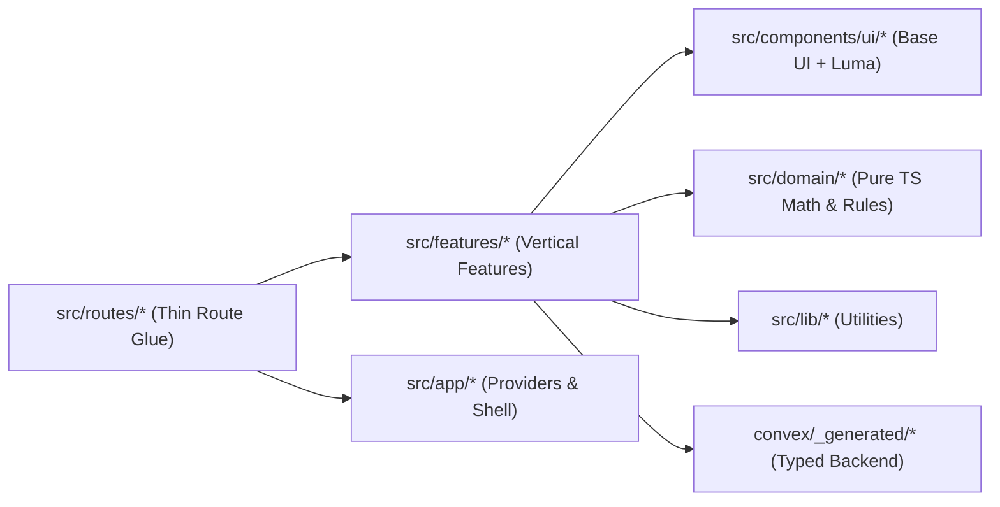

# Frontend Architecture Blueprint: React 19.3.1, Vite 8 (Rolldown), TypeScript 7 (`tsgo`), TanStack Router & TanStack Form + Zod v4

> **Project:** `250° Kitchen` (DEPI Egypt React Front-End Capstone)  
> **Verified Baseline:** **November 19, 2026** (verified via Context7 MCP `/tanstack/router`, `/tanstack/form`, `/vitejs/vite/v8.3.5` + live ecosystem checks)  
> **Target Stack:** `react@19.3.1` · `vite@8.3.8` (Rolldown) · `@vitejs/plugin-react@6.3.0` · `typescript@7.0.2` (with 2-min `typescript@6.x` fallback) · `@tanstack/react-router@^1.170.46` · `@tanstack/router-plugin@^1.170.46` · `@tanstack/react-form@^1.33.5` · `zod@^4.6.7` · `shadcn@4.23.0` (`base-luma` / `@base-ui/react@1.9.0`) · `tailwindcss@4.3.5` · `convex@1.51.0`  
> **Related Decisions:** [TECH-FACT-CHECK-2026-11-19.md](file:///Users/apple/Downloads/dev/antigravity/250-degree-Kitchen%20/01-audit/TECH-FACT-CHECK-2026-11-19.md) · [SIX-DECISIONS-ROADMAP.md](file:///Users/apple/Downloads/dev/antigravity/250-degree-Kitchen%20/03-decisions/SIX-DECISIONS-ROADMAP.md)

---

## 1. Clean Feature-Module Folder Tree (60-Second DEPI Defense Architecture)

We intentionally avoid heavy multi-layer enterprise abstractions (like strict Feature-Sliced Design with custom lint-boundary plugins). Instead, we use a **Clean Feature-Module Architecture** with **one-way downward dependencies**: routes compose features, features use shared UI & pure domain logic, and `src/domain` has **zero React or Convex imports** so every business rule (split-bill piaster math, modifier pricing, search normalization) runs in instant millisecond Vitest suites.

```text
250-degree-kitchen/
├── .vscode/
│   ├── extensions.json                 # Recommends TypeScriptTeam.native-preview, oxc.oxc-vscode
│   └── settings.json                   # Enables TS 7 native language server (useTsgo: true)
├── convex/                             # Real-time backend (Convex 1.51.0)
│   ├── _generated/                     # Auto-generated typed API & DataModel (never hand-edit)
│   ├── schema.ts                       # Dishes, modifierGroups, tables, cartItems, orders
│   ├── menu.ts                         # Live menu + 86/Sold-Out toggles
│   ├── tables.ts                       # 4-digit PIN join + participant sessions
│   ├── cart.ts                         # Real-time shared table cart mutations
│   ├── orders.ts                       # Split-bill settlement, tracker, & KDS bump mutations
│   └── auth.ts                         # Optional Tier-2 @convex-dev/auth staff auth
├── public/
│   └── images/                         # Optimized WebP/AVIF food photography (1 hero + signature dishes)
├── src/
│   ├── main.tsx                        # React 19.3 createRoot + <AppProviders>
│   ├── index.css                       # Tailwind CSS v4 @import + oklch() base-luma tokens
│   ├── routeTree.gen.ts                # Auto-generated by @tanstack/router-plugin (git-ignored or committed cleanly)
│   │
│   ├── app/                            # App-wide composition & shell (thin wiring layer)
│   │   ├── providers.tsx               # ConvexProvider + RouterProvider + Base UI Toast.Provider
│   │   ├── router.tsx                  # createRouter(), Register augmentation, global defaults
│   │   └── AppShell.tsx                # Floating Nav Pill + Floating Cart Dock visibility rules
│   │
│   ├── routes/                         # THIN TanStack Router file-based route definitions ONLY
│   │   ├── __root.tsx                  # Root layout, RouterContext, global notFound/error boundaries
│   │   ├── index.tsx                   # `/`                     → Storefront Hero + Signature preview
│   │   ├── menu.tsx                    # `/menu`                 → Zod v4 validateSearch + Menu view
│   │   ├── table.$tableNumber.tsx      # `/table/$tableNumber`   → Table PIN gate + shared dining view
│   │   ├── track.$orderToken.tsx       # `/track/$orderToken`    → Live order progress tracker
│   │   ├── staff.login.tsx             # `/staff/login`          → Tier-2 public Staff Login route
│   │   ├── _staff.tsx                  # Pathless layout route   → Auth guard (beforeLoad) for staff
│   │   └── _staff/
│   │       ├── kds.tsx                 # `/kds`                  → Dark Charcoal Kitchen Display Board
│   │       └── admin.tsx               # `/admin`                → Tier-2 Menu 86 + Table QR Manager
│   │
│   ├── features/                       # Vertical feature modules (UI + feature hooks + schemas)
│   │   ├── home/
│   │   │   ├── HomePage.tsx            # Hero stage, live kitchen ETA badge, interactive preview
│   │   │   └── components/             # HeroStage.tsx, KitchenPassPreview.tsx, QuickTableModal.tsx
│   │   ├── menu/
│   │   │   ├── MenuPage.tsx            # Category pills, search bar, 3-col dish grid
│   │   │   ├── schemas/
│   │   │   │   ├── menu-search.schema.ts      # Zod v4 URL search param contract
│   │   │   │   └── dish-customizer.schema.ts  # Dynamic minSelect/maxSelect + <=160 note factory
│   │   │   └── components/
│   │   │       ├── DishCard.tsx        # Concentric 24px/16px card + 86 Sold Out state
│   │   │       ├── MenuFiltersBar.tsx  # Syncs category/q/diet/available into URL search
│   │   │       ├── DishCustomizerDrawer.tsx   # Base UI Drawer host
│   │   │       └── DishCustomizerForm.tsx     # TanStack Form v1 + Zod v4 dynamic modifier form
│   │   ├── table/
│   │   │   ├── TablePage.tsx           # PIN gate ↔ active shared table view
│   │   │   ├── hooks/useGuestSession.ts       # localStorage participantToken & nickname
│   │   │   ├── schemas/table-join.schema.ts   # 4-digit PIN (string regex) + Unicode nickname
│   │   │   └── components/
│   │   │       ├── TableJoinForm.tsx   # TanStack Form v1 PIN + Nickname join sheet
│   │   │       └── ActiveDinersStrip.tsx      # Live avatar pills for diners at Table #N
│   │   ├── cart/
│   │   │   ├── components/
│   │   │   │   ├── FloatingCartDock.tsx       # CoolDock-inspired dark floating pill dock
│   │   │   │   ├── SharedCartDrawer.tsx       # Grouped by diner ownership tags
│   │   │   │   └── CartLineItem.tsx           # Qty +/- stepper + modifier summary
│   │   ├── checkout/
│   │   │   ├── components/
│   │   │   │   ├── SplitBillDrawer.tsx        # Pay Full / Pay My Items / Split Equally (÷ N)
│   │   │   │   └── SettlementSummary.tsx      # Integer-piaster breakdown + Instant/Counter CTA
│   │   ├── track/
│   │   │   ├── TrackOrderPage.tsx      # Live progress bar synced with KDS mutations
│   │   │   └── components/             # OrderTimeline.tsx, ReceiptBreakdown.tsx
│   │   └── kds/
│   │       ├── KdsBoardPage.tsx        # Dark Charcoal 3-lane board (New / On the Grill / Ready)
│   │       └── components/
│   │           ├── KdsTicketCard.tsx   # Elapsed timer, 48px+ tap-to-strike lines, 1-tap bump
│   │           └── Quick86Drawer.tsx   # Instant 86 / Sold Out menu lock toggle
│   │
│   ├── components/                     # Shared, domain-agnostic UI primitives
│   │   ├── ui/                         # shadcn/ui (base-luma on @base-ui/react) primitives
│   │   │   ├── button.tsx
│   │   │   ├── button-link.tsx         # Accessible TanStack createLink + buttonVariants wrapper
│   │   │   ├── drawer.tsx
│   │   │   ├── dialog.tsx
│   │   │   ├── field.tsx               # Base UI Field + FieldErrorMessage helper
│   │   │   ├── input.tsx
│   │   │   ├── badge.tsx
│   │   │   ├── tabs.tsx
│   │   │   └── skeleton.tsx
│   │   └── feedback/                   # RouteErrorFallback.tsx, RouteNotFound.tsx, MenuGridSkeleton.tsx
│   │
│   ├── domain/                         # PURE TypeScript business logic (0 React / 0 Convex imports!)
│   │   ├── money.ts                    # Integer piaster arithmetic & EGP formatting (tabular-nums)
│   │   ├── split-bill.ts               # Exact remainder-safe split (Full / Mine / Equal ÷ N)
│   │   ├── modifiers.ts                # Modifier price delta & option-key canonicalization
│   │   └── __tests__/                  # 100%-covered Vitest unit tests
│   │
│   └── lib/                            # Tiny cross-cutting utilities
│       ├── cn.ts                       # clsx + tailwind-merge
│       ├── form-errors.ts              # Standard Schema v1 issue -> string extractor
│       └── env.ts                      # Zod-validated import.meta.env (VITE_CONVEX_URL)
│
├── index.html
├── package.json
├── vite.config.ts                      # Vite 8.3.8 (Rolldown) config
├── vitest.config.ts                    # Vitest 5.1.1 + convex-test Vite 8 config
├── oxlint.config.ts                    # 35-line Oxlint 1.94 + stable tsgolint config
├── tsconfig.json                       # Solution root (NO baseUrl!)
├── tsconfig.app.json                   # Browser app TS 7.0.2 config
├── tsconfig.node.json                  # Vite/Vitest/Oxlint Node tooling config
└── wrangler.jsonc                      # Cloudflare Workers Static Assets SPA deploy
```

### Dependency Rules (One-Way Downward Flow)



**Three Non-Negotiable Import Rules:**
1. **Routes stay thin (`<= 60 lines`):** Files in `src/routes/` only declare `validateSearch`, `beforeLoad`, `pendingComponent`, `errorComponent`, and render a single `<FeaturePage />` from `src/features/`. Never dump 300-line forms inside `src/routes/`.
2. **Features do not tangle sideways:** `src/features/kds/` never imports internals from `src/features/checkout/`. Shared business calculations live in `src/domain/`, and shared live state lives in Convex.
3. **`src/domain/` stays 100% pure TypeScript:** Zero `react`, zero `convex/react`, zero DOM APIs. Evaluators can see instant deterministic Vitest unit tests proving our split-bill and modifier math has zero floating-point rounding bugs.

> [!TIP]
> **Your 60-Second DEPI Technical Defense Pitch:**  
> *"I organized `250° Kitchen` into four clean layers: **`src/routes`** handles type-safe TanStack Router URLs, search validation, and staff auth guards; **`src/features`** groups each user journey vertically (`menu`, `table`, `cart`, `checkout`, `track`, `kds`) so UI, forms, and schemas live right next to each other; **`src/components/ui`** holds accessible `shadcn/ui` Base UI primitives styled with Tailwind v4 `oklch()` tokens; and **`src/domain`** isolates pure TypeScript financial math—like integer-piaster split bills—with zero framework dependencies so Vitest verifies every piaster in milliseconds."*

---

## 2. Exact `vite.config.ts` for Vite 8.3.8 (Rolldown)

Vite 8 replaced Rollup + esbuild with **Rolldown + Oxc**. Three critical Vite 8 breaking changes are baked cleanly into the config below:
1. **`@tanstack/router-plugin/vite` exports `tanstackRouter()`** (replacing older `TanStackRouterVite`), and **MUST come BEFORE `react()`** so route file AST splitting runs before Oxc compiles JSX away.
2. **`@vitejs/plugin-react@6.3.0` removed inline `react({ babel })`** because JSX/Fast Refresh now runs natively in Rust (Oxc). If you enable the React Compiler, wire `@rolldown/plugin-babel` with `reactCompilerPreset()` as a separate plugin immediately after `react()`.
3. **`build.rollupOptions` and `manualChunks` are replaced by `build.rolldownOptions.output.codeSplitting.groups`** (object-form `manualChunks` was removed in Vite 8; function-form is deprecated).

```ts
// vite.config.ts
import { fileURLToPath, URL } from 'node:url'
import tailwindcss from '@tailwindcss/vite'
import { tanstackRouter } from '@tanstack/router-plugin/vite'
import react from '@vitejs/plugin-react'
import { defineConfig } from 'vite'

// OPTIONAL: Uncomment these two lines ONLY when enabling React Compiler
// after installing: npm install -D @rolldown/plugin-babel babel-plugin-react-compiler
// import babel from '@rolldown/plugin-babel'
// import { reactCompilerPreset } from '@vitejs/plugin-react'

export default defineConfig({
  plugins: [
    // 1. FIRST (MANDATORY): TanStack Router scans src/routes/* and injects
    //    autoCodeSplitting boundaries BEFORE JSX is transformed away.
    tanstackRouter({
      target: 'react',
      autoCodeSplitting: true,
      routesDirectory: './src/routes',
      generatedRouteTree: './src/routeTree.gen.ts',
      routeFileIgnorePrefix: '-',
      quoteStyle: 'single',
    }),

    // 2. SECOND: Native Oxc JSX transform + Fast Refresh (Vite 8 / plugin-react v6).
    react(),

    // 3. THIRD (OPTIONAL): React Compiler via Rolldown Babel bridge.
    //    Keep commented during Days 1–10 prototyping for zero Babel overhead;
    //    enable once Tier-1 flows stabilize if you want automatic memoization.
    // babel({
    //   presets: [reactCompilerPreset()],
    // }),

    // 4. FOURTH: Native Tailwind CSS v4 Vite integration.
    tailwindcss(),
  ],

  resolve: {
    // Explicit alias is faster than resolve.tsconfigPaths: true (no per-file
    // tsconfig scan) and works identically inside .css files (@import '@/...').
    alias: {
      '@': fileURLToPath(new URL('./src', import.meta.url)),
    },
  },

  server: {
    port: 5173,
    strictPort: true, // Predictable URL for Playwright E2E & Convex auth redirects
  },

  build: {
    target: 'es2023',
    sourcemap: 'hidden', // Readable stack traces in CI without shipping source maps publicly
    rolldownOptions: {
      output: {
        // Vite 8 / Rolldown native chunking (replaces deprecated Rollup manualChunks)
        codeSplitting: {
          groups: [
            {
              name: 'react-vendor',
              test: /node_modules[/\\](?:react|react-dom|scheduler)[/\\]/,
              priority: 40,
            },
            {
              name: 'tanstack-vendor',
              test: /node_modules[/\\]@tanstack[/\\]/,
              priority: 30,
            },
            {
              name: 'convex-vendor',
              test: /node_modules[/\\](?:convex|@convex-dev)[/\\]/,
              priority: 25,
            },
            {
              name: 'ui-vendor',
              test: /node_modules[/\\](?:@base-ui|lucide-react|motion|zod)[/\\]/,
              priority: 20,
            },
          ],
        },
      },
    },
  },
})
```

### Companion Note: `vitest.config.ts` (Vite 8 + `convex-test` Quirk)
Keep Vitest config separate from `vite.config.ts` so unit tests never run the TanStack Router file-watcher plugin and handle the verified Vite 8 `convex-test` inline requirement cleanly:

```ts
// vitest.config.ts
import { fileURLToPath, URL } from 'node:url'
import { defineConfig } from 'vitest/config'

export default defineConfig({
  resolve: {
    alias: {
      '@': fileURLToPath(new URL('./src', import.meta.url)),
    },
  },
  test: {
    environment: 'jsdom',
    globals: false, // Explicit imports from 'vitest' keep TS 7 types: [] clean
    include: ['src/**/*.test.{ts,tsx}', 'convex/**/*.test.ts'],
    server: {
      deps: {
        inline: ['convex-test'], // Required under Vite 8 Rolldown
      },
    },
  },
})
```

---

## 3. TypeScript 7.0.2 (`tsgo`) Configuration & 2-Minute TS 6 Fallback

TypeScript 7.0.2 ships the Go-native compiler (`tsgo`) directly behind the `tsc` binary (`8–12×` faster type-checking). Three strict TypeScript 6→7 changes **will break legacy Vite/shadcn templates** if you copy old configs blindly:
1. **`baseUrl` is a hard error (`TS5102`) in TypeScript 7.0.2.** Omit `baseUrl` completely and map `paths` directly relative to the `tsconfig` file (`"@/*": ["./src/*"]`). *(Heads-up: if `npx shadcn@latest init` injects `"baseUrl": "."`, delete that single line immediately!)*
2. **`types` defaults to `[]` (empty array) in TS 6 & TS 7.** Ambient globals from `node_modules/@types` are no longer auto-loaded—declare `"types": ["vite/client"]` in `tsconfig.app.json` and `"types": ["node"]` in `tsconfig.node.json`.
3. **`lib/tsserver.js` was removed in TS 7.0.2.** VS Code's built-in legacy TS server cannot load TS 7 unless you install the official **`TypeScriptTeam.native-preview`** extension and enable `"js/ts.experimental.useTsgo": true`.

### 3.1 Root `tsconfig.json` (Solution Config + `shadcn` CLI Discovery)

```json
{
  "files": [],
  "references": [
    { "path": "./tsconfig.app.json" },
    { "path": "./tsconfig.node.json" }
  ],
  "compilerOptions": {
    "paths": {
      "@/*": ["./src/*"]
    }
  }
}
```
*(Why keep `compilerOptions.paths` here without `baseUrl`? `shadcn@4.23.0` reads the root `tsconfig.json` to verify your `@/*` import alias during `npx shadcn add`, and TypeScript 7 accepts `paths` cleanly with zero `baseUrl`!)*

### 3.2 Browser Application `tsconfig.app.json`

```json
{
  "compilerOptions": {
    "tsBuildInfoFile": "./node_modules/.tmp/tsconfig.app.tsbuildinfo",
    "target": "ES2023",
    "lib": ["ES2023", "DOM", "DOM.Iterable"],
    "module": "ESNext",
    "moduleResolution": "bundler",
    "moduleDetection": "force",
    "jsx": "react-jsx",
    "noEmit": true,
    "allowImportingTsExtensions": true,
    "verbatimModuleSyntax": true,
    "erasableSyntaxOnly": true,
    "isolatedModules": true,
    "skipLibCheck": true,

    /* Explicit ambient types required because TS 6/7 defaults types to [] */
    "types": ["vite/client"],

    /* Path alias anchored directly to this file — NO baseUrl! */
    "paths": {
      "@/*": ["./src/*"]
    },

    /* Strict DEPI-grade type safety (zero `any`, zero dead code) */
    "strict": true,
    "noUnusedLocals": true,
    "noUnusedParameters": true,
    "noFallthroughCasesInSwitch": true,
    "noUncheckedIndexedAccess": true,
    "noUncheckedSideEffectImports": true
  },
  "include": ["src", "convex/_generated"]
}
```

### 3.3 Node Tooling `tsconfig.node.json`

```json
{
  "compilerOptions": {
    "tsBuildInfoFile": "./node_modules/.tmp/tsconfig.node.tsbuildinfo",
    "target": "ES2023",
    "lib": ["ES2023"],
    "module": "ESNext",
    "moduleResolution": "bundler",
    "moduleDetection": "force",
    "noEmit": true,
    "verbatimModuleSyntax": true,
    "erasableSyntaxOnly": true,
    "skipLibCheck": true,

    /* Explicit Node globals for node:url, process, etc. */
    "types": ["node"],

    "strict": true,
    "noUnusedLocals": true,
    "noUnusedParameters": true,
    "noFallthroughCasesInSwitch": true,
    "noUncheckedSideEffectImports": true
  },
  "include": ["vite.config.ts", "vitest.config.ts", "oxlint.config.ts"]
}
```

### 3.4 VS Code Native Preview Config (`.vscode/settings.json` & `.vscode/extensions.json`)

```json
// .vscode/settings.json
{
  "js/ts.experimental.useTsgo": true,
  "js/ts.tsdk.path": "./node_modules/typescript",
  "editor.defaultFormatter": "oxc.oxc-vscode",
  "editor.formatOnSave": true,
  "files.exclude": {
    "**/routeTree.gen.ts": false
  }
}
```

```json
// .vscode/extensions.json
{
  "recommendations": [
    "TypeScriptTeam.native-preview",
    "oxc.oxc-vscode",
    "bradlc.vscode-tailwindcss"
  ]
}
```

*(Note: If an older preview build of `TypeScriptTeam.native-preview` shows a warning on `"js/ts.experimental.useTsgo"`, open the Command Palette and run **`TypeScript: Enable TypeScript 7`**, which writes the exact key your VS Code build reads.)*

### 3.5 Exact 2-Minute Fallback Recipe to `typescript@6.x`

**When to pull this ripcord (Day 1 test):**
Watch for **two known Nov 2026 `tsgo` + TanStack Router / `oxlint-tsgolint` edge cases**:
- `Route.useParams()`, `Route.useSearch()`, or `<Link to="...">` autocomplete stalls or collapses to `any` inside `tsgo` / `oxlint --type-aware`, causing false-positive `no-unsafe-assignment` / `no-unsafe-member-access` errors on valid routes.
- VS Code's `TypeScriptTeam.native-preview` extension crashes or drops IntelliSense on `convex/_generated/api`.

Because our `tsconfig*.json` files above already obey TS 6 & TS 7 rules (zero `baseUrl`, explicit `types`, `moduleResolution: "bundler"`), **you do not have to edit a single line of `tsconfig*.json` to fall back!**

**Option A — Side-by-Side Verification (Keep TS 7 fast locally, cross-check with TS 6 in CI):**
```bash
npm install -D @typescript/typescript6@^6.0.2
```
Add to `package.json`:
```json
{
  "scripts": {
    "typecheck": "tsc -b --noEmit",
    "typecheck:ts6": "tsc6 -b --noEmit"
  }
}
```

**Option B — Full 2-Minute Switch to TypeScript 6.x as Primary Compiler & IDE Server:**
1. Replace `typescript` with Microsoft's official TS 6 compatibility package (restores `lib/tsserver.js` for default VS Code):
   ```bash
   npm install -D typescript@npm:@typescript/typescript6@^6.0.2
   ```
2. Flip one boolean in `.vscode/settings.json`:
   ```json
   {
     "js/ts.experimental.useTsgo": false,
     "typescript.tsdk": "node_modules/typescript/lib"
   }
   ```
3. Reload VS Code (`Cmd+Shift+P` → `Developer: Reload Window`) and verify:
   ```bash
   npx tsc --version && npm run typecheck
   ```
   Done in under 120 seconds, zero lost work, zero config rewrites.

---

## 4. TanStack Router (`1.170+`) Route Tree & URL Search State

### 4.1 Complete Route Map (Tier 1 Core + Tier 2 Optional)

| Route File (`src/routes/`) | Public URL | Tier | Guard / Search Params | Purpose |
| :--- | :--- | :--- | :--- | :--- |
| `__root.tsx` | *(Layout)* | Tier 1 | Global `notFoundComponent` & `errorComponent` | Top Floating Nav Pill + Bottom Floating Cart Dock (hidden on `/kds`, `/admin`, `/staff/login`) |
| `index.tsx` | `/` | Tier 1 | — | Sunlit Storefront Hero, live prep ETA, Quick Join Table & Signature Menu preview |
| `menu.tsx` | `/menu` | Tier 1 | Zod v4 `validateSearch`: `category`, `q`, `diet`, `available` | Interactive menu gallery + Dish Customizer Drawer |
| `table.$tableNumber.tsx` | `/table/$tableNumber` | Tier 1 | Param guard (`1..12`, else `notFound()`) | 4-Digit Table PIN gate → Live Shared Table Cart & Split-Bill Checkout |
| `track.$orderToken.tsx` | `/track/$orderToken` | Tier 1 | Unguessable `orderToken` param | Live order timeline (`New → On the Grill → Ready`) synced in real time |
| `_staff.tsx` | *(Pathless)* | Tier 1/2 | `beforeLoad` staff auth check (toggleable for Tier 1 demo vs Tier 2 auth) | Shared protection boundary for kitchen & manager tools |
| `_staff/kds.tsx` | `/kds` | Tier 1 | Inherits `_staff` | Full-bleed Dark Charcoal Kitchen Display Board + `86 / Sold Out` drawer |
| `_staff/admin.tsx` | `/admin` | Tier 2 | Inherits `_staff` + role check (`manager`) | Compact Menu `86` manager + printable Table QR cards |
| `staff.login.tsx` | `/staff/login` | Tier 2 | `validateSearch`: `redirect` (relative-path validated) | Clean `@convex-dev/auth` Username + Password staff gate |

### 4.2 Router Instance & Type Registration (`src/app/router.tsx`)

```tsx
// src/app/router.tsx
import { createRouter } from '@tanstack/react-router'
import { RouteErrorFallback } from '@/components/feedback/RouteErrorFallback'
import { RouteNotFound } from '@/components/feedback/RouteNotFound'
import { routeTree } from '@/routeTree.gen'

export interface StaffAuthState {
  isLoaded: boolean
  isAuthenticated: boolean
  role: 'kitchen' | 'manager' | null
}

export interface RouterContext {
  auth: StaffAuthState
}

export const router = createRouter({
  routeTree,
  context: {
    // Hydrated reactively via <RouterProvider router={router} context={{ auth }} />
    auth: { isLoaded: false, isAuthenticated: false, role: null },
  },
  defaultPreload: 'intent', // Preloads route chunks on hover/focus
  defaultPreloadStaleTime: 30_000,
  defaultPendingMs: 200, // Wait 200ms before flashing a skeleton
  defaultPendingMinMs: 300, // Keep skeleton visible >= 300ms to prevent flicker
  scrollRestoration: true,
  defaultErrorComponent: RouteErrorFallback,
  defaultNotFoundComponent: RouteNotFound,
})

declare module '@tanstack/react-router' {
  interface Register {
    router: typeof router
  }
}
```

### 4.3 Root Layout (`src/routes/__root.tsx`)

```tsx
// src/routes/__root.tsx
import { lazy, Suspense } from 'react'
import {
  createRootRouteWithContext,
  Outlet,
  useRouterState,
} from '@tanstack/react-router'
import { AppShell } from '@/app/AppShell'
import type { RouterContext } from '@/app/router'
import { RouteErrorFallback } from '@/components/feedback/RouteErrorFallback'
import { RouteNotFound } from '@/components/feedback/RouteNotFound'

const TanStackRouterDevtools = import.meta.env.DEV
  ? lazy(() =>
      import('@tanstack/react-router-devtools').then((m) => ({
        default: m.TanStackRouterDevtools,
      })),
    )
  : () => null

const STAFF_PREFIXES = ['/kds', '/admin', '/staff']

export const Route = createRootRouteWithContext<RouterContext>()({
  component: RootLayout,
  errorComponent: RouteErrorFallback,
  notFoundComponent: RouteNotFound,
})

function RootLayout() {
  const pathname = useRouterState({ select: (s) => s.location.pathname })
  const isStaffSurface = STAFF_PREFIXES.some((prefix) =>
    pathname.startsWith(prefix),
  )

  return (
    <>
      {isStaffSurface ? (
        <Outlet />
      ) : (
        <AppShell>
          <Outlet />
        </AppShell>
      )}
      {import.meta.env.DEV ? (
        <Suspense fallback={null}>
          <TanStackRouterDevtools position="bottom-right" />
        </Suspense>
      ) : null}
    </>
  )
}
```

### 4.4 Accessible Base UI + TanStack Router `ButtonLink` (`src/components/ui/button-link.tsx`)

> [!WARNING]
> **Critical Base UI Accessibility Catch (`@base-ui/react@1.9.0`):**  
> Never write `<Button render={<Link to="/menu" />} nativeButton={false} />` for navigational links! Base UI's `Button` with `nativeButton={false}` stamps `role="button"` onto the `<a>` element, breaking screen-reader link navigation and middle-click expectations. Instead, wrap a native `<a>` styled with `buttonVariants()` using TanStack Router's `createLink()`—zero `forwardRef` needed in React 19.3!

```tsx
// src/components/ui/button-link.tsx
import type { ComponentProps } from 'react'
import { createLink, type LinkComponent } from '@tanstack/react-router'
import type { VariantProps } from 'class-variance-authority'
import { buttonVariants } from '@/components/ui/button'
import { cn } from '@/lib/cn'

type StyledAnchorProps = ComponentProps<'a'> &
  VariantProps<typeof buttonVariants>

function StyledAnchor({
  className,
  variant,
  size,
  ref,
  ...props
}: StyledAnchorProps) {
  return (
    <a
      ref={ref}
      className={cn(buttonVariants({ variant, size }), className)}
      {...props}
    />
  )
}

const CreatedButtonLink = createLink(StyledAnchor)

export const ButtonLink: LinkComponent<typeof StyledAnchor> = (props) => (
  <CreatedButtonLink preload="intent" {...props} />
)
```

Usage anywhere in the app—100% type-safe route + search params, native `<a>` semantics, `base-luma` pill styling:
```tsx
<ButtonLink to="/menu" search={{ category: 'burgers' }} size="lg">
  Explore Signature Burgers
</ButtonLink>
```

### 4.5 `/menu` Zod v4 Standard Schema `validateSearch` (URL-Synced Filters)

**Two subtle TanStack Router + Zod v4 traps we neutralize right here:**
1. **The `?q=250` JSON Parsing Trap:** TanStack Router parses URL query strings as JSON by default. If a diner searches `"250"` (for the *250° Burger*) and refreshes, `?q=250` arrives in `validateSearch` as the **number `250`**, not `"250"`. A plain `z.string().default('').catch('')` would silently wipe their search! Our `z.union([z.string(), z.number()]).transform(...)` keeps `"250"` intact while still recovering gracefully from malformed inputs like `?q={"bad":1}`.
2. **The `z.coerce.boolean()` Trap:** Never use `z.coerce.boolean()` on query strings—`Boolean("false")` evaluates to **`true`** in JavaScript! Because TanStack Router natively JSON-parses `?available=true` → `true` and `?available=false` → `false`, plain `z.boolean().default(false).catch(false)` handles valid URLs accurately and safely falls back to `false` on `?available=nonsense`.

```ts
// src/features/menu/schemas/menu-search.schema.ts
import { z } from 'zod'

export const MENU_CATEGORIES = [
  'all',
  'burgers',
  'wood-fired-pizza',
  'sides',
  'drinks',
] as const

export const MENU_DIETS = [
  'all',
  'spicy',
  'vegetarian',
  'gluten-free',
] as const

export type MenuCategory = (typeof MENU_CATEGORIES)[number]
export type MenuDiet = (typeof MENU_DIETS)[number]

export const MENU_SEARCH_DEFAULTS = {
  category: 'all' as MenuCategory,
  q: '',
  diet: 'all' as MenuDiet,
  available: false,
} as const

export const menuSearchSchema = z.object({
  category: z
    .enum(MENU_CATEGORIES)
    .default(MENU_SEARCH_DEFAULTS.category)
    .catch(MENU_SEARCH_DEFAULTS.category),

  // Preserves numeric searches like ?q=250 after TanStack Router's JSON parser
  q: z
    .union([z.string(), z.number()])
    .transform((val) => String(val).slice(0, 64))
    .default(MENU_SEARCH_DEFAULTS.q)
    .catch(MENU_SEARCH_DEFAULTS.q),

  diet: z
    .enum(MENU_DIETS)
    .default(MENU_SEARCH_DEFAULTS.diet)
    .catch(MENU_SEARCH_DEFAULTS.diet),

  // Native boolean from TanStack JSON parser — NEVER use z.coerce.boolean()
  available: z
    .boolean()
    .default(MENU_SEARCH_DEFAULTS.available)
    .catch(MENU_SEARCH_DEFAULTS.available),
})

export type MenuSearch = z.output<typeof menuSearchSchema>
```

Now wire it into the thin route file (`src/routes/menu.tsx`)—passing the Zod v4 schema **directly** (zero `@tanstack/zod-adapter` required!) and stripping default values with `stripSearchParams` so `/menu` stays clean until a diner actually filters:

```tsx
// src/routes/menu.tsx
import { createFileRoute, stripSearchParams } from '@tanstack/react-router'
import { MenuGridSkeleton } from '@/components/feedback/MenuGridSkeleton'
import { RouteErrorFallback } from '@/components/feedback/RouteErrorFallback'
import { MenuPage } from '@/features/menu/MenuPage'
import {
  MENU_SEARCH_DEFAULTS,
  menuSearchSchema,
} from '@/features/menu/schemas/menu-search.schema'

export const Route = createFileRoute('/menu')({
  // Zod v4 implements Standard Schema (~standard) — pass directly!
  validateSearch: menuSearchSchema,
  search: {
    // Keeps /menu clean when filters equal defaults; preserves active filters on refresh/share
    middlewares: [stripSearchParams(MENU_SEARCH_DEFAULTS)],
  },
  pendingMs: 200,
  pendingMinMs: 300,
  pendingComponent: MenuGridSkeleton,
  errorComponent: RouteErrorFallback,
  component: MenuRouteComponent,
})

function MenuRouteComponent() {
  const search = Route.useSearch()
  const navigate = Route.useNavigate()

  const updateSearch = (patch: Partial<typeof search>) => {
    void navigate({
      search: (prev) => ({ ...prev, ...patch }),
      replace: true, // Avoids polluting browser Back history on every keystroke
    })
  }

  return <MenuPage search={search} onSearchChange={updateSearch} />
}
```

### 4.6 Dynamic Param Validation, Error Boundaries & Protected Staff Layout

#### Table Route with Strict Table Number Validation (`src/routes/table.$tableNumber.tsx`)
```tsx
// src/routes/table.$tableNumber.tsx
import { createFileRoute, notFound } from '@tanstack/react-router'
import { RouteErrorFallback } from '@/components/feedback/RouteErrorFallback'
import { TablePage } from '@/features/table/TablePage'

const MIN_TABLE = 1
const MAX_TABLE = 12

export const Route = createFileRoute('/table/$tableNumber')({
  beforeLoad: ({ params }) => {
    if (!/^\d{1,2}$/.test(params.tableNumber)) {
      throw notFound()
    }
    const tableNum = Number(params.tableNumber)
    if (tableNum < MIN_TABLE || tableNum > MAX_TABLE) {
      throw notFound()
    }
    return { tableNum }
  },
  errorComponent: RouteErrorFallback,
  notFoundComponent: () => (
    <section className="mx-auto max-w-md py-20 text-center">
      <h1 className="text-2xl font-semibold">Table Not Found</h1>
      <p className="mt-2 text-muted-foreground">
        250° Kitchen tables are numbered 1 through 12. Scan the QR code on your
        table card to join.
      </p>
    </section>
  ),
  component: TableRouteComponent,
})

function TableRouteComponent() {
  const { tableNum } = Route.useRouteContext()
  return <TablePage tableNumber={tableNum} />
}
```

#### Live Order Tracker Route with Skeleton + Error Recovery (`src/routes/track.$orderToken.tsx`)
```tsx
// src/routes/track.$orderToken.tsx
import { createFileRoute, notFound } from '@tanstack/react-router'
import { RouteErrorFallback } from '@/components/feedback/RouteErrorFallback'
import { TrackOrderSkeleton } from '@/components/feedback/TrackOrderSkeleton'
import { TrackOrderPage } from '@/features/track/TrackOrderPage'

export const Route = createFileRoute('/track/$orderToken')({
  beforeLoad: ({ params }) => {
    // Reject obviously invalid tokens before subscribing to Convex
    if (!/^[a-zA-Z0-9_-]{8,64}$/.test(params.orderToken)) {
      throw notFound()
    }
  },
  pendingMs: 150,
  pendingMinMs: 250,
  pendingComponent: TrackOrderSkeleton,
  errorComponent: RouteErrorFallback,
  component: TrackRouteComponent,
})

function TrackRouteComponent() {
  const { orderToken } = Route.useParams()
  return <TrackOrderPage orderToken={orderToken} />
}
```

#### Reusable Route Error Boundary (`src/components/feedback/RouteErrorFallback.tsx`)
```tsx
// src/components/feedback/RouteErrorFallback.tsx
import {
  type ErrorComponentProps,
  useRouter,
} from '@tanstack/react-router'
import { Button } from '@/components/ui/button'
import { ButtonLink } from '@/components/ui/button-link'

export function RouteErrorFallback({ error, reset }: ErrorComponentProps) {
  const router = useRouter()
  const message =
    error instanceof Error
      ? error.message
      : 'Something interrupted your connection to the kitchen.'

  const handleRetry = () => {
    reset()
    void router.invalidate()
  }

  return (
    <section
      role="alert"
      className="mx-auto my-16 max-w-lg rounded-3xl bg-card p-8 text-center"
    >
      <p className="text-[13px] font-medium uppercase tracking-widest text-muted-foreground">
        250° Kitchen
      </p>
      <h1 className="mt-2 text-2xl font-semibold text-foreground">
        We hit a snag loading this view
      </h1>
      <p className="mt-2 text-sm text-muted-foreground">{message}</p>
      <div className="mt-6 flex items-center justify-center gap-3">
        <Button type="button" onClick={handleRetry}>
          Try Again
        </Button>
        <ButtonLink to="/" variant="outline">
          Back to Kitchen Home
        </ButtonLink>
      </div>
    </section>
  )
}
```

#### Pathless Staff Auth Layout (`src/routes/_staff.tsx`) + Safe Login Redirect (`src/routes/staff.login.tsx`)
```tsx
// src/routes/_staff.tsx
import { createFileRoute, Outlet, redirect } from '@tanstack/react-router'

// Flip VITE_ENABLE_STAFF_AUTH=true once Tier-2 @convex-dev/auth is wired;
// keeps Tier-1 solo/demo KDS unblocked on Day 1 while proving real Protected Routes.
const REQUIRE_STAFF_AUTH = import.meta.env.VITE_ENABLE_STAFF_AUTH === 'true'

export const Route = createFileRoute('/_staff')({
  beforeLoad: ({ context, location }) => {
    if (!REQUIRE_STAFF_AUTH) return

    if (context.auth.isLoaded && !context.auth.isAuthenticated) {
      throw redirect({
        to: '/staff/login',
        search: {
          // Use location.href (not router.state.resolvedLocation)
          redirect: location.href,
        },
      })
    }
  },
  component: () => <Outlet />,
})
```

```tsx
// src/routes/staff.login.tsx
import { createFileRoute } from '@tanstack/react-router'
import { z } from 'zod'

const staffLoginSearchSchema = z.object({
  // Prevent open redirects: allow internal paths starting with single `/` only
  redirect: z
    .string()
    .refine(
      (val) => val.startsWith('/') && !val.startsWith('//'),
      'Invalid redirect target',
    )
    .default('/kds')
    .catch('/kds'),
})

export const Route = createFileRoute('/staff/login')({
  validateSearch: staffLoginSearchSchema,
  component: StaffLoginRoute,
})

function StaffLoginRoute() {
  const { redirect: redirectTo } = Route.useSearch()
  return (
    <main className="grid min-h-dvh place-items-center bg-neutral-950 p-6 text-neutral-100">
      {/* Mount <StaffLoginForm redirectTo={redirectTo} /> from src/features/staff */}
      <div data-redirect={redirectTo}>Staff Login (Tier 2)</div>
    </main>
  )
}
```

---

## 5. TanStack Form v1 (`1.33+`) + Zod v4 (`4.6.7`) Production Patterns

### 5.1 Zero Adapter Needed + Standard Schema Error Helper (`src/lib/form-errors.ts`)

> [!IMPORTANT]
> **Two Breaking Differences from Older TanStack Form v0 Tutorials:**
> 1. **Never install `@tanstack/zod-form-adapter`.** TanStack Form v1 natively supports the **Standard Schema v1** (`~standard`) spec built into Zod v4 (`4.6.7`). Pass schemas directly to `validators: { onSubmit, onChange, onBlur, onDynamic }`.
> 2. **Standard Schema errors are objects, not strings.** When a Zod v4 schema fails, `field.state.meta.errors` holds `StandardSchemaV1Issue` objects (`{ message: string, path?: ... }`), **not** plain strings. Rendering `{field.state.meta.errors.join(', ')}` prints **`[object Object]`**! Always normalize through a tiny typed helper.

```ts
// src/lib/form-errors.ts
interface StandardIssueLike {
  readonly message: string
}

function isIssueObject(value: unknown): value is StandardIssueLike {
  return (
    typeof value === 'object' &&
    value !== null &&
    'message' in value &&
    typeof (value as { message: unknown }).message === 'string'
  )
}

export function extractErrorMessages(errors: readonly unknown[]): string[] {
  const messages: string[] = []
  for (const err of errors) {
    if (typeof err === 'string' && err.length > 0) {
      messages.push(err)
    } else if (isIssueObject(err) && err.message.length > 0) {
      messages.push(err.message)
    }
  }
  return messages
}

export function getFirstErrorMessage(
  errors: readonly unknown[],
): string | undefined {
  return extractErrorMessages(errors)[0]
}
```

---

### 5.2 Form A — Dish Modifier Drawer (Dynamic `minSelect`/`maxSelect` + `<= 160` Char Note)

**Why this form is tricky in real hospitality apps:**
- Every dish has a different set of modifier groups loaded from Convex (e.g., *Patty Weight*: `minSelect: 1, maxSelect: 1`; *Char-Grill Add-Ons*: `minSelect: 0, maxSelect: 3`).
- While the diner has the drawer open, the kitchen can tap **`86 / Sold Out`** on an option (e.g., *Aged Cheddar*)—validation must reject unavailable options cleanly before mutating the cart.
- The sticky CTA button (`Add to Table Cart · 345 EGP`) must recalculate live in integer piasters **without** re-rendering the entire modifier list on every keystroke in the special note box.

#### Step 1: Dynamic Zod v4 Schema Factory (`src/features/menu/schemas/dish-customizer.schema.ts`)

```ts
// src/features/menu/schemas/dish-customizer.schema.ts
import { z } from 'zod'

export interface ModifierOption {
  id: string
  label: string
  priceDeltaPiastres: number
  isAvailable: boolean
}

export interface ModifierGroup {
  id: string
  name: string
  minSelect: number
  maxSelect: number
  options: ModifierOption[]
}

export interface DishCustomizerValues {
  quantity: number
  /** Map of groupId -> selected optionIds */
  selections: Record<string, string[]>
  specialNote: string
}

export const MAX_KITCHEN_NOTE_LENGTH = 160

export function createInitialDishValues(
  groups: readonly ModifierGroup[],
): DishCustomizerValues {
  const selections: Record<string, string[]> = {}
  for (const group of groups) {
    // Auto-preselect the first available option only for strict single-required groups
    if (group.minSelect === 1 && group.maxSelect === 1) {
      const firstAvailable = group.options.find((opt) => opt.isAvailable)
      selections[group.id] = firstAvailable ? [firstAvailable.id] : []
    } else {
      selections[group.id] = []
    }
  }

  return {
    quantity: 1,
    selections,
    specialNote: '',
  }
}

export function buildDishCustomizerSchema(groups: readonly ModifierGroup[]) {
  return z
    .object({
      quantity: z
        .number()
        .int('Quantity must be a whole number')
        .min(1, 'Order at least 1 item')
        .max(20, 'Maximum 20 per line item'),
      selections: z.record(z.string(), z.array(z.string())),
      specialNote: z
        .string()
        .trim()
        .max(
          MAX_KITCHEN_NOTE_LENGTH,
          `Kitchen note must be ${MAX_KITCHEN_NOTE_LENGTH} characters or fewer`,
        ),
    })
    .superRefine((data, ctx) => {
      for (const group of groups) {
        const chosen = data.selections[group.id] ?? []
        const availableIds = new Set(
          group.options.filter((o) => o.isAvailable).map((o) => o.id),
        )

        if (chosen.length < group.minSelect) {
          ctx.addIssue({
            code: 'custom',
            path: ['selections', group.id],
            message:
              group.minSelect === 1 && group.maxSelect === 1
                ? `Please choose ${group.name.toLowerCase()}`
                : `Select at least ${group.minSelect} for ${group.name}`,
          })
          continue
        }

        if (chosen.length > group.maxSelect) {
          ctx.addIssue({
            code: 'custom',
            path: ['selections', group.id],
            message: `Select up to ${group.maxSelect} for ${group.name}`,
          })
          continue
        }

        const unavailableChoice = chosen.find((id) => !availableIds.has(id))
        if (unavailableChoice) {
          ctx.addIssue({
            code: 'custom',
            path: ['selections', group.id],
            message: `An option in ${group.name} just sold out (86). Please update your selection.`,
          })
        }
      }
    })
}
```

#### Step 2: TanStack Form v1 Component (`src/features/menu/components/DishCustomizerForm.tsx`)

Notice three idiomatic v1 techniques:
- **`validationLogic: revalidateLogic({ mode: 'submit', modeAfterSubmission: 'change' })` + `validators: { onDynamic: schema }`**: Diners are never nagged with red errors the moment the drawer slides up. Errors appear if they tap "Add" with a missing required choice, and vanish instantaneously the second they pick it.
- **`useSelector(form.store, ...)`** (exported directly from `@tanstack/react-form`) computes the integer-piaster line total cleanly via `src/domain/modifiers.ts`.
- **Key by dish ID in the Drawer host (`<DishCustomizerForm key={dish._id} ... />`)**: guarantees fresh `defaultValues` whenever a diner switches from one dish to another without manual `useEffect(() => form.reset())` boilerplate!

```tsx
// src/features/menu/components/DishCustomizerForm.tsx
import { useMemo } from 'react'
import {
  revalidateLogic,
  useForm,
  useSelector,
} from '@tanstack/react-form'
import { Button } from '@/components/ui/button'
import { calculateDishTotalPiastres } from '@/domain/modifiers'
import { formatEgpFromPiastres } from '@/domain/money'
import {
  buildDishCustomizerSchema,
  createInitialDishValues,
  type DishCustomizerValues,
  MAX_KITCHEN_NOTE_LENGTH,
  type ModifierGroup,
} from '@/features/menu/schemas/dish-customizer.schema'
import { getFirstErrorMessage } from '@/lib/form-errors'

interface DishCustomizerFormProps {
  dishName: string
  basePricePiastres: number
  groups: readonly ModifierGroup[]
  isDishSoldOut: boolean
  onAddToCart: (values: DishCustomizerValues) => Promise<void>
}

export function DishCustomizerForm({
  dishName,
  basePricePiastres,
  groups,
  isDishSoldOut,
  onAddToCart,
}: DishCustomizerFormProps) {
  const schema = useMemo(() => buildDishCustomizerSchema(groups), [groups])
  const defaultValues = useMemo(
    () => createInitialDishValues(groups),
    [groups],
  )

  const form = useForm({
    defaultValues,
    // Calm UX: validate dynamically on first submit attempt, then immediately on change
    validationLogic: revalidateLogic({
      mode: 'submit',
      modeAfterSubmission: 'change',
    }),
    validators: {
      onDynamic: schema,
    },
    onSubmit: async ({ value }) => {
      // Final parse guarantees trimmed specialNote even if submitted quickly
      const parsed = schema.parse(value)
      await onAddToCart(parsed)
    },
  })

  // Fine-grained reactive total: recalculates ONLY when quantity or selections change
  const totalPiastres = useSelector(form.store, (state) =>
    calculateDishTotalPiastres({
      basePricePiastres,
      groups,
      selections: state.values.selections,
      quantity: state.values.quantity,
    }),
  )

  return (
    <form
      noValidate
      className="flex flex-col gap-6"
      onSubmit={(e) => {
        e.preventDefault()
        e.stopPropagation()
        void form.handleSubmit()
      }}
    >
      {groups.map((group) => {
        const isSingleSelect = group.maxSelect === 1
        return (
          <form.Field key={group.id} name={`selections.${group.id}`}>
            {(field) => {
              const selectedIds = field.state.value ?? []
              const errorMessage = getFirstErrorMessage(field.state.meta.errors)

              const toggleOption = (optionId: string) => {
                if (isSingleSelect) {
                  const alreadyChosen = selectedIds.includes(optionId)
                  // Allow unchecking only when group is optional (minSelect === 0)
                  field.handleChange(
                    alreadyChosen && group.minSelect === 0 ? [] : [optionId],
                  )
                  return
                }

                if (selectedIds.includes(optionId)) {
                  field.handleChange(selectedIds.filter((id) => id !== optionId))
                } else if (selectedIds.length < group.maxSelect) {
                  field.handleChange([...selectedIds, optionId])
                }
              }

              return (
                <fieldset
                  aria-invalid={Boolean(errorMessage)}
                  aria-describedby={
                    errorMessage ? `group-err-${group.id}` : undefined
                  }
                  className="space-y-3"
                >
                  <div className="flex items-baseline justify-between gap-2">
                    <legend className="text-base font-semibold text-foreground">
                      {group.name}
                    </legend>
                    <span className="text-[13px] font-medium text-muted-foreground">
                      {group.minSelect > 0
                        ? `Required · ${isSingleSelect ? 'Choose 1' : `Choose ${group.minSelect}–${group.maxSelect}`}`
                        : `Optional · Up to ${group.maxSelect}`}
                    </span>
                  </div>

                  <div className="grid gap-2">
                    {group.options.map((option) => {
                      const isChecked = selectedIds.includes(option.id)
                      const atLimit =
                        !isSingleSelect &&
                        !isChecked &&
                        selectedIds.length >= group.maxSelect
                      const isDisabled = !option.isAvailable || atLimit

                      return (
                        <label
                          key={option.id}
                          className="flex min-h-12 cursor-pointer items-center justify-between rounded-2xl border border-border bg-card px-4 py-3 has-[:checked]:border-primary has-[:disabled]:cursor-not-allowed has-[:disabled]:opacity-50"
                        >
                          <span className="flex items-center gap-3">
                            <input
                              type={isSingleSelect ? 'radio' : 'checkbox'}
                              name={`modifier-${group.id}`}
                              checked={isChecked}
                              disabled={isDisabled}
                              onBlur={field.handleBlur}
                              onChange={() => toggleOption(option.id)}
                              className="size-4 accent-primary"
                            />
                            <span className="text-sm font-medium text-foreground">
                              {option.label}
                              {!option.isAvailable ? ' (Sold Out)' : ''}
                            </span>
                          </span>
                          {option.priceDeltaPiastres > 0 ? (
                            <span className="text-sm tabular-nums text-muted-foreground">
                              +{formatEgpFromPiastres(option.priceDeltaPiastres)}
                            </span>
                          ) : null}
                        </label>
                      )
                    })}
                  </div>

                  {errorMessage ? (
                    <p
                      id={`group-err-${group.id}`}
                      role="alert"
                      className="text-sm font-medium text-destructive"
                    >
                      {errorMessage}
                    </p>
                  ) : null}
                </fieldset>
              )
            }}
          </form.Field>
        )
      })}

      {/* Special Kitchen Note (<= 160 chars) */}
      <form.Field name="specialNote">
        {(field) => {
          const errorMessage = getFirstErrorMessage(field.state.meta.errors)
          const remaining = MAX_KITCHEN_NOTE_LENGTH - field.state.value.length
          return (
            <div className="space-y-2">
              <div className="flex items-center justify-between">
                <label
                  htmlFor={field.name}
                  className="text-sm font-semibold text-foreground"
                >
                  Kitchen Note (optional)
                </label>
                <span className="text-[13px] tabular-nums text-muted-foreground">
                  {remaining} left
                </span>
              </div>
              <textarea
                id={field.name}
                name={field.name}
                rows={2}
                maxLength={MAX_KITCHEN_NOTE_LENGTH}
                placeholder="No pickles, sauce on the side, extra charred..."
                value={field.state.value}
                onBlur={field.handleBlur}
                onChange={(e) => field.handleChange(e.target.value)}
                aria-invalid={Boolean(errorMessage)}
                aria-describedby={errorMessage ? 'special-note-err' : undefined}
                className="w-full rounded-2xl border border-input bg-card px-4 py-3 text-base text-foreground placeholder:text-muted-foreground"
              />
              {errorMessage ? (
                <p
                  id="special-note-err"
                  role="alert"
                  className="text-sm font-medium text-destructive"
                >
                  {errorMessage}
                </p>
              ) : null}
            </div>
          )
        }}
      </form.Field>

      {/* Quantity Stepper + Live Sticky Total CTA */}
      <div className="sticky bottom-0 flex items-center gap-3 border-t border-border bg-background pt-4">
        <form.Field name="quantity">
          {(field) => (
            <div className="flex items-center rounded-full border border-border bg-card p-1">
              <Button
                type="button"
                variant="ghost"
                size="icon"
                aria-label={`Decrease quantity of ${dishName}`}
                disabled={field.state.value <= 1}
                onClick={() =>
                  field.handleChange(Math.max(1, field.state.value - 1))
                }
              >
                −
              </Button>
              <span className="min-w-8 text-center text-sm font-semibold tabular-nums">
                {field.state.value}
              </span>
              <Button
                type="button"
                variant="ghost"
                size="icon"
                aria-label={`Increase quantity of ${dishName}`}
                disabled={field.state.value >= 20}
                onClick={() =>
                  field.handleChange(Math.min(20, field.state.value + 1))
                }
              >
                +
              </Button>
            </div>
          )}
        </form.Field>

        <form.Subscribe
          selector={(state) => state.isSubmitting}
          children={(isSubmitting) => (
            <Button
              type="submit"
              size="lg"
              disabled={isDishSoldOut || isSubmitting}
              className="flex-1 tabular-nums"
            >
              {isDishSoldOut
                ? 'Sold Out (86)'
                : isSubmitting
                  ? 'Adding to Table...'
                  : `Add · ${formatEgpFromPiastres(totalPiastres)}`}
            </Button>
          )}
        />
      </div>
    </form>
  )
}
```

---

### 5.3 Form B — 4-Digit Table PIN + Guest Nickname Join Form (Avoiding `z.coerce.*` TS Traps!)

#### Why `z.coerce.number()` Fails Twice Here

```ts
// ❌ ANTI-PATTERN — DO NOT WRITE THIS!
const brokenPinSchema = z.object({
  // Trap 1 (TypeScript): In Zod v4, z.coerce.number() has input type `unknown`!
  //   Passing this to TanStack Form with defaultValues: { pin: '' } throws a
  //   StandardSchemaV1<unknown, number> mismatch against string form state.
  // Trap 2 (Domain Bug): Number("0482") === 482, which strips the leading zero
  //   and fails .min(1000) — locking diners out of tables whose PIN starts with 0!
  pin: z.coerce.number().int().min(1000).max(9999),
})
```

#### The Three Golden Rules for Zod v4 + TanStack Form Numeric Fields

| Field Kind | Correct Pattern | Why It Never Breaks TS or UX |
| :--- | :--- | :--- |
| **PINs, Phone Numbers, OTPs, Promo Codes** | `z.string().trim().regex(/^\d{4}$/)` | Preserves leading zeros (`"0482"`), `z.input === z.output === string`, zero TS mismatch. |
| **Steppers & Counters** (`quantity`, `splitCount`) | `z.number().int().min(1).max(20)` | Controlled by `+/-` buttons, state is always a clean `number`. |
| **Free-Text Numeric Input** (e.g., Tier-2 Admin Price input) | `z.coerce.number<string>().finite().positive()` | Zod v4's **explicit input generic `<string>`** changes `z.input` from `unknown` to `string`, making TanStack Form 100% happy while outputting a `number` on parse! |

#### Complete Working Implementation (`src/features/table/schemas/table-join.schema.ts` & `TableJoinForm.tsx`)

```ts
// src/features/table/schemas/table-join.schema.ts
import { z } from 'zod'

export const tableJoinSchema = z.object({
  // Supports English + Egyptian Arabic names (never restrict to ASCII [a-zA-Z]!)
  nickname: z
    .string()
    .trim()
    .min(2, 'Enter at least 2 characters for your name')
    .max(24, 'Keep your name under 24 characters')
    .regex(
      /^[\p{L}\p{N}\s'-]+$/u,
      'Use letters, numbers, or spaces only',
    ),

  // Strict 4-digit string preserves leading zeros (e.g. "0482") & avoids z.coerce TS traps
  pin: z
    .string()
    .trim()
    .regex(/^\d{4}$/, 'Enter the exact 4-digit PIN printed on your table card'),
})

export type TableJoinValues = z.output<typeof tableJoinSchema>
```

```tsx
// src/features/table/components/TableJoinForm.tsx
import { useState } from 'react'
import { revalidateLogic, useForm } from '@tanstack/react-form'
import { Button } from '@/components/ui/button'
import { Input } from '@/components/ui/input'
import {
  tableJoinSchema,
  type TableJoinValues,
} from '@/features/table/schemas/table-join.schema'
import { getFirstErrorMessage } from '@/lib/form-errors'

interface TableJoinFormProps {
  tableNumber: number
  initialNickname?: string
  onJoinTable: (values: TableJoinValues) => Promise<void>
}

export function TableJoinForm({
  tableNumber,
  initialNickname = '',
  onJoinTable,
}: TableJoinFormProps) {
  const [serverError, setServerError] = useState<string | null>(null)

  const form = useForm({
    defaultValues: {
      nickname: initialNickname,
      pin: '',
    } satisfies TableJoinValues,
    validationLogic: revalidateLogic({
      mode: 'submit',
      modeAfterSubmission: 'change',
    }),
    validators: {
      onDynamic: tableJoinSchema,
    },
    onSubmit: async ({ value }) => {
      setServerError(null)
      try {
        const parsed = tableJoinSchema.parse(value)
        await onJoinTable(parsed)
      } catch (err) {
        // Keep diner's nickname intact; only show clear server rejection (e.g. wrong PIN)
        setServerError(
          err instanceof Error
            ? err.message
            : `Incorrect PIN for Table ${tableNumber}. Check your table card and try again.`,
        )
      }
    },
  })

  return (
    <form
      noValidate
      className="mx-auto flex w-full max-w-md flex-col gap-5 rounded-3xl bg-card p-6 sm:p-8"
      onSubmit={(e) => {
        e.preventDefault()
        e.stopPropagation()
        void form.handleSubmit()
      }}
    >
      <header className="space-y-1">
        <p className="text-[13px] font-semibold uppercase tracking-widest text-primary">
          Table {String(tableNumber).padStart(2, '0')}
        </p>
        <h1 className="text-2xl font-semibold tracking-tight text-foreground">
          Join the shared table cart
        </h1>
        <p className="text-sm text-muted-foreground">
          Everyone at Table {tableNumber} adds dishes live—then pay together or
          split your own items.
        </p>
      </header>

      {/* Guest Nickname */}
      <form.Field name="nickname">
        {(field) => {
          const errorMessage = getFirstErrorMessage(field.state.meta.errors)
          return (
            <div className="space-y-2">
              <label
                htmlFor={field.name}
                className="text-sm font-medium text-foreground"
              >
                Your Name
              </label>
              <Input
                id={field.name}
                name={field.name}
                type="text"
                autoComplete="given-name"
                placeholder="e.g. Ahmed or سارة"
                value={field.state.value}
                onBlur={field.handleBlur}
                onChange={(e) => {
                  setServerError(null)
                  field.handleChange(e.target.value)
                }}
                aria-invalid={Boolean(errorMessage)}
                aria-describedby={errorMessage ? 'nickname-error' : undefined}
                className="h-12 text-base"
              />
              {errorMessage ? (
                <p
                  id="nickname-error"
                  role="alert"
                  className="text-sm font-medium text-destructive"
                >
                  {errorMessage}
                </p>
              ) : null}
            </div>
          )
        }}
      </form.Field>

      {/* 4-Digit Table PIN */}
      <form.Field name="pin">
        {(field) => {
          const errorMessage = getFirstErrorMessage(field.state.meta.errors)
          return (
            <div className="space-y-2">
              <label
                htmlFor={field.name}
                className="text-sm font-medium text-foreground"
              >
                4-Digit Table PIN
              </label>
              <Input
                id={field.name}
                name={field.name}
                type="text"
                inputMode="numeric"
                autoComplete="one-time-code"
                maxLength={4}
                placeholder="0482"
                value={field.state.value}
                onBlur={field.handleBlur}
                onChange={(e) => {
                  setServerError(null)
                  // Strip non-digits smoothly without fighting paste or mobile keyboards
                  const digitsOnly = e.target.value.replace(/\D/g, '').slice(0, 4)
                  field.handleChange(digitsOnly)
                }}
                aria-invalid={Boolean(errorMessage)}
                aria-describedby={errorMessage ? 'pin-error' : 'pin-hint'}
                className="h-14 text-center font-mono text-2xl tracking-[0.4em] tabular-nums"
              />
              {errorMessage ? (
                <p
                  id="pin-error"
                  role="alert"
                  className="text-sm font-medium text-destructive"
                >
                  {errorMessage}
                </p>
              ) : (
                <p id="pin-hint" className="text-[13px] text-muted-foreground">
                  Printed on the ceramic tent card on Table {tableNumber}.
                </p>
              )}
            </div>
          )
        }}
      </form.Field>

      {serverError ? (
        <div
          role="alert"
          className="rounded-2xl bg-destructive/10 px-4 py-3 text-sm font-medium text-destructive"
        >
          {serverError}
        </div>
      ) : null}

      <form.Subscribe
        selector={(state) => state.isSubmitting}
        children={(isSubmitting) => (
          <Button type="submit" size="lg" disabled={isSubmitting} className="h-12">
            {isSubmitting ? 'Joining Table...' : `Join Table ${tableNumber}`}
          </Button>
        )}
      />
    </form>
  )
}
```

---

## 6. React 19.3.1 Patterns & Banned Anti-Patterns

Use React 19.3.1's stable APIs deliberately where they delete boilerplate or improve perceived speed—never as gimmicks.

| Pattern (React 19.3.1) | Where We Use It in `250° Kitchen` | Why Evaluators Love It |
| :--- | :--- | :--- |
| **`ref` as a plain prop** | All custom wrappers (`ButtonLink`, `Input`, drawers) | Eliminates `React.forwardRef` noise cleanly across the codebase. |
| **`<Context value={...}>`** | `GuestSessionContext`, `LocaleContext` (Tier 2 RTL) | Drops deprecated `<Context.Provider>` wrapper syntax. |
| **Stable `<ViewTransition>` + `startTransition`** | Menu category tab switching & Dish Customizer image morphs (honoring `prefers-reduced-motion`) | Native browser smooth transitions in React 19.3 with zero heavy JS animation overhead. |
| **Stable `<Activity mode={...}>`** | Preserving background draft state across Split-Bill checkout mode tabs (`Full` / `Mine` / `Equal`) | Keeps local UI inputs warm without manual lifted state or full unmounts. |
| **`useDeferredValue`** | Client-side instant dish filtering while typing in `/menu` search | Keeps the search input at 60fps even while filtering images and syncing URL params. |
| **`useOptimistic`** | 1-tap KDS stage bumps (`New → On the Grill → Ready`) & cart quantity +/- | Kitchen staff feel instant `<16ms` tactile response while Convex commits the mutation. |

### Explicit Anti-Patterns (Zero Tolerance in Code Review)
- ❌ **NO `forwardRef`** — pass `ref` directly as a prop.
- ❌ **NO `useEffect` for derived state** — compute totals, filtered dishes, and split shares directly during render or inside `useSelector`.
- ❌ **NO `@tanstack/zod-form-adapter` or `@tanstack/zod-adapter`** — both TanStack Router `1.170+` and TanStack Form `1.33+` consume Zod v4 (`4.6.7`) directly via Standard Schema.
- ❌ **NO Radix `asChild` prop** — our `shadcn/ui` uses `base-luma` (`@base-ui/react@1.9.0`), which uses `render={...}` for triggers and `ButtonLink` (`createLink`) for links.
- ❌ **NO `z.coerce.boolean()` or untyped `z.coerce.number()`** — use `z.boolean()` (with TanStack Router JSON search parsing), regex strings for PINs/codes, or `z.coerce.number<string>()` when truly coercing free-text strings.
- ❌ **NO `baseUrl` in `tsconfig*.json`**, **NO `build.rollupOptions` / `manualChunks` in `vite.config.ts`**.

---

## 7. Day-1 Scaffold Verification Gate (Anti-Rubber-Stamp Checklist)

Before writing a single feature screen, verify the scaffold passes **all 6 real checks**:
1. `npm run typecheck` (`tsc -b --noEmit` on TS 7.0.2, or TS 6 fallback if triggered) exits **`0`** with zero `TS5102` (`baseUrl`) or missing `types` errors.
2. `npm run lint` (`oxlint@1.94.0` + `oxlint-tsgolint@7.0.2007`) exits **`0`** with zero false-positive `no-unsafe-*` errors on `src/routes/menu.tsx`.
3. `npm run build` (`vite@8.3.8`) succeeds cleanly with zero `manualChunks` deprecation warnings and outputs separate `react-vendor`, `tanstack-vendor`, `convex-vendor`, and `ui-vendor` chunks.
4. `npx vitest run` exits **`0`** on the initial `src/domain/__tests__/money.test.ts` smoke test.
5. Opening `/menu?category=burgers&q=250&available=true` and hard-refreshing preserves all three filters; opening `/menu?category=invalid&available=nope` gracefully falls back to clean defaults with **0 console errors**.
6. Opening `/table/99` triggers the clean Table `notFoundComponent`, and `/table/5` renders `TableJoinForm` where entering PIN `"0482"` submits the exact 4-character string `"0482"` (leading zero preserved!).
