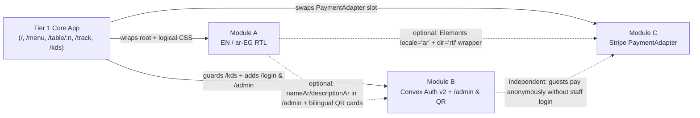
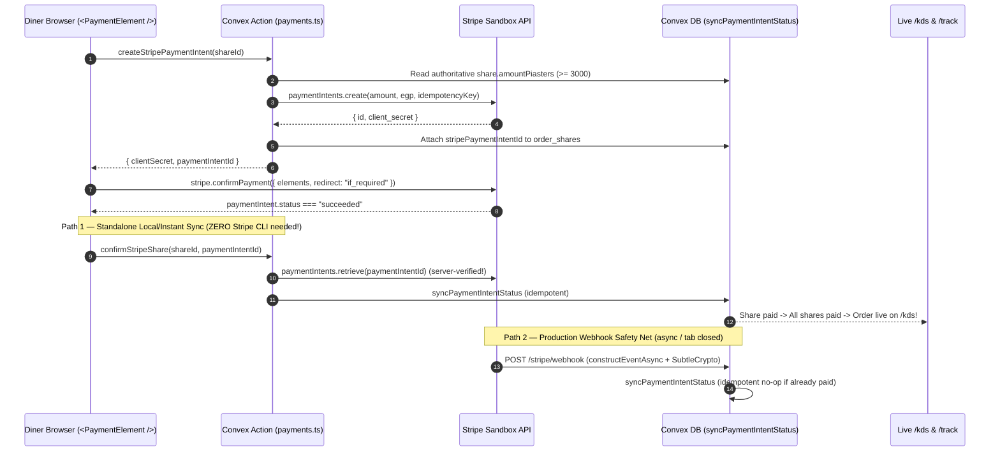

# Tier 2 Modular Expansion Blueprints Pack (Auth/Admin · Bilingual EN/AR RTL · Stripe Sandbox)

> **Date Verified:** November 19, 2026 · **Target Build Window:** Days 15–19 (after Tier 1 Core Loop is 100% verified)  
> **Verification Sources:** Context7 MCP (`/convex/convex-auth`, `/mui/base-ui/v1.9.0`, `/i18next/react-i18next/v18.0.2`, `/i18next/i18next`, `/websites/ui_shadcn`, `/websites/stripe`, `/websites/convex_dev`) and live web verification anchored to **November 19, 2026**.  
> **Design & Stack Alignment:** Built directly onto Tier 1 (`react@19.3.1`, `vite@8.3.8`, `tailwindcss@4.3.5`, `shadcn@4.23.0` `base-luma` on `@base-ui/react@1.9.0`, `@tanstack/react-router@1.170.46`, `@tanstack/react-form@1.33.5`, `zod@4.6.7`, `convex@1.51.0`, integer-piaster EGP math).

---

## Executive Selector — Pick 1 or 2 Modules (Zero Coupling)

All three Tier 2 modules are designed as **independent, drop-in expansions**. Each touches only explicit seams in Tier 1 so you can install **any single module in 3–6 hours** without rewriting the core storefront, shared table cart, split-bill engine, or live KDS loop.

| Module | What It Unlocks | Estimated Plug-In Time | DEPI Rubric Impact | External Setup Friction |
| :--- | :--- | :--- | :--- | :--- |
| **Module A — Bilingual EN + `ar-EG` RTL** | Instant English ↔ Egyptian Arabic toggle, Base UI RTL keyboard/portal sync, Arabic typography & BiDi numeric safety | **3–4 hours** | **Very High** (rare local Egypt UX polish + accessibility depth) | **Zero** (100% frontend + optional `nameAr`/`descriptionAr` fields) |
| **Module B — Staff Auth + Compact `/admin` & QR** | `@convex-dev/auth@2.0.0` login, server-enforced RBAC (`kitchen`/`manager`), protected `/kds` & `/admin`, 1-tap `86` toggle + printable SVG QR tent cards | **4–5 hours** | **Highest** (proves Protected Routes, real Auth, RBAC, full CRUD without ERP bloat) | **Zero** (native Convex components, no OAuth/SMTP/JWT keys needed!) |
| **Module C — Embedded Stripe Sandbox** | Swaps Tier 1's `InstantDemoPaymentAdapter` for real Stripe `<PaymentElement />` (`4242...`), zero-CLI local confirmation + verified webhook + 30 EGP floor fallback | **4–6 hours** | **High** (impressive real-world payment integration & webhook security) | **Low–Medium** (free Stripe Test Mode keys + CSP allowlist) |

> **Recommended Combo for Dec 12:** Pick **Module B + Module A** for maximum zero-external-risk rubric impact (Protected Routes + CRUD + Printable QR cards you can literally scan on stage + Egypt-native Arabic RTL). Add **Module C** if Tier 1 + B finish ahead of schedule and you want live `4242...` card settlement.

### Cross-Module Architecture & Optional Interop Seams



| If You Install Both… | Exact Interop Touchpoint (3–5 Lines) |
| :--- | :--- |
| **Module A + Module B** | Add optional `nameAr` / `descriptionAr` inputs to `MenuAdminTab` form; render bilingual header on printable QR tent cards (`Table 05 · طرابيزة 05`). |
| **Module A + Module C** | Pass `locale: dir === "rtl" ? "ar" : "en"` to Stripe `<Elements options>` and wrap `<Elements>` inside `<div dir={dir}>` so Stripe's iframe mirrors fields and translates labels automatically. |
| **Module B + Module C** | No coupling required — guest diners settle bills via anonymous `participantToken` while staff manage `/kds` and `/admin` via Convex Auth sessions. |

---

# Module A — Bilingual English + Idiomatic Egyptian Arabic (`ar-EG`) RTL Architecture

## A.1 Verified Packages & Tier 1 Seam Contract

```bash
npm install i18next@27.1.5 react-i18next@18.0.2
```

*(No `i18next-browser-languagedetector` required — a 20-line deterministic `localStorage` + browser-language normalizer avoids third-party region quirks like `ar-SA` failing to map to `ar-EG` and keeps bundle size minimal.)*

> **Verified Nov 19, 2026 Breaking Changes (`i18next@27.1.5` + `react-i18next@18.0.2`):**
> 1. **`fallbackLng` now defaults to `false`** (was `'dev'` in v26) — you **MUST** explicitly set `fallbackLng: "en"` in `i18next.init(...)`, otherwise missing keys render raw key strings instead of falling back!
> 2. **`returnEmptyString` now defaults to `false`** and **`strictInterpolationChecks` defaults to `true`** in TypeScript `CustomTypeOptions` — keep both defaults enabled so missing interpolation variables (`{{tableNumber}}`) fail `tsc --noEmit` at compile time.
> 3. **`react-i18next@18.0.2`** requires React 18+ (verified compatible with `react@19.3.1`), uses native `useSyncExternalStore`, and decodes HTML entities consistently inside `<Trans />`.
> 4. **`shadcn@4.23.0` `--rtl` flag:** If you already know you want Module A on Day 1, initialize shadcn with `npx shadcn@latest init -t vite -b base -p luma --rtl` so generated primitives use CSS logical utilities (`ms-*`, `me-*`, `ps-*`, `pe-*`, `start-*`, `end-*`, `text-start`) from the start.

**Minimal Tier 1 files touched:**
- `index.html` (pre-paint `dir`/`lang` bootstrap + static `IBM Plex Sans Arabic` font link)
- `src/index.css` (Arabic typography rules + BiDi helpers)
- `src/main.tsx` (wrap root in `<DirectionBridge>` which renders `@base-ui/react/direction-provider`)
- `src/components/ui/{dialog,drawer,popover}.tsx` (forward explicit `dir` to portal content)
- `src/features/i18n/*` (new self-contained folder)

---

## A.2 Strict TypeScript `CustomTypeOptions` & Egyptian Arabic (`ar-EG`) Dictionaries

Create `src/features/i18n/locales/en.ts` as the single source of truth for keys, then enforce compile-time parity on `src/features/i18n/locales/ar-EG.ts` using `satisfies`.

### `src/features/i18n/locales/en.ts`

```ts
export const enCommon = {
  brand: {
    name: "250° Kitchen",
    mark: "250°",
    livePrep: "~{{minutes}} min prep",
  },
  nav: {
    home: "Home",
    menu: "Menu",
    table: "Table {{number}}",
    kds: "Kitchen Pass",
    admin: "Admin",
    switchLanguage: "عربي",
  },
  hero: {
    joinTable: "Join Table (QR / 1–12)",
    exploreMenu: "Explore Live Menu",
  },
  menu: {
    searchPlaceholder: "Search burgers, stone-oven pizzas, sides...",
    soldOutBadge: "Sold Out · 86",
    addToCart: "Add",
    customize: "Customize",
    currencyEgp: "{{amount}} EGP",
    itemCount_one: "{{count}} item",
    itemCount_other: "{{count}} items",
  },
  table: {
    enterPinTitle: "Join Table {{number}}",
    pinLabel: "4-Digit Table PIN",
    nicknameLabel: "Your First Name",
    joinAction: "Join Shared Table",
    sharedCartTitle: "Table {{number}} Shared Cart",
    addedBy: "Added by {{name}}",
  },
  checkout: {
    title: "Split & Settle",
    modeFull: "Pay Full Table",
    modeMine: "Pay My Items",
    modeEqual: "Split Equally (÷ {{count}})",
    payCard: "Pay by Card",
    payCounter: "Pay at Counter (#C-201)",
    stripeMinNotice:
      "Card payments start at {{min}} EGP. Settle your {{amount}} EGP share at the counter (#C-201).",
  },
  kds: {
    stageNew: "New",
    stageGrill: "On the Grill",
    stageReady: "Ready",
    toggle86: "86 / Sold Out",
  },
} as const;

export type CommonDictionary = typeof enCommon;
```

### `src/features/i18n/locales/ar-EG.ts`

> **Voice Rule:** Write warm, natural modern **Cairo hospitality Egyptian Arabic (`ar-EG`)** — never robotic Modern Standard Arabic machine translations. Notice Arabic CLDR 6-form plural keys (`_zero`, `_one`, `_two`, `_few`, `_many`, `_other`) work natively in `i18next@27`.

```ts
import type { CommonDictionary } from "./en";

// Recursive structural shape keeping string values mutable across locales
type DeepStringRecord<T> = {
  [K in keyof T]: T[K] extends string ? string : DeepStringRecord<T[K]>;
};

export const arEgCommon = {
  brand: {
    name: "مطبخ 250°",
    mark: "250°",
    livePrep: "التحضير ~{{minutes}} د",
  },
  nav: {
    home: "الرئيسية",
    menu: "المنيو",
    table: "طرابيزة {{number}}",
    kds: "شاشة المطبخ",
    admin: "الإدارة",
    switchLanguage: "EN",
  },
  hero: {
    joinTable: "انضم لطرابيزتك (1–12)",
    exploreMenu: "تصفّح المنيو دلوقتي",
  },
  menu: {
    searchPlaceholder: "دوّر على برجر، بيتزا فرن حجري، مقبلات...",
    soldOutBadge: "خلصت النهارده · 86",
    addToCart: "أضف",
    customize: "عدّل طلبك",
    currencyEgp: "{{amount}} ج.م",
    itemCount_zero: "مفيش أصناف",
    itemCount_one: "صنف واحد",
    itemCount_two: "صنفين",
    itemCount_few: "{{count}} أصناف",
    itemCount_many: "{{count}} صنف",
    itemCount_other: "{{count}} صنف",
  },
  table: {
    enterPinTitle: "انضم لطرابيزة {{number}}",
    pinLabel: "كود الطرابيزة (4 أرقام)",
    nicknameLabel: "اسمك الأول",
    joinAction: "ادخل الطلب المشترك",
    sharedCartTitle: "سلة طرابيزة {{number}} المشتركة",
    addedBy: "طلب {{name}}",
  },
  checkout: {
    title: "قسّم الحساب وادفع",
    modeFull: "ادفع حساب الطرابيزة كله",
    modeMine: "ادفع طلباتي بس",
    modeEqual: "قسّم بالتساوي (÷ {{count}})",
    payCard: "ادفع بالكارت",
    payCounter: "ادفع عند الكاشير (#C-201)",
    stripeMinNotice:
      "الدفع بالكارت بيبدأ من {{min}} ج.م. تقدر تدفع نصيبك ({{amount}} ج.م) عند الكاشير برقم #C-201.",
  },
  kds: {
    stageNew: "جديد",
    stageGrill: "ع الشواية",
    stageReady: "جاهز للتقديم",
    toggle86: "خلصت (86)",
  },
} as const satisfies Omit<DeepStringRecord<CommonDictionary>, "menu"> & {
  menu: Omit<DeepStringRecord<CommonDictionary["menu"]>, "itemCount_one" | "itemCount_other"> & {
    itemCount_zero: string;
    itemCount_one: string;
    itemCount_two: string;
    itemCount_few: string;
    itemCount_many: string;
    itemCount_other: string;
  };
};
```

### `src/features/i18n/i18next.d.ts` (Strict `CustomTypeOptions`)

```ts
import "i18next";
import type { enCommon } from "./locales/en";

declare module "i18next" {
  interface CustomTypeOptions {
    defaultNS: "common";
    resources: {
      common: typeof enCommon;
    };
    // Explicit i18next v27 strictness guarantees:
    returnNull: false;
    returnEmptyString: false;
    strictInterpolationChecks: true;
  }
}
```

### `src/features/i18n/config.ts`

```ts
import i18n from "i18next";
import { initReactI18next } from "react-i18next";
import { enCommon } from "./locales/en";
import { arEgCommon } from "./locales/ar-EG";

export const SUPPORTED_LANGUAGES = ["en", "ar-EG"] as const;
export type AppLanguage = (typeof SUPPORTED_LANGUAGES)[number];
export type TextDirection = "ltr" | "rtl";

export const LANG_STORAGE_KEY = "kitchen250:lang";

export function normalizeLanguage(raw: string | null | undefined): AppLanguage {
  if (!raw) return "en";
  return raw.toLowerCase().startsWith("ar") ? "ar-EG" : "en";
}

export function getDirection(lang: AppLanguage): TextDirection {
  return lang === "ar-EG" ? "rtl" : "ltr";
}

function readInitialLanguage(): AppLanguage {
  if (typeof window === "undefined") return "en";
  try {
    const stored = window.localStorage.getItem(LANG_STORAGE_KEY);
    if (stored) return normalizeLanguage(stored);
  } catch {
    // Private browsing / blocked storage fallback
  }
  return "en"; // Default English per hospitality spec; toggle switches instantly
}

export function initI18n(): typeof i18n {
  if (i18n.isInitialized) return i18n;

  const initialLng = readInitialLanguage();

  void i18n.use(initReactI18next).init({
    resources: {
      en: { common: enCommon },
      "ar-EG": { common: arEgCommon },
    },
    lng: initialLng,
    // CRITICAL in i18next@27.1.5: fallbackLng defaults to `false` if omitted!
    fallbackLng: "en",
    supportedLngs: [...SUPPORTED_LANGUAGES],
    load: "currentOnly",
    defaultNS: "common",
    ns: ["common"],
    returnNull: false,
    returnEmptyString: false,
    interpolation: {
      escapeValue: false, // React escapes JSX automatically
    },
  });

  return i18n;
}

export async function switchAppLanguage(next: AppLanguage): Promise<void> {
  try {
    window.localStorage.setItem(LANG_STORAGE_KEY, next);
  } catch {
    // Ignore storage quota errors
  }
  await i18n.changeLanguage(next);
}

/**
 * Optional seam for bilingual Convex dish records without forcing Module A into Tier 1.
 */
export function pickLocalizedField(
  enValue: string,
  arValue: string | undefined,
  lang: AppLanguage,
): string {
  return lang === "ar-EG" && arValue && arValue.trim().length > 0 ? arValue : enValue;
}
```

---

## A.3 Syncing `<html dir lang>` + `@base-ui/react/direction-provider` + Portal `dir`

### 1. Zero-FOUC Pre-Paint Bootstrap in `index.html`

Place this 7-line inline script inside `<head>` before Vite's module entry so Arabic users never see a 1-frame LTR → RTL layout jump on refresh:

```html
<script>
  (function () {
    try {
      var saved = localStorage.getItem("kitchen250:lang");
      var isAr = saved && saved.toLowerCase().indexOf("ar") === 0;
      document.documentElement.lang = isAr ? "ar-EG" : "en";
      document.documentElement.dir = isAr ? "rtl" : "ltr";
    } catch (_) {}
  })();
</script>
```

### 2. `DirectionBridge` (`src/features/i18n/DirectionBridge.tsx`)

> **Verified `@base-ui/react@1.9.0` Contract:** `<DirectionProvider direction={dir}>` from `@base-ui/react/direction-provider` flips Base UI keyboard arrow logic (Tabs, RadioGroup, Menu, Slider) and Floating UI anchor placement, **but explicitly does NOT set HTML `dir` or CSS `direction`** — our `useLayoutEffect` MUST sync `document.documentElement` simultaneously.

```tsx
import { useEffect, useLayoutEffect, useState, type ReactNode } from "react";
import { DirectionProvider } from "@base-ui/react/direction-provider";
import { I18nextProvider } from "react-i18next";
import {
  getDirection,
  initI18n,
  normalizeLanguage,
  type AppLanguage,
  type TextDirection,
} from "./config";

const i18nInstance = initI18n();

export function DirectionBridge({ children }: { children: ReactNode }) {
  const [lang, setLang] = useState<AppLanguage>(() =>
    normalizeLanguage(i18nInstance.language),
  );

  useEffect(() => {
    const handleChanged = (nextLng: string) => {
      setLang(normalizeLanguage(nextLng));
    };
    i18nInstance.on("languageChanged", handleChanged);
    return () => {
      i18nInstance.off("languageChanged", handleChanged);
    };
  }, []);

  const dir: TextDirection = getDirection(lang);

  useLayoutEffect(() => {
    const root = document.documentElement;
    root.lang = lang;
    root.dir = dir;
  }, [lang, dir]);

  return (
    <I18nextProvider i18n={i18nInstance}>
      <DirectionProvider direction={dir}>{children}</DirectionProvider>
    </I18nextProvider>
  );
}
```

### 3. Explicit `dir` Propagation on Base UI Portals (`Dialog`, `Drawer`, `Popover`)

Base UI portals (`Dialog.Portal`, `Popover.Portal`, and Sheet/Drawer portals) mount onto `document.body`. Always stamp explicit `dir` from `@base-ui/react/direction-provider` (`useDirection()`) onto the portal popup/viewport wrapper so Tailwind `rtl:` variants, logical borders, close icons, and nested `<Elements>` iframes stay 100% deterministic even if an ancestor overrides `dir`:

```tsx
// Example drop-in patch inside src/components/ui/dialog.tsx, drawer.tsx, and popover.tsx
import { Dialog as BaseDialog } from "@base-ui/react/dialog";
import { useDirection } from "@base-ui/react/direction-provider";
import { cn } from "@/lib/utils";

export function DialogContent({
  className,
  children,
  ...props
}: BaseDialog.Popup.Props) {
  const dir = useDirection();

  return (
    <BaseDialog.Portal>
      <BaseDialog.Backdrop className="fixed inset-0 z-50 bg-black/40 backdrop-blur-xs" />
      <BaseDialog.Popup
        dir={dir}
        className={cn(
          "fixed start-1/2 top-1/2 z-50 w-full max-w-lg -translate-x-1/2 -translate-y-1/2 rtl:translate-x-1/2 rounded-3xl bg-card p-6 text-start shadow-xl",
          className,
        )}
        {...props}
      >
        {children}
      </BaseDialog.Popup>
    </BaseDialog.Portal>
  );
}
```

> **Watch-out on centering (`start-1/2` + `translate-x`):** In RTL, `start-1/2` maps to `right: 50%`, so `-translate-x-1/2` shifts the modal off-center unless paired with `rtl:translate-x-1/2` — **OR even cleaner:** use a Flexbox centering wrapper (`fixed inset-0 z-50 grid place-items-center p-4`) with **zero `translate` transforms**! That simultaneously eliminates the RTL centering math AND eliminates the iOS Safari `transform` iframe bug in Module C!

---

## A.4 Font Setup (`Plus Jakarta Sans` EN + Static `IBM Plex Sans Arabic` 400/500/700 AR)

### 1. Load Static `IBM Plex Sans Arabic` Weights Only (`index.html`)

Use **static** weights `400`, `500`, `700` (no variable font interpolation artifacts on Arabic cursive joins; Google Fonts' `unicode-range` automatically ensures English-only visitors download **0 bytes** of Arabic font files):

```html
<link rel="preconnect" href="https://fonts.googleapis.com" />
<link rel="preconnect" href="https://fonts.gstatic.com" crossorigin />
<link
  href="https://fonts.googleapis.com/css2?family=IBM+Plex+Sans+Arabic:wght@400;500;700&family=Plus+Jakarta+Sans:wght@400;500;600;700&display=swap"
  rel="stylesheet"
/>
```

*(Prefer offline/self-hosted assets for DEPI classroom Wi-Fi safety? Install `@fontsource/plus-jakarta-sans` and `@fontsource/ibm-plex-sans-arabic` and import only `400.css`, `500.css`, `700.css` inside `src/main.tsx`!)*

### 2. Mandatory Arabic Typography Guardrails (`src/index.css`)

```css
@layer base {
  :root {
    --font-sans-en: "Plus Jakarta Sans", system-ui, -apple-system, sans-serif;
    --font-sans-ar: "IBM Plex Sans Arabic", "Plus Jakarta Sans", system-ui, sans-serif;
    --font-sans: var(--font-sans-en);
  }

  /* Switch font stack cleanly when Arabic is active */
  html[lang^="ar"],
  [dir="rtl"] {
    --font-sans: var(--font-sans-ar);
    font-family: var(--font-sans-ar);
    /* Prevent browser faux-italics that distort Arabic neo-grotesque geometry */
    font-synthesis-style: none;
  }

  /* NON-NEGOTIABLE: Arabic cursive letters fracture if ANY letter-spacing is applied */
  html[lang^="ar"] *,
  [dir="rtl"] * {
    letter-spacing: 0 !important;
  }

  /* Generous leading for Arabic ascenders, loops, and vocalization marks */
  html[lang^="ar"] body,
  [dir="rtl"] body {
    line-height: 1.65;
  }

  html[lang^="ar"] :is(h1, h2, h3),
  [dir="rtl"] :is(h1, h2, h3) {
    line-height: 1.35;
  }
}

/* BiDi-safe numeric utility */
.bidi-num {
  unicode-bidi: isolate;
  direction: ltr;
  font-variant-numeric: tabular-nums;
}
```

---

## A.5 BiDi Safety Rules, Western `latn` Digits & Directional-Only Icon Mirroring

Create `src/features/i18n/bidi.tsx` as the single reusable BiDi safety kit across the app:

```tsx
import type { ComponentType, SVGProps } from "react";
import { cn } from "@/lib/utils";
import type { AppLanguage } from "./config";

/**
 * Isolates LTR tokens (brand mark `250°`, order codes `#C-201`, Table PINs `4829`,
 * timers `08:42`) inside RTL Arabic sentences so the Unicode BiDi algorithm never
 * flips `250°` into `°250` or `#C-201` into `201-C#`.
 */
export function LtrToken({
  children,
  className,
}: {
  children: string | number;
  className?: string;
}) {
  return (
    <bdi dir="ltr" className={cn("bidi-num inline-block", className)}>
      {children}
    </bdi>
  );
}

/**
 * Always formats EGP prices using Western Arabic (`latn`) digits (0-9) even in `ar-EG`,
 * matching modern Cairo hospitality POS & menu boards.
 * Input is ALWAYS integer piasters (e.g., 24500 -> "245" or "245.50").
 */
const egpLatnFormatter = new Intl.NumberFormat("en-EG", {
  numberingSystem: "latn",
  minimumFractionDigits: 0,
  maximumFractionDigits: 2,
});

export function formatEgpAmount(amountPiasters: number): string {
  const major = amountPiasters / 100;
  return egpLatnFormatter.format(major);
}

export function formatEgpLabel(amountPiasters: number, lang: AppLanguage): string {
  const formatted = formatEgpAmount(amountPiasters);
  return lang === "ar-EG" ? `${formatted} ج.م` : `${formatted} EGP`;
}

/**
 * Wraps directional navigation icons ONLY (chevrons, arrows, back/forward, sign-out).
 * Applies Tailwind v4 `rtl:-scale-x-100`.
 */
export function DirectionalIcon({
  icon: Icon,
  className,
}: {
  icon: ComponentType<SVGProps<SVGSVGElement>>;
  className?: string;
}) {
  return <Icon aria-hidden="true" className={cn("rtl:-scale-x-100", className)} />;
}
```

### Strict Icon & Media Mirroring Policy

| Category | Mirror in RTL (`rtl:-scale-x-100`)? | Concrete Examples |
| :--- | :---: | :--- |
| **Directional / Navigational** | **YES** | `ArrowRight`, `ArrowLeft`, `ChevronRight`, `ChevronLeft`, `LogOut`, `Undo2`, `CornerDownRight` |
| **Universal Symbols & Time** | **NEVER** | `Check`, `CheckCircle2`, `Clock`, `Timer`, `Flame`, `Heart`, `Search`, `ShoppingBag`, `Plus`, `Minus`, `QrCode`, `Utensils` |
| **Brand Marks & Codes** | **NEVER** (wrap in `<LtrToken>`) | `<bdi dir="ltr">250°</bdi>`, `<bdi dir="ltr">#C-201</bdi>`, `<bdi dir="ltr">PIN 4829</bdi>` |
| **Food Photography** | **NEVER** | Hero grill plates, 4:3 dish thumbnails, ingredient previews |

---

## A.6 Module A Verification Gate (Anti-Rubber-Stamp)

- [ ] **Compile-time key & interpolation safety:** `tsc --noEmit` fails if you pass an unknown translation key or omit a required `{{variable}}` (verified `strictInterpolationChecks: true`).
- [ ] **Zero LTR→RTL flash:** Switch to `ar-EG`, hard-reload `/menu` and `/table/5`, confirm `document.documentElement.dir === "rtl"` and `lang === "ar-EG"` before first paint.
- [ ] **Arabic ligature check:** Inspect computed CSS on an `h1` (`tracking-tight` in EN) and uppercase badge (`tracking-wider` in EN) while in `ar-EG` — computed `letter-spacing` MUST be `0px` and `font-synthesis-style` MUST be `none`.
- [ ] **Portal & keyboard check:** Open Dish Customizer Drawer and Split Checkout Dialog in `ar-EG` — verify `dir="rtl"` is present on the portal element, text aligns right, close button sits on the inline-end (left), and Base UI Tabs respond cleanly to reversed Left/Right arrow keys.
- [ ] **BiDi & digit check:** Verify `<bdi dir="ltr">250°</bdi>`, `#C-201`, prices (`245 ج.م`), and `/kds` elapsed timer (`04:18`) render Western `0-9` digits in proper LTR order inside RTL sentences.
- [ ] **Zero mirrored checkmarks/clocks/photos:** Visually inspect `/menu`, `/track`, and `/kds` screenshots in RTL at `1440×900` and `390×844`.

---

# Module B — Staff Protected Auth (`@convex-dev/auth@2.0.0`) + Compact `/admin` & Printable QR Generator

## B.1 Verified Packages & Convex Auth v2 Architecture Notes

```bash
npm install @convex-dev/auth@2.0.0 qrcode@1.5.4
npm install --save-dev @types/qrcode
```

> **Verified Nov 19, 2026 `@convex-dev/auth@2.0.0` (Released Nov 12, 2026) Critical Facts:**
> 1. **Component-first architecture:** You register `@convex-dev/auth` core + `password` + `username` components in `convex/convex.config.ts` and run `npx convex dev` to generate `components.auth`, `components.authPassword`, and `components.authUsername`.
> 2. **Zero JWT env vars required:** Requires `convex >= 1.48.0` (we run `convex@1.51.0`). `convexAuthProvider()` in `convex/auth.config.ts` lets your Convex deployment issue JWTs directly — do **NOT** run the removed `npx @convex-dev/auth` CLI and do **NOT** set `JWT_PRIVATE_KEY` or `JWKS`!
> 3. **Stateful sessions (`getAuthUserId`):** A JWT's `sub` is now the **session ID**, not the user ID. ALWAYS call `await getAuthUserId(ctx)` from `@convex-dev/auth/server` — never use `ctx.auth.getUserIdentity().subject` as a `users` document ID.
> 4. **Callback signature changed from beta.0:** `createUser` receives `method: { name: "usernamePassword", profile: {} }` (NOT `provider`).
> 5. **No `disableSignUp` flag on `setupUsernamePassword`:** Prevent public staff self-registration by **deliberately omitting `signUpWithUsernamePassword` from `convex/auth.ts` exports** and seeding staff strictly via CLI!

---

## B.2 Exact Convex Auth v2 Backend Setup

### 1. `convex/convex.config.ts`

```ts
import { defineApp } from "convex/server";
import auth from "@convex-dev/auth/convex.config.js";
import authPassword from "@convex-dev/auth/components/password/convex.config.js";
import authUsername from "@convex-dev/auth/components/username/convex.config.js";

const app = defineApp();

app.use(auth);
app.use(authPassword);
app.use(authUsername);

export default app;
```

Run `npx convex dev` once immediately after adding `convex/convex.config.ts` so Convex generates `components.auth`, `components.authPassword`, and `components.authUsername` inside `convex/_generated/api.d.ts`.

### 2. `convex/auth.config.ts`

```ts
import type { AuthConfig } from "convex/server";
import { convexAuthProvider } from "@convex-dev/auth/server";

export default {
  providers: [convexAuthProvider()],
} satisfies AuthConfig;
```

### 3. Schema Additions in `convex/schema.ts`

Merge these two tables into your existing Tier 1 `defineSchema({ ... })`:

```ts
import { defineSchema, defineTable } from "convex/server";
import { v } from "convex/values";

export const vStaffRole = v.union(v.literal("kitchen"), v.literal("manager"));

export default defineSchema({
  // ... existing Tier 1 tables (menu_items, tables, table_sessions, orders, order_shares)

  /** Minimal identity anchor owned by @convex-dev/auth@2.0.0 */
  users: defineTable({}),

  /** Server-enforced RBAC profile decoupled from auth credentials */
  staff_profiles: defineTable({
    userId: v.id("users"),
    username: v.string(),
    displayName: v.string(),
    role: vStaffRole,
    active: v.boolean(),
    createdAt: v.number(),
  })
    .index("by_userId", ["userId"])
    .index("by_username", ["username"]),
});
```

### 4. `convex/users.ts` (User Creation Callback)

```ts
import { internalMutation } from "./_generated/server";
import { v } from "convex/values";

/**
 * Callback required by setupUsernamePassword().attachUserCallbacks().
 * NOTE: Because `signUpWithUsernamePassword` is NOT publicly exported in `convex/auth.ts`,
 * this mutation is only reachable by controlled internal provisioning.
 */
export const createUser = internalMutation({
  args: {
    method: v.object({
      name: v.literal("usernamePassword"),
      profile: v.object({}),
    }),
  },
  returns: v.id("users"),
  handler: async (ctx) => {
    return await ctx.db.insert("users", {});
  },
});
```

### 5. `convex/auth.ts` (Public Sign-Up Deliberately Omitted!)

```ts
import { components, internal } from "./_generated/api";
import { setupConvexAuth } from "@convex-dev/auth/server";
import { setupUsernamePassword } from "@convex-dev/auth/methods/username-password/server";

const auth = setupConvexAuth({ component: components.auth });

// Core session lifecycle functions consumed by ConvexAuthProvider
export const { signOut, refreshSession, isAuthenticated } = auth;

const usernamePassword = setupUsernamePassword(auth, {
  component: components.authPassword,
  usernameComponent: components.authUsername,
}).attachUserCallbacks({
  createUser: internal.users.createUser,
});

/**
 * SECURITY CONTRACT:
 * `@convex-dev/auth@2.0.0` `setupUsernamePassword` has NO `disableSignUp` option.
 * We intentionally export ONLY `signInWithUsernamePassword` and `changePassword`.
 * `signUpWithUsernamePassword` is OMITTED so unauthenticated guests can NEVER
 * register staff accounts via public Convex endpoints.
 */
export const { signInWithUsernamePassword, changePassword } = usernamePassword;
```

### 6. CLI-Only Staff Seeding (`convex/seedStaff.ts`)

Because `signUpWithUsernamePassword` is omitted from public exports, seed your two demo staff accounts (`manager` and `chef`) strictly via **CLI-only internal functions** (`npx convex run ...` — impossible to call from browsers):

```ts
import { internalAction, internalMutation } from "./_generated/server";
import { components, internal } from "./_generated/api";
import { v } from "convex/values";
import { vStaffRole } from "./schema";

/**
 * Step 1 (internalMutation): Idempotently creates the `users` row + `staff_profiles` RBAC row.
 */
export const createStaffRecord = internalMutation({
  args: {
    username: v.string(),
    displayName: v.string(),
    role: vStaffRole,
  },
  returns: v.object({
    userId: v.id("users"),
    alreadyExisted: v.boolean(),
  }),
  handler: async (ctx, args) => {
    const normalized = args.username.trim().toLowerCase();
    const existing = await ctx.db
      .query("staff_profiles")
      .withIndex("by_username", (q) => q.eq("username", normalized))
      .unique();

    if (existing) {
      await ctx.db.patch(existing._id, {
        displayName: args.displayName,
        role: args.role,
        active: true,
      });
      return { userId: existing.userId, alreadyExisted: true };
    }

    const userId = await ctx.db.insert("users", {});
    await ctx.db.insert("staff_profiles", {
      userId,
      username: normalized,
      displayName: args.displayName,
      role: args.role,
      active: true,
      createdAt: Date.now(),
    });

    return { userId, alreadyExisted: false };
  },
});

/**
 * Step 2 (CLI-only internalAction): Seeds a staff user's username mapping, hashed password,
 * and RBAC `staff_profiles` row in one idempotent command:
 *
 *   npx convex run seedStaff:seedStaffAccount \
 *     '{"username":"manager","password":"<strong-demo-pass>","displayName":"Salma (Manager)","role":"manager"}'
 *
 *   npx convex run seedStaff:seedStaffAccount \
 *     '{"username":"chef","password":"<strong-demo-pass>","displayName":"Chef Tarek","role":"kitchen"}'
 *
 * IMPLEMENTATION VERIFICATION NOTE (Nov 19, 2026):
 * In `@convex-dev/auth@2.0.0`, internal component methods that accept caller-supplied IDs
 * use generated names under `components.authUsername` & `components.authPassword`
 * (and `setPassword` requires `minimumLength`, e.g., `8`). After running `npx convex dev`,
 * inspect `convex/_generated/api.d.ts` to verify exact argument field names on
 * `components.authUsername` and `components.authPassword` before running the seed command.
 */
export const seedStaffAccount = internalAction({
  args: {
    username: v.string(),
    password: v.string(),
    displayName: v.string(),
    role: vStaffRole,
  },
  returns: v.object({
    userId: v.id("users"),
    username: v.string(),
    role: vStaffRole,
    created: v.boolean(),
  }),
  handler: async (ctx, args) => {
    const normalized = args.username.trim().toLowerCase();
    if (args.password.length < 8) {
      throw new Error("Staff password must be at least 8 characters.");
    }

    const { userId, alreadyExisted } = await ctx.runMutation(
      internal.seedStaff.createStaffRecord,
      {
        username: normalized,
        displayName: args.displayName,
        role: args.role,
      },
    );

    if (!alreadyExisted) {
      // Reserve username in authUsername component & hash/store password in authPassword component.
      // Check exact method names in generated `convex/_generated/api.d.ts` after `npx convex dev`.
      await ctx.runMutation(components.authUsername.public.setUsername, {
        userId,
        username: normalized,
      });
    }

    // Idempotently set or rotate password (v2.0.0 requires explicit `minimumLength`)
    await ctx.runAction(components.authPassword.public.setPassword, {
      userId,
      password: args.password,
      minimumLength: 8,
    });

    return {
      userId,
      username: normalized,
      role: args.role,
      created: !alreadyExisted,
    };
  },
});
```

> **Zero-Friction Alternative if Generated Component Names Differ in a Minor Patch:**
> Because `setupUsernamePassword` already composes `components.authUsername` + `components.authPassword` internally, you can inspect `node_modules/@convex-dev/auth/dist/methods/username-password/server.js` (20 lines) on Day 15 to verify the exact `components.authUsername.*` and `components.authPassword.*` helper names called inside `signUpWithUsernamePassword`, and call those exact two component refs inside `seedStaffAccount` — keeping `signUpWithUsernamePassword` 100% unexported from public APIs!

---

## B.3 Server-Enforced RBAC Wrapper (`requireStaffRole`) & Staff Query

### `convex/lib/authGuard.ts`

```ts
import { ConvexError } from "convex/values";
import { getAuthUserId } from "@convex-dev/auth/server";
import type { MutationCtx, QueryCtx } from "../_generated/server";
import type { Doc } from "../_generated/dataModel";

export type StaffRole = "kitchen" | "manager";

export interface AuthenticatedStaff {
  userId: Doc<"users">["_id"];
  profile: Doc<"staff_profiles">;
}

/**
 * Mandatory server-side RBAC guard.
 * EVERY `/kds` and `/admin` query/mutation MUST call this at line 1 of its handler.
 * TanStack Router `beforeLoad` is UX only — this function is the real security boundary.
 */
export async function requireStaffRole(
  ctx: QueryCtx | MutationCtx,
  allowedRoles: readonly StaffRole[],
): Promise<AuthenticatedStaff> {
  const userId = await getAuthUserId(ctx);
  if (userId === null) {
    throw new ConvexError({
      code: "UNAUTHENTICATED",
      message: "Staff sign-in required.",
    });
  }

  const profile = await ctx.db
    .query("staff_profiles")
    .withIndex("by_userId", (q) => q.eq("userId", userId))
    .unique();

  if (!profile || !profile.active) {
    throw new ConvexError({
      code: "FORBIDDEN",
      message: "Staff account is inactive or missing a profile.",
    });
  }

  if (!allowedRoles.includes(profile.role)) {
    throw new ConvexError({
      code: "FORBIDDEN",
      message: `Requires one of roles: ${allowedRoles.join(", ")}.`,
    });
  }

  return { userId, profile };
}
```

### `convex/staff.ts` (Current Staff Profile Query)

```ts
import { query } from "./_generated/server";
import { getAuthUserId } from "@convex-dev/auth/server";

export const me = query({
  args: {},
  handler: async (ctx) => {
    const userId = await getAuthUserId(ctx);
    if (userId === null) return null;

    const profile = await ctx.db
      .query("staff_profiles")
      .withIndex("by_userId", (q) => q.eq("userId", userId))
      .unique();

    if (!profile || !profile.active) return null;

    return {
      userId,
      username: profile.username,
      displayName: profile.displayName,
      role: profile.role,
    };
  },
});
```

### Role Enforcement Matrix Across Backend Functions

| Convex Function | Allowed Roles | Notes |
| :--- | :--- | :--- |
| `menu.listPublic`, `table.join`, `cart.*`, `orders.create`, `orders.track` | **Public (Guest Diner)** | Never blocked by staff auth; table actions verified by `participantToken` + active session. |
| `kds.listActiveTickets`, `kds.bumpOrderStatus`, `menu.toggleItem86` | `["kitchen", "manager"]` | Both kitchen staff and managers can run the KDS pass and 86 sold-out dishes. |
| `admin.createMenuItem`, `admin.updateMenuItem`, `admin.rotateTablePin`, `admin.listTablesWithPins` | `["manager"]` | Strict manager-only mutations; `kitchen` receives `FORBIDDEN`. |

---

## B.4 Client Provider, Staff Login UI & TanStack Router `beforeLoad` Guard

### 1. Client Root Provider (`src/main.tsx` Patch)

Replace Tier 1's `<ConvexProvider>` with `<ConvexAuthProvider>` from `@convex-dev/auth/react`:

```tsx
import { ConvexReactClient } from "convex/react";
import { ConvexAuthProvider } from "@convex-dev/auth/react";
import { api } from "../convex/_generated/api";

const convex = new ConvexReactClient(import.meta.env.VITE_CONVEX_URL);

// Inside createRoot(...).render(...)
<ConvexAuthProvider
  client={convex}
  refreshSession={api.auth.refreshSession}
  signOut={api.auth.signOut}
  isAuthenticated={api.auth.isAuthenticated}
>
  <AppRouter />
</ConvexAuthProvider>
```

### 2. Race-Free TanStack Router Context Without Slowing Down Public Diner Routes

A common Convex + TanStack Router pitfall is blocking the *entire* app on `isLoading` from `useConvexAuth()`. **Do NOT block guest diners on `/`, `/menu`, or `/table/:n`!** Instead, pass `auth` state into router context and let the pathless `/_staff` layout handle both loading and unauthenticated redirects cleanly:

```tsx
// src/router.tsx
import { createRouter, RouterProvider } from "@tanstack/react-router";
import { useConvexAuth, useQuery } from "convex/react";
import { api } from "../convex/_generated/api";
import { routeTree } from "./routeTree.gen";
import type { StaffRole } from "../convex/lib/authGuard";

export interface StaffSession {
  username: string;
  displayName: string;
  role: StaffRole;
}

export interface RouterAuthContext {
  isLoading: boolean;
  isAuthenticated: boolean;
  staff: StaffSession | null | undefined; // undefined while query is in flight
}

export const router = createRouter({
  routeTree,
  context: {
    auth: {
      isLoading: true,
      isAuthenticated: false,
      staff: undefined,
    } satisfies RouterAuthContext,
  },
});

declare module "@tanstack/react-router" {
  interface Register {
    router: typeof router;
  }
}

export function AppRouter() {
  const { isLoading, isAuthenticated } = useConvexAuth();
  const staff = useQuery(api.staff.me, isAuthenticated ? {} : "skip");

  return (
    <RouterProvider
      router={router}
      context={{
        auth: {
          isLoading: isLoading || (isAuthenticated && staff === undefined),
          isAuthenticated,
          staff: isAuthenticated ? (staff ?? null) : null,
        },
      }}
    />
  );
}
```

### 3. Protected Layout Route (`src/routes/_staff.tsx`) + Manager Guard (`src/routes/_staff/admin.tsx`)

```tsx
// src/routes/_staff.tsx
import { createFileRoute, Outlet, redirect, useNavigate } from "@tanstack/react-router";
import { useEffect } from "react";

export const Route = createFileRoute("/_staff")({
  beforeLoad: ({ context, location }) => {
    // Only redirect once Convex auth hydration finishes (prevents false-positive redirects!)
    if (!context.auth.isLoading && !context.auth.isAuthenticated) {
      throw redirect({
        to: "/login",
        search: { redirect: location.pathname },
      });
    }
  },
  component: StaffProtectedLayout,
});

function StaffProtectedLayout() {
  const { auth } = Route.useRouteContext();
  const navigate = useNavigate();

  // Handles live session expiry or logout while staying on a protected route
  useEffect(() => {
    if (!auth.isLoading && !auth.isAuthenticated) {
      void navigate({
        to: "/login",
        search: { redirect: window.location.pathname },
        replace: true,
      });
    }
  }, [auth.isLoading, auth.isAuthenticated, navigate]);

  if (auth.isLoading) {
    return (
      <div className="grid min-h-dvh place-items-center bg-background text-muted-foreground">
        <p className="text-sm font-medium">Verifying staff session…</p>
      </div>
    );
  }

  if (!auth.isAuthenticated || !auth.staff) {
    return null;
  }

  return <Outlet />;
}
```

And inside `src/routes/_staff/admin.tsx`, add a 6-line manager-role check in `beforeLoad`:

```tsx
export const Route = createFileRoute("/_staff/admin")({
  beforeLoad: ({ context }) => {
    if (!context.auth.isLoading && context.auth.staff?.role !== "manager") {
      throw redirect({ to: "/kds" });
    }
  },
  component: AdminPage,
});
```

### 4. Staff Login Route (`src/routes/login.tsx`) with Typed Exhaustive Error Handling

```tsx
import { createFileRoute, useNavigate, useRouter } from "@tanstack/react-router";
import { useSignInWithUsernamePassword } from "@convex-dev/auth/methods/username-password/react";
import { z } from "zod";
import { useState } from "react";
import { api } from "../../convex/_generated/api";

const loginSearchSchema = z.object({
  redirect: z.string().optional(),
});

function sanitizeRedirect(raw: string | undefined): string {
  // Prevent open redirects (reject "//evil.com" or external URLs)
  if (!raw || !raw.startsWith("/") || raw.startsWith("//")) return "/kds";
  return raw;
}

export const Route = createFileRoute("/login")({
  validateSearch: loginSearchSchema,
  component: StaffLoginPage,
});

function StaffLoginPage() {
  const { redirect: rawRedirect } = Route.useSearch();
  const navigate = useNavigate();
  const router = useRouter();
  const { signIn, pending } = useSignInWithUsernamePassword(api.auth);

  const [username, setUsername] = useState("");
  const [password, setPassword] = useState("");
  const [errorMessage, setErrorMessage] = useState<string | null>(null);

  async function handleSubmit(e: React.FormEvent<HTMLFormElement>) {
    e.preventDefault();
    setErrorMessage(null);

    const result = await signIn({
      username: username.trim().toLowerCase(),
      password,
    });

    if (result.success) {
      await router.invalidate();
      await navigate({ to: sanitizeRedirect(rawRedirect), replace: true });
      return;
    }

    // Exhaustive typed userError handling per @convex-dev/auth@2.0.0 best practices
    switch (result.userError.error) {
      case "INVALID_CREDENTIALS":
        setErrorMessage("Incorrect staff username or password.");
        break;
      default: {
        const _exhaustive: never = result.userError.error;
        setErrorMessage(`Sign-in failed (${String(_exhaustive)}).`);
      }
    }
  }

  return (
    <main className="grid min-h-dvh place-items-center bg-background px-4">
      <form
        onSubmit={(e) => void handleSubmit(e)}
        className="w-full max-w-sm space-y-5 rounded-3xl bg-card p-8 shadow-sm"
      >
        <div className="space-y-1 text-center">
          <p className="text-xs font-semibold uppercase tracking-wider text-muted-foreground">
            250° Kitchen · Staff Pass
          </p>
          <h1 className="text-2xl font-bold text-foreground">Staff Sign In</h1>
        </div>

        <div className="space-y-3">
          <label className="block space-y-1.5 text-sm font-medium">
            <span>Username</span>
            <input
              type="text"
              autoComplete="username"
              required
              disabled={pending}
              value={username}
              onChange={(e) => setUsername(e.target.value)}
              className="w-full rounded-xl border border-input bg-background px-3.5 py-2.5 text-base"
              placeholder="chef or manager"
            />
          </label>

          <label className="block space-y-1.5 text-sm font-medium">
            <span>Password</span>
            <input
              type="password"
              autoComplete="current-password"
              required
              minLength={8}
              disabled={pending}
              value={password}
              onChange={(e) => setPassword(e.target.value)}
              className="w-full rounded-xl border border-input bg-background px-3.5 py-2.5 text-base"
            />
          </label>
        </div>

        {errorMessage && (
          <p role="alert" className="rounded-xl bg-destructive/10 px-3 py-2 text-sm text-destructive">
            {errorMessage}
          </p>
        )}

        <button
          type="submit"
          disabled={pending}
          className="h-11 w-full rounded-full bg-primary font-semibold text-primary-foreground transition hover:opacity-95 disabled:opacity-60"
        >
          {pending ? "Signing in…" : "Enter Staff Area"}
        </button>
      </form>
    </main>
  );
}
```

*(Note on Sign Out: call `const { signOut } = useAuthActions()` from `@convex-dev/auth/react`, await `signOut()`, then immediately call `await router.invalidate()` so protected guards re-evaluate cleanly!)*

---

## B.5 Compact 2-Tab `/admin` Design (Zero ERP Bloat!)

Keep `/admin` intentionally **lean, studio-clean, and strictly 2 tabs** using `@base-ui/react/tabs` (`shadcn base-luma`):

| Tab | What Lives Here | Explicitly Excluded (No ERP Bloat) |
| :--- | :--- | :--- |
| **Tab 1: Menu & `86` Toggle** | Live search + category pills, compact dish list (`14–16` items), **1-tap `86 / Sold Out` Switch** (instant sync to `/menu` & `/kds`), and **`Add / Edit Dish` Drawer** (`@tanstack/react-form` + `zod@4.6.7`, EGP major input → integer piasters on submit, image URL/preset selector, category, active/86 toggle). | No Recharts analytics, no `@dnd-kit` drag-reordering, no recipe BOM inventory, no multi-branch pricing matrices. |
| **Tab 2: Tables 1–12 & Printable QR Tent Cards** | 12-card responsive grid showing table status (`Idle` / `Active · N diners`), current 4-digit **Table PIN**, 1-tap **`Rotate PIN`** button, and **`Print QR Tent Card`** / **`Print All 12 (A4)`** using vector SVG QR generation (`qrcode@1.5.4`). | No interactive drag-and-drop floorplan canvas, no 80mm thermal `@media print` receipt hacks. |

### Lightweight Printable SVG QR Tent Card Component (`src/features/admin/PrintableQrTentCard.tsx`)

> **Why `qrcode.toString(..., { type: "svg" })`?** Pure SVG vector output prints razor-sharp at 600+ DPI on any A4 printer or PDF export, scales cleanly in responsive cards, has zero `<canvas>` retina blur, and is lazy-loaded strictly inside `/admin`.

```tsx
import { useEffect, useState } from "react";
import QRCode from "qrcode";

interface QrTentCardProps {
  tableNumber: number;
  pin: string;
  baseUrl?: string;
}

export function QrTentCard({
  tableNumber,
  pin,
  baseUrl = window.location.origin,
}: QrTentCardProps) {
  const [svgMarkup, setSvgMarkup] = useState<string>("");
  const targetUrl = `${baseUrl}/table/${tableNumber}`;

  useEffect(() => {
    let cancelled = false;

    void QRCode.toString(targetUrl, {
      type: "svg",
      errorCorrectionLevel: "M",
      margin: 2,
      color: {
        dark: "#1D1916", // Warm Espresso Charcoal (matches VISUAL-DIRECTION.md)
        light: "#FFFFFF",
      },
    }).then((svg) => {
      if (!cancelled) setSvgMarkup(svg);
    });

    return () => {
      cancelled = true;
    };
  }, [targetUrl]);

  return (
    <article className="qr-tent-card flex flex-col items-center justify-between rounded-3xl border border-border bg-white p-6 text-center shadow-xs print:break-inside-avoid print:rounded-2xl print:border-neutral-300 print:shadow-none">
      <div className="space-y-1">
        <p className="text-xs font-semibold uppercase tracking-wider text-neutral-500">
          <bdi dir="ltr">250°</bdi> Kitchen
        </p>
        <h3 className="text-2xl font-bold text-[#1D1916]">
          Table <bdi dir="ltr">{String(tableNumber).padStart(2, "0")}</bdi>
        </h3>
      </div>

      {/* Generated locally from trusted window.location.origin + integer tableNumber */}
      <div
        className="my-4 aspect-square w-44 rounded-2xl bg-white p-2 ring-1 ring-neutral-200 [&>svg]:h-full [&>svg]:w-full"
        aria-label={`QR code for Table ${tableNumber}`}
        dangerouslySetInnerHTML={{ __html: svgMarkup }}
      />

      <div className="space-y-1.5">
        <p className="text-xs font-medium text-neutral-600">
          Scan to browse live menu &amp; share cart
        </p>
        <div className="inline-flex items-center gap-2 rounded-full bg-[#F4F0E8] px-4 py-1.5 text-sm font-bold text-[#1D1916]">
          <span className="text-xs font-semibold uppercase text-neutral-500">PIN</span>
          <bdi dir="ltr" className="font-mono tracking-widest tabular-nums">
            {pin}
          </bdi>
        </div>
      </div>
    </article>
  );
}
```

### Print Sheet Stylesheet (`src/features/admin/print-qr.css`)

```css
@media print {
  @page {
    size: A4 portrait;
    margin: 12mm;
  }

  /* Hide floating nav, tabs, and buttons; print ONLY the 2x2 QR tent card grid */
  body * {
    visibility: hidden;
  }

  .qr-print-sheet,
  .qr-print-sheet * {
    visibility: visible;
  }

  .qr-print-sheet {
    position: absolute;
    inset: 0;
    display: grid !important;
    grid-template-columns: repeat(2, 1fr) !important;
    gap: 10mm !important;
  }

  .qr-tent-card {
    break-inside: avoid;
    page-break-inside: avoid;
  }
}
```

---

## B.6 Module B Verification Gate (Anti-Rubber-Stamp)

- [ ] **Public sign-up impossible:** Verify `api.auth` in `convex/_generated/api.d.ts` does **NOT** expose `signUpWithUsernamePassword`.
- [ ] **Server RBAC unit tests (`convex-test@0.0.73`):**
  1. Unauthenticated call to `kds.bumpOrderStatus` → throws `UNAUTHENTICATED`.
  2. Authenticated `kitchen` role call to `admin.rotateTablePin` → throws `FORBIDDEN`.
  3. Authenticated `manager` role call to `admin.rotateTablePin` → succeeds & returns new 4-digit PIN.
  4. Deactivated staff (`active: false`) → throws `FORBIDDEN`.
- [ ] **Router guard browser verification:** Open incognito tab → visit `/admin` → cleanly redirects to `/login?redirect=%2Fadmin` with 0 console errors → sign in as `chef` → redirects to `/kds` (blocked from `/admin`) → sign out → sign in as `manager` → lands on `/admin`.
- [ ] **Live `86` sync check:** Toggle `86` on a dish in Tab 1 (`/admin`) while `/menu` is open side-by-side → `/menu` card disables in `<300ms`.
- [ ] **Real QR scan test:** Click **Print Preview** on Tab 2, scan Table 5's SVG QR code with your phone camera, confirm it opens `/table/5` and accepts the displayed 4-digit PIN!

---

# Module C — Embedded Stripe Sandbox (`<PaymentElement />`) Adapter

## C.1 Verified Packages & Runtime Notes

```bash
npm install stripe@23.1.0 @stripe/stripe-js@10.3.0 @stripe/react-stripe-js@7.1.0
```

> **Verified Nov 19, 2026 Package & Runtime Facts:**
> 1. **`@stripe/react-stripe-js@7.1.0`** officially requires **React 19** (matches our `react@19.3.1`!) and removed legacy `PaymentRequestButtonElement` — use `<PaymentElement />` exclusively.
> 2. **`stripe@23.1.0`** requires Node 20+ (Mac runs Node `26.13.1`). In Convex V8 runtime (`httpAction` and default actions), initialize Stripe with **`httpClient: Stripe.createFetchHttpClient()`** and verify webhook signatures with **`Stripe.createSubtleCryptoProvider()`** + **`constructEventAsync(...)`** — zero Node-only `crypto`/`http` polyfills needed!
> 3. **Stripe EGP Minimum Charge Policy:** Stripe enforces a universal **`$0.50 USD` equivalent minimum** across currencies (`amount_too_small` API error below threshold). At ~49–55 EGP/USD, setting **`STRIPE_MIN_CHARGE_PIASTERS = 3000` (`30.00 EGP`)** gives a rock-solid buffer so small split shares (`÷ 4` on a light snack) gracefully route to **Pay at Counter (`#C-201`)** instead of throwing a Stripe 400!
> 4. **Environment Variables:**
>    - Frontend (`.env.local` & Cloudflare): `VITE_PAYMENT_ADAPTER=stripe-sandbox` (or `instant-demo`), `VITE_STRIPE_PUBLISHABLE_KEY=pk_test_...`
>    - Convex Deployment (`npx convex env set`): `STRIPE_SECRET_KEY=sk_test_...`, `STRIPE_WEBHOOK_SECRET=whsec_...` *(webhook secret only needed for deployed production webhook; local dev works standalone without it!)*.

---

## C.2 Clean `PaymentAdapter` Seam (Zero Checkout UI Rewrite!)

Tier 1 ships with `InstantDemoPaymentAdapter`. Installing Module C adds `StripeSandboxPaymentAdapter` behind the **exact same interface** — `SplitCheckoutDrawer` never imports Stripe directly!

### `src/features/payments/PaymentAdapter.ts`

```ts
import type { ComponentType } from "react";
import type { Id } from "../../../convex/_generated/dataModel";

export const STRIPE_MIN_CHARGE_PIASTERS = 3000; // 30.00 EGP safety floor (> $0.50 USD)
export const COUNTER_FALLBACK_CODE = "#C-201";

export type PaymentAdapterMode = "instant-demo" | "stripe-sandbox";

export type CardEligibility =
  | { eligible: true }
  | {
      eligible: false;
      reason: "BELOW_MIN_FLOOR" | "MISSING_KEY";
      minPiasters: number;
      fallbackCode: string;
    };

export interface PaymentStepProps {
  shareId: Id<"order_shares">;
  orderId: Id<"orders">;
  amountPiasters: number;
  dinerName: string;
  onSettled: (result: { orderId: Id<"orders">; paymentRef: string }) => void;
  onFallbackToCounter: () => void;
  onError: (message: string) => void;
}

export interface PaymentAdapter {
  readonly mode: PaymentAdapterMode;
  canHandleCardAmount: (amountPiasters: number) => CardEligibility;
  CardPaymentStep: ComponentType<PaymentStepProps>;
}
```

### `src/features/payments/registry.ts` (Graceful Auto-Fallback)

```ts
import type { PaymentAdapter } from "./PaymentAdapter";
import { instantDemoPaymentAdapter } from "./adapters/instantDemoAdapter";
import { stripeSandboxPaymentAdapter } from "./adapters/stripeSandboxAdapter";

/**
 * Evaluators cloning the repo without Stripe test keys automatically get
 * `instantDemoPaymentAdapter` with zero runtime crashes.
 */
export function resolvePaymentAdapter(): PaymentAdapter {
  const requested = import.meta.env.VITE_PAYMENT_ADAPTER;
  const hasPublishableKey = Boolean(import.meta.env.VITE_STRIPE_PUBLISHABLE_KEY);

  if (requested === "stripe-sandbox" && hasPublishableKey) {
    return stripeSandboxPaymentAdapter;
  }

  return instantDemoPaymentAdapter;
}
```

---

## C.3 Dual-Path Convex Backend (Zero-CLI Local Confirmation + Verified Production Webhook)



### 1. Shared Stripe V8 Client Helper (`convex/lib/stripeClient.ts`)

```ts
import Stripe from "stripe";

export const STRIPE_MIN_CHARGE_PIASTERS = 3000; // 30.00 EGP

export function createStripeClient(): Stripe {
  const secretKey = process.env.STRIPE_SECRET_KEY;
  if (!secretKey) {
    throw new Error("STRIPE_SECRET_KEY is not configured in Convex environment.");
  }

  return new Stripe(secretKey, {
    // Runs cleanly inside Convex's default V8 isolate (actions + httpAction)
    httpClient: Stripe.createFetchHttpClient(),
  });
}

export const stripeSubtleCrypto = Stripe.createSubtleCryptoProvider();
```

### 2. Server-Verified Payment Actions & Idempotent Sync Mutation (`convex/payments.ts`)

```ts
import { action, internalMutation, internalQuery } from "./_generated/server";
import { internal } from "./_generated/api";
import { ConvexError, v } from "convex/values";
import { createStripeClient, STRIPE_MIN_CHARGE_PIASTERS } from "./lib/stripeClient";

/** Internal read so actions never trust client-provided amounts */
export const getShareForPayment = internalQuery({
  args: { shareId: v.id("order_shares") },
  handler: async (ctx, { shareId }) => {
    const share = await ctx.db.get(shareId);
    if (!share) return null;
    const order = await ctx.db.get(share.orderId);
    return { share, order };
  },
});

export const attachPaymentIntentToShare = internalMutation({
  args: {
    shareId: v.id("order_shares"),
    paymentIntentId: v.string(),
  },
  handler: async (ctx, { shareId, paymentIntentId }) => {
    const share = await ctx.db.get(shareId);
    if (!share || share.status === "paid") return;
    await ctx.db.patch(shareId, {
      stripePaymentIntentId: paymentIntentId,
      paymentMethod: "stripe_card",
    });
  },
});

/**
 * IDEMPOTENT CONVERGENCE MUTATION:
 * Called by BOTH `confirmStripeShare` (zero-CLI instant path) AND `/stripe/webhook`
 * (production async path). Safe to call N times for the same PaymentIntent!
 */
export const syncPaymentIntentStatus = internalMutation({
  args: {
    shareId: v.id("order_shares"),
    paymentIntentId: v.string(),
    status: v.union(v.literal("succeeded"), v.literal("failed"), v.literal("canceled")),
    amountPiasters: v.number(),
    source: v.union(v.literal("client_sync"), v.literal("webhook")),
  },
  returns: v.object({
    alreadySettled: v.boolean(),
    orderPromotedToKds: v.boolean(),
  }),
  handler: async (ctx, args) => {
    const share = await ctx.db.get(args.shareId);
    if (!share) {
      throw new ConvexError({ code: "NOT_FOUND", message: "Order share not found." });
    }

    // Idempotency check: once paid, never downgrade or double-fire KDS
    if (share.status === "paid") {
      return { alreadySettled: true, orderPromotedToKds: false };
    }

    if (args.status !== "succeeded") {
      await ctx.db.patch(share._id, {
        status: args.status === "canceled" ? "unpaid" : "failed",
      });
      return { alreadySettled: false, orderPromotedToKds: false };
    }

    // Authoritative server-side amount verification
    if (args.amountPiasters !== share.amountPiasters) {
      throw new ConvexError({
        code: "AMOUNT_MISMATCH",
        message: "Stripe PaymentIntent amount does not match share amount.",
      });
    }

    await ctx.db.patch(share._id, {
      status: "paid",
      stripePaymentIntentId: args.paymentIntentId,
      paidAt: Date.now(),
      settlementSource: args.source,
    });

    // Check if all shares for the parent order are now settled
    const allShares = await ctx.db
      .query("order_shares")
      .withIndex("by_orderId", (q) => q.eq("orderId", share.orderId))
      .collect();

    const allPaid = allShares.every((s) => s._id === share._id || s.status === "paid");
    let orderPromotedToKds = false;

    if (allPaid) {
      const order = await ctx.db.get(share.orderId);
      if (order && order.paymentStatus !== "paid") {
        await ctx.db.patch(order._id, {
          paymentStatus: "paid",
          kdsStatus: "new", // Immediately lights up on /kds!
          paidAt: Date.now(),
        });
        orderPromotedToKds = true;
      }
    }

    return { alreadySettled: false, orderPromotedToKds };
  },
});

/**
 * Step 1: Creates (or safely reuses) a Stripe PaymentIntent for an unpaid order share.
 */
export const createStripePaymentIntent = action({
  args: {
    shareId: v.id("order_shares"),
    participantToken: v.string(),
  },
  returns: v.object({
    clientSecret: v.string(),
    paymentIntentId: v.string(),
  }),
  handler: async (ctx, { shareId, participantToken }) => {
    const record = await ctx.runQuery(internal.payments.getShareForPayment, { shareId });
    if (!record || !record.order) {
      throw new ConvexError({ code: "NOT_FOUND", message: "Share not found." });
    }

    const { share, order } = record;
    if (share.participantToken && share.participantToken !== participantToken) {
      throw new ConvexError({ code: "FORBIDDEN", message: "Not authorized for this share." });
    }
    if (share.status === "paid") {
      throw new ConvexError({ code: "ALREADY_PAID", message: "Share is already paid." });
    }

    // Hard server enforcement of the 30 EGP (3000 piaster) Stripe minimum floor
    if (share.amountPiasters < STRIPE_MIN_CHARGE_PIASTERS) {
      throw new ConvexError({
        code: "AMOUNT_BELOW_STRIPE_MINIMUM",
        minPiasters: STRIPE_MIN_CHARGE_PIASTERS,
        fallbackCode: "#C-201",
      });
    }

    const stripe = createStripeClient();

    // Reuse existing open PaymentIntent if diner reopened checkout modal
    if (share.stripePaymentIntentId) {
      const existing = await stripe.paymentIntents.retrieve(share.stripePaymentIntentId);
      if (
        existing.client_secret &&
        existing.amount === share.amountPiasters &&
        existing.status !== "succeeded" &&
        existing.status !== "canceled"
      ) {
        return { clientSecret: existing.client_secret, paymentIntentId: existing.id };
      }
    }

    const intent = await stripe.paymentIntents.create(
      {
        amount: share.amountPiasters, // Integer piasters (2-decimal currency: 3000 = 30.00 EGP)
        currency: "egp",
        payment_method_types: ["card"], // Clean card-only sandbox demo without regional wallet noise
        metadata: {
          shareId: String(shareId),
          orderId: String(order._id),
          tableNumber: String(order.tableNumber ?? "takeaway"),
        },
      },
      {
        idempotencyKey: `share_${String(shareId)}_${share.amountPiasters}`,
      },
    );

    if (!intent.client_secret) {
      throw new Error("Stripe did not return a client_secret.");
    }

    await ctx.runMutation(internal.payments.attachPaymentIntentToShare, {
      shareId,
      paymentIntentId: intent.id,
    });

    return { clientSecret: intent.client_secret, paymentIntentId: intent.id };
  },
});

/**
 * Step 2 (Standalone Zero-CLI Confirmation):
 * Independently retrieves the PaymentIntent from Stripe's API after `stripe.confirmPayment()`
 * and runs the idempotent `syncPaymentIntentStatus` mutation.
 * Works 100% locally WITHOUT running `stripe listen`!
 */
export const confirmStripeShare = action({
  args: {
    shareId: v.id("order_shares"),
    paymentIntentId: v.string(),
  },
  returns: v.object({
    settled: v.boolean(),
    stripeStatus: v.string(),
  }),
  handler: async (ctx, { shareId, paymentIntentId }) => {
    const stripe = createStripeClient();
    const intent = await stripe.paymentIntents.retrieve(paymentIntentId);

    // Prevent cross-share replay attacks
    if (intent.metadata.shareId !== String(shareId)) {
      throw new ConvexError({
        code: "FORBIDDEN",
        message: "PaymentIntent metadata does not match shareId.",
      });
    }

    if (intent.status === "succeeded") {
      await ctx.runMutation(internal.payments.syncPaymentIntentStatus, {
        shareId,
        paymentIntentId: intent.id,
        status: "succeeded",
        amountPiasters: intent.amount,
        source: "client_sync",
      });
      return { settled: true, stripeStatus: intent.status };
    }

    return { settled: false, stripeStatus: intent.status };
  },
});
```

### 3. Production Convex HTTP Webhook (`convex/http.ts`)

```ts
import { httpRouter } from "convex/server";
import { httpAction } from "./_generated/server";
import { internal } from "./_generated/api";
import type Stripe from "stripe";
import type { Id } from "./_generated/dataModel";
import { createStripeClient, stripeSubtleCrypto } from "./lib/stripeClient";

const http = httpRouter();

http.route({
  path: "/stripe/webhook",
  method: "POST",
  handler: httpAction(async (ctx, request) => {
    const signature = request.headers.get("stripe-signature");
    const webhookSecret = process.env.STRIPE_WEBHOOK_SECRET;

    if (!signature || !webhookSecret) {
      return new Response("Missing stripe-signature or STRIPE_WEBHOOK_SECRET", {
        status: 400,
      });
    }

    // CRITICAL: Read raw text verbatim BEFORE any JSON parsing!
    const rawBody = await request.text();
    const stripe = createStripeClient();

    let event: Stripe.Event;
    try {
      event = await stripe.webhooks.constructEventAsync(
        rawBody,
        signature,
        webhookSecret,
        undefined,
        stripeSubtleCrypto, // Web Crypto API provider for Convex V8 runtime
      );
    } catch (err) {
      const msg = err instanceof Error ? err.message : "Invalid signature";
      return new Response(`Webhook verification failed: ${msg}`, { status: 400 });
    }

    switch (event.type) {
      case "payment_intent.succeeded":
      case "payment_intent.payment_failed":
      case "payment_intent.canceled": {
        const intent = event.data.object;
        const shareId = intent.metadata.shareId as Id<"order_shares"> | undefined;
        if (!shareId) break;

        const mappedStatus =
          event.type === "payment_intent.succeeded"
            ? "succeeded"
            : event.type === "payment_intent.canceled"
              ? "canceled"
              : "failed";

        await ctx.runMutation(internal.payments.syncPaymentIntentStatus, {
          shareId,
          paymentIntentId: intent.id,
          status: mappedStatus,
          amountPiasters: intent.amount,
          source: "webhook",
        });
        break;
      }
      default:
        // Acknowledge unrelated events cleanly so Stripe stops retrying
        break;
    }

    return new Response(JSON.stringify({ received: true }), {
      status: 200,
      headers: { "Content-Type": "application/json" },
    });
  }),
});

export default http;
```

---

## C.4 Embedded `<PaymentElement />` Adapter & iOS Safari Drawer Placement Rule

### The iOS Safari `<PaymentElement />` Drawer Rule (NON-NEGOTIABLE)

> **Why You MUST NOT Mount `<PaymentElement />` Inside a CSS-`transform`ed Bottom Drawer:**
> Stripe renders card inputs inside cross-origin PCI iframes. On iOS Safari, any ancestor carrying CSS `transform: translateY(...)` or `translate3d(...)` (standard in slide-up bottom drawers) causes:
> 1. **Transform-focus disconnect:** tap hit-targets drift away from the visible input pixels.
> 2. **Hidden-behind-keyboard cutoff:** the iOS virtual keyboard covers the expiry/CVC/Pay button because transformed containers don't shrink with the visual viewport.
> 3. **Sticky numeric keyboard lock:** blur events inside cross-origin iframes fail to dismiss the keyboard on submit.

**Architectural Fix Built Into Our Adapter:**
1. Keep the split-mode chooser (`Pay Full` / `Pay My Items` / `Split Equally ÷ N`) inside the checkout drawer.
2. When the diner taps **`Continue to Card Payment`**, mount `<Elements><PaymentElement /></Elements>` inside a **non-transformed, scrollable centered `Dialog`** (`fixed inset-0 grid place-items-center overflow-y-auto p-4` using `opacity` fade only — **ZERO `transform` on any ancestor of `<Elements>`!**).
3. On submit, call `(document.activeElement as HTMLElement | null)?.blur()` to dismiss iOS Safari's numeric keypad cleanly before transitioning to `/track/:orderId`.
4. Ensure no floating labels or icons overlap the Stripe iframe with `pointer-events: auto`.

### `src/features/payments/adapters/stripeSandboxAdapter.tsx`

```tsx
import { useEffect, useMemo, useState } from "react";
import { loadStripe, type Appearance, type Stripe } from "@stripe/stripe-js";
import { Elements, PaymentElement, useElements, useStripe } from "@stripe/react-stripe-js";
import { useAction } from "convex/react";
import { api } from "../../../../convex/_generated/api";
import {
  COUNTER_FALLBACK_CODE,
  STRIPE_MIN_CHARGE_PIASTERS,
  type PaymentAdapter,
  type PaymentStepProps,
} from "../PaymentAdapter";

let cachedStripePromise: Promise<Stripe | null> | null = null;
function getStripePromise(): Promise<Stripe | null> {
  if (!cachedStripePromise) {
    const pk = import.meta.env.VITE_STRIPE_PUBLISHABLE_KEY as string | undefined;
    cachedStripePromise = pk ? loadStripe(pk) : Promise.resolve(null);
  }
  return cachedStripePromise;
}

function buildAppearance(isRtl: boolean): Appearance {
  return {
    theme: "flat",
    variables: {
      // Matches VISUAL-DIRECTION.md Temperament A (Sunlit Kiln & Terracotta)
      colorPrimary: "#D14928",
      colorBackground: "#FFFFFF",
      colorText: "#1D1916",
      colorDanger: "#B3391C",
      fontFamily: isRtl
        ? '"IBM Plex Sans Arabic", system-ui, sans-serif'
        : '"Plus Jakarta Sans", system-ui, sans-serif',
      borderRadius: "14px",
      spacingUnit: "4px",
    },
    rules: {
      ".Input": {
        border: "1px solid #E2DAD0",
        boxShadow: "none",
        padding: "12px 14px",
      },
      ".Input:focus": {
        border: "1px solid #D14928",
        boxShadow: "0 0 0 3px rgba(209, 73, 40, 0.14)",
      },
    },
  };
}

function StripeCardForm({
  shareId,
  orderId,
  paymentIntentId,
  amountPiasters,
  onSettled,
  onError,
}: Pick<
  PaymentStepProps,
  "shareId" | "orderId" | "amountPiasters" | "onSettled" | "onError"
> & { paymentIntentId: string }) {
  const stripe = useStripe();
  const elements = useElements();
  const confirmStripeShare = useAction(api.payments.confirmStripeShare);
  const [submitting, setSubmitting] = useState(false);

  async function handleSubmit(e: React.FormEvent<HTMLFormElement>) {
    e.preventDefault();
    if (!stripe || !elements || submitting) return;

    // Clear iOS Safari sticky numeric keyboard before confirming
    if (document.activeElement instanceof HTMLElement) {
      document.activeElement.blur();
    }

    setSubmitting(true);
    try {
      const { error, paymentIntent } = await stripe.confirmPayment({
        elements,
        redirect: "if_required",
        confirmParams: {
          return_url: `${window.location.origin}/track/${orderId}`,
        },
      });

      if (error) {
        onError(error.message ?? "Card authorization failed. Please try again.");
        return;
      }

      if (paymentIntent && paymentIntent.status === "succeeded") {
        // Standalone zero-CLI server verification & idempotent KDS promotion
        const sync = await confirmStripeShare({
          shareId,
          paymentIntentId: paymentIntent.id,
        });

        if (sync.settled) {
          onSettled({ orderId, paymentRef: paymentIntent.id });
          return;
        }
      }

      // Fallback sync if Stripe returned processing/requires_capture
      await confirmStripeShare({ shareId, paymentIntentId });
      onSettled({ orderId, paymentRef: paymentIntentId });
    } catch (err) {
      onError(err instanceof Error ? err.message : "Payment confirmation error.");
    } finally {
      setSubmitting(false);
    }
  }

  return (
    <form onSubmit={(e) => void handleSubmit(e)} className="space-y-4">
      <PaymentElement options={{ layout: "tabs" }} />
      <button
        type="submit"
        disabled={!stripe || !elements || submitting}
        className="h-12 w-full rounded-full bg-primary font-semibold text-primary-foreground transition hover:opacity-95 disabled:opacity-60"
      >
        {submitting
          ? "Confirming payment…"
          : `Pay ${(amountPiasters / 100).toFixed(amountPiasters % 100 === 0 ? 0 : 2)} EGP`}
      </button>
    </form>
  );
}

function StripeSandboxPaymentStep(props: PaymentStepProps) {
  const { shareId, amountPiasters, onFallbackToCounter, onError } = props;
  const createIntent = useAction(api.payments.createStripePaymentIntent);

  const [session, setSession] = useState<{
    clientSecret: string;
    paymentIntentId: string;
  } | null>(null);

  const isRtl =
    typeof document !== "undefined" && document.documentElement.dir === "rtl";

  useEffect(() => {
    // Immediate client guard for the 30 EGP floor before calling Stripe
    if (amountPiasters < STRIPE_MIN_CHARGE_PIASTERS) {
      onFallbackToCounter();
      return;
    }

    let cancelled = false;
    const participantToken = localStorage.getItem("kitchen250:participantToken") ?? "";

    void createIntent({ shareId, participantToken })
      .then((res) => {
        if (!cancelled) setSession(res);
      })
      .catch((err: unknown) => {
        if (!cancelled) {
          onError(err instanceof Error ? err.message : "Could not initialize card checkout.");
        }
      });

    return () => {
      cancelled = true;
    };
  }, [shareId, amountPiasters, createIntent, onFallbackToCounter, onError]);

  const appearance = useMemo(() => buildAppearance(isRtl), [isRtl]);

  if (!session) {
    return (
      <div className="space-y-3 py-6 text-center text-sm text-muted-foreground">
        <div className="mx-auto h-8 w-8 animate-spin rounded-full border-2 border-primary border-t-transparent" />
        <p>Preparing secure Stripe Sandbox form…</p>
      </div>
    );
  }

  // IMPORTANT: Render inside a non-transformed Dialog container (never a transformed drawer!)
  return (
    <div dir={isRtl ? "rtl" : "ltr"} className="w-full">
      <Elements
        stripe={getStripePromise()}
        options={{
          clientSecret: session.clientSecret,
          locale: isRtl ? "ar" : "en",
          appearance,
        }}
      >
        <StripeCardForm
          shareId={props.shareId}
          orderId={props.orderId}
          paymentIntentId={session.paymentIntentId}
          amountPiasters={props.amountPiasters}
          onSettled={props.onSettled}
          onError={props.onError}
        />
      </Elements>
    </div>
  );
}

export const stripeSandboxPaymentAdapter: PaymentAdapter = {
  mode: "stripe-sandbox",
  canHandleCardAmount(amountPiasters) {
    if (!import.meta.env.VITE_STRIPE_PUBLISHABLE_KEY) {
      return {
        eligible: false,
        reason: "MISSING_KEY",
        minPiasters: STRIPE_MIN_CHARGE_PIASTERS,
        fallbackCode: COUNTER_FALLBACK_CODE,
      };
    }
    if (amountPiasters < STRIPE_MIN_CHARGE_PIASTERS) {
      return {
        eligible: false,
        reason: "BELOW_MIN_FLOOR",
        minPiasters: STRIPE_MIN_CHARGE_PIASTERS,
        fallbackCode: COUNTER_FALLBACK_CODE,
      };
    }
    return { eligible: true };
  },
  CardPaymentStep: StripeSandboxPaymentStep,
};
```

### Cloudflare Workers Security Headers / CSP Allowlist (When Module C Is Enabled)

Add these directives to your Cloudflare Workers Static Assets `_headers` (or Worker response headers) so Stripe's PCI iframes and telemetry load with zero CSP console errors:

```text
/*
  Content-Security-Policy: default-src 'self'; script-src 'self' https://js.stripe.com; frame-src 'self' https://js.stripe.com https://hooks.stripe.com; connect-src 'self' https://api.stripe.com https://*.convex.cloud wss://*.convex.cloud; style-src 'self' 'unsafe-inline' https://fonts.googleapis.com; font-src 'self' https://fonts.gstatic.com; img-src 'self' data: https:;
```

---

## C.5 Module C Verification Gate (Anti-Rubber-Stamp)

- [ ] **Adapter swap invariance:** Switch `VITE_PAYMENT_ADAPTER` between `instant-demo` and `stripe-sandbox` — confirm `SplitCheckoutDrawer` renders cleanly in both modes with zero code edits and falls back safely to `instant-demo` if `VITE_STRIPE_PUBLISHABLE_KEY` is blank.
- [ ] **30 EGP floor enforcement (UI + Server):**
  1. Create a `100 EGP` cart and choose `Split Equally ÷ 4` (`25 EGP` / `2500` piasters per share) → Card tab automatically disables with helpful Counter `#C-201` notice.
  2. Unit test (`convex-test`): invoke `createStripePaymentIntent` directly with a `2999`-piaster share → rejects with `AMOUNT_BELOW_STRIPE_MINIMUM`.
- [ ] **Zero-CLI local card demo:** Complete a `>= 30 EGP` share locally with Stripe test card `4242 4242 4242 4242` (future expiry, any CVC) with **no Stripe CLI running** → `confirmStripeShare` verifies against Stripe API, marks share `paid`, and pops the ticket live onto `/kds` in `<1s`.
- [ ] **Webhook idempotency test (`convex-test`):** Call `syncPaymentIntentStatus` twice with the same `paymentIntentId` (`client_sync` then `webhook`) → second call returns `{ alreadySettled: true, orderPromotedToKds: false }` and never duplicates KDS state.
- [ ] **Mobile / iOS Safari check:** Verify `<Elements>` has zero CSS `transform` on any ancestor element (`getComputedStyle(el).transform === "none"` walking up to `<body>`) so mobile keyboards and card inputs behave smoothly.

---

## Safe Rollback / Toggle Matrix (Protecting Dec 12 Submission)

If time gets tight in Week 3, every module can be cleanly toggled off without breaking Tier 1:

| Module | Instant Safe Disable Switch | Tier 1 Impact |
| :--- | :--- | :--- |
| **Module A (EN/AR RTL)** | Hide language switcher pill in top nav; default `initialLng` to `"en"`. | Zero — English copy & LTR remain untouched. |
| **Module B (Auth & `/admin`)** | Remove `/admin` nav link; keep `/kds` public or behind a demo toggle if needed. | Zero — Guest routes (`/`, `/menu`, `/table/:n`, `/track`) never depend on staff auth. |
| **Module C (Stripe Sandbox)** | Set `VITE_PAYMENT_ADAPTER=instant-demo` in `.env.local` & Cloudflare env vars. | Zero — Checkout seamlessly runs `InstantDemoPaymentAdapter` + Counter `#C-201`. |
