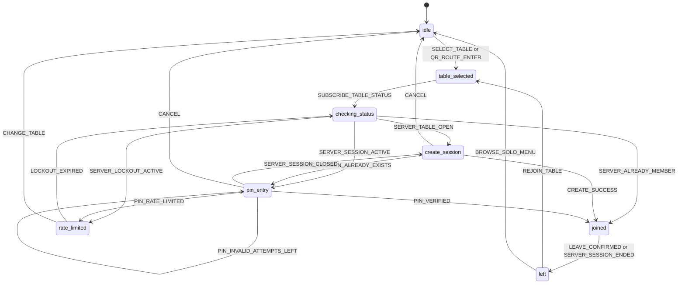
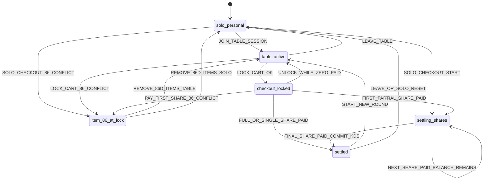
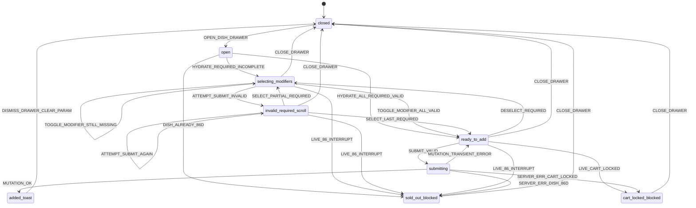
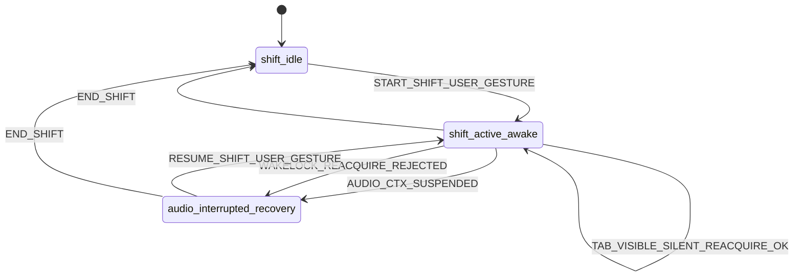
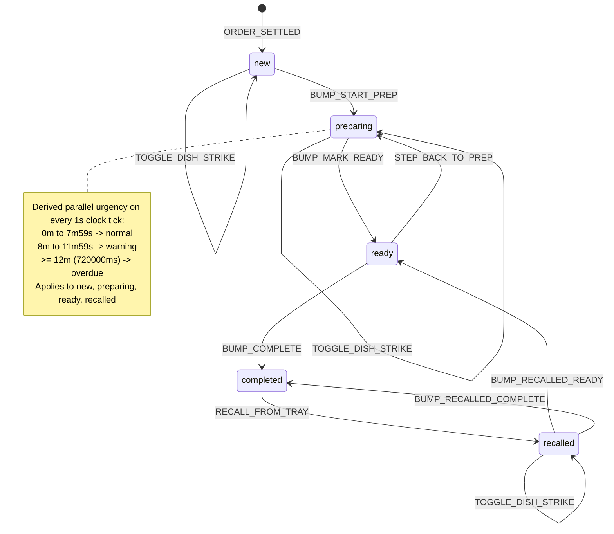
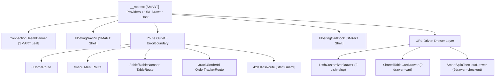

# 13 — React Frontend State Machines, Custom Hooks & Component Composition Architecture Blueprint

> **Document ID:** `ENG-13` · **Date:** November 19, 2026 · **Target Submission:** December 12, 2026  
> **Project:** **250° Kitchen** (`React 19.3.1` · `Vite 8.3.8` · `TypeScript 6.x strict` · `TanStack Router ^1.170` · `Convex 1.51.0` · `shadcn/ui base-luma / @base-ui/react ^1.9` · `@tanstack/react-form` · `Zod ^4.6.7`)  
> **DEPI Rubric Focus:** **40–50% of final grade** — React Frontend Architecture, Explicit State Modeling, Custom Hook Separation, Real-Time Reactivity, and Resilience.

---

## 0. Architectural North Star: Zero `useEffect` Spaghetti

Most student React apps collapse under bugs when real-time sockets, drawers, forms, and timers collide because state is duplicated across `useState` variables and stitched together with `useEffect` chains. **250° Kitchen enforces four non-negotiable architectural invariants:**

1. **Make Illegal States Unrepresentable:** Every multi-step interactive workflow is modeled as an **explicit TypeScript discriminated union** driven by a pure `useReducer` transition function (or derived atomically from a Convex document status). Boolean soup (`isLoading && !isLocked && hasPinError && !isRateLimited`) is banned.
2. **Single Owner Per Piece of State:** Every piece of data lives in **exactly one** of four tiers — **Convex Server State**, **URL Search State**, **Local Browser Identity**, or **Ephemeral Local UI State** — and is **never mirrored** into a second tier via `useEffect`.
3. **Derive During Render, Mutate Inside Events:** Filtered menus, dish totals, integer-piaster split-bill shares, cart counts, and KDS `>= 12m` overdue flags are computed **synchronously during render** via pure domain functions (`src/features/*/domain/`). Side effects like scroll-to-invalid-modifier and Web Audio chime unlock execute **directly inside user event handlers**, never inside reactive effects.
4. **Strict `useEffect` Quota (4 Justified Effects Total):** Across the entire application, `useEffect` is allowed **only** for synchronizing with non-React external browser APIs (and `useSyncExternalStore` is preferred wherever an external store exists):
   - `WakeLock` sentinel release + `document.visibilitychange` re-acquisition on `/kds`.
   - `AudioContext` `statechange` event subscription on `/kds`.
   - `1500ms` connection-drop debounce timer inside `<ConnectionHealthBanner />`.
   - Single-shot KDS chime trigger when a brand-new ticket ID enters `activeTickets` after initial hydration.

---

## 1. Explicit Finite State Machines (FSMs)

All four high-risk interactive flows below combine a formal **Mermaid `stateDiagram-v2`**, an **exhaustive TypeScript discriminated union**, and **server-reconciliation invariants** that eliminate race conditions without `useEffect` loops.

---

### 1.1 Table Session & PIN Join Flow

**Scope:** Governs scanning a QR code (`/table/$tableNumber`), picking Table 1–12 from the storefront, creating a fresh table session, joining an active session with a 4-digit PIN, enforcing brute-force rate limiting, and leaving/closing cleanly.



#### TypeScript Discriminated Union & Pure Reducer Contract

```ts
// src/features/table/domain/tableJoinMachine.ts
import type { Id } from "../../../../convex/_generated/dataModel";

export type TableJoinState =
  | { readonly status: "idle" }
  | { readonly status: "table_selected"; readonly tableNumber: number }
  | { readonly status: "checking_status"; readonly tableNumber: number }
  | {
      readonly status: "create_session";
      readonly tableNumber: number;
      readonly nickname: string;
      readonly submitting: boolean;
      readonly errorMessage: string | null;
    }
  | {
      readonly status: "pin_entry";
      readonly tableNumber: number;
      readonly sessionId: Id<"tableSessions">;
      readonly hostNickname: string;
      readonly activeDinerCount: number;
      readonly nickname: string;
      readonly pin: string;
      readonly attemptsRemaining: number;
      readonly submitting: boolean;
      readonly errorMessage: string | null;
      readonly noticeMessage: string | null;
    }
  | {
      readonly status: "rate_limited";
      readonly tableNumber: number;
      readonly sessionId: Id<"tableSessions">;
      readonly retryUntilEpochMs: number;
    }
  | {
      readonly status: "joined";
      readonly tableNumber: number;
      readonly sessionId: Id<"tableSessions">;
      readonly participantId: Id<"sessionParticipants">;
      readonly pin: string;
      readonly role: "host" | "guest";
    }
  | {
      readonly status: "left";
      readonly lastTableNumber: number;
      readonly reason: "user_left" | "session_settled" | "host_closed";
    };

export type TableJoinEvent =
  | { type: "SELECT_TABLE"; tableNumber: number }
  | { type: "CANCEL" }
  | { type: "SET_NICKNAME"; nickname: string }
  | { type: "SET_PIN"; pin: string }
  | { type: "SUBMIT_START" }
  | {
      type: "JOIN_SUCCEEDED";
      sessionId: Id<"tableSessions">;
      participantId: Id<"sessionParticipants">;
      tableNumber: number;
      pin: string;
      role: "host" | "guest";
    }
  | {
      type: "CREATE_RACE_SESSION_EXISTS";
      sessionId: Id<"tableSessions">;
      hostNickname: string;
      activeDinerCount: number;
    }
  | { type: "PIN_FAILED"; attemptsRemaining: number; message: string }
  | { type: "RATE_LIMITED"; retryUntilEpochMs: number }
  | { type: "LOCKOUT_EXPIRED" }
  | { type: "SUBMIT_ERROR"; message: string }
  | { type: "LEFT_SESSION"; reason: "user_left" | "session_settled" | "host_closed" };

export interface ServerTableJoinSnapshot {
  readonly tableNumber: number;
  readonly kind: "open" | "active_joinable" | "already_member" | "rate_limited";
  readonly sessionId?: Id<"tableSessions">;
  readonly participantId?: Id<"sessionParticipants">;
  readonly hostNickname?: string;
  readonly activeDinerCount?: number;
  readonly pin?: string;
  readonly role?: "host" | "guest";
  readonly retryUntilEpochMs?: number;
}
```

#### Zero-`useEffect` Reconciliation Invariant
- Instead of copying `useQuery(api.tables.getTableJoinStatus)` into `useReducer` via `useEffect`, `useTableJoinMachine` computes the **effective state during render** (`reconcileTableJoinState(localState, serverSnapshot, nowMs)`):
  - When `localState.status` is `"table_selected"` or `"checking_status"` and `serverSnapshot` resolves, render directly projects `"already_member" -> joined`, `"open" -> create_session`, `"active_joinable" -> pin_entry`, or `"rate_limited" -> rate_limited`.
  - When `localState.status === "rate_limited"` and `nowMs >= localState.retryUntilEpochMs` (driven by `useMonotonicClock(1000)`), the UI immediately re-enables `"pin_entry"` without a timer-reset `useEffect`.
  - **Simultaneous Scan Race (`CREATE_RACE_SESSION_EXISTS`):** If Diner A and Diner B scan empty Table #5 simultaneously, Convex's serializable transaction lets Diner A win `createSession` and returns a structured domain error to Diner B (`SESSION_ALREADY_EXISTS`), transitioning Diner B straight into `pin_entry` with `noticeMessage: "Table #5 was just opened — ask your tablemate for the 4-digit PIN."`

---

### 1.2 Shared Cart & Checkout Lock Lifecycle

**Scope:** Governs seamless progression from solo takeaway browsing (`solo_personal`) to live multi-diner editing (`table_active`), atomic checkout locking (`checkout_locked`), `86 / Sold Out` lock interception (`item_86_at_lock`), reversible pre-payment unlocking (`unlock_while_zero_paid`), partial split-bill settlement (`settling_shares`), and order handoff to `/kds` (`settled`).



#### TypeScript Discriminated Union (Server-Backed + Pure Derivation)

```ts
// src/features/cart/domain/cartLifecycle.ts
import type { Id } from "../../../../convex/_generated/dataModel";

export type SplitMode = "full" | "by_item" | "equal";

export interface CartModifierSelection {
  readonly groupId: string;
  readonly groupLabel: string;
  readonly optionIds: readonly string[];
  readonly optionLabels: readonly string[];
  readonly deltaPiasters: number;
}

export interface CartLineItem {
  readonly id: string; // Convex Id<"cartItems"> or client UUID in solo mode
  readonly dishId: Id<"dishes">;
  readonly dishSlug: string;
  readonly dishName: string;
  readonly dishImageUrl: string;
  readonly isAvailable: boolean; // Live-joined from dishes.isAvailable!
  readonly ownerParticipantId: string;
  readonly ownerNickname: string;
  readonly ownerColorToken: string;
  readonly quantity: number;
  readonly unitPricePiasters: number;
  readonly lineTotalPiasters: number;
  readonly modifiers: readonly CartModifierSelection[];
  readonly kitchenNote: string;
  readonly isOptimistic?: boolean;
}

export interface SplitShareEntry {
  readonly shareId: string;
  readonly label: string; // e.g. "Full Table", "Ahmed's Items", "Split 1 of 3"
  readonly assignedParticipantId: string | null;
  readonly amountPiasters: number; // Exact integer piasters (1 EGP = 100 piasters)
  readonly status: "unpaid" | "paid";
  readonly paidByNickname?: string;
  readonly paymentMethod?: "demo_card" | "counter";
}

export type CartLifecycleState =
  | {
      readonly phase: "solo_personal";
      readonly items: readonly CartLineItem[];
      readonly subtotalPiasters: number;
      readonly totalItemCount: number;
    }
  | {
      readonly phase: "table_active";
      readonly sessionId: Id<"tableSessions">;
      readonly tableNumber: number;
      readonly items: readonly CartLineItem[];
      readonly subtotalPiasters: number;
      readonly totalItemCount: number;
      readonly canLockForCheckout: boolean;
    }
  | {
      readonly phase: "item_86_at_lock";
      readonly origin: "solo_personal" | "table_active" | "checkout_locked";
      readonly sessionId: Id<"tableSessions"> | null;
      readonly items: readonly CartLineItem[];
      readonly unavailableItems: readonly CartLineItem[];
      readonly subtotalPiasters: number;
    }
  | {
      readonly phase: "checkout_locked";
      readonly sessionId: Id<"tableSessions">;
      readonly tableNumber: number;
      readonly lockedByParticipantId: Id<"sessionParticipants">;
      readonly lockedByNickname: string;
      readonly splitMode: SplitMode;
      readonly splitCount: number;
      readonly items: readonly CartLineItem[];
      readonly shares: readonly SplitShareEntry[];
      readonly paidShareCount: 0; // Type-level proof: unlock is ONLY legal here!
      readonly totalPiasters: number;
    }
  | {
      readonly phase: "settling_shares";
      readonly sessionId: Id<"tableSessions"> | null;
      readonly tableNumber: number | null;
      readonly splitMode: SplitMode;
      readonly shares: readonly SplitShareEntry[];
      readonly paidShareCount: number; // Guaranteed >= 1 in table mode
      readonly paidPiasters: number;
      readonly remainingPiasters: number;
      readonly totalPiasters: number;
    }
  | {
      readonly phase: "settled";
      readonly sessionId: Id<"tableSessions"> | null;
      readonly orderId: Id<"orders">;
      readonly orderCode: string; // e.g. "#204" or "#C-201"
      readonly totalPiasters: number;
      readonly settledAtMs: number;
    };
```

#### Critical Concurrency & Domain Invariants
1. **`item_86_at_lock` Guard (Zero Sold-Out Charges):** Both `lockCartForCheckout` and `payFirstShare` run inside Convex's atomic mutation engine and inspect `dishes.isAvailable` for every cart line item. If Kitchen staff toggled `86 / Sold Out` moments earlier, the mutation aborts the lock/payment and returns `{ kind: "ITEMS_86D", unavailableItemIds }`. The cart enters `item_86_at_lock`, surfaces the exact sold-out lines in terracotta warning cards, and provides a single button: **`Remove Sold-Out Items & Resume`**.
2. **`unlock_while_zero_paid` Strict Boundary:** In `checkout_locked`, `paidShareCount` is typed as literal `0`. Any diner can tap **`Back to Menu (Add Items)`** (`api.checkout.unlockCartWhileZeroPaid`), returning all connected tablemates to `table_active`. The instant share #1 is paid, Convex transitions the session to `settling_shares`, `unlockCartWhileZeroPaid` rejects with `CANNOT_UNLOCK_AFTER_PARTIAL_PAYMENT`, and the UI hides the unlock action entirely.
3. **Exact Integer-Piaster Split Engine (`src/features/checkout/domain/splitBillMath.ts`):** Every price is stored as integer piasters (`EGP 245.50 -> 24550`). For `Split Equally (÷ N)`, `base = Math.floor(total / n)` and `remainder = total % n`, distributing `+1` piaster to the first `remainder` shares so `shares.reduce((a, s) => a + s.amountPiasters, 0) === totalPiasters` holds for every positive integer (100% unit-tested in Vitest).

---

### 1.3 Dish Customizer Drawer State

**Scope:** Governs opening a dish from `/` or `/menu`, selecting required/optional modifiers, handling invalid submit attempts with accessible smooth scroll & focus, reacting to live `86` / `checkout_locked` interruptions, submitting optimistically, and dismissing into a native `@base-ui/react/toast` confirmation.



#### TypeScript Discriminated Union & Scroll-Without-`useEffect` Pattern

```ts
// src/features/menu/domain/dishCustomizerMachine.ts
import type { Id } from "../../../../convex/_generated/dataModel";

export interface ModifierDraft {
  readonly selectedByGroup: Readonly<Record<string, readonly string[]>>;
  readonly quantity: number;
  readonly kitchenNote: string;
}

export type DishCustomizerState =
  | { readonly status: "closed" }
  | { readonly status: "open"; readonly dishSlug: string; readonly editCartItemId: string | null }
  | {
      readonly status: "selecting_modifiers";
      readonly dishId: Id<"dishes">;
      readonly dishSlug: string;
      readonly draft: ModifierDraft;
      readonly missingRequiredGroupIds: readonly string[];
    }
  | {
      readonly status: "invalid_required_scroll";
      readonly dishId: Id<"dishes">;
      readonly dishSlug: string;
      readonly draft: ModifierDraft;
      readonly missingRequiredGroupIds: readonly string[];
      readonly scrollTargetGroupId: string;
      readonly pulseNonce: number; // Increments on repeat clicks to re-trigger focus ring
    }
  | {
      readonly status: "ready_to_add";
      readonly dishId: Id<"dishes">;
      readonly dishSlug: string;
      readonly draft: ModifierDraft;
      readonly submitError: string | null;
    }
  | {
      readonly status: "submitting";
      readonly dishId: Id<"dishes">;
      readonly dishSlug: string;
      readonly draft: ModifierDraft;
    }
  | {
      readonly status: "added_toast";
      readonly dishName: string;
      readonly quantity: number;
      readonly lineTotalPiasters: number;
    }
  | { readonly status: "sold_out_blocked"; readonly dishSlug: string; readonly dishName: string }
  | { readonly status: "cart_locked_blocked"; readonly dishSlug: string; readonly lockedByNickname: string };
```

#### Imperative Scroll-to-Invalid Without `useEffect`
Inside `useDishCustomizerMachine`, the drawer registers each required modifier `<fieldset>` DOM node in a `groupElementRefs = useRef<Map<string, HTMLElement>>(new Map())`. When the diner taps the primary CTA while required groups are missing, the **click handler itself**:
1. Computes `firstMissingId = missingRequiredGroupIds[0]`.
2. Dispatches `{ type: "ATTEMPT_SUBMIT_INVALID", scrollTargetGroupId: firstMissingId }`.
3. Immediately scrolls and focuses the target `<fieldset>` in the same event turn (`el.scrollIntoView({ behavior: reducedMotion ? "instant" : "smooth", block: "center" }); el.focus({ preventScroll: true });`), announcing the exact missing group via an `aria-live="assertive"` summary region.

---

### 1.4 KDS Ticket Lifecycle & Kitchen Shift Audio / WakeLock State

`/kds` runs **two orthogonal state machines** side-by-side:
- **Sub-machine 4A (Hardware / Shift Session):** Local browser AudioContext + Screen Wake Lock API lifecycle.
- **Sub-machine 4B (Ticket Operations):** Convex-persisted kitchen ticket progression + pure derived `>= 12m` overdue urgency.

#### Sub-Machine 4A — Kitchen Shift Audio & WakeLock State



#### Sub-Machine 4B — KDS Ticket Lifecycle & Derived Overdue Threshold (`>= 12m`)



#### TypeScript Contracts for Sub-Machines 4A & 4B

```ts
// src/features/kds/domain/kdsMachines.ts
import type { Id } from "../../../../convex/_generated/dataModel";

// --- 4A: Kitchen Shift Hardware Machine ---
export type KitchenShiftState =
  | {
      readonly status: "shift_idle";
      readonly wakeLockSupported: boolean;
      readonly audioSupported: boolean;
    }
  | {
      readonly status: "shift_active_awake";
      readonly wakeLockActive: boolean;
      readonly muted: boolean;
      readonly startedAtMs: number;
    }
  | {
      readonly status: "audio_interrupted_recovery";
      readonly reason: "audio_suspended" | "wakelock_rejected" | "tab_backgrounded";
      readonly wakeLockLost: boolean;
      readonly audioSuspended: boolean;
    };

// --- 4B: KDS Ticket Status & Pure Overdue Derivation ---
export type KdsTicketStatus = "new" | "preparing" | "ready" | "completed" | "recalled";
export type TicketUrgency = "normal" | "warning" | "overdue";

export const KDS_WARNING_THRESHOLD_MS = 8 * 60 * 1_000;  // 8m 00s
export const KDS_OVERDUE_THRESHOLD_MS = 12 * 60 * 1_000; // 12m 00s strict SLA

export function deriveTicketUrgency(
  createdAtMs: number,
  nowMs: number,
  status: KdsTicketStatus,
): TicketUrgency {
  if (status === "completed") return "normal";
  const elapsedMs = Math.max(0, nowMs - createdAtMs);
  if (elapsedMs >= KDS_OVERDUE_THRESHOLD_MS) return "overdue";
  if (elapsedMs >= KDS_WARNING_THRESHOLD_MS) return "warning";
  return "normal";
}

export function getNextTicketStatus(
  status: Exclude<KdsTicketStatus, "completed">,
): KdsTicketStatus {
  switch (status) {
    case "new":
      return "preparing";
    case "preparing":
      return "ready";
    case "ready":
      return "completed";
    case "recalled":
      return "ready";
  }
}

export interface KdsTicketViewModel {
  readonly orderId: Id<"orders">;
  readonly orderCode: string;
  readonly tableLabel: string; // "Table 05" or "Takeaway"
  readonly status: KdsTicketStatus;
  readonly createdAtMs: number;
  readonly elapsedMs: number;
  readonly elapsedFormatted: string; // "12:04" (rendered with tabular-nums)
  readonly urgency: TicketUrgency;
  readonly items: readonly {
    readonly lineId: string;
    readonly name: string;
    readonly quantity: number;
    readonly modifierSummary: string;
    readonly kitchenNote: string;
    readonly isStruck: boolean;
  }[];
  readonly struckCount: number;
  readonly totalLineCount: number;
}
```

#### Audio & WakeLock Platform Guarantees
- **Synthesized Web Audio Chime (Zero Asset 404s):** On `START_SHIFT_USER_GESTURE`, `AudioContext` initializes synchronously inside the click handler and plays a gentle two-tone kitchen pass bell (`OscillatorNode` sine wave `523.25Hz -> 659.25Hz`, exponential gain decay `180ms`). Zero external `.mp3` dependencies that can fail offline.
- **Silent Initial Hydration:** `seenTicketIdsRef` snapshots all existing ticket IDs on the first non-`undefined` Convex query result so loading `/kds` mid-service never blasts chimes for old tickets; only *newly arrived* `status === "new"` IDs ring the bell.
- **Seizure-Safe Overdue Signaling:** When `urgency === "overdue"` (`>= 12m`), the Dark Charcoal card swaps its rail to high-contrast crimson-terracotta (`oklch(0.62 0.21 27)`) and elevates a bold `OVERDUE 12:04` pill without rapid flashing (WCAG 2.3.1 compliant).

---

## 2. State Ownership Matrix & Custom Hooks Inventory (`src/features/*/hooks/`)

### 2.1 Single-Owner State Matrix (Zero Duplicated Derived State)

| Domain Data | Authoritative Owner | Mechanism | Forbidden Anti-Pattern (Banned) |
| :--- | :--- | :--- | :--- |
| Menu catalog, categories, live `86` stock | **Convex Server** | `useQuery(api.menu.listDishes)` | Copying query array into `useState` to filter |
| Active table session, PIN, participants | **Convex Server** | `useQuery(api.tables.getActiveSession)` | Caching participant list in `localStorage` |
| Shared table cart lines & checkout lock | **Convex Server** | `useQuery(api.cart.getSessionCart)` | Keeping a mirror `CartContext` synced by `useEffect` |
| Live order status & KDS ticket board | **Convex Server** | `useQuery(api.orders.getOrderById)` / `api.kds.*` | Storing `isOverdue` boolean in DB or `useState` |
| Live kitchen wait estimate (`~12 min`) | **Convex Server** | `useQuery(api.kds.getKitchenPulse)` | Hardcoding static wait text |
| Menu category, search `q`, dietary filter | **URL Search State** | TanStack Router `validateSearch` (Zod v4) | Storing menu filters in React state (breaks refresh/Back) |
| Open drawer (`?dish=`, `?drawer=cart\|checkout\|join`) | **URL Search State** | TanStack Router `validateSearch` (Zod v4) | Global boolean modal context that ignores browser Back |
| KDS filter tab (`all\|new\|preparing\|ready\|overdue`) | **URL Search State** | TanStack Router `validateSearch` (Zod v4) | Local state lost on KDS tablet refresh |
| Guest `participantToken`, `nickname`, `soloCart` | **Local Browser Identity** | `useSyncExternalStore` + `localStorage` | Reading `localStorage` once in `useEffect` (breaks multi-tab sync) |
| Active FSM drafts, validation pulse, scroll target | **Ephemeral UI State** | `useReducer` / `@tanstack/react-form` | Putting transient form inputs in Convex or URL |
| AudioContext, WakeLock sentinel, `nowMs` tick | **Ephemeral Browser Runtime** | `useRef` + `useSyncExternalStore` clock | Running 1 `setInterval` per KDS card |

---

### 2.2 Complete Custom Hooks Inventory

Every hook lives inside its feature module under `src/features/<feature>/hooks/` and exports explicit input/output TypeScript interfaces.

#### A. Shared Platform Hooks (`src/features/shared/hooks/`)

| Hook File | Exact Signature | Responsibility & Internals |
| :--- | :--- | :--- |
| `useParticipantToken.ts` | `useParticipantToken(): { token: string; nickname: string; colorToken: string; setNickname: (name: string) => void; resetIdentity: () => void }` | Uses `useSyncExternalStore` subscribed to `window.addEventListener("storage")` + custom in-tab event. Lazily mints a `crypto.randomUUID()` guest token stored under `kitchen250:identity:v1` with safe in-memory fallback for Safari private mode. |
| `useConvexConnectionHealth.ts` | `useConvexConnectionHealth(): { status: "connecting" \| "online" \| "reconnecting" \| "restored" \| "offline"; hasInflightMutations: boolean; disconnectedDurationMs: number }` | Wraps `useConvexConnectionState()` (`isWebSocketConnected`, `hasEverConnected`, `hasInflightRequests`) + `navigator.onLine`. Applies a `1500ms` drop debounce before exposing `"reconnecting"` and a `1800ms` `"restored"` pill on recovery. **Mounted ONLY inside `<ConnectionHealthBanner />`** to avoid re-rendering parent layouts. |
| `useMonotonicClock.ts` | `useMonotonicClock(intervalMs?: 1000): number` | Singleton shared interval exposed via `useSyncExternalStore`. Guarantees 20+ KDS tickets and order trackers tick in a **single synchronized render frame** with zero timer sprawl. Automatically tears down when subscriber count hits `0`. |
| `usePrefersReducedMotion.ts` | `usePrefersReducedMotion(): boolean` | `useSyncExternalStore` wrapper around `window.matchMedia("(prefers-reduced-motion: reduce)")`. Consumed by scroll-to-invalid, drawer transitions, and `<LazyMotion>`. |

#### B. Menu & Customizer Hooks (`src/features/menu/hooks/`)

| Hook File | Exact Signature | Responsibility & Internals |
| :--- | :--- | :--- |
| `useMenuSearchParams.ts` | `useMenuSearchParams(): { search: MenuSearchParams; setCategory: (cat: string) => void; setQuery: (q: string) => void; toggleDiet: (tag: DietTag) => void; openDishDrawer: (slug: string) => void; closeDishDrawer: () => void; resetFilters: () => void }` | Wraps TanStack Router `useSearch` & `useNavigate` (`replace: true` for search typing wrapped in `startTransition`, push entry for opening `?dish=`). Validated via Zod v4 `.catch()` defaults so malformed URLs never crash `/menu`. |
| `useFilteredMenu.ts` | `useFilteredMenu(params: MenuSearchParams): { isLoading: boolean; dishes: readonly Dish[]; groupedByCategory: readonly CategoryGroup[]; totalAvailableCount: number; soldOutCount: number }` | Subscribes to `useQuery(api.menu.listDishes)` and derives normalized search + category + diet filtering via `useMemo`. Zero `useEffect` state syncing. |
| `useDishCustomizerMachine.ts` | `useDishCustomizerMachine(dishSlug: string \| undefined): { state: DishCustomizerState; dish: Dish \| undefined; derivedPricing: { unitPiasters: number; lineTotalPiasters: number }; registerGroupRef: (groupId: string, el: HTMLElement \| null) => void; toggleOption: (groupId: string, optionId: string) => void; setQuantity: (qty: number) => void; setKitchenNote: (note: string) => void; submit: () => Promise<void>; close: () => void }` | Owns the Dish Customizer `useReducer` FSM, live server `86` & `checkout_locked` guards, imperative `scrollIntoView` + focus on invalid submit, optimistic `addCartItem`, and native `toastManager.add(...)` dispatch. |

#### C. Table Session Hooks (`src/features/table/hooks/`)

| Hook File | Exact Signature | Responsibility & Internals |
| :--- | :--- | :--- |
| `useActiveTableSession.ts` | `useActiveTableSession(): { isLoading: boolean; session: ActiveTableSession \| null; isHost: boolean; participantCount: number }` | Subscribes to `useQuery(api.tables.getActiveSessionByParticipant, { participantToken })`. Single source of truth for the Floating Nav Pill badge, Floating Cart Dock table header, and Table Hub. |
| `useTableJoinMachine.ts` | `useTableJoinMachine(routeTableNumber?: number): { state: TableJoinState; lockoutSecondsRemaining: number; selectTable: (n: number) => void; setNickname: (name: string) => void; setPin: (pin: string) => void; submitCreateSession: () => Promise<void>; submitJoinWithPin: () => Promise<void>; leaveActiveSession: () => Promise<void>; cancel: () => void }` | Owns the Table Join `useReducer` FSM reconciled synchronously during render with `useQuery(api.tables.getTableJoinStatus)`. Uses `useMonotonicClock(1000)` to derive `lockoutSecondsRemaining`. |

#### D. Shared Cart & Checkout Hooks (`src/features/cart/hooks/` & `src/features/checkout/hooks/`)

| Hook File | Exact Signature | Responsibility & Internals |
| :--- | :--- | :--- |
| `useCartLifecycle.ts` | `useCartLifecycle(): { isLoading: boolean; lifecycle: CartLifecycleState; myItems: readonly CartLineItem[]; tablematesItems: readonly CartLineItem[] }` | Unifies solo `localStorage` cart (`useSyncExternalStore`) and Convex `api.cart.getSessionCart` into the exhaustive `CartLifecycleState` union. Derives `myItems` vs `tablematesItems` synchronously. |
| `useCartMutations.ts` | `useCartMutations(): { addItem: (input: AddCartItemInput) => Promise<void>; updateQuantity: (itemId: string, delta: 1 \| -1) => Promise<void>; removeItem: (itemId: string) => Promise<void>; removeUnavailableItems: () => Promise<void>; migrateSoloToTable: (sessionId: Id<"tableSessions">) => Promise<void> }` | Routes mutations to local solo store OR Convex `useMutation` chained with `.withOptimisticUpdate()` (instant dock count + subtotal updates, automatic rollback on error). |
| `useSplitBillCheckout.ts` | `useSplitBillCheckout(): { lifecycle: CartLifecycleState; isBusy: boolean; error: string \| null; lockCart: () => Promise<void>; unlockWhileZeroPaid: () => Promise<void>; changeSplitMode: (mode: SplitMode, splitCount?: number) => Promise<void>; settleShare: (args: { shareId: string; method: "demo_card" \| "counter" }) => Promise<void>; resolve86dConflict: () => Promise<void>; startNewRound: () => Promise<void> }` | Orchestrates atomic lock, `item_86_at_lock` conflict recovery, `unlock_while_zero_paid`, pure piaster share computation (`computeSplitSharesPiasters`), and settlement commits straight to `/kds`. |

#### E. Order Tracker & KDS Hooks (`src/features/tracker/hooks/` & `src/features/kds/hooks/`)

| Hook File | Exact Signature | Responsibility & Internals |
| :--- | :--- | :--- |
| `useOrderTracker.ts` | `useOrderTracker(orderId: Id<"orders">): { status: "loading" \| "not_found" \| "ready"; order: TrackedOrderViewModel \| null; activeStepIndex: 0 \| 1 \| 2 \| 3; elapsedFormatted: string; struckProgress: { struck: number; total: number } }` | Subscribes to `useQuery(api.orders.getOrderById)` + `useMonotonicClock(1000)` to drive real-time progress stepper & elapsed clock synced directly with `/kds` taps. |
| `useKdsBoard.ts` | `useKdsBoard(filter: KdsFilterParam): { isLoading: boolean; activeTickets: readonly KdsTicketViewModel[]; completedTickets: readonly KdsTicketViewModel[]; counts: { all: number; new: number; preparing: number; ready: number; overdue: number } }` | Subscribes to `api.kds.listActiveTickets` & `api.kds.listRecentCompleted`, joins `useMonotonicClock(1000)` once for the whole board, and derives `elapsedFormatted` + `urgency` (`>= 12m -> "overdue"`). |
| `useKdsTicketMutations.ts` | `useKdsTicketMutations(): { toggleDishStrike: (orderId: Id<"orders">, lineId: string) => Promise<void>; bumpTicketStatus: (orderId: Id<"orders">, nextStatus: KdsTicketStatus) => Promise<void>; recallTicket: (orderId: Id<"orders">) => Promise<void>; toggleDishAvailability86: (dishId: Id<"dishes">, nextAvailable: boolean) => Promise<void> }` | Every kitchen action uses Convex `.withOptimisticUpdate()` for instant tactile feedback on touchscreens, paired with native Base UI error toast rollback reporting. |
| `useKitchenShiftAudioAndWakeLock.ts` | `useKitchenShiftAudioAndWakeLock(activeTickets: readonly KdsTicketViewModel[]): { shiftState: KitchenShiftState; startShift: () => Promise<void>; resumeShift: () => Promise<void>; endShift: () => Promise<void>; toggleMute: () => void; testChime: () => void }` | Owns Sub-machine 4A (`shift_idle -> shift_active_awake -> audio_interrupted_recovery`), Web Audio pass bell synthesis, `navigator.wakeLock` + `visibilitychange` recovery, and new-ticket detection via `seenTicketIdsRef`. |

---

## 3. Component Composition Tree (5 Core Routes + 3 Drawers + Floating Chrome)

### 3.1 Architecture Topology & Composition Rules



**Smart vs. Presentational Boundary Rules:**
- **`[SMART]` Container Components:** Own route params, custom hooks (`useQuery`, `useMutation`, FSM hooks), and compose layout slots. They contain **minimal styling logic** and **never** duplicate domain math.
- **`[PURE]` Presentational Components:** Receive strictly typed props + event callbacks (`onSelect`, `onBump`, `onStrike`). They **never** import `convex/react` or `@tanstack/react-router` directly. Because of this clean seam, every state (`loading`, `empty`, `86'd`, `rate_limited`, `checkout_locked`, `overdue >= 12m`) can be rendered in isolation with product-shaped mock fixtures (supporting the `state-machine` workbench pattern and fast Vitest/Playwright verification!).
- **Zero Prop-Drilling Rule:** Max prop pass-through depth is **2 levels**. Feature containers read their own focused hooks directly (`useActiveTableSession`, `useCartLifecycle`) instead of threading props from `__root.tsx` through intermediate layout wrappers.
- **Base UI (`@base-ui/react`) Composition Rule:** Always use Base UI's `render` prop (`<Button render={<Link to="/menu" />}>Browse Menu</Button>`) — **never** Radix UI's `asChild`.

---

### 3.2 Complete Component Tree Breakdown

```text
src/routes/__root.tsx [SMART]
├── ConvexProviderWithAuth
├── Toast.Provider (toastManager from @base-ui/react/toast — native, zero sonner)
│   ├── ConnectionHealthBanner [SMART Leaf — isolated useConvexConnectionHealth()]
│   ├── AppChromeLayout [PURE slot layout — hides customer chrome on /kds]
│   │   ├── FloatingNavPill [SMART — reads useActiveTableSession() + route match]
│   │   │   ├── BrandMark250 [PURE inline SVG]
│   │   │   ├── NavLinkPills [PURE — Home, Menu, Table #N badge / Join Table, KDS]
│   │   │   └── ActiveTablePillBadge [PURE — live pulse dot + "Table 05 · 3 diners"]
│   │   │
│   │   ├── RouteErrorBoundary -> <Outlet />
│   │   │   │
│   │   │   ├── ROUTE 1: / (src/routes/index.tsx) [SMART]
│   │   │   │   ├── HeroShowcaseSection [PURE + LiveKitchenPulsePill SMART Leaf]
│   │   │   │   │   ├── HeroVisualFrame (16:9 webp, fetchPriority="high", rounded-[36px])
│   │   │   │   │   ├── LiveKitchenWaitBadge [SMART Leaf — api.kds.getKitchenPulse]
│   │   │   │   │   └── HeroActionRow (Join Table CTA + Explore Menu CTA)
│   │   │   │   ├── SignatureMenuPreviewContainer [SMART — top 6 featured dishes]
│   │   │   │   │   └── DishCard [PURE — shared with /menu, triggers ?dish=<slug>]
│   │   │   │   ├── HowLiveTableWorksSwitcher [PURE — 3-step interactive preview]
│   │   │   │   └── DarkKitchenPassBand [PURE — Layer 4 contrast showcase + footer]
│   │   │   │
│   │   │   ├── ROUTE 2: /menu (src/routes/menu.tsx) [SMART]
│   │   │   │   ├── MenuFilterBarContainer [SMART — useMenuSearchParams()]
│   │   │   │   │   ├── CategoryPillTabs [PURE]
│   │   │   │   │   ├── MenuSearchInput [PURE — 16px+ mobile floor, clear button]
│   │   │   │   │   └── DietaryChipRow [PURE — Spicy, Veggie, 250°C Sear]
│   │   │   │   └── MenuCatalogContainer [SMART — useFilteredMenu()]
│   │   │   │       ├── MenuGridSkeleton [PURE — exact 4:3 + 2-line + 44px CTA geometry]
│   │   │   │       ├── MenuEmptySearchState [PURE — inline SVG + Reset Filters CTA]
│   │   │   │       └── DishCardGrid [PURE — 3-col desktop / 1-col mobile]
│   │   │   │           └── DishCard [PURE — resting, hover, 86 / Sold Out state]
│   │   │   │
│   │   │   ├── ROUTE 3: /table/$tableNumber (src/routes/table.$tableNumber.tsx) [SMART]
│   │   │   │   ├── TableNumberSelectorStrip [PURE — Tables 1..12 quick switch]
│   │   │   │   ├── TableJoinFlowContainer [SMART — useTableJoinMachine()]
│   │   │   │   │   ├── TableCheckingSkeleton [PURE]
│   │   │   │   │   ├── CreateTableSessionCard [PURE — nickname form + open table CTA]
│   │   │   │   │   ├── TablePinEntryCard [PURE — 4-digit OTP input + attempts badge]
│   │   │   │   │   ├── TableRateLimitedCard [PURE — live countdown + retry timer]
│   │   │   │   │   └── TableLeftConfirmationCard [PURE — Rejoin / Browse Solo]
│   │   │   │   └── ActiveTableHubContainer [SMART — rendered when state === "joined"]
│   │   │   │       ├── TableSessionHeaderCard [PURE — Table #5 + copyable 4-digit PIN]
│   │   │   │       ├── LiveDinerAvatarStrip [PURE — real-time participant chips]
│   │   │   │       └── ActiveTableQuickActions [PURE — Browse Menu / Open Shared Cart]
│   │   │   │
│   │   │   ├── ROUTE 4: /track/$orderId (src/routes/track.$orderId.tsx) [SMART]
│   │   │   │   ├── OrderTrackerHeader [PURE — Order #204, Table 05, live elapsed clock]
│   │   │   │   ├── OrderStatusStepper [PURE — Received -> On the Grill -> Ready -> Served]
│   │   │   │   ├── KitchenPlatingProgressCard [PURE — "3 of 4 dishes plated" live bar]
│   │   │   │   └── OrderReceiptSummaryCard [PURE — itemized modifiers + piaster total]
│   │   │   │
│   │   │   └── ROUTE 5: /kds (src/routes/kds.tsx) [SMART — Staff Auth Guard]
│   │   │       ├── KdsShiftHeaderContainer [SMART — useKitchenShiftAudioAndWakeLock()]
│   │   │       │   ├── KdsBrandAndClockBar [PURE — "250° Pass", live shift time]
│   │   │       │   ├── ShiftAudioWakeLockControl [PURE — Start / Active / Interrupted]
│   │   │       │   ├── KdsFilterStatusBar [PURE — All, New, Grill, Ready, Overdue >=12m]
│   │   │       │   └── Quick86StockPopover [SMART Leaf — 1-tap dish isAvailable toggle]
│   │   │       ├── KdsAudioRecoveryBanner [PURE — role="alert" when audio/wakelock lost]
│   │   │       ├── KdsActiveTicketBoard [SMART — useKdsBoard() + useKdsTicketMutations()]
│   │   │       │   ├── KdsEmptyBoardState [PURE — "All caught up at the pass"]
│   │   │       │   └── KdsTicketCard [PURE — Dark Charcoal, urgency rail, 48px+ targets]
│   │   │       │       ├── TicketCardHeader [PURE — #204, Table 05, tabular-nums timer]
│   │   │       │       ├── TicketDishStrikeList [PURE — 48px tap-to-strike rows]
│   │   │       │       └── TicketStageActionBar [PURE — Start Prep / Mark Ready / Bump]
│   │   │       └── KdsCompletedRecallTray [PURE — collapsible recent 15 + Recall button]
│   │   │
│   │   ├── FloatingCartDock [SMART — useCartLifecycle() + useActiveTableSession()]
│   │   │   └── FloatingDockPill [PURE — Layer 4 Charred Walnut, avatars, item count, EGP total, Open Cart]
│   │   │
│   │   └── GlobalUrlDrawerHost [SMART — reads root search params ?dish & ?drawer]
│   │       ├── DRAWER 1: DishCustomizerDrawer [SMART — useDishCustomizerMachine()]
│   │       │   ├── DrawerErrorBoundary
│   │       │   ├── DishHeroHeader [PURE — 4:3 photo, base price, 86 banner if sold out]
│   │       │   ├── ModifierGroupList [PURE — RadioGroup / CheckboxGroup + missing ring]
│   │       │   ├── KitchenNoteTextarea [PURE — 120-char counter, 16px+ mobile font]
│   │       │   └── StickyAddFooter [PURE — stepper qty + live EGP CTA + aria-live error]
│   │       │
│   │       ├── DRAWER 2: SharedTableCartDrawer [SMART — useCartLifecycle() + useCartMutations()]
│   │       │   ├── DrawerErrorBoundary
│   │       │   ├── CartHeaderBanner [PURE — Solo Mode vs Table #5 PIN + diner count]
│   │       │   ├── Cart86ConflictBanner [PURE — shown in item_86_at_lock + 1-tap fix]
│   │       │   ├── CartLockedNoticeBanner [PURE — shown when tablemate locked cart]
│   │       │   ├── CartLineItemList [PURE — grouped by My Items vs Tablemates with tags]
│   │       │   └── CartSummaryFooter [PURE — subtotal + Lock & Checkout CTA]
│   │       │
│   │       └── DRAWER 3: SmartSplitCheckoutDrawer [SMART — useSplitBillCheckout()]
│   │           ├── DrawerErrorBoundary
│   │           ├── CheckoutUnlockBar [PURE — visible ONLY in checkout_locked (0 paid)]
│   │           ├── SplitModeSegmentedControl [PURE — Full Table / My Items / Split ÷ N]
│   │           ├── SplitShareLedgerList [PURE — exact piaster rows + paid checkmarks]
│   │           ├── PaymentMethodSelector [PURE — Instant Demo Card / Pay at Counter]
│   │           └── SettledOrderSuccessCard [PURE — #204 / #C-201 + Track Order CTA]
│   │
│   └── Toast.Portal -> Toast.Viewport [PURE styled base-luma toast stack]
```

---

## 4. Resilience, Optimistic UI & `CLS = 0` Patterns

### 4.1 Optimistic UI Updates (`.withOptimisticUpdate`)

We apply Convex optimistic updates **selectively** where perceived latency directly shapes tactile feel, while keeping atomic financial/lock boundaries strictly server-confirmed.

| Mutation | Optimistic? | Reason & Rollback Behavior |
| :--- | :---: | :--- |
| `api.kds.toggleDishStrike` | **YES** | Chefs tap rapidly on greasy tablets; `<16ms` strike-through is essential. Auto-rolls back on failure + toast. |
| `api.kds.bumpTicketStatus` | **YES** | Immediate card stage transition (`New -> On the Grill -> Ready`). Auto-rolls back if RBAC/network fails. |
| `api.cart.addItem` / `updateQuantity` | **YES** | Floating Cart Dock count & EGP subtotal react instantaneously on `+ Add`. Guarded by `isOptimistic` flag until server `_id` syncs. |
| `api.checkout.lockCartForCheckout` | **NO** | Must run server-side `item_86_at_lock` inventory verification atomically before freezing tablemates. Uses `aria-busy` button spinner. |
| `api.checkout.settleShare` | **NO** | Payment ledger transition (`paidShareCount` -> `settling_shares` / `settled`) must never falsely display "Paid" if rejected. |

#### Reference Implementation A — KDS Dish Strike-Through Optimistic Update

```ts
// src/features/kds/hooks/useKdsTicketMutations.ts
import { useMutation } from "convex/react";
import { api } from "../../../../convex/_generated/api";
import { toastManager } from "../../shared/lib/toastManager";

export function useKdsTicketMutations() {
  const rawToggleStrike = useMutation(api.kds.toggleDishStrike).withOptimisticUpdate(
    (localStore, args) => {
      const currentTickets = localStore.getQuery(api.kds.listActiveTickets, {});
      if (currentTickets === undefined) return;

      // Immutable update: never mutate query cache arrays in-place
      const nextTickets = currentTickets.map((ticket) => {
        if (ticket._id !== args.orderId) return ticket;
        const alreadyStruck = ticket.struckLineIds.includes(args.lineId);
        return {
          ...ticket,
          struckLineIds: alreadyStruck
            ? ticket.struckLineIds.filter((id) => id !== args.lineId)
            : [...ticket.struckLineIds, args.lineId],
        };
      });

      localStore.setQuery(api.kds.listActiveTickets, {}, nextTickets);
    },
  );

  async function toggleDishStrike(
    orderId: Parameters<typeof rawToggleStrike>[0]["orderId"],
    lineId: string,
  ): Promise<void> {
    try {
      await rawToggleStrike({ orderId, lineId });
    } catch {
      // Convex rolls back localStore automatically; inform kitchen staff cleanly
      toastManager.add({
        id: `kds-strike-err-${orderId}`,
        title: "Could not sync dish check",
        description: "Reverted to last server state. Tap again once reconnected.",
      });
    }
  }

  return { toggleDishStrike };
}
```

#### Reference Implementation B — Instant `+ Add` to Shared Cart Optimistic Update

```ts
// src/features/cart/hooks/useCartMutations.ts (excerpt)
const rawAddItem = useMutation(api.cart.addItem).withOptimisticUpdate(
  (localStore, args) => {
    const existing = localStore.getQuery(api.cart.getSessionCart, {
      sessionId: args.sessionId,
    });
    if (existing === undefined || existing.status !== "table_active") return;

    const optimisticLine = {
      _id: `optimistic_${args.clientMutationId}` as typeof existing.items[number]["_id"],
      _creationTime: Date.now(),
      dishId: args.dishId,
      dishSlug: args.optimisticPreview.dishSlug,
      dishName: args.optimisticPreview.dishName,
      dishImageUrl: args.optimisticPreview.dishImageUrl,
      isAvailable: true,
      ownerParticipantId: args.participantId,
      ownerNickname: args.optimisticPreview.ownerNickname,
      ownerColorToken: args.optimisticPreview.ownerColorToken,
      quantity: args.quantity,
      unitPricePiasters: args.optimisticPreview.unitPricePiasters,
      lineTotalPiasters: args.optimisticPreview.unitPricePiasters * args.quantity,
      modifiers: args.modifiers,
      kitchenNote: args.kitchenNote,
      isOptimistic: true,
    };

    localStore.setQuery(
      api.cart.getSessionCart,
      { sessionId: args.sessionId },
      {
        ...existing,
        items: [...existing.items, optimisticLine],
        subtotalPiasters: existing.subtotalPiasters + optimisticLine.lineTotalPiasters,
      },
    );
  },
);
```

---

### 4.2 Network Drop & `"Reconnecting live updates..."` Banner

`useConvexConnectionState()` triggers frequently as `hasInflightRequests` flips during normal mutations. Therefore, **only** the tiny leaf component `<ConnectionHealthBanner />` calls it — isolating re-renders from the rest of the React tree.

```tsx
// src/features/shared/components/ConnectionHealthBanner.tsx
import { WifiOff, RefreshCw, CheckCircle2 } from "lucide-react";
import { useConvexConnectionHealth } from "../hooks/useConvexConnectionHealth";

export function ConnectionHealthBanner() {
  const { status } = useConvexConnectionHealth();

  if (status === "connecting" || status === "online") {
    return null;
  }

  return (
    <div
      role="status"
      aria-live="polite"
      className="fixed inset-x-0 top-[76px] z-50 mx-auto flex w-fit max-w-[calc(100vw-32px)] items-center gap-2 rounded-full border border-amber-500/30 bg-[#171412]/95 px-4 py-2 text-[14px] font-medium text-[#F4F0E8] shadow-lg backdrop-blur-md transition-all duration-200 starting:opacity-0 starting:-translate-y-2"
    >
      {status === "reconnecting" && (
        <>
          <RefreshCw className="size-4 animate-spin text-amber-400" strokeWidth={1.75} />
          <span>Reconnecting live updates...</span>
        </>
      )}
      {status === "offline" && (
        <>
          <WifiOff className="size-4 text-[#D14928]" strokeWidth={1.75} />
          <span>Offline — live sync resumes automatically when back online</span>
        </>
      )}
      {status === "restored" && (
        <>
          <CheckCircle2 className="size-4 text-emerald-400" strokeWidth={1.75} />
          <span>Live sync restored</span>
        </>
      )}
    </div>
  );
}
```

**Anti-Flicker Debounce Rules inside `useConvexConnectionHealth()`:**
- **Cold-start grace (`0–4000ms`):** Before `hasEverConnected` becomes `true`, return `"connecting"` (never flash a scary red drop banner on first load unless socket handshake exceeds `4s`).
- **Transient-blip grace (`1500ms`):** Once connected, if `isWebSocketConnected` flips `false`, wait `1500ms` before showing `"Reconnecting live updates..."` (eliminates Wi-Fi handoff & dev HMR flicker).
- **Recovery feedback (`1800ms`):** When reconnected after displaying the warning, show `"Live sync restored"` for `1800ms`, then collapse cleanly.

---

### 4.3 Multi-Layer Route & Drawer Error Boundaries

TanStack Router's route-scoped `errorComponent` + Zod v4 `validateSearch` prevent bad URLs or backend errors from blank-screening the app:

| Boundary Layer | Catches | Recovery UX |
| :--- | :--- | :--- |
| **1. URL Search Guard (`validateSearch` + `.catch()`)** | Corrupted `?category=`, `?diet=`, or `?drawer=` values | Silently normalizes bad search params to safe defaults — **zero crash** on shared broken links. |
| **2. Route `errorComponent`** (`/menu`, `/table/$n`, `/track/$orderId`, `/kds`) | Invalid `$orderId`, expired table route, Convex authorization error, unexpected render error | Renders warm-linen card inside the shell (Nav Pill & Cart Dock stay alive!) with exact recovery button (`Reset Filters`, `Go to Menu`, `Sign In as Staff`). |
| **3. Drawer `DrawerErrorBoundary`** | Runtime error inside Dish Customizer / Shared Cart / Split Checkout | Isolates failure inside the drawer frame with `"Close Drawer & Retry"` so the diner never loses their `/menu` scroll position or table session. |
| **4. Root `defaultErrorComponent`** | Unhandled fatal error at shell level | Clean branded `250° Kitchen` recovery screen with `Reload Page` and `Return Home`. |

```tsx
// Example: src/routes/menu.tsx — TanStack Router + Zod v4 Safe Search Contract
import { createFileRoute, useRouter } from "@tanstack/react-router";
import { z } from "zod";

export const menuSearchSchema = z.object({
  category: z.string().catch("all"),
  q: z.string().max(80).catch(""),
  diet: z.array(z.enum(["spicy", "vegetarian", "signature"])).catch([]),
  dish: z.string().optional().catch(undefined),
  drawer: z.enum(["cart", "checkout", "join"]).optional().catch(undefined),
});

export const Route = createFileRoute("/menu")({
  validateSearch: menuSearchSchema,
  errorComponent: ({ error, reset }) => {
    const router = useRouter();
    return (
      <section className="mx-auto my-16 max-w-md rounded-[24px] bg-white p-8 text-center">
        <h2 className="text-[22px] font-semibold text-[#1D1916]">
          Menu view hit a snag
        </h2>
        <p className="mt-2 text-[15px] text-[#1D1916]/70">
          {error instanceof Error ? error.message : "Unable to load menu right now."}
        </p>
        <div className="mt-6 flex justify-center gap-3">
          <button
            type="button"
            onClick={() => reset()}
            className="h-11 rounded-full bg-[#D14928] px-5 text-[15px] font-medium text-white"
          >
            Try Again
          </button>
          <button
            type="button"
            onClick={() => router.navigate({ to: "/menu", search: {} })}
            className="h-11 rounded-full bg-[#ECE6DC] px-5 text-[15px] font-medium text-[#1D1916]"
          >
            Reset Filters
          </button>
        </div>
      </section>
    );
  },
  component: MenuRoutePage,
});
```

---

### 4.4 Guaranteed `CLS = 0` Skeleton & Geometry Lock Specification

Cumulative Layout Shift (`CLS = 0.000`) is achieved by **enforcing identical intrinsic heights, aspect ratios, and line-box reservations** between every skeleton placeholder and its hydrated component, plus fixed-overlay isolation for floating chrome.

| UI Surface | Exact Skeleton Dimensions | Exact Loaded Component Dimensions | Anti-Shift Guardrails |
| :--- | :--- | :--- | :--- |
| **Hero Stage (`/`)** | `aspect-[4/3] md:aspect-[16/9]` · `rounded-[36px]` · `bg-[#ECE6DC]` | Same `aspect-[4/3] md:aspect-[16/9]` · `` | Container owns aspect ratio before image bytes arrive. |
| **Menu Dish Card (`/menu`, `/`)** | Outer `rounded-[24px] p-4 bg-white`<br>1. Photo: `aspect-square md:aspect-[4/3] rounded-[16px]`<br>2. Title bar: `mt-4 h-[28px] w-3/4`<br>3. Desc block: `mt-2 h-[50px]` (2 lines)<br>4. Footer row: `mt-4 h-[44px]` | Outer `rounded-[24px] p-4 bg-white`<br>1. Photo: `aspect-square md:aspect-[4/3] rounded-[16px]` (`width={960} height={720}`)<br>2. Title: `mt-4 min-h-[28px] text-[20px] leading-[1.4] line-clamp-1`<br>3. Desc: `mt-2 min-h-[50px] text-[16px] leading-[1.55] line-clamp-2`<br>4. Footer: `mt-4 h-[44px]` (price `tabular-nums` + `44px` `+ Add` pill) | **Zero height delta (`0px`)** when 1-line vs 2-line descriptions hydrate; `86 / Sold Out` badge overlays inside photo corner (never shifts card height). |
| **Floating Nav Pill** | Fixed `top-4 h-[56px]` overlay | Fixed `top-4 h-[56px]` overlay; `<main>` reserves `pt-[88px]` permanently | Out-of-flow `position: fixed`; table badge updates width smoothly inside centered pill without shifting document flow. |
| **Floating Cart Dock** | Not rendered in document flow | `position: fixed; bottom: max(20px, env(safe-area-inset-bottom))`; customer `<main>` reserves `pb-[112px]` permanently | Mounting/unmounting dock causes **zero** page push or scroll jump. |
| **Order Tracker Stepper (`/track`)** | Card `rounded-[24px] p-6 min-h-[220px]` with 4 fixed-height `h-[44px]` step tracks | Same `rounded-[24px] p-6 min-h-[220px]` + `tabular-nums` elapsed badge `min-w-[68px]` | Fixed `min-w` + `tabular-nums` stops `9:59 -> 10:00` horizontal jitter. |
| **KDS Ticket Card (`/kds`)** | Dark card `rounded-[20px] min-h-[248px]`: header `h-[56px]`, 3 skeleton rows `h-[48px]`, footer `h-[52px]` | Same `rounded-[20px] min-h-[248px]`: header `h-[56px]`, dish strike buttons `min-h-[48px]`, stage button `h-[52px]` | `tabular-nums` on every timer (`12:04`); urgency border uses `ring-2 ring-inset` (zero outer box-model expansion!). |

#### Warm-Linen Skeleton Discipline
- Use calm warm stone pulses (`bg-[#ECE6DC]` on Layer 1 crisp white cards; `bg-white/10` on Layer 4 Dark Charcoal `/kds`) — never harsh cool gray `#E5E7EB` shimmer bars.
- Respect `prefers-reduced-motion`: wrap shimmer animation with `motion-safe:animate-pulse` so reduced-motion users see steady warm tonal blocks.

---

## 5. Verification, State Workbench & DEPI Defense Playbook

### 5.1 Pre-Merge Anti-Spaghetti Audit Checklist
Before any feature slice is marked complete (Decision 6 Gate):
1. **Zero Effect-Mirroring:** `grep` confirms zero `useEffect(() => { setX(...) }, [queryData])` patterns.
2. **Exhaustive Discriminated Unions:** Every FSM `switch (state.status)` / `switch (state.phase)` ends with `default: { const _exhaustive: never = state; return _exhaustive; }`.
3. **Zero `any` & Strict Lint:** `oxlint` (`0` errors) + `tsc --noEmit` (`0` errors).
4. **Isolated Pure Presentational Verification:** Because every `[PURE]` leaf component takes state strictly via props, all critical states (`MenuCard` resting/`86`, `TableJoinFlow` `pin_entry`/`rate_limited`, `SharedCart` `item_86_at_lock`/`checkout_locked`/`settling_shares`, `KdsTicketCard` `new`/`preparing`/`ready`/`recalled`/`overdue >= 12m`) can be inspected cleanly on a temporary throwaway state-workbench route (with product-shaped Cairo hospitality fixtures) and tested in Vitest + Playwright without mocking Convex internals.
5. **CLS Verification:** Playwright + Lighthouse on Desktop (`1440×900`) and Mobile (`390×844`) confirm `CLS === 0`, zero React console warnings, and instant `<300ms` two-tab sync.

### 5.2 60-Second DEPI Live Technical Defense Script
> *"Instead of dumping everything into global Context or syncing server queries with `useEffect`, we separated state into four strict owners: Convex for real-time shared truth, TanStack Router Zod-validated search params for shareable filters and drawers, `useSyncExternalStore` for frictionless cross-tab guest identity and a single synchronized KDS clock, and explicit TypeScript discriminated-union state machines for our four trickiest flows — Table PIN Join with rate limiting, Shared Cart Checkout Lock with atomic `86` interception and zero-paid unlock, Dish Customizer scroll-to-invalid validation, and KDS Shift WakeLock/Audio recovery with live `>= 12m` overdue derivation. On top of that, KDS dish strikes and `+ Add` use Convex optimistic updates for instant touch response, while every skeleton locks exact `4:3` and line-box heights to guarantee `CLS = 0`."*
