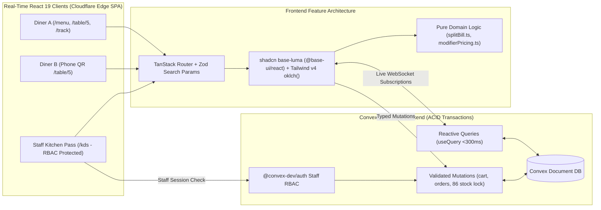

# DEPI Egypt React Capstone — Evaluation, Live Demo Script & Technical Defense Playbook

> **Project:** `250° Kitchen` (Customer Storefront, Shared QR Table Ordering & `250° Pass` Real-Time KDS)  
> **Target Submission & Defense:** December 12, 2026 (Digital Egypt Pioneers Initiative — React Front-End Track)  
> **Prepared:** November 19, 2026 · **Purpose:** Your rehearsable, zero-panic playbook covering grading alignment, second-by-second dual-screen live demo choreography, 15 senior-level Q&A answers, and a hiring-grade portfolio `README.md`.

---

## How to Use This Playbook (And Why This Demo Wins DEPI)

Most DEPI React capstone defenses follow the exact same forgettable script: a 12-slide deck followed by a slow tour through a CRUD e-commerce template with static mock JSON and a broken dark-mode toggle.

Evaluators (EYouth / ITIDA technical leads and senior React mentors) sit through 10–15 projects in a single day. You win an effortless top score by flipping the script in the first 60 seconds:

1. **Zero template smell:** You open a live Cloudflare production URL onto a sunlit, warm-linen hospitality storefront built with intentional **Layers, Light, and Layout** (`shadcn/ui` `base-luma` on `@base-ui/react` + Tailwind v4 `oklch()`).
2. **Real-time theater across two screens:** Instead of talking about state management in the abstract, you join **Table #5** on two devices/windows, sync a shared cart in **`<300ms`**, split an indivisible bill with zero floating-point drift, fire the ticket straight onto a **Dark Charcoal Kitchen Display System (`/kds`)**, advance the ticket live, and **`86` (sold-out lock)** a dish across every open menu instantaneously.
3. **Calm architectural ownership:** You close with crisp engineering receipts — strict TypeScript, VoidZero `oxlint` ("error, never warn"), unit-tested integer-piaster math in Vitest, multi-tab Playwright E2E tests, and zero console errors.

### Plain-English Jargon Quick Reference (So You Never Blank Under Pressure)
- **KDS (Kitchen Display System):** The dark-background screen mounted above a restaurant's hot kitchen pass where chefs read incoming tickets, tap off prepared dishes, and advance order stages.
- **`86` (Eighty-Six):** Real hospitality shorthand meaning *"this item just ran out — stop selling it immediately."*
- **Integer-Piaster Math:** Storing and calculating all currency as whole integers (`100 piasters = 1 EGP`, e.g., `185.50 EGP` is stored as `18550`) so IEEE-754 floating-point errors (`0.1 + 0.2 === 0.30000000000000004`) can never corrupt split bills.
- **RBAC (Role-Based Access Control):** Enforcing permissions on the **server** (not just hiding UI buttons in React) so only authenticated staff can call KDS or menu-stock mutations.
- **CLS (Cumulative Layout Shift):** A Core Web Vitals score measuring whether images or fonts jump around while loading (`0.00` means rock-steady layout).
- **`oklch()`:** Modern perceptual CSS color space used natively by Tailwind CSS v4 so warm linen, terracotta, and charcoal ramps keep predictable lightness and contrast.

---

## 1. DEPI Rubric Traceability Matrix

Every grading pillar below maps directly to **exact files, hooks, components, automated tests, and live visual proof moments** in our `250° Kitchen` architecture (`src/features/{menu,cart,table,kds,shared}` + `convex/`).

> **Note on Tier 2 Optional Upgrades:** Items marked *(Tier 2)* add bonus rubric depth if you complete Tier 1 ahead of schedule (Days 15–19): Bilingual EN/Egyptian Arabic (`ar-EG`) RTL, Compact `/admin` QR Generator, or Stripe Sandbox `<PaymentElement />`. Tier 1 alone already satisfies **100%** of the DEPI rubric.

### Pillar 1 — React Architecture & State Management (40–50% of Grade)

| Sub-Criterion | What Evaluators Check | Exact File / Hook / Component Proof | Live Demo Proof Moment | Verification Evidence |
| :--- | :--- | :--- | :--- | :--- |
| **Component Composition & Feature Modularity** | Clean separation of domain features vs. reusable UI primitives; no monolithic 900-line pages | `src/components/ui/*` (`shadcn base-luma` primitives) · `src/features/menu/` · `src/features/cart/` · `src/features/table/` · `src/features/kds/` · `src/features/shared/` | `4:15–4:30` (VS Code folder flash) | Clear unidirectional imports; zero circular dependencies via `oxlint` |
| **Custom Hooks & Pure Domain Separation** | Business logic extracted out of JSX into testable pure functions and focused custom hooks | `src/features/table/hooks/useTableSession.ts` · `src/features/cart/hooks/useSharedCart.ts` · `src/features/cart/lib/splitBill.ts` · `src/features/menu/lib/modifierPricing.ts` | `1:45–2:25` (Split-bill mode toggle) & `4:30–4:45` | `vitest` pure unit suite runs in `<500ms` with zero DOM mocks needed |
| **Type-Safe Routing, URL Search State & Protected Routes** | Validated route params, shareable filter URLs, and auth-guarded staff views | `src/routes/__root.tsx` · `src/routes/index.tsx` · `src/routes/menu.tsx` (Zod `validateSearch` for category/query) · `src/routes/table.$tableNumber.tsx` · `src/routes/track.$orderId.tsx` · `src/routes/kds.tsx` (`beforeLoad` staff auth guard) · `src/routes/login.tsx` | `0:45–1:05` (`/table/5`), `2:25–3:05` (`/track/:id` ↔ `/kds`) | Direct navigation to `/kds` while logged out redirects cleanly to `/login` |
| **Real-Time Reactive Server State & Async UI States** | Loading skeletons, empty states, error boundaries, and multi-client live synchronization | `convex/schema.ts` · `convex/tables.ts` · `convex/cart.ts` · `convex/orders.ts` · `convex/menu.ts` · `src/features/shared/components/ErrorBoundary.tsx` · `src/features/menu/components/MenuSkeleton.tsx` | `1:05–1:45` (`<300ms` cart sync), `2:45–3:45` (KDS → Tracker + `86` lock) | Multi-tab Playwright E2E verifies live reactivity without manual refreshes |
| **Schema-Driven Forms & Complex Validation** | Controlled validation for dish modifiers, required groups, PIN entry, and checkout | `src/features/menu/components/DishCustomizerDrawer.tsx` · `src/features/table/components/TableJoinSheet.tsx` · `src/features/cart/components/SplitCheckoutDrawer.tsx` (`@tanstack/react-form` + `zod` v4) | `1:05–1:25` (Required modifier + add-on live price) | Submitting without required patty/crust selection shows inline accessible error |

### Pillar 2 — Code Quality & Maintainability (15–20% of Grade)

| Sub-Criterion | What Evaluators Check | Exact File / Config Proof | Live Demo Proof Moment | Verification Evidence |
| :--- | :--- | :--- | :--- | :--- |
| **Strict End-to-End TypeScript** | Zero `any`, strict compiler flags, generated backend-to-frontend types | `tsconfig.json` (`strict: true`, `noUnusedLocals: true`, `noUncheckedIndexedAccess: true`) · `convex/_generated/api.d.ts` · `convex/_generated/dataModel.d.ts` | `4:15–4:30` (`tsc --noEmit` green check) | `npm run typecheck` exits `0` in CI and locally |
| **Zero-Warning Automated Linting & Formatting** | Consistent code style, React hooks safety, accessibility linting, no ignored warnings | `oxlint.config.ts` (`oxlint@1.94.0` + `oxlint-tsgolint@7.0.2007`: `"error"` policy for `react`, `react-hooks`, `jsx-a11y`, `vitest`, `no-floating-promises`, `no-explicit-any`) · `oxfmt` (pinned `0.79.0`) or `prettier` | `4:15–4:30` (Architecture flash) | `npm run lint` exits `0` with 0 errors and 0 warnings |
| **Dependency Discipline & Modern 2026 Hygiene** | No bloated unused packages, no broken pre-1.0 libs, no Radix/Base UI mixing | `package.json` (dropped pre-1.0 `@dnd-kit/react`, dropped `sonner` in favor of native `@base-ui/react/toast`, Base UI `render` prop used consistently — zero stale Radix `asChild`) | Mentioned in Q2 & Q9 during defense | Clean lean `package.json`; zero React 19 peer-dep or `StrictMode` warnings |
| **Git Hygiene & Environment Security** | Meaningful atomic commits, clean `.env.example`, zero leaked secrets in repo | `.env.example` (`VITE_CONVEX_URL=...`) · `.gitignore` · semantic commit history (`feat(cart):`, `test(split-bill):`, `fix(kds):`) | `README.md` & GitHub repo inspection | Zero hardcoded keys; `git log --oneline` reads like a clean engineering story |

### Pillar 3 — UI/UX Polish, Design System & Responsiveness (15–20% of Grade)

| Sub-Criterion | What Evaluators Check | Exact File / Component Proof | Live Demo Proof Moment | Verification Evidence |
| :--- | :--- | :--- | :--- | :--- |
| **Cohesive Design System (Layers, Light, Layout)** | Intentional token hierarchy, warm hospitality identity, zero generic SaaS/aggregator clutter | `src/index.css` (Tailwind v4 `@theme` with `oklch()` 5-layer ramp: Sunlit Linen Floor → Crisp Paper Tiles → Frosted Daylight Nav → Hearth Accent → Roasted Charcoal Dock/KDS) | `0:00–0:45` (Sunlit Hero `/`) & `2:45–3:05` (Dark KDS contrast) | Computed WCAG AA ratios verified (`>= 4.5:1` body/pills, `>= 3:1` large CTAs) |
| **Typography Floor & Concentric Geometry** | Readable sizing, `tabular-nums` alignment, mathematical inner/outer radii (`base-luma`) | `src/features/menu/components/DishCard.tsx` (`24px` outer / `16px` padding / `16px` inner photo, `20–22px` title, `16px` body, `13px+` metadata, `tabular-nums`) | `0:12–0:45` & `1:05–1:45` | Zero sub-`13px` micro-text; prices & KDS timers never jitter horizontally |
| **Responsive Desktop (`1440px`) ↔ Mobile (`390px`)** | Purpose-built mobile flows (bottom drawers, `44px+` tap targets, `16px+` inputs to avoid iOS zoom) | `src/features/cart/components/FloatingCartDock.tsx` · `src/features/menu/components/MenuGrid.tsx` (`3-col` desktop `4:3` → crisp mobile list/grid) · `src/features/kds/components/KdsTicketCard.tsx` (`48px+` touch targets) | `0:45–1:45` (Phone + Laptop side-by-side live demo) | Verified in Playwright & real browser at both `1440×900` and `390×844` |
| **Accessible Interaction & Restrained Tactile Craft** | Keyboard focus rings, screen-reader labels, `prefers-reduced-motion`, authentic micro-delight | `src/components/ui/*` (`@base-ui/react` ARIA + focus traps) · `src/features/shared/components/RollingPrice.tsx` · `src/features/shared/components/EditorialFooter.tsx` (`250°` halftone + *"Open Kitchen / Daylight Only"* toggle) | `1:25–1:45` (Rolling price) & `3:45–4:15` (Footer Easter egg) | Full keyboard-only pass (`Tab`/`Enter`/`Esc`) + Lighthouse Accessibility `95+` |
| **Bilingual EN / Egyptian Arabic RTL *(Optional Tier 2)*** | Clean logical CSS (`ps-*`, `pe-*`, `ms-*`, `text-start`) and instant `dir="rtl"` flip | `src/features/shared/i18n/` (`shadcn init --rtl` logical classes + `IBM Plex Sans Arabic`) | Optional 10-second bonus toggle during Q&A | Layout mirrors cleanly with zero overlapping icons or broken drawers |

### Pillar 4 — Testing, Performance & Live Deployment (10–15% of Grade)

| Sub-Criterion | What Evaluators Check | Exact File / Config Proof | Live Demo Proof Moment | Verification Evidence |
| :--- | :--- | :--- | :--- | :--- |
| **Unit & Backend Integration Tests** | Real business-logic tests (not trivial "renders div" tests) + backend mutation verification | `src/features/cart/lib/splitBill.test.ts` (indivisible splits, remainder distribution, 0-item guards) · `src/features/menu/lib/modifierPricing.test.ts` · `convex/orders.test.ts` (`convex-test` with Vite 8 array-negation glob) | `4:30–4:45` (Vitest terminal output) | `npm run test` passes 100% in CI & locally |
| **Multi-Tab End-to-End (E2E) Verification** | Real browser automation proving diner-to-kitchen workflow works end to end | `tests/e2e/table-to-kds.spec.ts` (`@playwright/test@1.65.1`: 2 browser contexts joining Table #5 → checkout → `/kds` bump → `/track` update + `86` lock) | `4:30–4:45` (Test summary flash) | `npx playwright test` passes against production preview build |
| **Performance, Assets & Zero Console Noise** | Fast LCP hero, `CLS = 0`, compressed local `.webp` food photography, clean console | `public/images/*.webp` (`<220 KB` hero with `fetchpriority="high"`, `<90 KB` lazy `4:3` dishes) · `<LazyMotion>` (`motion/react`) | `0:00–0:15` (Instant load) & `4:30–4:45` (DevTools Console `0 errors`) | Lighthouse Performance/Best Practices/Accessibility `90+` on live Cloudflare URL |
| **CI/CD & Production Deployment** | Public working HTTPS URL with clean SPA deep-link reloads and automated CI checks | `wrangler.jsonc` (`assets.not_found_handling: "single-page-application"`) · `.github/workflows/ci.yml` (`lint` + `typecheck` + `vitest` + `build`) | Entire 5-minute demo runs on live Cloudflare URL (`https://...workers.dev`) | Hard-refreshing `/menu` or `/table/5` on live URL returns `200 OK` (zero 404s) |

### Pillar 5 — Presentation, Live Demo & Technical Defense (10% of Grade)

| Sub-Criterion | What Evaluators Check | Exact Preparation Asset | Live Demo Proof Moment | Verification Evidence |
| :--- | :--- | :--- | :--- | :--- |
| **Problem-to-Solution Storytelling** | Clear real-world hospitality narrative, crisp pacing, confident eye contact | Section 2 (5-Minute Second-by-Second Choreography below) | `0:00–5:00` | Timed rehearsals consistently finish between `4:40` and `5:00` |
| **Live Technical Defense ("Why" Mastery)** | Deep grasp of trade-offs, state ownership, security boundaries, and math edge cases | Section 3 (Top 15 Tough Defense Q&A below) | Post-demo Q&A (`5:00–10:00`) | Every question answered in `~30 seconds` with concrete code references |
| **Documentation & Portfolio Presentation** | Complete `README.md` with live URL, screenshots, setup steps, and architecture diagram | Section 4 (`README.md` Blueprint + Center Stage & Unblast visuals) | Repo link submitted to DEPI portal | Evaluators can clone, inspect `.env.example`, and test the live link effortlessly |

---

## 2. Beat-by-Beat 5-Minute Dual-Screen Live Demo Choreography

### Pre-Demo Physical & Browser Stage Setup (Do This 10 Minutes Before Your Slot)

Never waste the first 45 seconds of your slot typing passwords or hunting for browser tabs. Set up this exact 2-device (or 3-window) cockpit before you say your first word:

```text
┌─────────────────────────────────────────────────────┐   ┌───────────────────────┐
│  PROJECTOR / LAPTOP SCREEN (1440×900 or 1280×800)   │   │  YOUR PHONE (390×844) │
│                                                     │   │  (Or Right Split Win) │
│  Browser Window A (Main Profile — Diner A "Omar")   │   │                       │
│   • Tab 1: Live Cloudflare URL `/` (Active at 0:00) │   │  Safari / Chrome      │
│   • Tab 2: Live `/kds` (Already signed in as Chef!) │   │  Pre-loaded QR Camera │
│   • Tab 3: DevTools / Vitest & Code Proof Slide     │   │  (or Table #5 URL)    │
│                                                     │   │  Acts as Diner B      │
│  [If Projector is wide enough, snap Window A Left   │   │  ("Salma")            │
│   (60%) and Window B / KDS Right (40%) at 0:45!]    │   └───────────────────────┘
└─────────────────────────────────────────────────────┘
```

**Pre-Flight 60-Second Checklist:**
1. **Clean Table #5 state:** Verify Table `#5` (PIN `4825`) starts **empty** with **zero stale items** and **zero `86`'d dishes** before you walk up.
2. **Pre-authenticated KDS tab:** Sign into `/kds` in Tab 2 (or Right Window) *before* starting so you don't burn 20 seconds typing staff credentials (mention the auth guard cleanly, and offer to demonstrate the `/login` redirect during Q&A).
3. **Browser chrome clean:** Hide bookmarks bar (`Cmd+Shift+B`), disable noisy browser extensions, turn on macOS **Do Not Disturb**, and set zoom to `100%`.
4. **Failsafe armed:** Keep a **local 1080p MP4 screen recording** of the entire 5-minute run on your Desktop + keep your phone hotspot ready to toggle in 3 seconds if the venue Wi-Fi hiccups.

---

### The Second-by-Second 5-Minute Script

> **Pacing Rule:** Speak at a calm **~130 words per minute**. Let visual moments breathe for 1.5 seconds after clicking so evaluators actually *see* the `<300ms` sync and rolling price animation register.

#### Beat 1 (`0:00–0:45`) — Opening the Sunlit Homepage (`/`) & Waking the Floating Cart Dock

| Time | Exact On-Screen Action | Spoken Script (Say This Naturally) | Rubric Hit |
| :--- | :--- | :--- | :--- |
| **`0:00–0:15`** | **Window A open on live Cloudflare URL (`/`).** Pause 2 seconds on the sunlit Hero so the warm linen canvas, frosted floating nav pill, studio-lit dish photography, and live `~12 min` kitchen prep pill land visually. | *"Good afternoon everyone. Group dining at modern restaurants has a surprisingly broken digital experience: one person passes a phone around the table, splitting the bill takes five minutes of calculator math, and waiters still walk back to say a dish ran out ten minutes ago. I built **250° Kitchen** — a real-time table ordering and Kitchen Display System running live on Cloudflare Workers and Convex."* | Storytelling, Live Production Deploy, Problem Framing |
| **`0:15–0:28`** | Slowly glide mouse over the **Frosted Daylight Nav Pill** and hero frame, pointing out the quiet visual hierarchy without rushing. | *"Before we test the real-time sync, notice the visual design: it's built on `shadcn/ui`'s Base UI `base-luma` preset and Tailwind v4 `oklch()` tokens using five deliberate light layers — sunlit warm linen canvas, shadowless crisp white tiles, frosted navigation, and hearth terracotta reserved strictly for earned actions."* | UI/UX Polish, Design System Depth, Typography |
| **`0:28–0:45`** | Scroll gently to the **Signature Menu Preview** on `/`. Click **`+ Add`** on one signature dish (e.g., *Wood-Fired Margherita* or *250° Smash Burger*). Pause 1 second as the **Dark Charcoal Floating Cart Dock** smoothly wakes up at the bottom of the screen with an animated rolling price. | *"The homepage isn't a dead marketing brochure — it connects straight into live state. The instant I tap **Add**, the roasted-charcoal Floating Cart Dock wakes up at the bottom with tabular rolling totals. Now let's bring a second diner to the table."* | Immediate Interactivity, `motion`/CSS craft, Component Reuse |

---

#### Beat 2 (`0:45–1:45`) — Joining Table #5 (4-Digit PIN) Across Two Devices & `<300ms` Live Shared Cart Sync

| Time | Exact On-Screen Action | Spoken Script (Say This Naturally) | Rubric Hit |
| :--- | :--- | :--- | :--- |
| **`0:45–1:05`** | **Snap Window A (Left, Diner A) and Window B / Phone Mirror (Right, Diner B) side-by-side.** On Window A, tap **`Join Table`**, select **Table #5**, enter nickname **`Omar`** and 4-digit PIN **`4825`**. On Device/Window B, scan the Table #5 QR code (or open `/table/5`), enter nickname **`Salma`** and PIN **`4825`**. | *"In a real restaurant, forcing hungry guests through email signup kills adoption. Instead, diners scan the table QR code and join with a lightweight guest session token plus a rotating 4-digit **Table PIN** — here, **Table #5, PIN 4825** — which prevents random outsiders from injecting dishes into another table's bill. Omar is on the left; Salma just joined the exact same table on the right."* | Real-World UX Thinking, Route Params (`/table/5`), Security Trade-Off |
| **`1:05–1:25`** | On **Device B (Salma)**, open `/menu`, click a customizable dish (e.g., *250° Double Smash*), opening the **Dish Customizer Drawer**. Deliberately tap `Add` once *before* picking a required option (optional 2-second validation flash) OR select required patty/sear + add-on (*Truffle Honey Glaze*), showing live modifier price recalculation, then tap **`Add to Table`**. | *"Salma opens the Dish Customizer Drawer — validated by TanStack Form and Zod v4. Required choices like sear or crust and optional add-ons recalculate the price cleanly in integer piasters. Watch **Omar's** screen on the left the exact millisecond Salma taps Add."* | Forms + Zod v4 Validation, Modifier Math, Mobile/Drawer UX |
| **`1:25–1:45`** | **Keep your hands off Window A (Omar)!** Point directly at Window A as the **Floating Cart Dock** pulses, increments the item count, rolls the EGP total smoothly upward, and open the **Shared Cart Drawer** to show per-diner ownership pills (`Omar` · `Salma`). | *"Under 300 milliseconds — zero page reload, zero polling, zero hand-rolled WebSocket listeners. Both clients subscribe to the same reactive Convex query, so Omar immediately sees Salma's item tagged under her name alongside his own, with rolling tabular numbers that never shift layout."* | Real-Time State Architecture (`useQuery`), Custom Hooks, Zero-Jank UI |

---

#### Beat 3 (`1:45–2:45`) — Smart Split-Bill Checkout (Zero-Drift Piaster Math) → Live Fire to Dark Charcoal KDS

| Time | Exact On-Screen Action | Spoken Script (Say This Naturally) | Rubric Hit |
| :--- | :--- | :--- | :--- |
| **`1:45–2:05`** | On **Window A**, click **`Split & Checkout`** inside the Shared Cart Drawer. Click cleanly across the 3 mode pills: **`Pay Full Table`** → **`Pay My Items`** (highlights only Omar's tagged dishes) → **`Split Equally (÷ 3)`**. | *"Now comes the hardest part of group dining: checkout. Diners can toggle seamlessly between **Pay Full Table**, **Pay My Items** — which isolates every line item owned by Omar — or **Split Equally** across any number of guests."* | Complex Frontend State, Real User Value, Base UI `RadioGroup`/`Tabs` |
| **`2:05–2:25`** | Pause clearly on **`Split Equally (÷ 3)`** (make sure the total isn't evenly divisible by 3 — e.g., `400.00 EGP ÷ 3` → `133.34 / 133.33 / 133.33 = 400.00 EGP`!). Point at the deterministic penny/piaster breakdown. | *"Notice the math when we divide by 3: `133.34`, `133.33`, and `133.33` — summing back to the exact piaster with zero rounding drift. JavaScript floating-point math loses cents on `0.1 + 0.2`, so our pure TypeScript split engine calculates strictly in integer piasters and allocates remainders deterministically — proven by our Vitest unit suite."* | Engineering Rigor, Pure Domain Logic, Unit Testing |
| **`2:25–2:45`** | Bring **Tab 2 / Right Window (`/kds`)** into view beside Diner A. On Diner A, select **`Confirm & Fire to Kitchen`** (Instant Demo Settlement / Pay at Counter). Watch **both screens simultaneously**: Diner A transitions to `/track/:orderId` (`Order Received`), while a crisp new ticket pops straight onto the **Dark Charcoal KDS Board** with a live elapsed timer! | *"I confirm checkout — and watch both screens at once. The diner lands on a live Order Tracker, and that exact ticket fires straight onto the **Dark Charcoal Kitchen Display System** on the right."* | End-to-End Real-Time Loop, Protected Staff Route (`/kds`), Dual-Screen Payoff |

---

#### Beat 4 (`2:45–3:45`) — Live Kitchen Pass (`/kds`) ↔ Diner Tracker (`/track`) & Instant `86 / Sold Out` Lock

| Time | Exact On-Screen Action | Spoken Script (Say This Naturally) | Rubric Hit |
| :--- | :--- | :--- | :--- |
| **`2:45–3:05`** | Spotlight on **`/kds`** (Right Window). Tap one dish line to strike it off (`48px+` touch target), then tap the explicit **`Start Cooking`** button (`Queued → On the Grill`). | *"Notice why `/kds` switches purposefully to roasted charcoal dark mode: under bright stainless-steel kitchen pass lamps, white screens create harsh glare. We also deliberately dropped drag-and-drop in favor of `48px+` one-tap buttons — chefs work with wet or gloved hands, and explicit buttons are both faster and 100% keyboard-accessible. The chef strikes off a dish and taps **Start Cooking**..."* | Deliberate UX Architecture, Accessibility, Touch Ergonomics |
| **`3:05–3:20`** | Point straight to **Window A (`/track/:orderId`)** as the progress bar advances live to **`On the Grill`**. Then on `/kds`, chef taps **`Ready`** → Window A shifts immediately to **`Ready at the Pass`**! | *"...and without refreshing, the diner's live tracker moves from **Queued** to **On the Grill** — and when the chef taps **Ready**, the table knows immediately."* | Bidirectional Real-Time State, Multi-Role Workflow |
| **`3:20–3:45`** | Switch Window A back to **`/menu`** showing the dish grid. On **`/kds`**, chef opens the quick stock bar and taps **`86 / Sold Out`** on a visible signature dish (e.g., *Truffle Mushroom Flatbread*). Point at Window A as that exact card dims, locks its `+ Add` button, and flips to a crisp **`Sold Out`** badge instantaneously! *(Toggle it back on afterward if you want evaluators to order it during Q&A.)* | *"One more real-world kitchen reality: **86-ing** a dish when an ingredient runs out mid-dinner rush. Watch the diner's menu on the left when the chef taps **86** on the flatbread. Every open menu locks that card instantaneously — and the same check is enforced inside our Convex checkout mutation so no stale tab can ever sneak an out-of-stock item into the kitchen."* | Server-Enforced Data Integrity, Race-Condition Prevention, Unforgettable Wow Moment |

---

#### Beat 5 (`3:45–4:15`) — The Human Touch: Editorial Halftone `250°` Footer & "Open Kitchen / Daylight Only" Toggle

| Time | Exact On-Screen Action | Spoken Script (Say This Naturally) | Rubric Hit |
| :--- | :--- | :--- | :--- |
| **`3:45–3:58`** | Maximize Window A cleanly on `/` and scroll smoothly to the bottom, revealing the minimal **Editorial Halftone `250°` Wordmark Footer**. | *"Finally, great frontend craft isn't just databases and hooks — it's also knowing when **not** to add a feature just to check a box."* | Brand Craft, Restraint, Visual Polish |
| **`3:58–4:15`** | Click the subtle sun/moon theme switch in the footer. Let the playful, tasteful toast/inline message pop cleanly: **"Open Kitchen — Daylight Only. Dark mode lives strictly behind the pass on `/kds`."** Pause 2–3 seconds and smile with the panel. | *"Every developer portfolio slaps on a half-baked dark mode toggle that turns food photography muddy. Here, clicking the theme switch gives a polite nod: **Open Kitchen — Daylight Only**, because dark mode is reserved purposefully for the chefs on `/kds`. Every visual decision has a real user reason."* | Memorable Personality, Design Intent, Evaluator Smile |

---

#### Beat 6 (`4:15–5:00`) — The 45-Second Architecture Flash (Code, Tests & Deploy Proof)

| Time | Exact On-Screen Action | Spoken Script (Say This Naturally) | Rubric Hit |
| :--- | :--- | :--- | :--- |
| **`4:15–4:30`** | Switch quickly to **Tab 3 / VS Code** (already open, zoomed to `16px` readable font!) showing the clean `src/features/{menu,cart,table,kds,shared}` tree alongside `oxlint.config.ts`. | *"Under the hood, the codebase stays intentionally clean and maintainable: **React 19.3, Vite 8, strict TypeScript with zero `any`, TanStack Router, and feature-sliced modules** guarded by VoidZero's **Oxlint** running on an 'error, never warn' policy."* | Code Quality, Architecture Clarity, Modern Tooling |
| **`4:30–4:45`** | Flash pre-run terminal output (or live `npm run test` if `<2s`) showing **Vitest (`splitBill.test.ts` + `convex-test`)** green + **Playwright multi-tab E2E** green + **Browser DevTools Console (`0 errors, 0 warnings`)**. | *"Every critical invariant is verified automatically: Vitest proves the integer-piaster split-bill math and Convex mutations, Playwright runs the full multi-tab Table-to-KDS loop in a real browser, and the production Cloudflare build runs with **zero console errors or warnings**."* | Automated Testing, Verification Discipline, Reliability |
| **`4:45–5:00`** | Return cleanly to the live Cloudflare URL (or display the **Table #5 QR Code** card on screen) and look directly at the evaluation committee. | *"Thank you so much for your time. The production app is live on Cloudflare Workers Static Assets — and if any of you want to scan this Table #5 QR code on your phones right now during Q&A, you'll show up live in my cart. I'd love to take your questions."* | Confident Close, Interactive Q&A Hook |

---

### Emergency Demo Failsafe Protocol (Zero-Panic Backup Plans)

| What Could Go Wrong Live? | Instant 5-Second Recovery Move |
| :--- | :--- |
| **Venue Wi-Fi drops or throttles WebSockets** | 1. Flip Mac to pre-paired phone hotspot (`5 sec`).<br>2. If cellular signal is dead inside the hall, launch your pre-recorded `1080p` local MP4 walkthrough (`250-kitchen-live-demo-backup.mp4`) and narrate the exact same script smoothly over it! |
| **Table #5 still has leftover items from an evaluator scanning early** | Smile (*"Looks like someone beat me to Table #5!"*) and jump straight to **Table #6 (PIN `4826`)** — keep Table #6 pre-seeded as your clean spare! |
| **Projector resolution is small (`1280×720` or `1024×768`)** | Don't cram two broken narrow windows side-by-side. Keep **Diner A** full-width on the projector, hold up **your physical phone as Diner B** (or flip cleanly between Window A and `/kds` via `Cmd+\``), and narrate cleanly. |
| **An evaluator asks to see `/kds` protection live** | Open a fresh Incognito window (`Cmd+Shift+N`), navigate to `/kds`, and let TanStack Router's `beforeLoad` guard bounce immediately to `/login`! |

---

## 3. Top 15 Tough Technical Defense Q&A Questions

Each answer below is tuned to **~30 seconds spoken (~75–90 words)** — crisp, honest, senior-level, and grounded directly in what you actually built.

---

### Category A — React Architecture, Routing & Real-Time State

#### Q1. *"Why did you choose Convex instead of Redux Toolkit + an Express/Node REST API?"*
- **What the evaluator is really testing:** Do you understand the difference between client-side state, server cache, and real-time subscriptions — or did you just follow a hype trend?
- **30-Second Spoken Answer:**
  > *"Redux Toolkit is awesome for complex purely client-side state, and Express REST is great for classic request-response CRUD. But our core product loop — a shared multi-diner table cart, live `86` stock locks, and a real-time Kitchen Display — is fundamentally **synchronized server state**. With REST + Redux, I'd have to bolt on Socket.io, manually reconcile reconnect drops, and duplicate TypeScript types across client and server. Convex gives me transactional database mutations and automatic reactive React subscriptions (`useQuery`) with end-to-end generated TypeScript types — letting me keep local UI state (like drawers and split mode) cleanly inside lightweight React state."*
- **Follow-up trap & recovery:** *"Do you still know Redux/REST?"* → *"Yes — for non-realtime REST backends I pair TanStack Query for server cache with Zustand or Redux Toolkit for client state; here Convex eliminated an entire sync layer cleanly."*

#### Q2. *"Why Base UI (`@base-ui/react` via `shadcn base-luma`) instead of Radix UI or Material UI (MUI)?"*
- **What the evaluator is really testing:** Are you blindly installing component libraries, or do you know the 2026 accessibility & styling trade-offs?
- **30-Second Spoken Answer:**
  > *"Two reasons: visual ownership and 2026 ecosystem direction. MUI ships strong opinions based on Material Design — making a warm sunlit hospitality brand look non-Google means fighting MUI's defaults constantly. On the headless side, **`shadcn/ui` officially made Base UI (`@base-ui/react`) its default primitive layer in 2026**, paired with the `base-luma` preset's soft rounded geometry. Base UI gives me rock-solid WAI-ARIA focus traps, keyboard navigation, and native Toast/Drawer/Dialog behavior while letting Tailwind v4 `oklch()` own 100% of the visual styling."*
- **Follow-up trap & recovery:** *"What's the biggest coding difference vs. Radix?"* → *"Composition: Radix uses `asChild`, whereas Base UI uses an explicit `render` prop (`render={<Link ... />}`), which is cleaner for TypeScript inference."*

#### Q3. *"How do you avoid unnecessary React re-renders when live real-time cart or KDS data streams in?"*
- **What the evaluator is really testing:** Do you actually understand React's render lifecycle and subscription granularity, or do you spam `useMemo` everywhere blindly?
- **30-Second Spoken Answer:**
  > *"First, **subscription scoping** — I never dump the entire restaurant state into one top-level React Context. The menu grid subscribes to `menu.list`, the Floating Cart Dock subscribes strictly to the active `tableSessionId`, and KDS tickets isolate their live elapsed-second timer inside a tiny leaf `<ElapsedTimer />` component so ticking every second never re-renders the whole KDS board. Second, Convex structurally shares unchanged query results, and React 19.3 keeps reconciliation lean without needing fragile manual `useMemo` wrappers everywhere. Third, our pure calculations like `splitBill` only run when the drawer is open and inputs change."*
- **Follow-up trap & recovery:** *"Did you measure it?"* → *"Yes — with React DevTools Profiler / Highlight Updates, ticking timers stay strictly inside the timer badge and adding a cart item never re-renders unrelated menu cards."*

#### Q4. *"Why TanStack Router instead of standard React Router — and how do you protect `/kds`?"*
- **What the evaluator is really testing:** Type safety maturity and understanding the difference between *frontend route guards* and *backend authorization*.
- **30-Second Spoken Answer:**
  > *"TanStack Router gives me **100% compile-time type safety** not only for route paths like `/table/$tableNumber`, but also for URL search params validated directly through Zod v4 — so a filtered menu link like `/menu?category=burgers&q=smash` is shareable, typed, and never crashes on bad query strings. For `/kds`, I use a **two-layer guard**: TanStack Router's `beforeLoad` redirects unauthenticated visitors to `/login` for instant UX, **and** every Convex kitchen mutation independently verifies the staff session and role on the server — because client-side route guards alone are never security."*
- **Follow-up trap & recovery:** *"What if someone calls the Convex mutation directly from DevTools?"* → *"The server checks `ctx.auth` and staff role inside `convex/kds.ts` and throws `Unauthorized` immediately."*

#### Q5. *"What happens if two diners edit the shared cart—or a chef `86`s a dish—at the exact same millisecond?"*
- **What the evaluator is really testing:** Real-world concurrency thinking (race conditions!), which separates junior UI builders from production-minded engineers.
- **30-Second Spoken Answer:**
  > *"Because Convex mutations execute with **ACID serializable transactions** on the backend, two diners adding items concurrently never overwrite each other's array — each cart line is its own atomic row/record tied to `participantToken`, so concurrent inserts merge cleanly. And for the `86` race condition: even if Diner A already had a flatbread in their cart the exact millisecond the chef marked it `Sold Out`, our `orders.placeOrder` mutation re-checks `dish.isAvailable` inside the same server transaction before creating the KDS ticket, rejects cleanly with a structured error listing the sold-out item, and prompts the diner to remove it."*
- **Follow-up trap & recovery:** *"What about double-clicking Checkout?"* → *"The submit button disables immediately while pending, and the server validates that the cart/order hasn't already transitioned before creating a duplicate ticket."*

---

### Category B — UI, Design Systems & Accessibility

#### Q6. *"How do you verify accessibility (a11y) and zero console errors across the app?"*
- **What the evaluator is really testing:** Whether accessibility and clean logs are real automated habits or empty buzzwords on a slide.
- **30-Second Spoken Answer:**
  > *"I verify both at **three layers** so nothing slips through. First, at write-time: `oxlint` runs `jsx-a11y` rules as hard errors, and every overlay (`Dialog`, `Drawer`, `Tabs`, `RadioGroup`) inherits battle-tested ARIA attributes and focus restoration from `@base-ui/react`. Second, visually: every color pair in our Tailwind v4 `oklch()` palette is verified mathematically for WCAG AA contrast (`>= 4.5:1` for text/pills, `>= 3:1` for large CTAs), inputs stay `>= 16px`, and tap targets stay `44px+` (`48px+` on KDS). Third, in automated Playwright tests and Lighthouse audits, I explicitly fail runs if `pageerror` or `console.error` fires even once."*
- **Follow-up trap & recovery:** *"What about animations for motion-sensitive users?"* → *"CSS transitions and `motion/react` respect `@media (prefers-reduced-motion: reduce)` / `<MotionConfig reducedMotion='user'>`."*

#### Q7. *"Why doesn't the customer storefront have a full Dark Mode toggle?"*
- **What the evaluator is really testing:** Can you defend a bold product/design decision with user-centered reasoning instead of apologizing for a "missing" feature?
- **30-Second Spoken Answer:**
  > *"Because every visual choice should serve the domain, not a checklist. Food photography looks dramatically more appetizing on sunlit warm linen and crisp ceramic tones — inverting a restaurant storefront into pure dark gray makes warm food look flat and sterile. Meanwhile, the Kitchen Display System (`/kds`) **is** intentionally dark roasted charcoal because chefs stare at it under harsh overhead heat lamps for eight-hour shifts. Adding the playful **'Open Kitchen — Daylight Only'** footer toggle turns that deliberate architectural decision into a memorable brand moment instead of hiding it."*
- **Follow-up trap & recovery:** *"Could you add dark mode cleanly if a client demanded it?"* → *"In minutes — all surfaces already flow through semantic Tailwind v4 CSS tokens (`--surface-canvas`, `--surface-card`, `--ink-primary`) in `src/index.css`."*

#### Q8. *"Why didn't you implement drag-and-drop columns on the Kitchen Display System (`/kds`)?"*
- **What the evaluator is really testing:** Practical engineering judgment vs. resume-driven package bloat.
- **30-Second Spoken Answer:**
  > *"I actually researched `@dnd-kit/react` (`0.5.3` pre-1.0) during our technical audit and deliberately cut it for two reasons: engineering stability and real kitchen ergonomics. Technically, `@dnd-kit/react` pre-1.0 still had open React 19 `StrictMode` DOM bugs. More importantly, real kitchen staff tap KDS screens with wet hands or kitchen gloves — dragging a small card across columns fails constantly on touchscreens and hurts keyboard accessibility. Explicit `48px+` one-tap stage buttons (`Start Cooking` → `Ready`) are faster, zero-bug, and natively accessible."*
- **Follow-up trap & recovery:** *"How do chefs track individual dishes inside a big ticket?"* → *"Every line item inside a ticket is a `48px+` tap-to-strike row synced live, so two line cooks can clear grill and salad items independently."*

#### Q9. *"How do you guarantee fast performance and zero layout shift (CLS) with 16+ food photographs?"*
- **What the evaluator is really testing:** Real Core Web Vitals knowledge (`LCP`, `CLS`, `INP`), not generic "I used lazy loading."
- **30-Second Spoken Answer:**
  > *"Three specific techniques. First, **asset cohesion and hosting**: all 16–20 dish images are uniformly cropped and compressed locally as `.webp` inside `public/images/` (`<220 KB` hero, `<90 KB` dish cards), served directly from Cloudflare's edge with zero flaky third-party image CDNs. Second, **LCP prioritization**: only the hero centerpiece gets `fetchpriority='high'` and `loading='eager'`; all menu cards use `loading='lazy'` and `decoding='async'`. Third, **zero CLS**: every card declares an explicit `aspect-[4/3]` container plus warm stone skeleton shimmer before paint, so nothing ever jumps."*
- **Follow-up trap & recovery:** *"What about JS bundle size from animations?"* → *"Simple reveals use native CSS `@starting-style` and Tailwind transitions, and `motion/react` uses `<LazyMotion features={domAnimation}>` to keep the animation payload tiny."*

---

### Category C — Engineering Craft, Math, Security & Testing

#### Q10. *"How do you prevent floating-point rounding bugs in split-bill calculations?"*
- **What the evaluator is really testing:** Fundamental computer science awareness (IEEE-754 binary floats) and how you prove correctness with tests.
- **30-Second Spoken Answer:**
  > *"Never represent money as JavaScript `number` decimals like `19.99`, because binary floating-point arithmetic turns `0.1 + 0.2` into `0.30000000000000004` and drops piasters when dividing by 3 or 7. Across our Convex schema and frontend, every price is stored strictly as an **integer in piasters** (`18550` = `185.50 EGP`). In `src/features/cart/lib/splitBill.ts`, equal splits compute `Math.floor(total / n)` and distribute the `total % n` remainder piasters deterministically (`+1 piaster` to the first `r` shares) — mathematically guaranteeing `sum(shares) === total` on every input, verified by our Vitest test suite."*
- **Follow-up trap & recovery:** *"How do you format it cleanly for Egypt?"* → *"A single pure `formatEgp(piasters, locale)` helper using `Intl.NumberFormat` converts integer piasters to display strings only at the final JSX render layer."*

#### Q11. *"Why is guest table joining protected only by a 4-digit PIN instead of full user login/JWT?"*
- **What the evaluator is really testing:** Threat modeling — matching security friction to the actual risk of each persona!
- **30-Second Spoken Answer:**
  > *"Because diners and kitchen staff have completely different threat models. A hungry diner scanning a QR code on Table #5 will bounce immediately if forced to create an account and verify an email. So guests receive an opaque `participantToken` scoped strictly to their table session, gated by a **4-digit Table PIN** printed on the table tent — which stops remote prank orders from outside the restaurant while keeping join time under 5 seconds. Meanwhile, privileged surfaces (`/kds` and stock `86` controls) use real server-verified **username/password authentication via `@convex-dev/auth`** with strict server-side RBAC."*
- **Follow-up trap & recovery:** *"What stops someone from brute-forcing the 4-digit PIN?"* → *"The `tables.join` Convex mutation enforces basic rate-limiting/attempt tracking per table session, and staff can rotate a table's PIN in one click when closing out a party."*

#### Q12. *"Why did you choose `oxlint` and strict TypeScript — and what did your automated tests actually catch?"*
- **What the evaluator is really testing:** Did you just install linters/tests for decoration, or do you understand their real engineering ROI?
- **30-Second Spoken Answer:**
  > *"Traditional ESLint + TypeScript type-aware linting can take 10–15 seconds per run, which tempts solo developers to skip running it. VoidZero's Rust-based `oxlint` paired with `oxlint-tsgolint` runs type-aware checks like `no-floating-promises`, `react-hooks`, and `jsx-a11y` in milliseconds — and I enforce an **'error, never warn'** rule so warnings don't rot into noise. On the testing side, I focused high-leverage tests where bugs actually cost money or break demos: Vitest covers edge cases in `splitBill.ts` (zero-item splits, indivisible `÷3`/`÷7` remainders, modifier stacking), `convex-test` verifies server stock-lock rejections, and Playwright verifies the multi-tab Table-to-KDS loop."*
- **Follow-up trap & recovery:** *"Why didn't you aim for 100% component snapshot test coverage?"* → *"Snapshot tests break on every Tailwind tweak without catching real bugs; testing pure domain math, backend mutations, and real multi-tab user journeys gives far higher confidence per minute invested."*

---

### Category D — Deployment, Scope & Solo Delivery

#### Q13. *"Why Cloudflare Workers Static Assets instead of GitHub Pages or Vercel?"*
- **What the evaluator is really testing:** Understanding modern SPA deployment mechanics (routing fallbacks, headers, cold starts, vendor lock-in).
- **30-Second Spoken Answer:**
  > *"GitHub Pages breaks deep-linked SPA routes like `/table/5` on hard refresh unless you rely on ugly `404.html` redirect hacks, and it doesn't let you set custom security headers. Cloudflare Workers Static Assets (`wrangler.jsonc` with `assets.not_found_handling: 'single-page-application'`) is Cloudflare's current production replacement for Pages: static routes serve from Cloudflare's global edge with zero Worker invocation cost on the free tier, clean deep-link routing works natively, and GitHub Actions automatically gates every deploy behind lint, typecheck, Vitest, and Vite 8 production builds."*
- **Follow-up trap & recovery:** *"Why Vite 8 instead of Next.js?"* → *"This is an interactive, real-time client application (shared cart + live KDS) with Convex handling our server boundary — a pure React 19 + Vite 8 (Rolldown) SPA avoids SSR hydration overhead and aligns directly with the DEPI React Front-End track."*

#### Q14. *"Why keep the app to 5–6 focused routes instead of building a full 12-page restaurant ERP?"*
- **What the evaluator is really testing:** Product judgment, engineering discipline, and ability to ship production-quality software under real deadlines.
- **30-Second Spoken Answer:**
  > *"Before writing code, I did an honest scope audit against our 23-day deadline. A 12-route restaurant ERP with thermal-printer layouts, accounting charts, and 42 mismatched stock photos would have forced me to cut testing, design polish, and real-time reliability. Instead, I engineered a **Tier 1 vertical slice** — Storefront, Interactive Menu & Customizer, Shared Table Cart, Integer-Piaster Split Checkout, Live Tracker, and Real-Time KDS — where every single route has zero console errors, responsive desktop/mobile craft, automated tests, and rock-solid real-time sync. That's how senior teams ship an MVP."*
- **Follow-up trap & recovery:** *"What would you build next in V2?"* → *"Embedded Stripe `<PaymentElement />` via Convex Actions (replacing demo settlement via our clean payment adapter), full Egyptian Arabic `ar-EG` RTL parity, and a printable table QR generator inside `/admin`."*

#### Q15. *"Did you build this solo? How did you manage architecture, design, and testing in 23 days alongside another course?"*
- **What the evaluator is really testing:** Accountability, ownership, maturity (never trash-talking teammates!), and genuine understanding of every line of code.
- **30-Second Spoken Answer:**
  > *"Yes — due to schedule conflicts, I ended up owning the full stack solo, and honestly it taught me how to think like a disciplined product engineer. Because I didn't have time to waste on rework, I front-loaded three things: locking a crisp 5-layer visual spec before coding, picking high-leverage primitives (`shadcn base-luma` + Convex + TanStack Router) so I wasn't reinventing modals or WebSockets from scratch, and enforcing automated quality gates (`oxlint`, `tsc`, Vitest, Playwright) on every slice. Because I built every layer myself, I can walk you through any file — from the Convex schema right down to the integer-piaster split math."*
- **Tone Note for You:** Keep your tone calm, positive, and matter-of-fact — never sound stressed or bitter about inactive teammates. Evaluators respect quiet solo ownership tremendously!

---

## 4. Portfolio & `README.md` Showcase Blueprint

Your GitHub `README.md` is graded by DEPI **and** doubles as your flagship React portfolio piece for Egyptian and remote engineering recruiters. Treat it like a studio product launch, not a homework dump.

### Step 4.1 — Visual Showcase Shot List (30 Minutes on Dec 10–11)

Capture high-resolution screenshots (`1440×900` desktop @ `2x` Retina + `390×844` mobile) from your live Cloudflare URL, then elevate them with **two free, pro-grade framing tools** (keeping our warm sunlit linen aesthetic — never neon purple SaaS backgrounds!):

#### Tool A: **React Bits `Center Stage`** (`https://reactbits.dev/`)
Center Stage turns raw screenshots and screen recordings into crisp browser/device compositions with subtle 3D tilt, realistic ambient shadow, depth-of-field, and 4K PNG or looping GIF exports.

| Asset File (`docs/showcase/`) | Capture Source | Center Stage Composition Settings | Where It Goes in `README.md` |
| :--- | :--- | :--- | :--- |
| **`01-hero-center-stage.webp`** | Live `/` Sunlit Hero + Floating Nav Pill + Floating Cart Dock (`1440×900`) | Clean macOS Browser frame · subtle `4–6°` tilt · warm muted linen/stone studio backdrop (`#ECE6DC`) · soft warm drop shadow · export `4K PNG` → compress `.webp` (`<350 KB`) | **Top Hero Banner** (immediately below title & live demo link) |
| **`02-dual-sync-kds-split.webp`** | Side-by-side capture: Diner `/table/5` Split-Bill Checkout (Left) + Dark Charcoal `/kds` Ticket Board (Right) | Flat 2-up studio layout (zero distracting tilt so text stays razor sharp) on warm stone canvas | **Core Architecture & Real-Time Loop** section |
| **`03-live-kds-loop.gif`** *(or `.mp4`)* | 8-second screen recording of Chef tapping `Start Cooking → Ready` + `86 Sold Out` locking Diner `/menu` live | Center Stage looping GIF / 1080p MP4 export (`<4 MB` for instant GitHub playback) | **Live Real-Time Sync Preview** (recruiters LOVE a 6-second real GIF!) |

#### Tool B: **Unblast Free PSD Mockups** (`https://unblast.com/`)
Unblast provides free **iPhone Mockup PSDs** and **Restaurant Menu Stand / Table Tent PSDs** with Photoshop Smart Object layers (if you don't have Photoshop installed, open the `.psd` free in your browser with **Photopea** at `photopea.com`!).

- **Target Composition (`docs/showcase/04-table-qr-iphone-mockup.webp`):**
  1. Download a clean **Unblast Minimal iPhone Mockup PSD** (warm sunlit stone or neutral tabletop surface — avoid dark neon backgrounds) + optionally an **Unblast Table Menu Stand / Card Mockup PSD**.
  2. Double-click the iPhone screen Smart Object layer → drop in your crisp `390×844` mobile screenshot of **`/table/5` Shared Cart + Floating Cart Dock**.
  3. On the adjacent Table Tent / Stand Smart Object (or clean printed card next to the phone), drop a high-contrast **`250° Kitchen · Table #5 · PIN 4825`** card featuring your **real scannable QR code** pointing straight to your live Cloudflare `/table/5` URL!
  4. Export at `1600×900` `.webp` (`<300 KB`). **Bonus Magic:** Anyone viewing your GitHub README or LinkedIn post can literally point their phone at the mockup and land straight on your live demo!

---

### Step 4.2 — Copy-Paste Ready `README.md` Blueprint

Replace `<YOUR_CLOUDFLARE_URL>` and `<YOUR_GITHUB_USER>` before final submission on Dec 12:

````markdown
# 250° Kitchen — Real-Time QR Table Ordering & Kitchen Display System

> **Sunlit modern hospitality storefront, multi-diner shared QR table cart, deterministic split-bill checkout, and real-time Kitchen Display System (`/kds`) — built with React 19, TypeScript, TanStack Router, `shadcn/ui` (`base-luma` / Base UI), Tailwind CSS v4, and Convex.**

[](https://<YOUR_CLOUDFLARE_URL>)
[](https://github.com/<YOUR_GITHUB_USER>/250-degree-kitchen/actions)
[](./tsconfig.json)


---

## Try the Live Demo in 30 Seconds

1. **Open the Live App:** [https://<YOUR_CLOUDFLARE_URL>](https://<YOUR_CLOUDFLARE_URL>)
2. **Test Real-Time Shared Table Sync:** Open `/table/5` in **two browser tabs** (or scan the Table #5 QR code below on your phone) using Table PIN **`4825`** with two different nicknames — watch cart items, diner tags, and rolling totals sync in **`<300ms`**.
3. **Test Live Kitchen Pass (`/kds`):** Open `/kds` in a side-by-side window (demo staff credentials listed in `.env.example` / Demo Guide), bump incoming orders (`Queued → On the Grill → Ready`), or tap **`86`** to lock a sold-out dish across every open menu instantaneously.

| Mobile QR Table Experience (Unblast Mockup) | Live Diner-to-KDS Real-Time Loop (Center Stage) |
| :---: | :---: |
|  |  |

---

## Key Engineering Highlights

- **Multi-Diner Shared Table Cart (`<300ms` Sync):** Lightweight guest `participantToken` + 4-digit Table PIN lets groups build a shared cart across phones without signup friction, complete with per-diner item ownership tags and tabular rolling prices.
- **Zero-Drift Integer-Piaster Split Engine:** Supports `Pay Full Table`, `Pay My Items`, and `Split Equally (÷ N)`. All prices and calculations operate strictly in integer piasters (`100 piasters = 1 EGP`) with deterministic remainder distribution — 100% unit-tested in Vitest.
- **Real-Time Kitchen Display (`/kds`) & Instant `86` Locks:** High-contrast roasted-charcoal KDS built for pass-lamp visibility with `48px+` touch targets, tap-to-strike line items, live elapsed timers, and atomic server-verified `86 / Sold Out` menu locking.
- **Intentional 5-Layer Design System:** Built on `shadcn/ui` (`base-luma` / `@base-ui/react`) + Tailwind CSS v4 `oklch()` semantic tokens — sunlit linen customer surfaces, frosted daylight floating nav pill, concentric radii, WCAG AA contrast, and a playful *"Open Kitchen — Daylight Only"* footer toggle.
- **Strict Automated Quality Gates:** `tsc --noEmit` (`strict: true`), VoidZero `oxlint` + `oxlint-tsgolint` (*"error, never warn"*), Vitest + `convex-test`, and multi-tab Playwright E2E tests gated on GitHub Actions before deploying to Cloudflare Workers Static Assets.

---

## System Architecture



---

## Tech Stack

| Layer | Technology | Why It Was Chosen |
| :--- | :--- | :--- |
| **Core Framework** | React `19.3` · Vite `8.3` (Rolldown) · Strict TypeScript | Fast Rust bundling, modern concurrent React, zero `any` end-to-end |
| **Routing & Forms** | TanStack Router · TanStack Form · Zod `v4` | Compile-time route & URL search param safety + schema-driven drawer validation |
| **UI & Styling** | `shadcn/ui` (`base-luma` on `@base-ui/react`) · Tailwind CSS `v4` (`oklch()`) | Accessible headless primitives (`render` prop) + breathable sunlit hospitality tokens |
| **Real-Time Backend** | Convex `1.51` · `@convex-dev/auth` | Transactional ACID mutations + automatic React real-time subscriptions |
| **Testing & Lint** | Vitest `5` · `convex-test` · Playwright · Oxlint (`oxlint-tsgolint`) | Pure split-bill math proofs, server mutation tests, multi-tab E2E, ms-speed linting |
| **Deployment** | Cloudflare Workers Static Assets (`wrangler.jsonc`) · GitHub Actions | Zero-cost global edge SPA routing (`not_found_handling: single-page-application`) |

---

## Project Structure

```text
src/
├── components/ui/          # Accessible shadcn base-luma (@base-ui/react) primitives
├── routes/                 # Type-safe TanStack Router routes (/, /menu, /table/$n, /track/$id, /kds)
└── features/
    ├── menu/               # Menu grid, Dish Customizer Drawer, modifier pricing math
    ├── cart/               # Floating Cart Dock, Shared Cart Drawer, integer-piaster splitBill.ts + tests
    ├── table/              # QR table session hook, 4-digit PIN join sheet
    ├── kds/                # Dark Charcoal KDS board, 48px+ ticket cards, 86 stock lock bar
    └── shared/             # Brand mark, RollingPrice, EditorialFooter, ErrorBoundary
convex/                     # Schema, reactive queries, ACID mutations, auth RBAC, convex-test specs
tests/e2e/                  # Multi-tab Playwright user journeys (Diner A + Diner B + KDS)
```

---

## Local Development Setup

```bash
# 1. Clone and install dependencies (Node 22+ / 26 LTS)
git clone https://github.com/<YOUR_GITHUB_USER>/250-degree-kitchen.git
cd 250-degree-kitchen
npm install

# 2. Configure environment variables
cp .env.example .env.local
# Fill in VITE_CONVEX_URL (generated automatically when running `npx convex dev`)

# 3. Start Convex backend & Vite dev server in parallel terminals
npx convex dev
npm run dev
```

### Verification Commands

```bash
npm run lint        # Oxlint + oxlint-tsgolint (0 errors, 0 warnings)
npm run typecheck   # Strict TypeScript check (tsc --noEmit)
npm run test        # Vitest unit tests (split-bill math + modifier pricing + convex-test)
npm run test:e2e    # Playwright multi-tab real-time Diner ↔ KDS E2E suite
npm run build       # Production Vite 8 Rolldown bundle
```

---

## Credits & Context

Built as a solo Front-End React Graduation Capstone for the **Digital Egypt Pioneers Initiative (DEPI)** — December 2026.
````

---

## 5. Final 3-Day Rehearsal Countdown (Dec 9–11, 2026)

Never wait until the night of December 11 to deploy or rehearse. Follow this calm 45-minute daily close-out plan:

- **Day 21 (Dec 9 — Production & Audit Lock):**
  - Run `npm run lint && npm run typecheck && npm run test && npm run test:e2e` against the production Cloudflare build.
  - Run Chrome Lighthouse on the live Cloudflare URL (both Desktop and Mobile); verify `0` console errors, `0` console warnings, `CLS <= 0.02`, and Accessibility `95+`.
  - Freeze new feature work permanently — from here on, **only polish, showcase assets, and rehearsal**.
- **Day 22 (Dec 10 — Showcase Visuals & `README.md` Polish):**
  - Capture crisp Retina screenshots on the live Cloudflare URL, frame hero/split shots in **React Bits Center Stage**, build the Table #5 iPhone QR composite in **Unblast + Photopea**, and commit the finished `README.md`.
  - Record your **5-minute 1080p MP4 emergency backup video** (one clean uninterrupted take) and save it directly on your Desktop.
- **Day 23 (Dec 11 — Timed Out-Loud Rehearsals):**
  - Run **3 timed out-loud rehearsals** with a stopwatch (`target: 4:40–4:55`) using the exact laptop + phone arrangement you will bring to defense.
  - Have a friend (or speak out loud to a mirror) fire 5 random questions from Section 3 (`Q1`, `Q2`, `Q3`, `Q10`, `Q15`) so your 30-second answers roll off your tongue naturally without reading notes.
  - Reset Table `#5` and spare Table `#6` clean, charge laptop and phone to `100%`, and sleep a full 8 hours before Dec 12!
