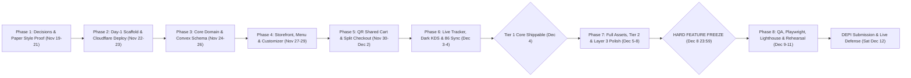

# 23-Day Solo Execution Schedule (Nov 19 → Dec 12, 2026)

> **UPDATED NOV 19 (DESIGN-AS-CODE PIVOT — SUPERSEDES PAPER/AUTH SECTIONS BELOW!):**
> - **ZERO Paper MCP / `pen.dev` / Kite canvas days!** We start **REAL Vite 8 + React 19 + `shadcn base-luma` (`Pure White #FFFFFF`) + official `shadcn` MCP & `.agents/skills/shadcn/`** IMMEDIATELY (buying back **2 full days**!).
> - **ZERO Login / Staff Auth (`C-08`)!** Skip `@convex-dev/auth` completely on Day 16 (saves another half-day!).
> - **Revised Lean Sprint Map (Nov 20 → Dec 12):**
>   - **Nov 20–21 (Sprint 1 — Real Foundation):** `P2-1` Real Vite 8 + React 19 + `shadcn base-luma` (`neutral` pure white) + all 2026 primitives (`empty`, `item`, `field`, `input-group`, `button-group`, `toggle-group`, `drawer`, `sheet`, `popover`, `input-otp`, `direction`, `toast`) + `Hugeicons` + `@nkzw/oxlint-config` + user's `FlameLink` SVG + new GitHub repo (`depi-kitchen-capstone`) + pure TS `bill-engine` & `fast-check` TDD tests.
>   - **Nov 22–24 (Sprint 2 — Convex Realtime Backend):** Schema + 20-dish audited seed (`Pack 14`) + `joinTable`, `addCartItem`, `splitCheckout`, `toggleItem86` + `convex-test` integration tests.
>   - **Nov 25–28 (Sprint 3 — Pure White `base-luma` Storefront & `/menu`):** Storytelling `/` Home (NO menu/cart, Cairo Sun/Moon clock, 3 Fire Stations, CSS-3D interactive SVG iPhone Pro, dark KDS band, tall Cue interactive halftone `<canvas>` footer + shake-reject Popover switch) + `/menu` (20 dishes, Apple Bottom Sheet `Drawer` w/ `− 1 +` stepper & `rolling-number`, Floating Cart Dock, Trailing Side `Sheet` w/ `Item` & `Empty`).
>   - **Nov 29 – Dec 2 (Sprint 4 — `/table`, `/track`, `/kds` — CORE TIER 1 SHIPPABLE!):** Zero-login 4-digit `InputOTP` Table Join, multi-diner shared cart, 3-way exact piaster Split Checkout, `/track/:orderId`, dark `/kds` + live `<300ms` `86` sync + chime/Wake Lock.
>   - **Dec 3–7 (Sprint 5 — Tier 2, Layer 3 & Targeted Opus 5.5 Craft Pass):** Bilingual EN ↔ Natural Cairo Arabic (`ar-EG` RTL + `Direction` + optical size parity) → Stripe Sandbox test cards → Notion-style cheeky peeking doodles → **1–2 targeted Claude Opus 5.5 visual craft passes on the real GitHub repo** → `unslop-ui` + `better-accessibility` + `better-layout` sweep.
>   - **Dec 8 (23:59) — HARD FEATURE FREEZE.**
>   - **Dec 9–11 (Buffer, QA & Deploy):** Playwright E2E, Lighthouse (`a11y >= 95`), re-enable Cloudflare MCP & deploy live URL, DEPI Pitch Deck (3D Figma/Unblast phone renders for slides ONLY), `README.md`, 2 timed 5-min dual-screen rehearsals.
>   - **Dec 12 — Live DEPI Defense.**
> - **Elephant Goldfish Mode (EGM) Policy:** Do **NOT** run a 10-agent EGM document-review loop now — ship code first! Use targeted EGM (`egm-zoom-out` + `egm-codebase-details`) strictly ONCE right before the Dec 8 freeze if needed.

---

> *(Historical Day-by-Day Breakdown Below Kept for Hour-Budget Reference Only — Follow the Design-as-Code Sprint Map Above!)*

> **Prep Pack #12 · Product & Execution Roadmap**  
> **Start Date:** Thursday, November 19, 2026 · **Submission & DEPI Defense:** Saturday, December 12, 2026  
> **Pacing Reality:** Solo builder + AI agents (3 teammates inactive) alongside a second concurrent course — budgeted strictly at **2.5–3.5 focused hours/day** (**~71 total focused hours** across 23 active days, averaging **~3.1 hrs/day**).  
> **Hard Feature Freeze:** **Tuesday, December 8 at 23:59.** Zero new features on **Dec 9–11** (reserved strictly for QA, Playwright E2E, Lighthouse, `README.md`, and live defense rehearsal).

---

## 1. Real-World Operating Constraints (Why This Plan Actually Works)

This calendar is engineered around four hard boundaries from `STATUS.md`, `PARTNER-PROFILE.md`, and `00-workflow/ANTIGRAVITY-PLAYBOOK.md` — **not** 14-hour fantasy marathons:

| Constraint | Reality | How This Schedule Protects You |
| :--- | :--- | :--- |
| **Human Energy & Second Course** | **2.5–3.5 focused hours/day** on weekdays (up to 3.5h on weekends). | Every day has **1 concrete vertical deliverable** small enough to finish, verify, and commit inside a single focused block. |
| **3-Layer Cake Discipline** | Mixing base structure, photography, and Easter eggs simultaneously creates visual soup and missed deadlines. | **Layer 1** (Skeleton + Core Loop) locks completely by **Day 16 (Dec 4)** — **8 full days before defense**. **Layer 2** (Full Photography) + **Tier 2** + **Layer 3** (Delights) happen strictly on **Days 17–20 (Dec 5–8)**. |
| **Paper MCP Free Tier** | **100 MCP tool calls/week** (weekly reset). | Zero calls burned on Day 1. All primary design bursts are batched cleanly into **Week 1 (80/100 calls)** with a 20-call reserve; Weeks 2–3 stay light (0–40 calls). Backups: `pen.dev` (`pencil` MCP) → `kgoedecke/doop`. |
| **Antigravity Model Quotas** | `Neon` / `Orchestrator` / `Hydrogen` / `Flash` at **99%**; **`Argon (High)` at 35% (resets Nov 25)**. | Zero `Argon` spent pre-Nov 25; three fresh-eyes `Argon (High)` audits land post-reset (**Nov 26**, **Dec 2**, **Dec 9**). Fresh chat opened at every Phase boundary via `STATUS.md` + `DECISIONS.md` handoff. |

> **Day 1 Workspace Prerequisite (Before Running Any Terminal Commands):**  
> Per `STATUS.md`, rename the workspace folder from `250-degree-Kitchen ` (removing the trailing space) to `250-degree-Kitchen` and reopen it cleanly in Antigravity before Phase 2 scaffolding begins.

---

## 2. Visual Milestone Timeline (Nov 19 → Dec 12, 2026)

---

## 3. Master Day-by-Day Calendar (Nov 19 → Dec 12, 2026)

> **Legend:** `L1` = Layer 1 Unbreakable Skeleton · `L2` = Layer 2 Brand Soul & Assets · `L3` = Layer 3 Signature Human Delights · `QA` = Freeze / Verification / Defense Prep.

| Day & Date | Phase | Layer | Hrs | Exact Daily Goal & Concrete Deliverable | Antigravity Mode & Model | Paper MCP Calls |
| :--- | :--- | :---: | :---: | :--- | :--- | :---: |
| **Day 1 · Thu Nov 19** | **P1** | `L1/L2` | 2.5h | Lock all 6 Decisions in `DECISIONS.md` (Brand, Tier 2 pick, Palette A/B/C, Typography, Auth/Checkout). Remove folder trailing space & reopen IDE. Generate **starter photo set** (1 Hero `16:9` + 4 dish `4:3` via locked sunlit-linen prompt). Write text wireframes for Paper Frames 1–2. | Interactive Chat · `Neon (High)` + `image-generator` | **0** *(W1)* |
| **Day 2 · Fri Nov 20** | **P1** | `L1` | 3.0h | **Paper Checkpoint #1 (Style Proof — 2 Frames):** Build Frame 1 (Desktop `1440×900` Hero + Floating Nav Pill + Floating Cart Dock) & Frame 2 (Menu Card Resting/Hover/`86` + Customizer Drawer). Inspect screenshots, verify WCAG AA in `oklch.fyi`, refine until you love it. | Interactive Chat · `Neon (High)` | **~40** *(W1)* |
| **Day 3 · Sat Nov 21** | **P1** | `L1` | 3.0h | **Paper Checkpoint #2 (Core Flows):** Build Mobile `390×844` Menu, Table Join PIN sheet, Split-Bill Checkout Drawer, Live Order Tracker & Dark Charcoal `/kds` frames. Export/record final `oklch()` tokens. Formal Visual Sign-Off + update `STATUS.md`. | Interactive Chat · `Neon (High)` | **~40** *(W1 total: ~80/100)* |
| **Day 4 · Sun Nov 22** | **P2** | `L1` | 3.5h | **Fresh Chat.** Scaffold React `19.3.1` + Vite `8.3.8` + TS (verify TS 7 IDE or lock TS 6.x) + Tailwind v4 + `shadcn/ui` (`base-luma`, `@base-ui/react`) + `Hugeicons` + TanStack Router + `oxlint@1.94.0` + `vitest@5.1.1`. Sync Paper `oklch()` tokens into `src/index.css` `@theme inline`. Create `src/features/*` shell + Nav Pill. | `Orchestrator (Neon)` | **0** *(W1)* |
| **Day 5 · Mon Nov 23** | **P2** | `L1` | 2.5h | Wire Convex `1.51.0` dev project, GitHub Actions CI (`lint + typecheck + test + build`), and **Cloudflare Workers Static Assets** (`wrangler.jsonc` SPA routing). Ship Hello-World sunlit shell to live public URL! | `Orchestrator (Neon)` + `/goal` *(CI + deploy green)* | **0** *(W1)* |
| **Day 6 · Tue Nov 24** | **P3** | `L1` | 3.0h | **Fresh Chat.** Build pure TS domain layer: integer-piaster `EGP` formatter, modifier price math, **Smart Split-Bill Engine** (`Pay Full` / `Pay My Items` / `Split Equally ÷ N` with exact remainder math), and search normalizer. Hit 100% Vitest unit test coverage. | `Orchestrator (Neon)` + `/goal` *(TDD math loop)* | **0** *(W1)* |
| **Day 7 · Wed Nov 25** | **P3** | `L1` | 3.0h | *(Argon quota resets today!)* Implement Convex schema (`categories`, `menuItems`, `tableSessions`, `cartItems`, `orders`, `kitchenTickets`), server validators, seed script (14–16 dishes, Tables `1–12` + PINs), and core queries/mutations (`listMenu`, `joinTable`, `addCartItem`, `toggleItem86`). | `Orchestrator (Neon)` | **0** *(W1 ends)* |
| **Day 8 · Thu Nov 26** | **P3** | `L1` | 2.5h | *(Paper Week 2 resets: 100 calls).* Write `convex-test@0.0.73` backend integration tests (PIN checks, `86` rejection, atomic order creation, KDS transitions). Run **Argon Audit #1** on Convex schema, server-trusted pricing & integer-piaster math. | `Orchestrator (Neon)` → Fresh **`Argon (High)`** audit | **0** *(W2)* |
| **Day 9 · Fri Nov 27** | **P4** | `L1` | 3.0h | **Fresh Chat.** Build `/` Sunlit Storefront Homepage: centered `<h1>` + dual CTAs + `36px`-rounded `16:9` hero stage, Live Signature Menu Preview strip, 3-Step Interactive *"How Table Ordering Works"* switcher, single Dark Kitchen Pass preview island, clean base footer. | `Orchestrator (Neon)` | **0** *(W2)* |
| **Day 10 · Sat Nov 28** | **P4** | `L1` | 3.5h | Build `/menu` gallery: spacious `3-col` desktop / smooth mobile `4:3` dish cards on warm stone, instant search, category/diet pill filters (`Hugeicons`), TanStack Router Zod-validated URL params (`?cat=&q=`), warm stone skeletons, empty-search state, and `86 / Sold Out` card anatomy. | `Orchestrator (Neon)` | **0** *(W2)* |
| **Day 11 · Sun Nov 29** | **P4** | `L1` | 3.5h | Build **Dish Customizer Drawer** (`@base-ui/react` Drawer + `@tanstack/react-form` + Zod v4): required choices, optional add-ons, kitchen note, live piaster recalculation, submit mutation. Run **`clean-copy` + `unslop-ui`** sweep + Desktop & Mobile browser screenshot check. | `Orchestrator (Neon)` + `/goal` + `browser` (`Flash`) | **0–10** *(W2 opt.)* |
| **Day 12 · Mon Nov 30** | **P5** | `L1` | 3.0h | **Fresh Chat.** Build `/table/:n` Join Table flow: QR deep-link handling, 4-digit Table PIN gate, frictionless guest nickname (`participantToken` in `localStorage`), copy/share table invite, and live Convex subscription for active diners. | `Orchestrator (Neon)` | **0** *(W2)* |
| **Day 13 · Tue Dec 1** | **P5** | `L1` | 3.5h | Build **Dark Charcoal Floating Table & Cart Dock** (`CoolDock` style: Table #, diner chips, item count, subtotal, `Open Cart`) + **Shared Table Cart Drawer** with per-diner ownership tags, quantity controls, optimistic feedback, and `<300ms` multi-tab sync. | `Orchestrator (Neon)` | **0–10** *(W2 opt.)* |
| **Day 14 · Wed Dec 2** | **P5** | `L1` | 3.5h | Build **Smart Split-Bill Checkout Drawer** wired to Phase 3's piaster engine (`Pay Full` / `Pay My Items` / `Split ÷ N`) + Instant Demo Card & Pay at Counter (`#C-201`) atomic order settlement → redirect to `/track/:orderId`. Run **Argon Audit #2** + two-tab browser verification. | `Orchestrator (Neon)` → Fresh **`Argon (High)`** + `browser` (`Flash`) | **0** *(W2 ends)* |
| **Day 15 · Thu Dec 3** | **P6** | `L1` | 3.5h | *(Paper Week 3 resets: 100 calls).* **Fresh Chat.** Build **Live Order Tracker (`/track/:orderId`)** (real-time stage progress, itemized receipt, invalid-ID fallback) AND **Dark Charcoal Kitchen Display (`/kds`)** (live elapsed timers, `48px+` tap-to-strike dish lines, stage buttons `New → On the Grill → Ready`). | `Orchestrator (Neon)` | **0–15** *(W3 opt.)* |
| **Day 16 · Fri Dec 4** | **P6** | `L1` | 3.0h | Build **Real-Time `86 / Sold Out` Toggle Panel** inside `/kds` (instant menu lock + stale-cart protection) + clean **Staff Auth Gate** (`@convex-dev/auth` username/password for `/kds`). Verify full 2-window loop live on Cloudflare. **Milestone: Tier 1 Core 100% Shippable!** | `Orchestrator (Neon)` + `/goal` + `browser` (`Flash`) | **0** *(W3)* |
| **Day 17 · Sat Dec 5** | **P7** | `L2` | 3.5h | **Fresh Chat · Layer 2 Visual Cohesion Shoot:** Generate remaining 10–12 dish photos + 1–2 custom `250°` branded packaging shots (craft box/cup via Google Flow / `image-generator` with locked sunlit-linen prompt) + crisp `250°` geometric SVG mark. Optimize all assets to `.webp` (`<90 KB` dish, `<220 KB` hero) with zero CLS. | Interactive Chat · `Neon (High)` + `image-generator` | **0** *(W3)* |
| **Day 18 · Sun Dec 6** | **P7** | `L2` | 3.5h | **Tier 2 Pick — Build Part 1 (Pick ONLY 1 from `DECISIONS.md`):** *Option A:* Bilingual EN / Egyptian Arabic (`ar-EG`) RTL Switch (`dir="rtl"`, logical CSS, `IBM Plex Sans Arabic`) **OR** *Option B:* Compact Protected `/admin` Menu + Printable QR Table Cards **OR** *Option C:* Stripe Sandbox `<PaymentElement />` adapter. | `Orchestrator (Neon)` | **0–10** *(W3 opt.)* |
| **Day 19 · Mon Dec 7** | **P7** | `L2/L3` | 3.0h | **Tier 2 Pick — Finish & Verify** + **Layer 2/3 Tactile Micro-Polish:** Add `rolling-number` price counters (Cart Subtotal, Customizer Price, Split Share), subtle `+ → ✓` / `Copy → Copied` spring transitions, and optional `<5 KB` brand-recolored `dotLottie` order-preparing mark. | `Orchestrator (Neon)` + `Neon (High)` taste check | **0** *(W3)* |
| **Day 20 · Tue Dec 8** | **P7** | `L3` | 3.0h | **HARD FEATURE FREEZE (23:59)!** Build **Signature Editorial Footer** (Cue/Imgrain-style subtle halftone/ASCII `250°` wordmark with gentle hover ripple + `Back to top ↑` + **Playful "Open Kitchen / Daylight Only" Theme Switch Joke**). Run final **`clean-copy` / `unslop-ui`** + **`better-ui` / `better-accessibility`** audit. Tag `v1.0-freeze`! | `Orchestrator (Neon)` + `Neon (High)` skill audit | **0–15** *(W3 total: ≤40/100)* |
| **Day 21 · Wed Dec 9** | **P8** | `QA` | 3.0h | **BUFFER DAY 1 (Zero New Features):** Write & run 4 `@playwright/test@1.65.1` E2E journeys against production build (Storefront/Customizer, 2-Tab Shared Cart + Split Math, Checkout → KDS → Live Tracker, KDS `86` live menu lock). Run **Argon Final Audit #3** (RBAC, a11y, error boundaries, dead code). | `Orchestrator (Neon)` + `/goal` → Fresh **`Argon (High)`** audit | **0** *(W3 ends)* |
| **Day 22 · Thu Dec 10** | **P8** | `QA` | 3.0h | *(Paper Week 4 resets).* **BUFFER DAY 2 (Zero New Features):** Squash every bug/a11y finding from Day 21. Run **Lighthouse** on live Cloudflare URL until Accessibility `>= 95` & Performance `>= 90`. **Real Smartphone QA:** scan Table #5 QR code on your phone while `/kds` is open on laptop! | `Orchestrator (Neon)` + `browser` (`Flash`) | **0** *(W4)* |
| **Day 23 · Fri Dec 11** | **P8** | `QA` | 2.5h | **BUFFER DAY 3 (Zero New Features):** Capture framed Desktop/Mobile screenshots + record 1 offline backup demo video (Wi-Fi insurance!). Write portfolio-grade `README.md` (live link, architecture diagram, testing proof). Run **2 timed 5-minute DEPI live pitch rehearsals** + reset fresh demo seed data. | Interactive Chat · `Neon (High)` | **0** *(W4)* |
| **D-Day · Sat Dec 12** | **P8** | `LIVE` | 0.5h | **Submission & Live DEPI Defense:** 15-min morning smoke check (Cloudflare URL `200 OK`, Convex live, clean seed state, backup clip ready on Desktop). Deliver a spotless 5-minute live multi-device defense! | None (Ship & Celebrate!) | **0** |

---

## 4. Paper MCP Weekly Call Budget (100 Calls/Week Hard Cap)

Paper Free Tier resets every 7 days. Never spend Paper MCP calls on unstructured exploration or 1-pixel CSS tweaks — plan layouts in plain text first and send batched `write_html` calls per visual section.

| Budget Window | Dates | Planned Spend | Reserve | What Calls Are Spent On |
| :--- | :--- | :---: | :---: | :--- |
| **Week 1** *(Design Burst)* | Thu Nov 19 – Wed Nov 25 | **~80 calls** | ~20 calls | **Day 1:** 0 calls (decisions + prose wireframes). **Day 2:** ~40 calls (Checkpoint #1: Hero + Nav Pill + Cart Dock + Menu Card + Customizer). **Day 3:** ~40 calls (Checkpoint #2: Mobile Menu + Table PIN + Split Checkout + Tracker + Dark KDS + token export). |
| **Week 2** *(Core Code)* | Thu Nov 26 – Wed Dec 2 | **0–20 calls** | 80+ calls | Coding weeks require almost zero Paper calls. Only use 5–10 calls if Floating Cart Dock or Split-Bill Drawer density needs a visual sanity check before coding. |
| **Week 3** *(KDS & Layer 3)* | Thu Dec 3 – Wed Dec 9 | **15–40 calls** | 60+ calls | Optional layout polish for Dark KDS card density (≤15 calls), Tier 2 `/admin` QR card (≤10 calls), and Signature Editorial Footer `250°` halftone wordmark proportions (≤15 calls). |
| **Week 4** *(Freeze & Defense)* | Thu Dec 10 – Sat Dec 12 | **0 calls** | 100 calls | Feature freeze in effect — zero UI redesigns. *(Optional: up to 10 calls strictly if you want a visual slide graphic for your DEPI pitch deck.)* |

**Paper Budget Guardrails & Backup Chain:**
1. **Batch Every `write_html` Call:** Render one full logical section (e.g., entire Hero or entire Menu Card anatomy) per call — never element-by-element.
2. **Audit Screenshots Twice, Not Ten Times:** Capture `get_screenshot` after completing a frame, list ALL spacing/contrast tweaks in one consolidated checklist, then apply them in a single edit batch.
3. **If Week 1 Ever Hits 95 Calls Early:** Switch immediately to **Pen.dev (`pencil` MCP — already installed)** or self-hosted **`kgoedecke/doop`** rather than stalling Phase 2!

---

## 5. Antigravity Mode, Model & Session Hygiene Strategy

Use the right engine for each job — turning on Swarm or `/goal` during creative alignment burns quota and creates messy rework:

| Mode / Model | Scheduled Days | Why & Exact Usage Rule |
| :--- | :--- | :--- |
| **Interactive Chat · `Neon (High)`** | Days 1–3, 17, 20, 23 | **Tight Human Taste Calibration.** Best for decisions, Paper MCP screenshot reviews, food photography art direction, design-skill copy reviews, and README/pitch crafting. **Never use `/goal` or `/swarm` here.** |
| **`Orchestrator (Neon)`** | Days 4–16, 18–22 | **Daily Coding Engine.** Plans architectural steps with Neon while delegating mechanical file edits and test runs to Hydrogen automatically. Fast, clean, and quota-efficient. |
| **`/goal` (Bounded Autonomous Loop)** | **5 exact targets only:** Days 5, 6, 11, 16, 21 | Use **ONLY** when a slice has hard, binary automated checks (`oxlint`, `tsc --noEmit`, `vitest`, Playwright, or live build exit `0`): Day 5 (CI/Cloudflare), Day 6 (Piaster Split-Bill TDD), Day 11 (Customizer Zod forms), Day 16 (`86` live sync), Day 21 (Playwright E2E green run). |
| **Fresh-Eyes `Argon (High)` Audit** | **3 checkpoints (all post-Nov 25 reset!):** Days 8, 14, 21 | **Zero-Author-Bias Security & Math Auditor.** Conserve remaining 35% quota before Nov 25; then run 3 surgical fresh-session audits: **#1 (Nov 26)** Convex schema & piaster math, **#2 (Dec 2)** multi-diner shared cart concurrency & split checkout, **#3 (Dec 9)** final RBAC, error boundaries & a11y sweep. |
| **`browser` Subagent (`Gemini 3.8 Flash`)** | Days 11, 14, 16, 20, 22 | Real Desktop (`1440×900`) and Mobile (`390×844`) screenshot verification, multi-tab real-time sync tests, and zero-console-error gates. |
| **`/swarm`** | **Off by default** | Overkill and quota-heavy for a 2.5–3.5h/day solo pace where sequential `Orchestrator (Neon)` is easier to review. *(Only optional exception: if ahead of schedule on Day 15 with 100% locked Convex contracts, to parallelize `/track` + `/kds` + Verifier).* |

**Anti-Pollution Session Rule:** Never let a single chat run past ~25–30 turns or span two phases. At the end of **every phase** (Days 3, 5, 8, 11, 14, 16, 20), ask the agent to update `STATUS.md` and `DECISIONS.md`, verify in 30 seconds, and open a **brand-new chat**.

---

## 6. Phase-by-Phase Blueprint & Non-Negotiable Verification Exit Gates

Nothing moves to the next phase on *"looks good."* Every milestone requires real, verifiable proof:

### Phase 1 — Decisions, Starter Shoot & Paper Style Proof (Days 1–3 · Nov 19–21)
- **Focus:** Lock brand identity, palette temperament (`A`/`B`/`C`), typography, and Tier 2 priority in `DECISIONS.md`; generate 1 Hero + 4 starter dish photos under one unified sunlit-linen art direction; validate visual physics in Paper MCP before writing a single line of React.
- **Mandatory Exit Gate:**
  - [ ] All 6 Decisions logged under **Locked Decisions** in `DECISIONS.md`.
  - [ ] Workspace folder renamed cleanly without trailing space (`250-degree-Kitchen`) and reopened in Antigravity.
  - [ ] Paper `get_screenshot` captured at **Desktop (`1440×900`)** and **Mobile (`390×844`)** for both Checkpoint #1 and #2.
  - [ ] Computed WCAG AA contrast verified mathematically (`>= 4.5:1` body/pills, `>= 3:1` large CTAs) via `oklch.fyi`.
  - [ ] Typography floor audited: zero sub-`13px` micro-text, `>= 16px` mobile inputs, `>= 44px` tap targets.
  - [ ] Explicit **User Visual Sign-Off** recorded in `STATUS.md`.

### Phase 2 — Day-1 Scaffold + Token Sync + Cloudflare Hello-World Deploy (Days 4–5 · Nov 22–23)
- **Focus:** Prove the entire toolchain, 1-place `oklch()` theming, CI checks, and production Cloudflare SPA hosting on **Day 5** — never on Dec 11!
- **Mandatory Exit Gate:**
  - [ ] `npm run lint` (`oxlint`), `npm run typecheck` (`tsc --noEmit`), `npm run test` (`vitest`), and `npm run build` all exit `0`.
  - [ ] Every UI component uses semantic Tailwind v4 tokens (`bg-background`, `bg-card`, `bg-primary`) — **zero hardcoded hex values in JSX**.
  - [ ] Local `vite dev` + `convex dev` renders with **0 browser console errors & 0 React warnings**.
  - [ ] Live Cloudflare Workers Static Assets URL loads `/` and refreshes directly on `/menu` and `/kds` with `200 OK` (SPA routing proven).
  - [ ] GitHub Actions CI passes green on `main`.

### Phase 3 — Core Domain Engine + Convex Schema & Seed (Days 6–8 · Nov 24–26)
- **Focus:** Lock exact money math and real-time backend contracts before touching UI screens so every React component binds to typed, tested truth.
- **Mandatory Exit Gate:**
  - [ ] Pure Split-Bill Engine (`Pay Full`, `Pay My Items`, `Split Equally ÷ N`) uses **integer piasters** exclusively and passes 100% Vitest coverage (including indivisible splits like `100.00 EGP ÷ 3` summing back to exact `100.00 EGP`).
  - [ ] `convex-test` integration tests prove: invalid Table PIN rejected, `86` item blocked on add/checkout, server recalculates prices from DB (never trusts client price payloads), and KDS stage transitions validate cleanly.
  - [ ] Seed script populates 14–16 dishes across 4–5 categories + Tables `1–12` cleanly and idempotently.
  - [ ] **Fresh-Eyes `Argon (High)` Audit #1** signs off with zero high/critical findings.

### Phase 4 — Storefront Hero, Interactive Menu & Dish Customizer (Days 9–11 · Nov 27–29)
- **Focus:** Deliver the sunlit hospitality storefront and appetizing interactive menu gallery directly mapped from Paper geometry onto `@/components/ui/*` (`shadcn base-luma` on `@base-ui/react` + `Hugeicons`).
- **Mandatory Exit Gate:**
  - [ ] `/` and `/menu` match Paper Frame 1 & 2 proportions with zero raw exported Paper `
` soup (100% semantic `base-luma` components).
  - [ ] Category/diet filters & search sync to URL via TanStack Router Zod `validateSearch` and survive page reload.
  - [ ] Dish Customizer Drawer blocks submission when required options are unselected, recalculates total live, and adds to cart cleanly.
  - [ ] **`clean-copy` + `unslop-ui`** pass completed (zero decorative eyebrows, zero filler subtitles, zero fake KPI strips or decorative emojis).
  - [ ] `browser` subagent (`Flash`) verifies Desktop (`1440×900`) & Mobile (`390×844`) with zero horizontal overflow and `0` console errors.

### Phase 5 — QR Table Shared Cart + Floating Dock + Split Checkout (Days 12–14 · Nov 30–Dec 2)
- **Focus:** Deliver the capstone's signature real-time multi-diner magic: scan/join Table #5, watch the `CoolDock`-inspired Floating Dock update live across devices, and split the check seamlessly.
- **Mandatory Exit Gate:**
  - [ ] Guest diners join `/table/5` via 4-digit PIN + nickname without any login wall (`participantToken` persisted in `localStorage`).
  - [ ] Two live browser tabs on `/table/5` show `<300ms` real-time shared cart sync with clear per-diner ownership tags.
  - [ ] Floating Charcoal Cart Dock appears cleanly on `/` and `/menu` once joined/active and shows accurate live totals.
  - [ ] Split-Bill Checkout settles via Instant Demo Card or Pay at Counter (`#C-201`), creates an atomic Convex order, clears settled cart items, and routes to `/track/:orderId`.
  - [ ] **Fresh-Eyes `Argon (High)` Audit #2** signs off on multi-diner race conditions & split checkout edge cases.

### Phase 6 — Live Order Tracker + Dark Charcoal KDS + Real-Time `86` Sync (Days 15–16 · Dec 3–4)
- **Focus:** Close the full restaurant loop so the **entire Tier 1 Capstone is 100% shippable 8 days before submission!**
- **Mandatory Exit Gate:**
  - [ ] Submitting an order from `/table/5` pops onto Dark Charcoal `/kds` in `<300ms` with live elapsed timer and `48px+` tap-to-strike lines.
  - [ ] Bumping ticket state (`New → On the Grill → Ready`) on `/kds` updates the diner's `/track/:orderId` progress tracker instantaneously.
  - [ ] Toggling `86 / Sold Out` on `/kds` dims/disables that dish on `/` and `/menu` in `<300ms` and gracefully blocks stale cart checkout with a clear inline message.
  - [ ] `/kds` is protected by a real server-verified staff auth gate (`@convex-dev/auth`).
  - [ ] Full 5-minute demo flow verified end-to-end on the **live Cloudflare production URL**.

### Phase 7 — Full Photography, Tier 2 Pick & Layer 3 Polish (Days 17–20 · Dec 5–8)
- **Focus:** Elevate the rock-solid app from *"great engineering"* to *"jaw-dropping studio brand"* — strictly enforcing the **Dec 8 23:59 Hard Feature Freeze**.
- **Mandatory Exit Gate:**
  - [ ] All 16–20 local `.webp` assets (`public/images/`) share one cohesive sunlit-linen lighting aesthetic, load with explicit dimensions (`CLS = 0`), and keep hero `<220 KB` / dish cards `<90 KB`.
  - [ ] Chosen **single Tier 2 pick** (EN/AR RTL **OR** Compact `/admin` + QR Cards **OR** Stripe Sandbox) works end-to-end with tests and zero regressions.
  - [ ] Layer 3 touches (`rolling-number` counters, Cue/Imgrain-style subtle halftone/ASCII `250°` footer, playful *"Open Kitchen / Daylight Only"* theme switch popover) respect `prefers-reduced-motion` and are each removable in 1 line without breaking UX.
  - [ ] Final **`clean-copy` + `unslop-ui`** AND global **`better-ui` + `better-accessibility` + `better-typography`** audit passed.
  - [ ] Git tag **`v1.0-freeze`** pushed and live on Cloudflare before midnight Dec 8.

### Phase 8 — Hard Buffer: QA, Playwright E2E, Lighthouse & Defense (Days 21–23 + D-Day · Dec 9–12)
- **Focus:** Zero new code features — 100% polish, automated verification, real-phone testing, documentation, and confident live delivery.
- **Mandatory Exit Gate:**
  - [ ] All 4 Playwright E2E journeys pass green against the production build (`npx playwright test`).
  - [ ] **Fresh-Eyes `Argon (High)` Final Audit #3** reports zero security, RBAC, accessibility, or error-boundary blockers.
  - [ ] Lighthouse on the **live Cloudflare URL** achieves **Accessibility `>= 95`** and **Performance `>= 90`** with `0` console errors.
  - [ ] **Real-Device Dry Run:** Scanned Table #5 QR on your physical smartphone while `/kds` ran on your laptop — full loop completed cleanly twice.
  - [ ] Portfolio-grade `README.md` (live demo URL, architecture diagram, stack rationale, screenshots) committed to `main`.
  - [ ] 1 local offline MP4 screen recording of the 5-minute demo saved on Desktop (failsafe in case presentation Wi-Fi drops).

---

## 7. "Slip Insurance" Contingency Rules (Exam Week Protection)

Because you are building solo while taking a second concurrent course, **an exam week or heavy assignment WILL try to steal 2–5 days.** Never panic and never pull destructive 14-hour all-nighters that break working code. Follow these deterministic trim rules instead:

### A. The Sacred Non-Negotiables (NEVER Cut These — They ARE Your 10/10 Grade)
1. **The 5-Minute Real-Time Loop:** `/` → `/menu` + Customizer → `/table/:n` Shared Cart + Split Checkout → `/kds` Dark Pass + `86` Sync → `/track/:orderId`.
2. **Visual Craft & Copy Discipline:** Sunlit `base-luma` minimalism, 1-place `oklch()` theme, `Hugeicons`, cohesive food photography, zero AI-slop copy.
3. **Engineering Proof:** Integer-piaster `Vitest` suite, `oxlint`/`tsc` zero errors, live Cloudflare production URL.
4. **Minimum 2 Full Buffer/QA Days (Dec 10–11):** Never sacrifice testing and rehearsal to cram a half-finished extra feature!

### B. Deterministic Trim Ladder (Cut Strictly in This Order)

| Slip Level | Trigger Checkpoint | Exactly What to Trim Gracefully | What Still Ships on Dec 12 (Still Looks 10/10!) |
| :--- | :--- | :--- | :--- |
| **Level 1 — Mild Slip** *(Lost 1–2 days)* | Phase 5 finishes **Dec 3** instead of Dec 2, or Phase 6 finishes **Dec 5**. | Drop optional micro-extras: `dotLottie` loader, `Sound Lab` KDS chime, and Unblast branded packaging mockup shots (keep core dish photos). | **Full Tier 1 + Chosen Tier 2 pick + `rolling-number` + Footer Easter Egg + full 3-day QA buffer (Dec 9–11).** |
| **Level 2 — Exam Week Hit** *(Lost 3–4 days)* | Phase 6 isn't signed off by **Sat Dec 5 night**. | **Drop ALL Tier 2 features immediately** (skip EN/AR RTL, skip `/admin` CRUD tab, skip Stripe `<PaymentElement />` — keep Instant Demo Card + Pay at Counter `#C-201` and lightweight `/kds` staff passcode). Trim menu from **16 → 10–12 hyper-curated signature dishes** (3 per category × 4 categories). | **100% polished Tier 1 Core Loop + cohesive 12-dish sunlit photography + `rolling-number` + Playful "Open Kitchen" Footer Easter Egg + full 3-day QA buffer (Dec 9–11).** |
| **Level 3 — Severe Crunch** *(Lost 5–6 days / Illness)* | Phase 5 isn't signed off by **Fri Dec 4 night**. | Apply all Level 2 cuts **PLUS** drop Layer 3 interactive delights (skip halftone ripple & `rolling-number`; ship crisp minimal editorial footer). Slide Hard Feature Freeze by 24h max to **Wed Dec 9 (23:59)**, locking **Dec 10–11** strictly for 2 core Playwright E2E flows, Lighthouse fix, `README.md`, and pitch rehearsal. | **Spotless 5-route, 12-dish, real-time synced restaurant studio app with zero console errors, green tests, live Cloudflare URL, and rehearsed live phone+laptop demo.** |

> **Why Evaluators Still Award 10/10 Under Level 2 or Level 3:** Evaluators never see your cut backlog — they only experience what runs in front of them. A calm, museum-clean 12-dish restaurant app where scanning a real QR code on your phone fires a ticket onto a dark KDS board in `<300ms` destroys a bloated 11-route dashboard with broken buttons every single time.

### C. Hard Recovery Checkpoint Dates
- **Checkpoint A — Thu Nov 26 (End of Phase 3):** If Convex schema & Split-Bill Vitest aren't green yet → tighten Phase 4 by skipping `/` interactive 3-step animation (use a crisp static 3-step numbered card grid instead) to recover 1 day cleanly.
- **Checkpoint B — Wed Dec 2 (End of Phase 5):** If Shared Cart + Split Checkout aren't signed off yet → **activate Level 1 immediately**.
- **Checkpoint C — Sat Dec 5 (Start of Phase 7):** If Phase 6 (Live Tracker + KDS + `86` Sync) isn't live on Cloudflare yet → **activate Level 2 immediately** (drop Tier 2 completely to protect Layer 2 photography + Dec 9–11 QA buffer).

### D. The "Brutal Exam Day" 30-Minute Micro-Momentum Rule
When your concurrent course eats an entire day and you only have **30–45 minutes** of brainpower left:
- **DO NOT** start a half-baked React component or refactor Convex schemas (tired code creates 3 hours of debugging tomorrow).
- **DO** pick one self-contained micro-task: review 1 Paper screenshot, generate 3 dish images with your locked style prompt, write/review 5 Vitest unit test cases, or update `STATUS.md`. Keep the streak alive with zero broken commits!
